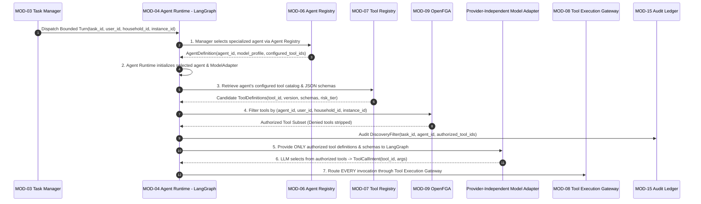
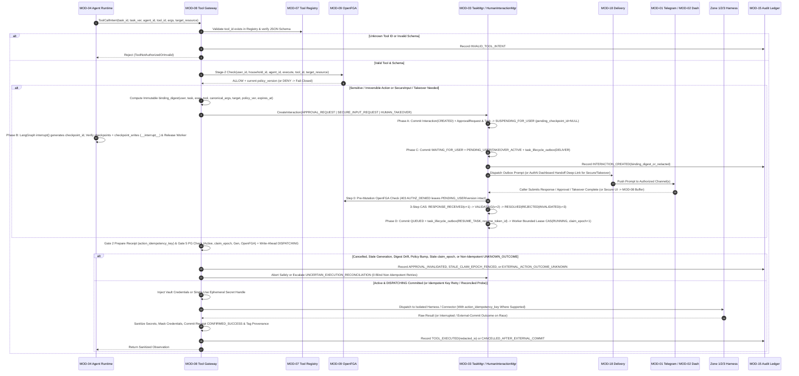
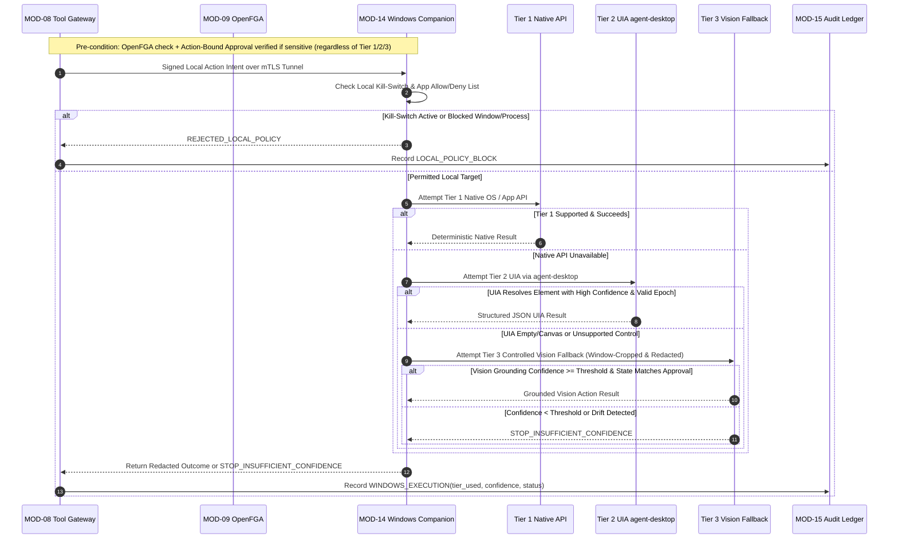

# Orbi — General Level Design (GLD): Functional Responsibilities

- **Document ID**: `DOC-GLD-003`
- **Revision**: `1.4` *(Updated with Centralized HITL `HumanInteractionManager`, Multi-Channel Secret Bypass, Gateway Cancellation Gate & Memory/Automation Safety Refinements)*
- **Phase**: `01-GLD`
- **Status**: `Draft - For Review`
- **Last Updated**: `2026-11-17`
- **Traceability**: Maps operational flows and negative constraints across `MOD-01`–`MOD-18` ([module-catalog.md](file:///f:/Projects/Orbi/docs/01-gld/module-catalog.md)), `AP-01`–`AP-10` ([vision.md](file:///f:/Projects/Orbi/docs/00-product/vision.md)), System HLD ([system-architecture.md](file:///f:/Projects/Orbi/docs/02-hld/system-architecture.md)), Memory HLD ([memory-architecture.md](file:///f:/Projects/Orbi/docs/02-hld/memory-architecture.md)), and ADRs ([docs/04-adr/](file:///f:/Projects/Orbi/docs/04-adr/README.md)).

---

## 1. Cross-Module Responsibility Matrix

**Legend**:
- **`O` (Owns / Executes)** — Primary responsible module.
- **`E` (Enforces)** — Deterministically permits or blocks outside LLM context.
- **`C` (Consulted / Input)** — Supplies metadata, signals, or UI rendering.
- **`A` (Audits)** — Persists immutable correlation record.
- **`X` (Strictly Forbidden)** — Explicitly prohibited by `AP-01`–`AP-10`.

| Platform Operation | `MOD-01` Channel | `MOD-02` Dash | `MOD-03` TaskMgr | `MOD-04` Agents | `MOD-05` Decision | `MOD-06/07` Regs | `MOD-08` Gateway | `MOD-09` OpenFGA | `MOD-10` Memory Manager | `MOD-11` Skills/SB | `MOD-12/13/14` Harnesses | `MOD-17` AutoPlat | `MOD-18` Delivery | `MOD-15` Audit |
| :--- | :---: | :---: | :---: | :---: | :---: | :---: | :---: | :---: | :---: | :---: | :---: | :---: | :---: | :---: |
| Authenticate user/household & ingest command | **O** | **O** | `C` | `X` | `—` | `—` | `X` | **E** | `X` | `X` | `X` | `X` | `—` | **A** |
| Own task lifecycle, budgets, TTLs & `WAITING_FOR_USER` HITL state | `X` | `X` | **O** | `X` *(Checkpoint Only)* | `X` | `—` | `C` | `—` | `X` | `X` | `X` | `C` *(Dispatch)* | `C` *(Callbacks)* | **A** |
| Manage centralized 5-type HITL interactions & `SECURE_INPUT` / `HUMAN_TAKEOVER` | `C` *(No Secrets)* | **O** *(Secure UI / Takeover)* | **O** *(Lifecycle)* | `C` *(Yield/Resume)* | `—` | `—` | **E** *(Secret Inject / Lockout / Gate)* | **E** *(Responder/Approver/Controller)* | `C` *(Clarify)* | `—` | `C` *(Browser / Companion)* | `C` *(Cascade Cancel)* | **O** *(Prompts / Handoff)* | **A** *(Redacted)* |
| Select agent & filter authorized tool discovery | `X` | `X` | `C` | **O** *(Init)* | `C` | `C` | `X` | **E** *(Filter)* | `—` | `C` | `X` | `—` | `X` | **A** |
| Run Decision Service + deterministic/LLM fallback | `—` | `—` | `C` | `C` | **O** | `C` | `C` *(Advisory)* | `X` | `—` | `—` | `—` | `—` | `—` | **A** |
| Select authorized tool & emit `ToolCallIntent` | `X` | `X` | `C` | **O** | `C` | `C` | `X` | `X` | `C` | `C` | `X` | `—` | `X` | **A** |
| Enforce Stage-2 OpenFGA, pre-dispatch cancel gate & action-bound approval | `C` *(UI)* | `C` *(UI)* | **O** *(State)* | `X` | `C` | `C` | **E** | **O** *(Policy)* | `X` | `X` | `X` | `C` *(Gen Check)* | `C` *(Notify)* | **A** |
| Inject secrets & dispatch to cloud/local harness | `X` | `X` | `X` | `X` | `X` | `C` | **O** | **E** | `X` | `C` *(Sandbox)* | **O** *(Exec)* | `—` | `—` | **A** |
| Manage memory lifecycle, resolution, 9-step deletion, tombstone gate & 5-stage retrieval | `X` | `C` *(Curate/Forget)* | `C` *(HITL Clarify)* | `C` *(Query/Propose)* | `C` *(Tier-2 QU)* | `—` | `—` | **E** *(Per-Branch)* | **O** *(Lifecycle, Pre-Fusion Gate, Hybrid Pipeline & Internal `CogneeAdapter`)* | `X` | `X` | `—` | **C** *(Prompt)* | **A** *(Redacted)* |
| Package, evaluate, approve & run Markdown skills | `X` | `C` *(Approve)* | `—` | `C` *(Instruct)* | `—` | `C` | **E** *(Script)* | **E** | `X` | **O** | `X` | `—` | `—` | **A** |
| Layered Windows exec (Native/UIA/Vision) + confidence halt | `X` | `X` | `X` | `X` | `X` | `X` | `C` | **E** | `X` | `X` | **O** (`MOD-14`) | `—` | `—` | **A** |
| Create/adapt autonomous schedules, events & responsibilities | `—` | `C` *(Manage)* | `—` | **O** *(Plan)* | `C` | `C` | **E** | **E** *(3-Pt)* | `C` | `—` | `X` | **O** *(Persist)* | `—` | **A** |
| Evaluate non-LLM conditions via `MOD-08` probes & dispatch due tasks | `X` | `—` | **O** *(Run Task)* | `X` *(No Wait Loop)* | `—` | `—` | **E** *(Probe)* | **E** *(Exec Check)* | `—` | `—` | `C` *(Read Probe)* | **O** *(Eval/Timer)* | `—` | **A** |
| Deliver formatted results, notifications, handoff links & completion callbacks | `C` *(Render)* | `C` *(Stream)* | `C` *(Outcome)* | `X` | `—` | `—` | `X` | **E** | `—` | `—` | `X` | `C` *(Callback)* | **O** *(Route)* | **A** |

---

## 2. End-to-End Operational Flows

### Flow 1A: Agent Selection & Permission-Filtered Tool Discovery (`Clarification A`, `ADR-002`)

`[CONFIRMED]` Every agent turn MUST follow this exact 7-step sequence so agents can never invent tool identifiers, grant themselves access, or execute tools directly:



---

### Flow 1B: Provider-Independent Decision Service & Fallbacks (`Clarification B`, `ADR-003`)

`[CONFIRMED]` When `MOD-03` or `MOD-04` requires structured classification (`noul`, `choice`, or `score`):

1. **Primary Invocation**: Caller invokes `MOD-05` (`DecisionService`) with typed question schema, bounded context, and hard timeout (`timeout_ms`).
2. **Optional Jev Provider (`EVAL-01`)**: If deterministic rules do not short-circuit the decision and the optional Jev provider is enabled and healthy, `MOD-05` queries Jev within `timeout_ms`.
3. **Automatic Fallback Chain**: If Jev is disabled, unavailable, times out, errors, or returns confidence below Jev's provider-specific threshold (`CON-12`), `MOD-05` transparently falls back to:
   - **Deterministic Rule Evaluator** (where applicable, e.g., exact keyword/pattern/risk floor checks), or
   - **LLM-Based Fallback Provider** via `MOD-04` `ModelAdapter` using strict structured-output schema parsing.
4. **Safe Failure Semantics**: If all providers fail or fallback confidence remains ambiguous, `MOD-05` returns `DecisionFallbackStatus.AMBIGUOUS`, routing complex choices to the Manager LLM or escalating risk upward—never lowering security posture. Every attempt and fallback transition is audited in `MOD-15`.

---

### Flow 2: Governed Execution, Pre-Dispatch Cancellation & Centralized HITL Suspension (`Clarification C`, `ADR-004`, `DOC-HLD-002` §E.5)

`[CONFIRMED]` Every invocation arriving at `MOD-08` undergoes Stage-2 authorization, centralized `HumanInteractionManager` handling across all 5 interaction types (`INFORMATION_REQUEST`, `APPROVAL_REQUEST`, `SECURE_INPUT_REQUEST`, `HUMAN_TAKEOVER`, `PHYSICAL_ACTION_REQUEST`), and pre-dispatch cancellation/generation revalidation:



---

### Flow 3: Layered Windows Companion Execution (`Decision 9`, `ADR-006`)

`[CONFIRMED]` Local desktop interaction in `MOD-14` always follows **Native APIs -> UI Automation (`agent-desktop`) -> Controlled Vision Fallback**, halting safely on low confidence and enforcing policy/approvals across all layers:



---

### Flow 4: `MOD-10: Memory Manager` — Lifecycle, Hybrid Retrieval, Provenance, Temporal Validity & Pre-Fusion Authorization (`ADR-007`, `ADR-008`)

`[CONFIRMED]` / `[PROPOSED]` **`MOD-10: Memory Manager`** owns end-to-end memory lifecycle, canonical `MemoryUnit` provenance and bi-temporal validity (`orbi_memory`), the **5-stage Hybrid Retrieval Pipeline**, and **per-branch pre-fusion OpenFGA enforcement**, while encapsulating **Cognee** strictly as an internal, replaceable adapter (**`CogneeAdapter`**) ([memory-architecture.md](file:///f:/Projects/Orbi/docs/02-hld/memory-architecture.md)):

```mermaid
sequenceDiagram
    autonumber
    participant M04 as MOD-04 Agent Runtime
    participant M10 as MOD-10 Memory Manager
    participant QU as Stage 1: QueryUnderstandingPort
    participant BR as Stage 2: Parallel Branches (CogneeAdapter Vector/Graph + PG Lexical/Bitemporal)
    participant M09 as Stage 3: MOD-09 OpenFGA
    participant FUS as Stage 4: CandidateFusionPort (RRF* - ID-Only Dedup)
    participant RR as Stage 5: RerankerPort*
    participant M15 as MOD-15 Audit Ledger

    M04->>M10: MemoryQueryRequest(query, tenant_id, actor_principal, limits)
    M10->>QU: Tier 1 Parser -> Optional Tier 2 MOD-05 -> Conditional Tier 3 LLM
    QU-->>M10: QueryPlan(intent, entities, keywords, bitemporal_mode, activated_branches)
    M10->>BR: Dispatch ONLY activated branches concurrently (per-branch timeout_ms)
    Note over BR,M09: Source-Level Pre-Fusion Authz & Bitemporal Interval Checks (FR-MS-12)
    BR->>M09: Prefilter + Independent Check per source MemoryUnit, graph_entity & hop (No permission union)
    M09-->>BR: Authorized items & scope-filtered projections ONLY (Fail closed on missing provenance)
    BR-->>M10: Authorized BranchResult lists (with branch provenance)
    M10->>FUS: Rank-fuse incompatible branch scales (RRF*, k=60); dedup by memory_unit_id ONLY
    FUS-->>M10: Deduplicated FusedCandidates (<= candidate_limit; content_hash NEVER merges)
    M10->>RR: Rerank against raw_query (NoOp / Local ONNX / API / Conditional LLM, or selective bypass)
    RR-->>M10: Final Top-K MemoryContextItems (<= final_context_limit)
    M10->>M15: Record HYBRID_RETRIEVAL(lexical_backend, bitemporal_mode, authz_dropped, reranker, latency)
    M10-->>M04: Return Provenance-Tagged Authorized MemoryContext
```

1. **Stage 1 — Provider-Independent Query Understanding (`QueryUnderstandingPort`)**: `MOD-10: Memory Manager` runs a deterministic lexical/date parser first (`< 5 ms`, Tier 1), optionally consults `MOD-05` (Tier 2), and uses an LLM fallback (Tier 3) only when permitted by budget (`FR-MS-08`). `TemporalBranch` activates selectively for `CURRENT` (maintaining the `recorded_to IS NULL` -> `superseded_by IS NULL` invariant), `HISTORICAL` (supporting combined valid-time + `as_of_recorded_ts` queries without global `superseded_by IS NULL`), or `RANGE` overlap queries.
2. **Stages 2 & 3 — Parallel Branches, Distinct PG FTS vs. BM25, Source-Level Graph Authz & Tombstone Gate (`FR-MS-09`, `FR-MS-12`, `CON-13`)**: Every retrieval branch (`VectorBranch`, `BM25Branch`, `GraphBranch`, `TemporalBranch`) enforces **both** OpenFGA (`MOD-09`) authorization and the **authoritative PG `orbi_memory` deletion/tombstone gate** (`deletion_state == 'ACTIVE'` and zero active/completed tombstones—blocking stale `CogneeAdapter` hits during `PENDING_PROPAGATION` or `FAILED_REQUIRES_RECONCILIATION`) before candidates exit the branch. `VectorBranch` and `GraphBranch` invoke internal replaceable `CogneeAdapter` (`EVAL-03`); `BM25Branch` uses configurable `LexicalBackendPort` separately evaluating **PostgreSQL FTS** (`tsvector`/`ts_rank_cd` — never labeled BM25) vs. **Genuine BM25** (`pg_search`); `TemporalBranch` executes bitemporal SQL over valid time (`valid_from`/`valid_to`) and system time (`recorded_from`/`recorded_to`). Graph projections preserve `source_memory_unit_ids[]`, authorize every active source independently, never union permissions across convergent shared/private entities (e.g., `"Project Apollo"`), verify all multi-hop sources, and fail closed if provenance, tombstone status, or `MOD-09` is unavailable.
3. **Stages 4 & 5 — Candidate Fusion & Replaceable Reranking (`[PROPOSED]`, `EVAL-07`)**: Because raw branch scores are incomparable, `CandidateFusionPort` applies rank fusion (initial: weighted RRF), deduplicating **strictly by `memory_unit_id`** (`content_hash` never merges distinct records), while preserving provenance and timeline metadata. `RerankerPort` applies configurable, non-LLM-mandatory reranking (or selective bypass/RRF fallback on timeout).
4. **Memory Resolution & Explicit Deletion Lifecycles (`DOC-HLD-001` §5–§6, `CON-14`, `CON-16`)**:
   - *Internal Memory Resolution Stage (`MOD-10`) & `NEEDS_CLARIFICATION` HITL*: Every candidate passes through `MemoryResolutionEngine`, deterministically resolving to **`CREATE`**, **`REINFORCE`** (updating `confirmation_count`/`corroborating_provenance[]` without duplication), **`REFINE`**, **`SUPERSEDE`** *(distinguishing real-world succession from belief correction; closing `recorded_to` and linking `superseded_by` atomically while preserving history)*, or **`NEEDS_CLARIFICATION`** (`memory_resolution_candidates`, zero premature active visibility). Pending clarifications solicit user disambiguation cleanly via `MOD-03`'s `HumanInteractionManager` (`INFORMATION_REQUEST`) -> `MOD-18` (`MOD-01`/`MOD-02`); upon resolution, `MOD-03` commits `InteractionStatus.RESOLVED` atomically with `MEMORY_CLARIFICATION_DECIDED` (`idempotency_key = sha256(memory_candidate_id, interaction_id)`) in `orbi_app.task_lifecycle_outbox`, delivered with bounded retry/`DEAD_LETTERED` quarantine to `MOD-10.submit_clarification_decision()`, deduplicated via `orbi_memory.memory_sync_processed_events`, and backed by a periodic cross-schema reconciler while preserving `original_source_provenance` and `original_trust_tier` (`HITL-EVAL-23`).
   - *Explicit Memory Deletion vs. Correction (`FR-MS-14`)*: Valid-time succession preserves old records for `HISTORICAL` queries; **"Forget X" Explicit Deletion** follows the 9-step state machine (`REQUESTED -> PENDING_PROPAGATION -> COMPLETED | FAILED_REQUIRES_RECONCILIATION`), capturing non-plaintext `deletion_dependency_manifest` **prior** to scrubbing plaintext/provenance, blocking all 4 branches immediately via the pre-fusion tombstone gate, removing `source_memory_unit_ids[]` and recomputing/pruning graph nodes cleanly per independent scope, verifying 4-branch non-retrievability, setting terminal `memory_units.deletion_state = 'COMPLETED'` tombstones, retrying `CogneeAdapter` failures via outbox/reconciler, and recording redacted `MEMORY_FORGOTTEN` proof in `MOD-15` (backups obey retention TTL + tombstone replay).

---

### Flow 5: Markdown Skill Package Lifecycle & Sandboxed Scripts (`Clarification D`, `ADR-005`)

1. **Authoring (`DRAFT`)**: A candidate skill is packaged as a versioned Markdown bundle (`SKILL.md` narrative instructions + optional JSON schemas, usage examples, golden test cases, and supporting Python/utility scripts).
2. **Instruction vs. Script Separation**:
   - `SKILL.md` prose is **guidance only**; loading it into `MOD-04` does **not** grant tool permissions (`AP-02`).
   - Any supporting script is strictly flagged as executable code requiring sandbox isolation (`MOD-11-SANDBOX`).
3. **Evaluation (`EVALUATED`)**: `MOD-11` executes the package's test suite inside `MOD-11-SANDBOX` (`EVAL-06`) against mocked `MOD-08` Gateway interfaces, verifying schema compliance and zero unauthorized syscalls/network access.
4. **Human Publication Gate (`AWAITING_PUBLISH_APPROVAL` -> `PUBLISHED`)**: Owner reviews the exact `SKILL.md` diff, supporting script code, test results, and required permissions in `MOD-02` Dashboard (`AP-06`). Upon explicit approval, `MOD-11` pins the semantic version (`v1.0.0`), registers the callable metadata in `MOD-07`, and records the publication in `MOD-15`.
5. **Production Runtime Execution**: When an authorized agent invokes a published skill's supporting script, the request passes through `MOD-08`, checks Stage-2 OpenFGA + any required action-bound approval, runs the script in an ephemeral `MOD-11-SANDBOX` instance (with no ambient secrets or direct network), and routes any external actions the script requests back through `MOD-08`.

---

### Flow 6: Autonomous Agent-Driven Automation, Ongoing Responsibilities & Delegation (`ADR-009`)

`[CONFIRMED]` Authorized agents arrange future, recurring, event-driven, and condition-driven work independently through `MOD-08` -> `MOD-17`, keeping zero LLM sessions alive while waiting and ensuring every execution passes through `MOD-03` and `MOD-09`:

```mermaid
sequenceDiagram
    autonumber
    participant M04 as MOD-04 Authorized Agent
    participant M08 as MOD-08 Tool Gateway
    participant M09 as MOD-09 OpenFGA
    participant M17 as MOD-17 Automation Platform
    participant M03 as MOD-03 Task Manager
    participant M18 as MOD-18 Result & Delivery
    participant M15 as MOD-15 Audit Ledger

    M04->>M08: ToolCallIntent(automation.create_condition_monitor / schedule, execution_target, envelope)
    M08->>M09: Check Creation, Non-Inherited Delegation & Initial PermissionEnvelope (Point 1)
    M09-->>M08: ALLOW
    M08->>M17: Validate Typed Target, Cycles, Min Interval, Depth & Quotas
    M17-->>M08: Atomic Commit (Definition + Envelope + ScheduleVersion v1 + automation_outbox)
    M17->>M15: Record AUTOMATION_CREATED
    M08-->>M04: AutomationRegistered(id, envelope_v1, version=1) -> LLM Turn Ends Cleanly

    Note over M17,M08: Time / Condition / Event Evaluation via Outbox->Redis (Zero Active LLM Sessions)
    loop Scheduled Condition Poll Interval
        M17->>M08: ExecuteReadOnlyProbe(tool_id, scope)
        M08-->>M17: Probe Payload
        M17->>M17: Evaluate Deterministic Predicate Locally (False -> Sleep)
    end

    Note over M17,M03: Trigger Fired -> Event Dedup + Loop Guard + PostgreSQL Generation Fence
    M17->>M17: Verify PG status==ACTIVE & schedule_version/generation match (Drop stale/cancelled Redis ticks)
    M17->>M09: Re-verify Execution Authz & Live PermissionEnvelope for Owner + Target (Point 3)
    M09-->>M17: ALLOW
    M17->>M03: DispatchAutomationTask(execution_target, correlation_id, automation_generation, trigger_depth, envelope_budget)
    M03->>M04: Run Target Under Own Non-Inherited Identity INTERSECT PermissionEnvelope
    M04->>M08: Execute Authorized Tools (WAITING_FOR_USER HITL if Sensitive/Challenge; Gate 5 PG/Gen Revalidated)
    M04-->>M03: TurnOutcome (Cascade CANCELLED to Waiting HITL on Pause/Cancel/Update/6-Step Delete)
    M03->>M18: Deliver Task Result & Commit Completion Callback -> automation_outbox
    M18->>M17: CompletionCallback(execution_id, correlation_id, outcome)
    M18->>M15: Record RESULT_DELIVERED
```

---

## 3. Explicit Negative Responsibilities ("What Modules Must NEVER Do")

1. **Agents (`MOD-04`) Must NEVER Invent Tools, Self-Authorize, Bypass HITL, or Execute Side Effects**: Agents may only invoke tools present in their Stage-1 filtered OpenFGA catalog via `MOD-08`, and never interpret raw chat replies directly as approval, OTP input, or resumption of another principal's task (`AP-01`, `Clarification A`).
2. **Decision Service (`MOD-05`) & Jev Must NEVER Be Mandatory or Authoritative for Security**: Core tasks must continue functioning via deterministic/LLM fallbacks if Jev is unavailable (`Decision 3`). Neither Jev nor LLM confidence scores may bypass OpenFGA (`MOD-09`) or downgrade tool risk tiers (`CON-02`).
3. **Approvals, Write-Ahead Receipts & HITL Interactions Must NEVER Outlive Payload/Version Mutations, Blindly Retry `UNKNOWN_OUTCOME`, or Expose Secrets (`Decision 8`, `NFR-SEC-06`)**: `MOD-08` must never execute an approved intent if `user_id`, `task_id`, `task_version`, `claim_epoch`, `automation_generation`, `cancellation_requested`, `tool_id`, canonical arguments, `target_resource`, `policy_version`, or `expires_at` fail validation; retries must never alter approved arguments, target resource, or `action_idempotency_key`; non-idempotent tools left in `DISPATCHING` / `UNKNOWN_OUTCOME` must NEVER blindly auto-retry without provider reconciliation or `UNCERTAIN_EXECUTION_RECONCILIATION` human intervention; `INFORMATION_REQUEST` / `PHYSICAL_ACTION_REQUEST` replies never satisfy `APPROVAL_REQUEST`; Telegram (`MOD-01`), `MOD-04` prompts, `langgraph_checkpoints`, `MOD-10` memory, and `MOD-15` logs must NEVER store or collect `SECURE_INPUT_REQUEST` OTPs or passwords.
4. **Skills & Supporting Scripts (`MOD-11`) Must NEVER Run Unsandboxed or Grant Permissions (`Decision 7`, `Clarification D`)**: `SKILL.md` instructions never modify OpenFGA tuples; supporting scripts never execute inside `orbi-core` or hold raw API credentials (`CON-08`).
5. **LangGraph (`MOD-04`) Must NEVER Own Task Lifecycle (`AP-03`)**: Task statuses (`WAITING_FOR_USER`), `interaction_requests`, budgets, retries, and `ApprovalRequest` bindings belong exclusively to `MOD-03` in PostgreSQL.
6. **`MOD-10: Memory Manager` Must NEVER Leak Deleted/Unauthorized Candidates, Expose `CogneeAdapter` Directly, or Bypass Lifecycle/Provenance Governance (`AP-02`, `AP-04`, `FR-MS-12`, `FR-MS-14`, `NFR-SEC-04`)**: `CogneeAdapter` is strictly an internal, replaceable adapter; every retrieval branch must enforce the authoritative PG deletion/tombstone gate (`deletion_state == 'ACTIVE'`) + OpenFGA before exit (`PENDING_PROPAGATION`/`FAILED_REQUIRES_RECONCILIATION` included); unresolved `memory_resolution_candidates` (`NEEDS_CLARIFICATION`) never enter active retrieval; plaintext/provenance scrub never runs before capturing `deletion_dependency_manifest`; and `untrusted_external` entries never silently overwrite `user_explicit` facts (`CON-16`).
7. **Windows Companion (`MOD-14`) & Browser (`MOD-13`) Must NEVER Bypass CAPTCHAs/Auth or Ignore Local/Confidence Guardrails (`Decision 9`, `AP-05`)**: Insufficient confidence across UIA/Vision must trigger `STOP_INSUFFICIENT_CONFIDENCE`; browser/desktop challenges hand off cleanly via `HUMAN_TAKEOVER` (`CON-20`); all cloud communication originates outbound over mTLS.
8. **Audit Service (`MOD-15`) Must NEVER Mutate History or Persist Unredacted Secrets (`AP-07`, `NFR-SEC-06`)**.
9. **Automation Platform (`MOD-17`) Must NEVER Run a Competing Task Execution Engine, Reorder `DELETE` Cleanup, or Bypass `MOD-08`/`MOD-09` (`ADR-009`)**: Every triggered execution dispatches as a normal `MOD-03` task; `DELETE` commits PG `status = 'DELETED'` + `generation += 1` + `automation_outbox` *before* async cleanup; every condition probe executes `READ_ONLY` via `MOD-08`; and delegated `execution_target` identities never inherit creator permissions or expand their `PermissionEnvelope`.
10. **Agent Runtime (`MOD-04`) Must NEVER Hold Sleeping LLM Sessions Waiting for Users or Future Triggers or Directly Mutate `MOD-17` Schedules**: Waiting states (`WAITING_FOR_USER` and `MOD-17` triggers) release workers cleanly with zero active LLMs; schedule mutations occur solely through authorized `automation.*` calls via `MOD-08`.

---

## 4. Failure Modes & Degraded Operation Boundaries

| Failure Scenario | Owning Detector | Required System Behavior |
| :--- | :--- | :--- |
| **OpenFGA (`MOD-09`) unreachable or times out** | `MOD-04` (Discovery) / `MOD-03` (`HITL`) / `MOD-08` (Gateway) | **Fail closed.** Stage-1 returns empty tool list; HITL response validation rejects (`AUTHZ_UNAVAILABLE`); Stage-2 rejects execution, audits event (`MOD-15`), surfaces clean error to `MOD-03`. |
| **Optional Jev (`MOD-05`) unavailable, slow, or low confidence** | `MOD-05` Decision Service | Fallback cleanly within `timeout_ms` to deterministic rules or `LLMDecisionProvider` (`Clarification B`); audit fallback event (`MOD-15`). |
| **Action arguments, resource, cancellation state, `claim_epoch`, or OpenFGA `policy_version` change before dispatch, or post-dispatch receipt uncertain (`UNKNOWN_OUTCOME`)** | `MOD-08` Gateway (`Gate 2 / Gate 5`) & `MOD-03` | Reject stale approval / cancelled task / expired-lease zombie (`APPROVAL_INVALIDATED` / `PRE_DISPATCH_ABORTED` / `STALE_CLAIM_EPOCH_FENCED`); if cancellation raced after non-interruptible external send, record `CANCELLED_AFTER_EXTERNAL_COMMIT` cleanly (`MOD-15`). On `DISPATCHING -> UNKNOWN_OUTCOME` after worker crash/timeout: verify immutable `(tool_id, tool_version, canonical_arguments_hash, target_resource, action_idempotency_key)`, retry with same `action_idempotency_key` (`PROVIDER_IDEMPOTENCY_KEY`) or run `READ_ONLY` probe (`RECONCILABLE_READ_PROBE`), and prohibit blind retry for `NON_IDEMPOTENT_NO_RECONCILE`—escalating to `WAITING_FOR_USER` (`UNCERTAIN_EXECUTION_RECONCILIATION`). |
| **Interaction unanswered (`expires_at`), cancelled by user/task/automation, duplicated, or unauthorized household responder** | `MOD-03` `HumanInteractionManager` / `MOD-09` | Pre-mutation OpenFGA check rejects unauthorized callers (`403 AUTHZ_DENIED` + `MOD-15` audit) leaving pending state and `interaction_version` untouched (never invalidating active requests); idempotent retry lookup + 3-step `interaction_version` CAS (`RESPONSE_RECEIVED -> VALIDATING -> RESOLVED \| VALIDATION_FAILED_RETRYABLE \| REJECTED \| INVALIDATED \| CANCELLED`); TTL sweeper marks `EXPIRED` + closes takeover; cancel cascades `CANCELLED` across task & automation (`STALE_INTERACTION_REJECTED` / `STALE_AUTOMATION_GENERATION_REJECTED`). |
| **`SECURE_INPUT_REQUEST` / `HUMAN_TAKEOVER` attempted on Telegram (`MOD-01`) or stream drops** | `MOD-01` / `MOD-02` / `MOD-08` | Reject raw secret ingress on Telegram; enforce short-lived HMAC `handoff_nonce` -> independently authenticated Dashboard (`MOD-02`); wipe ephemeral buffers on timeout/use; verify state via `READ_ONLY` probe upon takeover return. |
| **Windows Native API & UIA fail and Vision confidence < threshold** | `MOD-14` Companion | Abort immediately (`STOP_INSUFFICIENT_CONFIDENCE`), perform zero clicks/keystrokes, report safe stop to `MOD-08`/`MOD-03` (`ADR-006`). |
| **Skill supporting script attempts network/FS escape or times out** | `MOD-11-SANDBOX` | Sandbox runtime kills container/process immediately, returns `SANDBOX_VIOLATION_OR_TIMEOUT`, audits security alert (`MOD-15`). |
| **Windows Companion offline or user hits local kill-switch** | `MOD-08` Relay / `MOD-14` | Return `COMPANION_OFFLINE` or `LOCAL_KILL_SWITCH_ACTIVE` cleanly; notify user via `MOD-01`/`MOD-02`. |
| **One memory retrieval branch (e.g., `GraphBranch` or internal `CogneeAdapter`) times out or errors** | `MOD-10: Memory Manager` | Cancel timed-out branch; fuse remaining **authorized active** branches (e.g., PostgreSQL `BM25Branch` + `VectorBranch`), mark `partial_retrieval=True`, log `MEMORY_BRANCH_DEGRADED` in `MOD-15`; **never** bypass OpenFGA or PG tombstone checks. |
| **Internal replaceable `CogneeAdapter` completely unavailable** | `MOD-10: Memory Manager` | Gracefully fall back to authorized PostgreSQL `BM25Branch` (PG FTS/BM25*) + `TemporalBranch` (`deletion_state='ACTIVE'`) over `orbi_memory` so exact & bitemporal recall continue (`DOC-HLD-001` §7); queue outbox writes/deletes with `deletion_dependency_manifest` in `memory_sync_outbox`. |
| **Memory candidate is ambiguous, contradictory, or from `UNTRUSTED_EXTERNAL`** | `MOD-10` `MemoryResolutionEngine` | Resolve to `NEEDS_CLARIFICATION`, persist candidate cleanly in `memory_resolution_candidates` with zero active-memory exposure, dispatch `INFORMATION_REQUEST` via `MOD-03` (`HumanInteractionManager`) -> `MOD-18`; `MOD-03` commits `RESOLVED` + `MEMORY_CLARIFICATION_DECIDED` (`orbi_app.task_lifecycle_outbox`) with backoff/`DEAD_LETTERED` + periodic cross-schema reconciler, delivered idempotently via `memory_sync_processed_events` to `MOD-10.submit_clarification_decision()` (`DOC-HLD-001` §5.4, `HITL-EVAL-23`). |
| **Downstream deletion fails or lags in `CogneeAdapter` / lexical store** | `MOD-10` Deletion Reconciler | Authoritative 4-branch pre-fusion PG tombstone gate immediately drops stale `CogneeAdapter` hits (`PENDING_PROPAGATION` / `FAILED_REQUIRES_RECONCILIATION`); outbox reconciler replays persisted `deletion_dependency_manifest` until 4-branch verify passes -> terminal `COMPLETED` tombstone (`DOC-HLD-001` §6). |
| **Pre-queued Redis automation event dequeued after user `CANCEL` / `PAUSE` / `UPDATE` / 6-step `DELETE`** | `MOD-17` Worker & `MOD-08` Gate 5 | Revalidate authoritative PG `status`, `schedule_version`, and `generation`; reject stale tick (`SKIPPED_CANCELLED` / `SKIPPED_STALE_GENERATION`), audit in `MOD-15`, zero task created. |
| **Task/HITL, memory, or automation outbox poison event exhausts retries (`DEAD_LETTERED`)** | `MOD-03` / `MOD-10` / `MOD-17` Outbox Dispatcher | Move failed row to `DEAD_LETTERED` without blocking healthy sibling events, reclaim stale leases on restart (`locked_until < now()`), audit alert in `MOD-15`, and surface replay action in `MOD-02`. |
| **Graph node/edge missing source `MemoryUnit` provenance** | `MOD-10` `BranchAuthzFilter` | **Fail closed immediately.** Drop unverified graph assertion/summary/path so unauthorized or deleted sources cannot leak (`DOC-HLD-001` §4 Stage 3). |
| **Memory Reranker (`MOD-10: Memory Manager`) times out or is disabled** | `MOD-10: Memory Manager` | Fall back cleanly to pre-rerank RRF fused ordering capped at `final_context_limit`, recording `reranker_bypassed=true` in `MOD-15`. |
| **Container restart / crash during HITL checkpoint suspension, `RUNNING` resume, or post-dispatch external call** | `MOD-17`, `MOD-03` & `MOD-08` Reconcilers | `MOD-17` reconciles `next_run_at < now()` per `misfire_policy` (`SKIP`, `RUN_LATEST`, `CATCH_UP_BOUNDED`); `MOD-03`'s 3-part reconciler rolls forward/back stuck `SUSPENDING_FOR_USER` using `pending_checkpoint_id` (falling back to `langgraph_checkpoints` `thread_id` lookup and verifying both `checkpoints` and `checkpoint_writes` `__interrupt__`), cascades task TTL expiration (`EXPIRED`) to open interactions/approvals and pending/running outbox rows, replays unpublished `PENDING` `task_lifecycle_outbox`, recovers expired `RUNNING` (`lease_expires_at < now()`) `RESUME_TASK` claims via PG cancellation/expiry/version/generation revalidation + monotonic `claim_epoch + 1` CAS (retaining `resume_token_id` until completion, deduplicating post-resume pre-ack crashes via `task_lifecycle_processed_events`), reconciles unfinalized `DISPATCHING -> UNKNOWN_OUTCOME` receipts per `external_idempotency_mode` with zero blind non-idempotent retries (`action_idempotency_key` / probe / `UNCERTAIN_EXECUTION_RECONCILIATION`), and prunes orphaned checkpoints (`EVAL-04` `CONDITIONAL PASS`, `HITL-EVAL-01`–`26`). |
| **Condition monitor `READ_ONLY` probe fails or times out** | `MOD-17` Condition Eval / `MOD-08` | Record `PROBE_FAILED` without triggering false-positive LLM tasks; apply exponential backoff, and auto-pause + notify user via `MOD-18` after consecutive failure threshold. |
| **Circular automation dependency, envelope expansion, or indirect-loop circuit breaker trip** | `MOD-17` Policy Validator & Loop Guard / `MOD-09` | Abort chain before task creation (`AUTOMATION_POLICY_VIOLATION` or `PAUSED_SAFETY_TRIP`), require renewed approval for envelope expansion, audit `MOD-15`, and notify owner immediately via `MOD-18`. |
| **Delegated automation execution fails Point-3 OpenFGA check or hits quota** | `MOD-17` Dispatcher / `MOD-09` | Abort dispatch before creating a `MOD-03` task (fail closed), mark execution `AUTHZ_DENIED` or `QUOTA_EXCEEDED`, pause if policy revoked, and alert owner via `MOD-18`. |
