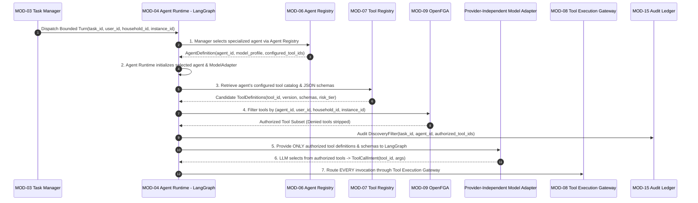
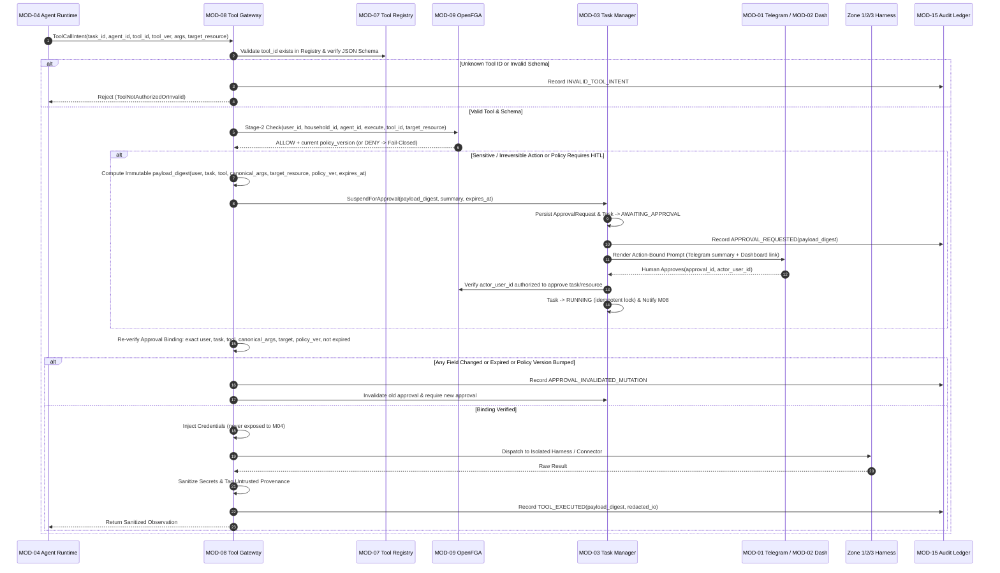
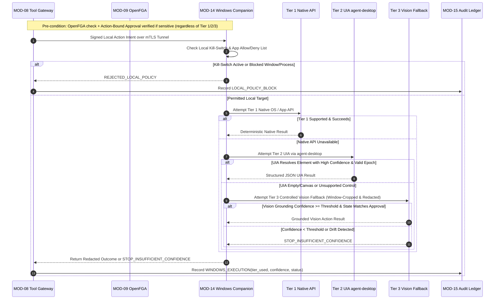

# Orbi — General Level Design (GLD): Functional Responsibilities

- **Document ID**: `DOC-GLD-003`
- **Revision**: `1.3` *(Updated with Autonomous Agent-Driven Automation `MOD-17` & Result Delivery `MOD-18`)*
- **Phase**: `01-GLD`
- **Status**: `Draft - For Review`
- **Last Updated**: `2026-11-16`
- **Traceability**: Maps operational flows and negative constraints across `MOD-01`–`MOD-18` ([module-catalog.md](file:///f:/Projects/Orbi/docs/01-gld/module-catalog.md)), `AP-01`–`AP-10` ([vision.md](file:///f:/Projects/Orbi/docs/00-product/vision.md)), System HLD ([system-architecture.md](file:///f:/Projects/Orbi/docs/02-hld/system-architecture.md)), Memory HLD ([memory-architecture.md](file:///f:/Projects/Orbi/docs/02-hld/memory-architecture.md)), and ADRs ([docs/04-adr/](file:///f:/Projects/Orbi/docs/04-adr/README.md)).

---

## 1. Cross-Module Responsibility Matrix

**Legend**:
- **`O` (Owns / Executes)** — Primary responsible module.
- **`E` (Enforces)** — Deterministically permits or blocks outside LLM context.
- **`C` (Consulted / Input)** — Supplies metadata, signals, or UI rendering.
- **`A` (Audits)** — Persists immutable correlation record.
- **`X` (Strictly Forbidden)** — Explicitly prohibited by `AP-01`–`AP-10`.

| Platform Operation | `MOD-01` Channel | `MOD-02` Dash | `MOD-03` TaskMgr | `MOD-04` Agents | `MOD-05` Decision | `MOD-06/07` Regs | `MOD-08` Gateway | `MOD-09` OpenFGA | `MOD-10` Memory Manager | `MOD-11` Skills/SB | `MOD-12/13/14` Harnesses | `MOD-17` AutoPlat | `MOD-18` Delivery | `MOD-15` Audit |
| :--- | :---: | :---: | :---: | :---: | :---: | :---: | :---: | :---: | :---: | :---: | :---: | :---: | :---: | :---: |
| Authenticate user/household & ingest command | **O** | **O** | `C` | `X` | `—` | `—` | `X` | **E** | `X` | `X` | `X` | `X` | `—` | **A** |
| Own task lifecycle, budgets & TTLs | `X` | `X` | **O** | `X` | `X` | `—` | `C` | `—` | `X` | `X` | `X` | `C` *(Dispatch)* | `C` *(Callbacks)* | **A** |
| Select agent & filter authorized tool discovery | `X` | `X` | `C` | **O** *(Init)* | `C` | `C` | `X` | **E** *(Filter)* | `—` | `C` | `X` | `—` | `X` | **A** |
| Run Decision Service + deterministic/LLM fallback | `—` | `—` | `C` | `C` | **O** | `C` | `C` *(Advisory)* | `X` | `—` | `—` | `—` | `—` | `—` | **A** |
| Select authorized tool & emit `ToolCallIntent` | `X` | `X` | `C` | **O** | `C` | `C` | `X` | `X` | `C` | `C` | `X` | `—` | `X` | **A** |
| Enforce Stage-2 OpenFGA & action-bound approval | `C` *(UI)* | `C` *(UI)* | **O** *(State)* | `X` | `C` | `C` | **E** | **O** *(Policy)* | `X` | `X` | `X` | `—` | `C` *(Notify)* | **A** |
| Inject secrets & dispatch to cloud/local harness | `X` | `X` | `X` | `X` | `X` | `C` | **O** | **E** | `X` | `C` *(Sandbox)* | **O** *(Exec)* | `—` | `—` | **A** |
| Manage memory lifecycle, provenance, temporal validity & run 5-stage hybrid retrieval | `X` | `C` *(Curate/Purge)* | `—` | `C` *(Query/Propose)* | `C` *(Tier-2 QU)* | `—` | `—` | **E** *(Per-Branch)* | **O** *(Lifecycle, Hybrid Pipeline, Provenance, Temporal & Internal `CogneeAdapter`)* | `X` | `X` | `—` | `—` | **A** |
| Package, evaluate, approve & run Markdown skills | `X` | `C` *(Approve)* | `—` | `C` *(Instruct)* | `—` | `C` | **E** *(Script)* | **E** | `X` | **O** | `X` | `—` | `—` | **A** |
| Layered Windows exec (Native/UIA/Vision) + confidence halt | `X` | `X` | `X` | `X` | `X` | `X` | `C` | **E** | `X` | `X` | **O** (`MOD-14`) | `—` | `—` | **A** |
| Create/adapt autonomous schedules, events & responsibilities | `—` | `C` *(Manage)* | `—` | **O** *(Plan)* | `C` | `C` | **E** | **E** *(3-Pt)* | `C` | `—` | `X` | **O** *(Persist)* | `—` | **A** |
| Evaluate non-LLM conditions via `MOD-08` probes & dispatch due tasks | `X` | `—` | **O** *(Run Task)* | `X` *(No Wait Loop)* | `—` | `—` | **E** *(Probe)* | **E** *(Exec Check)* | `—` | `—` | `C` *(Read Probe)* | **O** *(Eval/Timer)* | `—` | **A** |
| Deliver formatted results, notifications & completion callbacks | `C` *(Render)* | `C` *(Stream)* | `C` *(Outcome)* | `X` | `—` | `—` | `X` | **E** | `—` | `—` | `X` | `C` *(Callback)* | **O** *(Route)* | **A** |

---

## 2. End-to-End Operational Flows

### Flow 1A: Agent Selection & Permission-Filtered Tool Discovery (`Clarification A`, `ADR-002`)

`[CONFIRMED]` Every agent turn MUST follow this exact 7-step sequence so agents can never invent tool identifiers, grant themselves access, or execute tools directly:



---

### Flow 1B: Provider-Independent Decision Service & Fallbacks (`Clarification B`, `ADR-003`)

`[CONFIRMED]` When `MOD-03` or `MOD-04` requires structured classification (`noul`, `choice`, or `score`):

1. **Primary Invocation**: Caller invokes `MOD-05` (`DecisionService`) with typed question schema, bounded context, and hard timeout (`timeout_ms`).
2. **Optional Jev Provider (`EVAL-01`)**: If deterministic rules do not short-circuit the decision and the optional Jev provider is enabled and healthy, `MOD-05` queries Jev within `timeout_ms`.
3. **Automatic Fallback Chain**: If Jev is disabled, unavailable, times out, errors, or returns confidence below Jev's provider-specific threshold (`CON-12`), `MOD-05` transparently falls back to:
   - **Deterministic Rule Evaluator** (where applicable, e.g., exact keyword/pattern/risk floor checks), or
   - **LLM-Based Fallback Provider** via `MOD-04` `ModelAdapter` using strict structured-output schema parsing.
4. **Safe Failure Semantics**: If all providers fail or fallback confidence remains ambiguous, `MOD-05` returns `DecisionFallbackStatus.AMBIGUOUS`, routing complex choices to the Manager LLM or escalating risk upward—never lowering security posture. Every attempt and fallback transition is audited in `MOD-15`.

---

### Flow 2: Governed Execution & Immutable Action-Bound Approval (`Clarification C`, `ADR-004`)

`[CONFIRMED]` Every invocation arriving at `MOD-08` undergoes Stage-2 authorization and strict immutable approval binding:



---

### Flow 3: Layered Windows Companion Execution (`Decision 9`, `ADR-006`)

`[CONFIRMED]` Local desktop interaction in `MOD-14` always follows **Native APIs -> UI Automation (`agent-desktop`) -> Controlled Vision Fallback**, halting safely on low confidence and enforcing policy/approvals across all layers:



---

### Flow 4: `MOD-10: Memory Manager` — Lifecycle, Hybrid Retrieval, Provenance, Temporal Validity & Pre-Fusion Authorization (`ADR-007`, `ADR-008`)

`[CONFIRMED]` / `[PROPOSED]` **`MOD-10: Memory Manager`** owns end-to-end memory lifecycle, canonical `MemoryUnit` provenance and bi-temporal validity (`orbi_memory`), the **5-stage Hybrid Retrieval Pipeline**, and **per-branch pre-fusion OpenFGA enforcement**, while encapsulating **Cognee** strictly as an internal, replaceable adapter (**`CogneeAdapter`**) ([memory-architecture.md](file:///f:/Projects/Orbi/docs/02-hld/memory-architecture.md)):

```mermaid
sequenceDiagram
    autonumber
    participant M04 as MOD-04 Agent Runtime
    participant M10 as MOD-10 Memory Manager
    participant QU as Stage 1: QueryUnderstandingPort
    participant BR as Stage 2: Parallel Branches (CogneeAdapter Vector/Graph + PG Lexical/Bitemporal)
    participant M09 as Stage 3: MOD-09 OpenFGA
    participant FUS as Stage 4: CandidateFusionPort (RRF* - ID-Only Dedup)
    participant RR as Stage 5: RerankerPort*
    participant M15 as MOD-15 Audit Ledger

    M04->>M10: MemoryQueryRequest(query, tenant_id, actor_principal, limits)
    M10->>QU: Tier 1 Parser -> Optional Tier 2 MOD-05 -> Conditional Tier 3 LLM
    QU-->>M10: QueryPlan(intent, entities, keywords, bitemporal_mode, activated_branches)
    M10->>BR: Dispatch ONLY activated branches concurrently (per-branch timeout_ms)
    Note over BR,M09: Source-Level Pre-Fusion Authz & Bitemporal Interval Checks (FR-MS-12)
    BR->>M09: Prefilter + Independent Check per source MemoryUnit, graph_entity & hop (No permission union)
    M09-->>BR: Authorized items & scope-filtered projections ONLY (Fail closed on missing provenance)
    BR-->>M10: Authorized BranchResult lists (with branch provenance)
    M10->>FUS: Rank-fuse incompatible branch scales (RRF*, k=60); dedup by memory_unit_id ONLY
    FUS-->>M10: Deduplicated FusedCandidates (<= candidate_limit; content_hash NEVER merges)
    M10->>RR: Rerank against raw_query (NoOp / Local ONNX / API / Conditional LLM, or selective bypass)
    RR-->>M10: Final Top-K MemoryContextItems (<= final_context_limit)
    M10->>M15: Record HYBRID_RETRIEVAL(lexical_backend, bitemporal_mode, authz_dropped, reranker, latency)
    M10-->>M04: Return Provenance-Tagged Authorized MemoryContext
```

1. **Stage 1 — Provider-Independent Query Understanding (`QueryUnderstandingPort`)**: `MOD-10: Memory Manager` runs a deterministic lexical/date parser first (`< 5 ms`, Tier 1), optionally consults `MOD-05` (Tier 2), and uses an LLM fallback (Tier 3) only when permitted by budget (`FR-MS-08`). `TemporalBranch` activates selectively for `CURRENT`, `HISTORICAL`, or `RANGE` queries (without applying a global `superseded_by IS NULL` filter to historical/range queries).
2. **Stages 2 & 3 — Parallel Branches, Distinct PG FTS vs. BM25, Source-Level Graph Authz (`FR-MS-09`, `FR-MS-12`, `CON-13`)**: `VectorBranch` and `GraphBranch` invoke internal replaceable `CogneeAdapter` (`EVAL-03`); `BM25Branch` uses configurable `LexicalBackendPort` separately evaluating **PostgreSQL FTS** (`tsvector`/`ts_rank_cd` — never labeled BM25) vs. **Genuine BM25** (`pg_search`); `TemporalBranch` executes bitemporal SQL over valid time (`valid_from`/`valid_to`) and system time (`recorded_from`/`recorded_to`). Graph projections preserve `source_memory_unit_ids[]`, authorize every source independently, never union permissions across convergent shared/private entities (e.g., `"Project Apollo"`), verify all multi-hop sources, and fail closed if provenance or `MOD-09` is unavailable.
3. **Stages 4 & 5 — Candidate Fusion & Replaceable Reranking (`[PROPOSED]`, `EVAL-07`)**: Because raw branch scores are incomparable, `CandidateFusionPort` applies rank fusion (initial: weighted RRF), deduplicating **strictly by `memory_unit_id`** (`content_hash` never merges distinct records), while preserving provenance and timeline metadata. `RerankerPort` applies configurable, non-LLM-mandatory reranking (or selective bypass/RRF fallback on timeout).
4. **Memory Lifecycle, Bitemporal Correction, Provenance & Transactional Outbox (`CON-14`, `CON-16`)**: `MOD-10: Memory Manager` commits every canonical `MemoryUnit` first to PostgreSQL `orbi_memory` alongside an atomic row in **`memory_sync_outbox`**. Belief corrections close `recorded_to` and set `superseded_by` on the retired record while preserving prior system-time history; `untrusted_external` entries remain quarantined and cannot mutate high-trust records (`CON-16`). A leased dispatcher publishes outbox rows to Redis for idempotent `CogneeAdapter` sync with bounded retries, `DEAD_LETTERED` handling, and crash reconciliation.

---

### Flow 5: Markdown Skill Package Lifecycle & Sandboxed Scripts (`Clarification D`, `ADR-005`)

1. **Authoring (`DRAFT`)**: A candidate skill is packaged as a versioned Markdown bundle (`SKILL.md` narrative instructions + optional JSON schemas, usage examples, golden test cases, and supporting Python/utility scripts).
2. **Instruction vs. Script Separation**:
   - `SKILL.md` prose is **guidance only**; loading it into `MOD-04` does **not** grant tool permissions (`AP-02`).
   - Any supporting script is strictly flagged as executable code requiring sandbox isolation (`MOD-11-SANDBOX`).
3. **Evaluation (`EVALUATED`)**: `MOD-11` executes the package's test suite inside `MOD-11-SANDBOX` (`EVAL-06`) against mocked `MOD-08` Gateway interfaces, verifying schema compliance and zero unauthorized syscalls/network access.
4. **Human Publication Gate (`AWAITING_PUBLISH_APPROVAL` -> `PUBLISHED`)**: Owner reviews the exact `SKILL.md` diff, supporting script code, test results, and required permissions in `MOD-02` Dashboard (`AP-06`). Upon explicit approval, `MOD-11` pins the semantic version (`v1.0.0`), registers the callable metadata in `MOD-07`, and records the publication in `MOD-15`.
5. **Production Runtime Execution**: When an authorized agent invokes a published skill's supporting script, the request passes through `MOD-08`, checks Stage-2 OpenFGA + any required action-bound approval, runs the script in an ephemeral `MOD-11-SANDBOX` instance (with no ambient secrets or direct network), and routes any external actions the script requests back through `MOD-08`.

---

### Flow 6: Autonomous Agent-Driven Automation, Ongoing Responsibilities & Delegation (`ADR-009`)

`[CONFIRMED]` Authorized agents arrange future, recurring, event-driven, and condition-driven work independently through `MOD-08` -> `MOD-17`, keeping zero LLM sessions alive while waiting and ensuring every execution passes through `MOD-03` and `MOD-09`:

```mermaid
sequenceDiagram
    autonumber
    participant M04 as MOD-04 Authorized Agent
    participant M08 as MOD-08 Tool Gateway
    participant M09 as MOD-09 OpenFGA
    participant M17 as MOD-17 Automation Platform
    participant M03 as MOD-03 Task Manager
    participant M18 as MOD-18 Result & Delivery
    participant M15 as MOD-15 Audit Ledger

    M04->>M08: ToolCallIntent(automation.create_condition_monitor / schedule, execution_target, envelope)
    M08->>M09: Check Creation, Non-Inherited Delegation & Initial PermissionEnvelope (Point 1)
    M09-->>M08: ALLOW
    M08->>M17: Validate Typed Target, Cycles, Min Interval, Depth & Quotas
    M17-->>M08: Atomic Commit (Definition + Envelope + ScheduleVersion v1 + automation_outbox)
    M17->>M15: Record AUTOMATION_CREATED
    M08-->>M04: AutomationRegistered(id, envelope_v1, version=1) -> LLM Turn Ends Cleanly

    Note over M17,M08: Time / Condition / Event Evaluation via Outbox->Redis (Zero Active LLM Sessions)
    loop Scheduled Condition Poll Interval
        M17->>M08: ExecuteReadOnlyProbe(tool_id, scope)
        M08-->>M17: Probe Payload
        M17->>M17: Evaluate Deterministic Predicate Locally (False -> Sleep)
    end

    Note over M17,M03: Trigger Fired -> Event Dedup + Cohesive 8-Control Loop Guard
    M17->>M09: Re-verify Execution Authz & Live PermissionEnvelope for Owner + Target (Point 3)
    M09-->>M17: ALLOW
    M17->>M03: DispatchAutomationTask(execution_target, correlation_id, trigger_depth, envelope_budget)
    M03->>M04: Run Target Under Own Non-Inherited Identity INTERSECT PermissionEnvelope
    M04->>M08: Execute Authorized Tools (ADR-004 HITL if Sensitive/Physical; Envelope Checked on update)
    M04-->>M03: TurnOutcome
    M03->>M18: Deliver Task Result & Commit Completion Callback -> automation_outbox
    M18->>M17: CompletionCallback(execution_id, correlation_id, outcome)
    M18->>M15: Record RESULT_DELIVERED
```

---

## 3. Explicit Negative Responsibilities ("What Modules Must NEVER Do")

1. **Agents (`MOD-04`) Must NEVER Invent Tools, Self-Authorize, or Execute Side Effects**: Agents may only invoke tools present in their Stage-1 filtered OpenFGA catalog via `MOD-08`. Zero direct HTTP/SDK/Playwright/Windows/DB-write access (`AP-01`, `Clarification A`).
2. **Decision Service (`MOD-05`) & Jev Must NEVER Be Mandatory or Authoritative for Security**: Core tasks must continue functioning via deterministic/LLM fallbacks if Jev is unavailable (`Decision 3`). Neither Jev nor LLM confidence scores may bypass OpenFGA (`MOD-09`) or downgrade tool risk tiers (`CON-02`).
3. **Approvals Must NEVER Outlive Payload Mutations (`Decision 8`, `Clarification C`)**: `MOD-08` must never execute an approved intent if `user_id`, `task_id`, `tool_id`, canonical arguments, `target_resource`, `policy_version`, or `expires_at` fail validation.
4. **Skills & Supporting Scripts (`MOD-11`) Must NEVER Run Unsandboxed or Grant Permissions (`Decision 7`, `Clarification D`)**: `SKILL.md` instructions never modify OpenFGA tuples; supporting scripts never execute inside `orbi-core` or hold raw API credentials (`CON-08`).
5. **LangGraph (`MOD-04`) Must NEVER Own Task Lifecycle (`AP-03`)**: Task statuses, budgets, retries, and `AWAITING_APPROVAL` durability belong exclusively to `MOD-03` in PostgreSQL.
6. **`MOD-10: Memory Manager` Must NEVER Leak Unauthorized Candidates, Expose `CogneeAdapter` Directly, or Bypass Lifecycle/Provenance/Temporal Governance (`AP-02`, `AP-04`, `FR-MS-12`, `NFR-SEC-04`)**: `CogneeAdapter` is strictly an internal, replaceable adapter—external modules must never query Cognee directly; unauthorized memories, graph nodes, edges, or metadata must never cross into Fusion, Reranking, or LLM context; `untrusted_external` entries must never overwrite `user_explicit` facts (`CON-16`); and `MOD-10: Memory Manager` must never store operational task state, OpenFGA tuples, or OAuth secrets.
7. **Windows Companion (`MOD-14`) Must NEVER Guess Low-Confidence Actions or Open Inbound Listeners (`Decision 9`, `AP-05`)**: Insufficient confidence across UIA or Vision Fallback must trigger `STOP_INSUFFICIENT_CONFIDENCE`; all cloud communication must originate outbound over mTLS.
8. **Audit Service (`MOD-15`) Must NEVER Mutate History or Persist Unredacted Secrets (`AP-07`)**.
9. **Automation Platform (`MOD-17`) Must NEVER Run a Competing Task Execution Engine or Bypass `MOD-08`/`MOD-09` (`ADR-009`)**: Every triggered execution must dispatch as a normal `MOD-03` task, every condition probe must execute as a `READ_ONLY` call via `MOD-08`, and delegated `execution_target` identities must never inherit creator permissions or expand their `PermissionEnvelope`.
10. **Agent Runtime (`MOD-04`) Must NEVER Hold Sleeping LLM Sessions Waiting for Future Triggers or Directly Mutate `MOD-17` Schedules**: Temporal waiting and condition polling happen inside `MOD-17`; schedule mutations occur solely through authorized `automation.*` calls via `MOD-08`.

---

## 4. Failure Modes & Degraded Operation Boundaries

| Failure Scenario | Owning Detector | Required System Behavior |
| :--- | :--- | :--- |
| **OpenFGA (`MOD-09`) unreachable or times out** | `MOD-04` (Discovery) / `MOD-08` (Gateway) | **Fail closed.** Stage-1 returns empty tool list; Stage-2 rejects execution (`AUTHZ_UNAVAILABLE`), audits event (`MOD-15`), surfaces clean error to `MOD-03`. |
| **Optional Jev (`MOD-05`) unavailable, slow, or low confidence** | `MOD-05` Decision Service | Fallback cleanly within `timeout_ms` to deterministic rules or `LLMDecisionProvider` (`Clarification B`); audit fallback event (`MOD-15`). |
| **Action arguments, resource, or OpenFGA `policy_version` change during approval** | `MOD-08` Gateway | Reject stale approval (`APPROVAL_DIGEST_MISMATCH`), log invalidation (`MOD-15`), request fresh human approval via `MOD-03` (`ADR-004`). |
| **Windows Native API & UIA fail and Vision confidence < threshold** | `MOD-14` Companion | Abort immediately (`STOP_INSUFFICIENT_CONFIDENCE`), perform zero clicks/keystrokes, report safe stop to `MOD-08`/`MOD-03` (`ADR-006`). |
| **Skill supporting script attempts network/FS escape or times out** | `MOD-11-SANDBOX` | Sandbox runtime kills container/process immediately, returns `SANDBOX_VIOLATION_OR_TIMEOUT`, audits security alert (`MOD-15`). |
| **Windows Companion offline or user hits local kill-switch** | `MOD-08` Relay / `MOD-14` | Return `COMPANION_OFFLINE` or `LOCAL_KILL_SWITCH_ACTIVE` cleanly; notify user via `MOD-01`/`MOD-02`. |
| **One memory retrieval branch (e.g., `GraphBranch` or internal `CogneeAdapter`) times out or errors** | `MOD-10: Memory Manager` | Cancel timed-out branch; fuse remaining **authorized** branches (e.g., PostgreSQL `BM25Branch` + `VectorBranch`), mark `partial_retrieval=True`, log `MEMORY_BRANCH_DEGRADED` in `MOD-15`; **never** bypass OpenFGA checks. |
| **Internal replaceable `CogneeAdapter` completely unavailable** | `MOD-10: Memory Manager` | Gracefully fall back to authorized PostgreSQL `BM25Branch` (PG FTS/BM25*) + `TemporalBranch` over `orbi_memory` so exact & bitemporal recall continue with OpenFGA enforced (`DOC-HLD-001` §5); queue outbox writes in `memory_sync_outbox`. |
| **Memory or automation outbox poison event exhausts retries (`DEAD_LETTERED`)** | `MOD-10` / `MOD-17` Outbox Dispatcher | Move failed row to `DEAD_LETTERED` without blocking healthy sibling events, reclaim stale leases on restart (`locked_until < now()`), audit alert in `MOD-15`, and surface replay action in `MOD-02`. |
| **Graph node/edge missing source `MemoryUnit` provenance** | `MOD-10` `BranchAuthzFilter` | **Fail closed immediately.** Drop unverified graph assertion/summary/path so unauthorized sources cannot leak (`DOC-HLD-001` §4 Stage 3). |
| **Memory Reranker (`MOD-10: Memory Manager`) times out or is disabled** | `MOD-10: Memory Manager` | Fall back cleanly to pre-rerank RRF fused ordering capped at `final_context_limit`, recording `reranker_bypassed=true` in `MOD-15`. |
| **Container restart / outage causes missed automation schedules** | `MOD-17` AutoPlat Reconciler | Compare `next_run_at < now()` against persisted `misfire_policy` (`SKIP`, `RUN_LATEST`, `CATCH_UP_BOUNDED`), claim idempotent execution slot in PG/Redis, and log reconciled runs in `MOD-15`. |
| **Condition monitor `READ_ONLY` probe fails or times out** | `MOD-17` Condition Eval / `MOD-08` | Record `PROBE_FAILED` without triggering false-positive LLM tasks; apply exponential backoff, and auto-pause + notify user via `MOD-18` after consecutive failure threshold. |
| **Circular automation dependency, envelope expansion, or indirect-loop circuit breaker trip** | `MOD-17` Policy Validator & Loop Guard / `MOD-09` | Abort chain before task creation (`AUTOMATION_POLICY_VIOLATION` or `PAUSED_SAFETY_TRIP`), require renewed approval for envelope expansion, audit `MOD-15`, and notify owner immediately via `MOD-18`. |
| **Delegated automation execution fails Point-3 OpenFGA check or hits quota** | `MOD-17` Dispatcher / `MOD-09` | Abort dispatch before creating a `MOD-03` task (fail closed), mark execution `AUTHZ_DENIED` or `QUOTA_EXCEEDED`, pause if policy revoked, and alert owner via `MOD-18`. |
