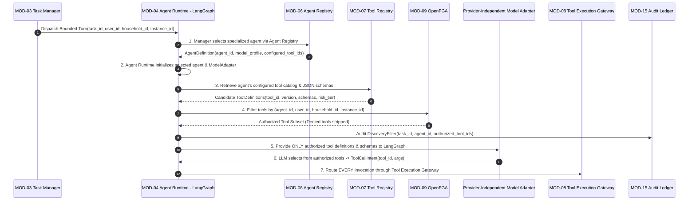
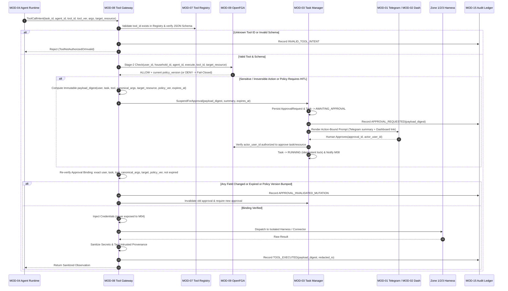
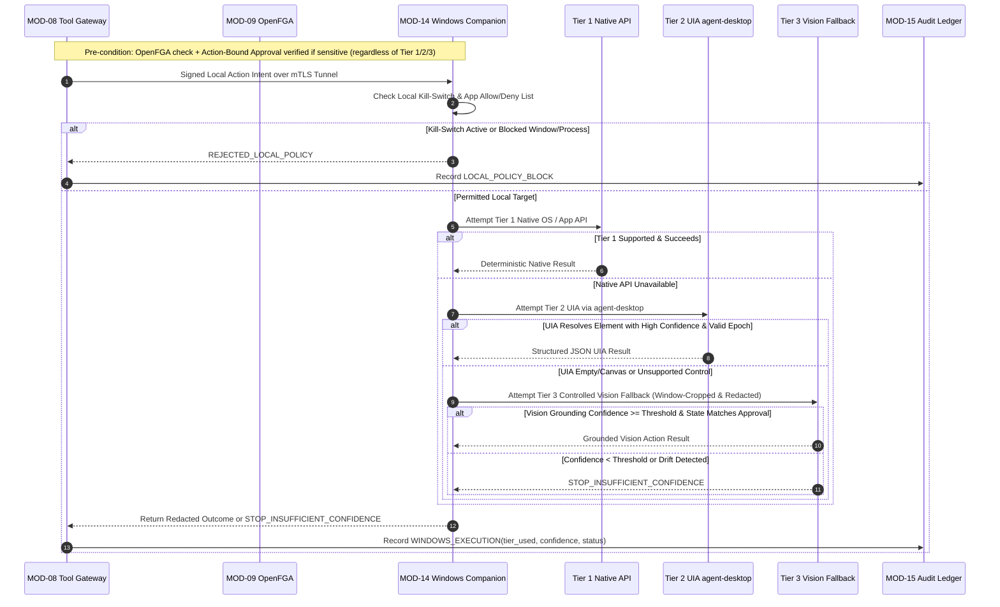

# Orbi — General Level Design (GLD): Functional Responsibilities

- **Document ID**: `DOC-GLD-003`
- **Revision**: `1.1` *(Updated with Discovery Sequence, Decision Fallback, Action-Bound Approvals, Layered Windows & Skill Sandbox)*
- **Phase**: `01-GLD`
- **Status**: `Draft - For Review`
- **Last Updated**: `2026-11-14`
- **Traceability**: Maps operational flows and negative constraints across `MOD-01`–`MOD-15` ([module-catalog.md](file:///f:/Projects/Orbi/docs/01-gld/module-catalog.md)), `AP-01`–`AP-10` ([vision.md](file:///f:/Projects/Orbi/docs/00-product/vision.md)), and ADRs ([docs/04-adr/](file:///f:/Projects/Orbi/docs/04-adr/README.md)).

---

## 1. Cross-Module Responsibility Matrix

**Legend**:
- **`O` (Owns / Executes)** — Primary responsible module.
- **`E` (Enforces)** — Deterministically permits or blocks outside LLM context.
- **`C` (Consulted / Input)** — Supplies metadata, signals, or UI rendering.
- **`A` (Audits)** — Persists immutable correlation record.
- **`X` (Strictly Forbidden)** — Explicitly prohibited by `AP-01`–`AP-10`.

| Platform Operation | `MOD-01` Channel | `MOD-02` Dash | `MOD-03` TaskMgr | `MOD-04` Agents | `MOD-05` Decision | `MOD-06/07` Regs | `MOD-08` Gateway | `MOD-09` OpenFGA | `MOD-10` Memory | `MOD-11` Skills/SB | `MOD-12/13/14` Harnesses | `MOD-15` Audit |
| :--- | :---: | :---: | :---: | :---: | :---: | :---: | :---: | :---: | :---: | :---: | :---: | :---: |
| Authenticate user/household & ingest command | **O** | **O** | `C` | `X` | `—` | `—` | `X` | **E** | `X` | `X` | `X` | **A** |
| Own task lifecycle, budgets & TTLs | `X` | `X` | **O** | `X` | `X` | `—` | `C` | `—` | `X` | `X` | `X` | **A** |
| Select agent & filter authorized tool discovery | `X` | `X` | `C` | **O** *(Init)* | `C` | `C` | `X` | **E** *(Filter)* | `—` | `C` | `X` | **A** |
| Run Decision Service + deterministic/LLM fallback | `—` | `—` | `C` | `C` | **O** | `C` | `C` *(Advisory)* | `X` | `—` | `—` | `—` | **A** |
| Select authorized tool & emit `ToolCallIntent` | `X` | `X` | `C` | **O** | `C` | `C` | `X` | `X` | `C` | `C` | `X` | **A** |
| Enforce Stage-2 OpenFGA & action-bound approval | `C` *(UI)* | `C` *(UI)* | **O** *(State)* | `X` | `C` | `C` | **E** | **O** *(Policy)* | `X` | `X` | `X` | **A** |
| Inject secrets & dispatch to cloud/local harness | `X` | `X` | `X` | `X` | `X` | `C` | **O** | **E** | `X` | `C` *(Sandbox)* | **O** *(Exec)* | **A** |
| Retrieve / quarantine / curate Cognee memory | `X` | `C` *(UI)* | `—` | `C` *(Read)* | `—` | `—` | `—` | **E** | **O** | `X` | `X` | **A** |
| Package, evaluate, approve & run Markdown skills | `X` | `C` *(Approve)* | `—` | `C` *(Instruct)* | `—` | `C` | **E** *(Script)* | **E** | `X` | **O** | `X` | **A** |
| Layered Windows exec (Native/UIA/Vision) + confidence halt | `X` | `X` | `X` | `X` | `X` | `X` | `C` | **E** | `X` | `X` | **O** (`MOD-14`) | **A** |

---

## 2. End-to-End Operational Flows

### Flow 1A: Agent Selection & Permission-Filtered Tool Discovery (`Clarification A`, `ADR-002`)

`[CONFIRMED]` Every agent turn MUST follow this exact 7-step sequence so agents can never invent tool identifiers, grant themselves access, or execute tools directly:

---

### Flow 1B: Provider-Independent Decision Service & Fallbacks (`Clarification B`, `ADR-003`)

`[CONFIRMED]` When `MOD-03` or `MOD-04` requires structured classification (`noul`, `choice`, or `score`):

1. **Primary Invocation**: Caller invokes `MOD-05` (`DecisionService`) with typed question schema, bounded context, and hard timeout (`timeout_ms`).
2. **Optional Jev Provider (`EVAL-01`)**: If deterministic rules do not short-circuit the decision and the optional Jev provider is enabled and healthy, `MOD-05` queries Jev within `timeout_ms`.
3. **Automatic Fallback Chain**: If Jev is disabled, unavailable, times out, errors, or returns confidence below Jev's provider-specific threshold (`CON-12`), `MOD-05` transparently falls back to:
   - **Deterministic Rule Evaluator** (where applicable, e.g., exact keyword/pattern/risk floor checks), or
   - **LLM-Based Fallback Provider** via `MOD-04` `ModelAdapter` using strict structured-output schema parsing.
4. **Safe Failure Semantics**: If all providers fail or fallback confidence remains ambiguous, `MOD-05` returns `DecisionFallbackStatus.AMBIGUOUS`, routing complex choices to the Manager LLM or escalating risk upward—never lowering security posture. Every attempt and fallback transition is audited in `MOD-15`.

---

### Flow 2: Governed Execution & Immutable Action-Bound Approval (`Clarification C`, `ADR-004`)

`[CONFIRMED]` Every invocation arriving at `MOD-08` undergoes Stage-2 authorization and strict immutable approval binding:

---

### Flow 3: Layered Windows Companion Execution (`Decision 9`, `ADR-006`)

`[CONFIRMED]` Local desktop interaction in `MOD-14` always follows **Native APIs -> UI Automation (`agent-desktop`) -> Controlled Vision Fallback**, halting safely on low confidence and enforcing policy/approvals across all layers:

---

### Flow 4: Memory Retrieval & Controlled Curation (`MOD-10`, `ADR-007`)

1. **Scoped Read Path**: `MOD-04` queries `MOD-10` (**Memory Manager**). `MOD-10` enforces OpenFGA `user_id` + `household_id` ownership visibility before retrieving knowledge from Cognee's verified storage backends (`EVAL-03`), returning facts labeled with provenance (`user_explicit` vs. `untrusted_external`).
2. **Quarantined Write Path**: Facts extracted from untrusted external channels (emails via `MOD-12`, web scrapes via `MOD-13`, screen text via `MOD-14`) carry `untrusted_external` provenance and cannot silently alter high-trust user preferences or system policies (`CON-07`).
3. **Owner Curation**: Via `MOD-02` Dashboard, authorized users inspect, correct, promote, or delete memories inside `MOD-10`, with mutations audited in `MOD-15`.

---

### Flow 5: Markdown Skill Package Lifecycle & Sandboxed Scripts (`Clarification D`, `ADR-005`)

1. **Authoring (`DRAFT`)**: A candidate skill is packaged as a versioned Markdown bundle (`SKILL.md` narrative instructions + optional JSON schemas, usage examples, golden test cases, and supporting Python/utility scripts).
2. **Instruction vs. Script Separation**:
   - `SKILL.md` prose is **guidance only**; loading it into `MOD-04` does **not** grant tool permissions (`AP-02`).
   - Any supporting script is strictly flagged as executable code requiring sandbox isolation (`MOD-11-SANDBOX`).
3. **Evaluation (`EVALUATED`)**: `MOD-11` executes the package's test suite inside `MOD-11-SANDBOX` (`EVAL-06`) against mocked `MOD-08` Gateway interfaces, verifying schema compliance and zero unauthorized syscalls/network access.
4. **Human Publication Gate (`AWAITING_PUBLISH_APPROVAL` -> `PUBLISHED`)**: Owner reviews the exact `SKILL.md` diff, supporting script code, test results, and required permissions in `MOD-02` Dashboard (`AP-06`). Upon explicit approval, `MOD-11` pins the semantic version (`v1.0.0`), registers the callable metadata in `MOD-07`, and records the publication in `MOD-15`.
5. **Production Runtime Execution**: When an authorized agent invokes a published skill's supporting script, the request passes through `MOD-08`, checks Stage-2 OpenFGA + any required action-bound approval, runs the script in an ephemeral `MOD-11-SANDBOX` instance (with no ambient secrets or direct network), and routes any external actions the script requests back through `MOD-08`.

---

## 3. Explicit Negative Responsibilities ("What Modules Must NEVER Do")

1. **Agents (`MOD-04`) Must NEVER Invent Tools, Self-Authorize, or Execute Side Effects**: Agents may only invoke tools present in their Stage-1 filtered OpenFGA catalog via `MOD-08`. Zero direct HTTP/SDK/Playwright/Windows/DB-write access (`AP-01`, `Clarification A`).
2. **Decision Service (`MOD-05`) & Jev Must NEVER Be Mandatory or Authoritative for Security**: Core tasks must continue functioning via deterministic/LLM fallbacks if Jev is unavailable (`Decision 3`). Neither Jev nor LLM confidence scores may bypass OpenFGA (`MOD-09`) or downgrade tool risk tiers (`CON-02`).
3. **Approvals Must NEVER Outlive Payload Mutations (`Decision 8`, `Clarification C`)**: `MOD-08` must never execute an approved intent if `user_id`, `task_id`, `tool_id`, canonical arguments, `target_resource`, `policy_version`, or `expires_at` fail validation.
4. **Skills & Supporting Scripts (`MOD-11`) Must NEVER Run Unsandboxed or Grant Permissions (`Decision 7`, `Clarification D`)**: `SKILL.md` instructions never modify OpenFGA tuples; supporting scripts never execute inside `orbi-core` or hold raw API credentials (`CON-08`).
5. **LangGraph (`MOD-04`) Must NEVER Own Task Lifecycle (`AP-03`)**: Task statuses, budgets, retries, and `AWAITING_APPROVAL` durability belong exclusively to `MOD-03` in PostgreSQL.
6. **Memory Manager (`MOD-10`) Must NEVER Store Operational State or Secrets (`AP-04`)**: No task states, OpenFGA tuples, or OAuth tokens inside Cognee stores.
7. **Windows Companion (`MOD-14`) Must NEVER Guess Low-Confidence Actions or Open Inbound Listeners (`Decision 9`, `AP-05`)**: Insufficient confidence across UIA or Vision Fallback must trigger `STOP_INSUFFICIENT_CONFIDENCE`; all cloud communication must originate outbound over mTLS.
8. **Audit Service (`MOD-15`) Must NEVER Mutate History or Persist Unredacted Secrets (`AP-07`)**.

---

## 4. Failure Modes & Degraded Operation Boundaries

| Failure Scenario | Owning Detector | Required System Behavior |
| :--- | :--- | :--- |
| **OpenFGA (`MOD-09`) unreachable or times out** | `MOD-04` (Discovery) / `MOD-08` (Gateway) | **Fail closed.** Stage-1 returns empty tool list; Stage-2 rejects execution (`AUTHZ_UNAVAILABLE`), audits event (`MOD-15`), surfaces clean error to `MOD-03`. |
| **Optional Jev (`MOD-05`) unavailable, slow, or low confidence** | `MOD-05` Decision Service | Fallback cleanly within `timeout_ms` to deterministic rules or `LLMDecisionProvider` (`Clarification B`); audit fallback event (`MOD-15`). |
| **Action arguments, resource, or OpenFGA `policy_version` change during approval** | `MOD-08` Gateway | Reject stale approval (`APPROVAL_DIGEST_MISMATCH`), log invalidation (`MOD-15`), request fresh human approval via `MOD-03` (`ADR-004`). |
| **Windows Native API & UIA fail and Vision confidence < threshold** | `MOD-14` Companion | Abort immediately (`STOP_INSUFFICIENT_CONFIDENCE`), perform zero clicks/keystrokes, report safe stop to `MOD-08`/`MOD-03` (`ADR-006`). |
| **Skill supporting script attempts network/FS escape or times out** | `MOD-11-SANDBOX` | Sandbox runtime kills container/process immediately, returns `SANDBOX_VIOLATION_OR_TIMEOUT`, audits security alert (`MOD-15`). |
| **Windows Companion offline or user hits local kill-switch** | `MOD-08` Relay / `MOD-14` | Return `COMPANION_OFFLINE` or `LOCAL_KILL_SWITCH_ACTIVE` cleanly; notify user via `MOD-01`/`MOD-02`. |
