# Orbi — General Level Design (GLD): System Overview

- **Document ID**: `DOC-GLD-001`
- **Revision**: `1.1` *(Updated with GLD Review Decisions, Clarifications A–E & ADRs)*
- **Phase**: `01-GLD`
- **Status**: `Draft - For Review`
- **Last Updated**: `2026-11-14`
- **Traceability**: Realizes Product Vision ([vision.md](file:///f:/Projects/Orbi/docs/00-product/vision.md)), Requirements ([requirements.md](file:///f:/Projects/Orbi/docs/00-product/requirements.md)), and ADRs ([docs/04-adr/](file:///f:/Projects/Orbi/docs/04-adr/README.md)).

---

## 1. Architectural Philosophy: Governed Modular Monolith

`[CONFIRMED]` Orbi adopts a **Governed Modular Monolith with Isolated Execution Harnesses**, balancing strict internal modularity/testability (`AP-08`) with pragmatic operational simplicity (`AP-09`, `ADR-001`):

1. **Confirmed Core Runtime (`orbi-core`)**: Implemented in **Python 3.12+**, **FastAPI**, and **LangGraph**, deploying initially via **Docker Compose on a single Oracle Cloud Infrastructure (OCI) VM**. *(VM hardware tier and Always Free adequacy remain `[EVALUATION REQUIRED]` under `EVAL-05`.)*
2. **Provider-Independent Cognitive & Decision Ports**: Both LLM reasoning (`MOD-04`) and structured System-1 classification (`MOD-05` Decision Service) operate behind provider-independent interfaces with configurable budgets and deterministic/LLM fallbacks (`ADR-003`).
3. **Three-Zone Resource & Execution Isolation (`Clarification E`)**: Components run in-process inside `orbi-core` only when stateless or control-oriented; untrusted code execution, browser rendering, policy engine evaluation, and local OS interaction are strictly isolated into dedicated containers/sandboxes or the local Windows host.

---

## 2. Three-Zone Resource Isolation & Six-Plane Topology

`[CONFIRMED]` / `[PROPOSED]` The diagram and isolation table below explicitly clarify which components execute **inside `orbi-core`**, which execute as **isolated cloud execution environments / backing containers**, and which execute on the **local Windows Companion** (`Clarification E`):

```mermaid
flowchart TB
    subgraph USER["Human Operators - Single Owner Initially, Household-Extensible"]
        TG_USER["Telegram Client"]
        WEB_USER["Admin & Approval Browser"]
    end

    subgraph OCI["OCI Single-VM Docker Compose Host - Sizing Pending EVAL-05"]
        subgraph ZONE1["Zone 1: In-Process Orbi Core - Python 3.12+ / FastAPI / LangGraph"]
            MOD01["MOD-01: Channel Gateway & Telegram Adapter"]
            MOD03["MOD-03: Deterministic Task Manager"]
            MOD04["MOD-04: LangGraph Runtime & LLM Adapters"]
            MOD05["MOD-05: Provider-Independent Decision Service"]
            MOD06["MOD-06: Central Agent Registry"]
            MOD07["MOD-07: Central Tool Registry"]
            MOD08["MOD-08: Tool Execution Gateway"]
            MOD10["MOD-10: Memory Manager Facade - Cognee"]
            MOD11["MOD-11: Skill Lifecycle Manager - SKILL.md"]
            MOD12["MOD-12: Stateless SaaS API Connectors"]
            MOD15["MOD-15: Audit & Provenance Service"]
        end

        subgraph ZONE2["Zone 2: Isolated Cloud Execution Environments & Backing Services"]
            MOD02["MOD-02: Web Dashboard UI Container - Tech OQ-01"]
            MOD09["MOD-09: OpenFGA Authorization Container"]
            MOD13["MOD-13: Cloud Browser Container - Playwright"]
            MOD11_SB["MOD-11-SANDBOX: Isolated Skill Script Sandbox - EVAL-06"]
            PG["orbi-postgres: Isolated Schemas for App / OpenFGA"]
            REDIS["orbi-redis: Queues, Locks & Events"]
            MEM_STORE["Cognee Verified Storage Backends - EVAL-03"]
            EXT_JEV["Optional External Jev Provider - EVAL-01"]
            MOD16["MOD-16-EXT: Future Home Assistant / MQTT Boundary - AP-10"]
        end
    end

    subgraph ZONE3["Zone 3: Local Windows Desktop Zone - MOD-14 Off-Cloud"]
        MOD14["MOD-14: Windows Companion & Local Policy / Kill-Switch"]
        L1["Tier 1: Native OS / App APIs"]
        L2["Tier 2: UI Automation - agent-desktop - EVAL-02"]
        L3["Tier 3: Controlled Vision Fallback"]
    end

    TG_USER <--> MOD01
    WEB_USER <--> MOD02
    MOD02 <--> MOD01

    MOD01 --> MOD03
    MOD03 <--> REDIS
    MOD03 <--> PG
    MOD03 <--> MOD04
    MOD03 --> MOD05
    MOD03 --> MOD15

    MOD04 --> MOD05
    MOD04 --> MOD06
    MOD04 --> MOD07
    MOD04 --> MOD09
    MOD04 <--> MOD10
    MOD04 -- "Authorized ToolCallIntent ONLY - AP-01" --> MOD08

    MOD05 -. "Optional Provider" .-> EXT_JEV
    MOD08 --> MOD07
    MOD08 --> MOD09
    MOD08 <--> MOD03
    MOD08 --> MOD15
    MOD08 --> MOD12
    MOD08 --> MOD13
    MOD08 --> MOD11_SB
    MOD08 -. "Future Home IoT" .-> MOD16

    MOD09 <--> PG
    MOD10 <--> MEM_STORE
    MOD11 --> MOD07
    MOD11 --> MOD11_SB

    MOD14 -- "Outbound mTLS Tunnel - ASM-05" --> MOD08
    MOD14 --> L1
    MOD14 --> L2
    MOD14 --> L3
```

### Resource Isolation Boundary Matrix (`Clarification E`)

| Execution Zone | Components | Process / Network / Credential Privilege | Prohibited Capabilities |
| :--- | :--- | :--- | :--- |
| **Zone 1: `orbi-core` (OCI API + Worker Containers)** | `MOD-01`, `MOD-03`, `MOD-04`, `MOD-05`, `MOD-06`, `MOD-07`, `MOD-08`, `MOD-10` (facade), `MOD-11` (manager), `MOD-12` (SaaS adapters), `MOD-15` | Controlled OCI Python runtime; holds DB/Redis connections and encrypted credential vault access **strictly inside `MOD-08`/`MOD-12`** boundaries (never exposed to `MOD-04` agent prompts/state). | Must never render untrusted web DOMs in-process, run unverified supporting scripts in-process, or directly touch Windows UIA/desktop APIs. |
| **Zone 2a: Isolated Cloud Execution Sandboxes** | `MOD-13` (Playwright Browser), `MOD-11-SANDBOX` (Skill Supporting Script Runner) | Dedicated ephemeral/capped containers or micro-sandboxes (`EVAL-06`); zero access to `orbi_app` DB, Redis, OpenFGA admin APIs, or OAuth secrets; strict egress controls (`MOD-13` domain allowlist; `MOD-11-SANDBOX` no ambient network/host FS). | Must never call external SaaS with host credentials, mutate DB tables directly, or bypass `MOD-08`. |
| **Zone 2b: Dedicated Cloud Backing Services** | `MOD-02` (Dashboard UI), `MOD-09` (OpenFGA), `orbi-postgres`, `orbi-redis`, `Cognee Storage Backends` (`EVAL-03`) | Separate Docker Compose services on internal OCI Docker network; no public exposure except TLS reverse proxy for `MOD-01`/`MOD-02`/`MOD-08` mTLS relay. | Never invoke LLM loops or execute user-facing tools. |
| **Zone 3: Local Windows Companion (Off-Cloud)** | `MOD-14` (`Native API` -> `agent-desktop` UIA -> `Controlled Vision Fallback`) | Runs on user's Windows PC under local user session; initiates **outbound-only** mTLS tunnel (`ASM-05`); enforces local app allow/deny lists, PII redaction, and local hardware/tray kill-switch. | Must never listen on public inbound sockets, bypass cloud OpenFGA/approvals, or hold cloud OAuth secrets (`AP-05`). |

---

## 3. Core Architectural Invariants

### 3.1 Two-Stage Agent & Tool Discovery + Gateway Exclusivity (`Clarification A`, `AP-01`, `AP-02`, `ADR-002`)
`[CONFIRMED]` Tool visibility and execution enforce **defense in depth**:
1. **Stage 1 — Pre-Reasoning Discovery Filtering**: When `MOD-04` initializes an agent selected by the Manager from `MOD-06`, `MOD-04` retrieves the agent's configured tool catalog from `MOD-07` and filters it via `MOD-09` (**OpenFGA**) against `(agent, user, instance)` permissions. LangGraph receives **only** the authorized tool definitions and schemas.
2. **Stage 2 — Non-Bypassable Execution Verification**: When the LLM selects a tool from that filtered set, it emits a `ToolCallIntent` strictly to `MOD-08` (**Tool Execution Gateway**). `MOD-08` re-checks OpenFGA against the specific `target_resource` and `args`, verifies action-bound human approval (`ADR-004`), injects secrets, executes via the target harness, and audits (`MOD-15`).
3. **Prohibition**: Agents must never invent tool identifiers, grant themselves access, read raw credentials, or execute tools directly.

### 3.2 Household-Ready Identity & Resource Ownership (`Decision 2`, `ADR-002`)
`[CONFIRMED]` While Orbi operates for a single owner initially, `MOD-01`, `MOD-03`, `MOD-09`, and `MOD-10` explicitly separate `user_id` (human actor), `household_id` (shared group scope), `owner_id` (resource/memory/device owner), and `agent_id` (delegated executor) so future household members can be onboarded via OpenFGA tuples without schema rewrites.

### 3.3 Provider-Independent Decision & Model Adapters (`Decisions 3 & 4`, `Clarification B`, `ADR-003`)
`[CONFIRMED]`
- **LLM Model Adapters (`MOD-04`)**: LangGraph nodes invoke LLMs solely through a provider-independent `ModelAdapter` interface enforcing per-agent/per-task model selection and token/cost budgets configured in `MOD-03`/`MOD-06`.
- **Decision Service (`MOD-05`)**: Provides typed `noul`/`choice`/`score` decision contracts behind a `DecisionProvider` interface with deterministic rules and LLM-based fallbacks. **Jev by TypeSafe** is an **optional** provider (`EVAL-01`). If Jev times out, errors, or is disabled, `MOD-05` degrades transparently to deterministic or LLM fallback.

### 3.4 Immutable Action-Bound Approval Integrity (`Decision 8`, `Clarification C`, `ADR-004`)
`[CONFIRMED]` Human approvals are never generic "allow task to continue" flags. Every `ApprovalRequest` persisted by `MOD-03` computes and signs/hashes a canonical action payload covering:
- `user_id` (authorized approver)
- `task_id`
- `tool_id` & `tool_version`
- `canonical_arguments_hash` (normalized JSON arguments)
- `target_resource`
- `policy_version` (OpenFGA model/policy snapshot version)
- `expires_at` (strict TTL)

At resume/execution time, `MOD-08` recomputes this binding. **Any change** to arguments, target resource, tool version, or policy version—or expiration of `expires_at`—automatically **invalidates** the approval, forcing a fresh approval cycle.

### 3.5 Macro-Task State vs. Micro-Cognitive State (`AP-03`) & Tri-Partite Data Separation (`AP-04`)
`[CONFIRMED]`
- **`MOD-03` vs. `MOD-04`**: `MOD-03` (PostgreSQL + Redis) owns task lifecycle, retries, budgets, and action-bound approvals; LangGraph (`MOD-04`) owns only ephemeral turn-scoped reasoning state.
- **App State vs. Memory vs. Skills (`AP-04`)**:
  - **PostgreSQL (`orbi_app`)**: Authoritative operational state, registries, approval bindings, audit ledger.
  - **Memory Manager (`MOD-10` over Cognee, `ADR-007`)**: Associative knowledge memory behind an abstract facade; actual storage backends verified in `EVAL-03` before HLD.
  - **Skill Lifecycle Manager (`MOD-11`, `ADR-005`)**: Versioned **Markdown-based skill packages (`SKILL.md`)** distinguishing declarative planning instructions from optional sandboxed supporting scripts (`MOD-11-SANDBOX`), evaluated and human-approved prior to production publication.

### 3.6 Layered Windows Companion Execution (`Decision 9`, `ADR-006`)
`[CONFIRMED]` `MOD-14` strictly enforces a three-layer interaction ladder:
1. **Native OS / App APIs** (highest determinism, lowest fragility)
2. **UI Automation (UIA)** via `vercel-labs/agent-desktop` (`EVAL-02`)
3. **Controlled Vision Fallback** (used only when layers 1 & 2 cannot resolve target controls)

Across **all three layers**, `MOD-14` must stop safely (`STOP_INSUFFICIENT_CONFIDENCE`) when confidence is insufficient, enforce local app/window policies, and obey cloud OpenFGA + action-bound approvals for sensitive actions.

---

## 4. Architectural Conflicts & Tensions Register (`CON-01` – `CON-12`)

### Previously Identified Conflicts (`CON-01` – `CON-07`, Updated)

| ID | Conflict / Tension | Resolution / Mitigation Strategy |
| :--- | :--- | :--- |
| **`CON-01`** | LangGraph `Checkpointer`/`interrupt()` vs. `AP-03` separate Task Manager. | `MOD-03` owns durable task/approval states; LangGraph runs bounded turns returning explicit intents (`EVAL-04`). |
| **`CON-02`** | Probabilistic Decision Service scores (Jev/LLM) vs. deterministic `AP-02`/`AP-06` authorization. | Decision Service advises routing and can *escalate* sensitivity upward, but never downgrades Tool Registry risk tiers or bypasses OpenFGA. |
| **`CON-03`** | Cognee storage footprint vs. `AP-09` single-VM Docker Compose simplicity & `AP-04` separation. | Encapsulate Cognee behind `MOD-10` Memory Manager; verify officially supported minimal backends via `EVAL-03` and size VM via `EVAL-05` (`ADR-007`). |
| **`CON-04`** | Dynamic skill generation vs. zero-trust governance (`AP-01`, `AP-02`, `AP-06`). | Markdown skill packages (`SKILL.md`) remain `DRAFT`/`EVALUATED` until explicit human publication approval; skills never grant permissions (`ADR-005`). |
| **`CON-05`** | Cloud HITL approval delay vs. live Windows UIA `ref` / visual state drift (`AP-05`, `AP-06`). | Bind desktop actions to short-lived `snapshot_id` / screen perceptual checks; abort safely (`STALE_UI_SNAPSHOT`) if target state drifted (`ADR-004`, `ADR-006`). |
| **`CON-06`** | Dual approval UIs (Telegram vs. Dashboard) vs. payload visibility & idempotency. | Single atomic `ApprovalRequest` state in `MOD-03` with optimistic locking, canonical payload summary in Telegram, and full digest inspection in `MOD-02`. |
| **`CON-07`** | Untrusted external content (email, web DOM, OCR) vs. memory poisoning & prompt injection. | Tag observations with `untrusted_external` provenance; quarantine unverified facts in `MOD-10`; enforce OpenFGA + Gateway validation outside the LLM. |

### Newly Identified Conflicts from GLD Review Decisions (`CON-08` – `CON-12`)

| ID | Newly Identified Conflict | Analysis & Proposed Mitigation |
| :--- | :--- | :--- |
| **`CON-08`** | **Skill Supporting Scripts (`Decision 7`) vs. Gateway Exclusivity (`AP-01`) & Host Isolation (`Clarification E`)** | Allowing Markdown skill packages to bundle executable scripts creates a vector for arbitrary code execution, secret theft, or direct network calls bypassing `MOD-08`. **Mitigation (`ADR-005`, `EVAL-06`)**: Scripts never execute inside `orbi-core`; they run inside `MOD-11-SANDBOX` with no ambient secrets or external network access, receiving only scoped input JSON and emitting structured intents back through `MOD-08`. |
| **`CON-09`** | **Windows Vision Fallback (`Decision 9`) vs. Immutable Action-Bound Approvals (`Decision 8`) & Screen Privacy (`AP-05`)** | Vision fallback requires sending visual UI context for grounding and clicking screen coordinates `(x, y)` instead of deterministic API endpoints or stable UIA `ref` names. Window movement or resolution shifts can cause a coordinate click to hit an unintended button after human approval, and raw screenshots risk leaking sensitive background windows to cloud LLM/Audit logs. **Mitigation (`ADR-006`)**: Crop screenshots strictly to active allowlisted target windows, redact configured sensitive regions locally before upload, require high grounding confidence (`STOP_INSUFFICIENT_CONFIDENCE` otherwise), bind approval to `(window_identity, target_element_label, perceptual_state_hash, action)`, and verify state consistency right before execution. |
| **`CON-10`** | **Immutable Action-Bound Approvals (`Decision 8`) vs. Volatile Execution Tokens (`snapshot_id`, OAuth nonces)** | Binding approval hashes to *all* raw arguments means that if a browser/desktop `snapshot_id` or pagination cursor refreshes during a 5-minute approval pause, a strict byte-for-byte hash check would break valid resumable actions; conversely, allowing mutable target arguments violates `Decision 8`. **Mitigation (`ADR-004`)**: Tool schemas in `MOD-07` separate **immutable semantic action fields** (recipient, subject, file path, target control semantics, payload) included in the `canonical_arguments_hash` from non-semantic ephemeral session tokens validated separately via state freshness checks (`CON-05`). *Exact split specified in HLD/LLD.* |
| **`CON-11`** | **Pre-Reasoning Discovery Filtering (`Clarification A`) vs. Instance-Specific Resource Permissions in `MOD-09`** | During Step 4 of discovery, the Runtime may know the user and agent (`agent:email`, `user:owner`) before knowing which specific target resource (`email:123` or `device:living_room_lock`) the LLM will choose in Step 6. **Mitigation (`ADR-002`)**: Discovery uses OpenFGA Stage-1 capability checks (`can_invoke_tool_type` / authorized instance list for that user+agent), while Stage-2 Gateway execution performs exact resource-level OpenFGA `Check(subject, relation, specific_resource)` once arguments are populated. |
| **`CON-12`** | **Multi-Provider Confidence Calibration Drift (`Decision 3`: Jev vs. Deterministic Rules vs. LLM Fallbacks)** | Jev is trained with RLCD for calibrated probabilities (`0.0–1.0`), whereas deterministic heuristics are boolean/ordinal and fallback LLMs are notoriously poorly calibrated when outputting self-assessed confidence scores. Using a single static confidence threshold across providers would yield erratic fallback/escalation behavior. **Mitigation (`ADR-003`)**: `MOD-05` tracks provider identity in every `DecisionResult` and applies **per-provider threshold policies** (e.g., strict deterministic rules bypass probability thresholds; LLM fallbacks default to conservative escalation on ambiguity). |
