# Orbi — General Level Design (GLD): System Overview

- **Document ID**: `DOC-GLD-001`
- **Revision**: `1.3` *(Updated with Autonomous Automation Platform `MOD-17`, Result & Delivery `MOD-18` & `CON-23`–`26`)*
- **Phase**: `01-GLD`
- **Status**: `Draft - For Review`
- **Last Updated**: `2026-11-16`
- **Traceability**: Realizes Product Vision ([vision.md](file:///f:/Projects/Orbi/docs/00-product/vision.md)), Requirements ([requirements.md](file:///f:/Projects/Orbi/docs/00-product/requirements.md)), ADRs ([docs/04-adr/](file:///f:/Projects/Orbi/docs/04-adr/README.md)), System HLD ([system-architecture.md](file:///f:/Projects/Orbi/docs/02-hld/system-architecture.md)), and Memory HLD ([memory-architecture.md](file:///f:/Projects/Orbi/docs/02-hld/memory-architecture.md)).

---

## 1. Architectural Philosophy: Governed Modular Monolith

`[CONFIRMED]` Orbi adopts a **Governed Modular Monolith with Isolated Execution Harnesses**, balancing strict internal modularity/testability (`AP-08`) with pragmatic operational simplicity (`AP-09`, `ADR-001`):

1. **Confirmed Core Runtime (`orbi-core`)**: Implemented in **Python 3.12+**, **FastAPI**, and **LangGraph**, deploying initially via **Docker Compose on a single Oracle Cloud Infrastructure (OCI) VM**. *(VM hardware tier and Always Free adequacy remain `[EVALUATION REQUIRED]` under `EVAL-05`.)*
2. **Provider-Independent Cognitive & Decision Ports**: Both LLM reasoning (`MOD-04`) and structured System-1 classification (`MOD-05` Decision Service) operate behind provider-independent interfaces with configurable budgets and deterministic/LLM fallbacks (`ADR-003`).
3. **Three-Zone Resource & Execution Isolation (`Clarification E`)**: Components run in-process inside `orbi-core` only when stateless or control-oriented; untrusted code execution, browser rendering, policy engine evaluation, and local OS interaction are strictly isolated into dedicated containers/sandboxes or the local Windows host.

---

## 2. Three-Zone Resource Isolation & Six-Plane Topology

`[CONFIRMED]` / `[PROPOSED]` The diagram and isolation table below explicitly clarify which components execute **inside `orbi-core`**, which execute as **isolated cloud execution environments / backing containers**, and which execute on the **local Windows Companion** (`Clarification E`):

```mermaid
flowchart TB
    subgraph USER["Human Operators - Single Owner Initially, Household-Extensible"]
        TG_USER["Telegram Client"]
        WEB_USER["Admin & Approval Browser"]
    end

    subgraph OCI["OCI Single-VM Docker Compose Host - Sizing Pending EVAL-05"]
        subgraph ZONE1["Zone 1: In-Process Orbi Core - Python 3.12+ / FastAPI / LangGraph"]
            MOD01["MOD-01: Channel Gateway & Telegram Adapter"]
            MOD03["MOD-03: Deterministic Task Manager"]
            MOD04["MOD-04: LangGraph Runtime & LLM Adapters"]
            MOD05["MOD-05: Provider-Independent Decision Service"]
            MOD06["MOD-06: Central Agent Registry"]
            MOD07["MOD-07: Central Tool Registry"]
            MOD08["MOD-08: Tool Execution Gateway"]
            MOD10["MOD-10: Memory Manager"]
            MOD11["MOD-11: Skill Lifecycle Manager - SKILL.md"]
            MOD12["MOD-12: Stateless SaaS API Connectors"]
            MOD15["MOD-15: Audit & Provenance Service"]
            MOD17["MOD-17: Autonomous Automation Platform - Phabric Port"]
            MOD18["MOD-18: Result & Delivery Manager"]
        end

        subgraph ZONE2["Zone 2: Isolated Cloud Execution Environments & Backing Services"]
            MOD02["MOD-02: Web Dashboard UI Container - Tech OQ-01"]
            MOD09["MOD-09: OpenFGA Authorization Container"]
            MOD13["MOD-13: Cloud Browser Container - Playwright"]
            MOD11_SB["MOD-11-SANDBOX: Isolated Skill Script Sandbox - EVAL-06"]
            PG["orbi-postgres: App, OpenFGA & Memory Catalog / Search Eval"]
            REDIS["orbi-redis: Queues, Locks & Events"]
            MEM_STORE["Internal Replaceable CogneeAdapter Backends - EVAL-03"]
            EXT_JEV["Optional External Jev Provider - EVAL-01"]
            MOD16["MOD-16-EXT: Future Home Assistant / MQTT Boundary - AP-10"]
        end
    end

    subgraph ZONE3["Zone 3: Local Windows Desktop Zone - MOD-14 Off-Cloud"]
        MOD14["MOD-14: Windows Companion & Local Policy / Kill-Switch"]
        L1["Tier 1: Native OS / App APIs"]
        L2["Tier 2: UI Automation - agent-desktop - EVAL-02"]
        L3["Tier 3: Controlled Vision Fallback"]
    end

    TG_USER <--> MOD01
    WEB_USER <--> MOD02
    MOD02 <--> MOD01

    MOD01 --> MOD03
    MOD03 <--> REDIS
    MOD03 <--> PG
    MOD03 <--> MOD04
    MOD03 --> MOD05
    MOD03 --> MOD15

    MOD04 --> MOD05
    MOD04 --> MOD06
    MOD04 --> MOD07
    MOD04 --> MOD09
    MOD04 <--> MOD10
    MOD04 -- "Authorized ToolCallIntent ONLY - AP-01" --> MOD08

    MOD05 -. "Optional Provider" .-> EXT_JEV
    MOD08 --> MOD07
    MOD08 --> MOD09
    MOD08 <--> MOD03
    MOD08 --> MOD15
    MOD08 --> MOD12
    MOD08 --> MOD13
    MOD08 --> MOD11_SB
    MOD08 -. "Future Home IoT" .-> MOD16
    MOD08 --> MOD17
    MOD17 -- "Read-Only Probes" --> MOD08
    MOD17 -- "Dispatch Tasks" --> MOD03
    MOD17 <--> PG
    MOD17 <--> REDIS
    MOD17 --> MOD09
    MOD17 --> MOD15
    MOD03 --> MOD18
    MOD18 --> MOD17
    MOD18 --> MOD01
    MOD18 --> MOD02
    MOD18 --> MOD15

    MOD09 <--> PG
    MOD10 <--> PG
    MOD10 <--> MOD09
    MOD10 --> MOD05
    MOD10 <--> MEM_STORE
    MOD10 --> MOD15
    MOD11 --> MOD07
    MOD11 --> MOD11_SB

    MOD14 -- "Outbound mTLS Tunnel - ASM-05" --> MOD08
    MOD14 --> L1
    MOD14 --> L2
    MOD14 --> L3
```

### Resource Isolation Boundary Matrix (`Clarification E`)

| Execution Zone | Components | Process / Network / Credential Privilege | Prohibited Capabilities |
| :--- | :--- | :--- | :--- |
| **Zone 1: `orbi-core` (OCI API + Worker Containers)** | `MOD-01`, `MOD-03`, `MOD-04`, `MOD-05`, `MOD-06`, `MOD-07`, `MOD-08`, `MOD-10` (Memory Manager), `MOD-11` (manager), `MOD-12` (SaaS adapters), `MOD-15`, `MOD-17` (Automation Platform), `MOD-18` (Result & Delivery) | Controlled OCI Python runtime; holds DB/Redis connections and encrypted credential vault access **strictly inside `MOD-08`/`MOD-12`** boundaries (never exposed to `MOD-04` agent prompts/state). | Must never render untrusted web DOMs in-process, run unverified supporting scripts in-process, or directly touch Windows UIA/desktop APIs. |
| **Zone 2a: Isolated Cloud Execution Sandboxes** | `MOD-13` (Playwright Browser), `MOD-11-SANDBOX` (Skill Supporting Script Runner) | Dedicated ephemeral/capped containers or micro-sandboxes (`EVAL-06`); zero access to `orbi_app` DB, Redis, OpenFGA admin APIs, or OAuth secrets; strict egress controls (`MOD-13` domain allowlist; `MOD-11-SANDBOX` no ambient network/host FS). | Must never call external SaaS with host credentials, mutate DB tables directly, or bypass `MOD-08`. |
| **Zone 2b: Dedicated Cloud Backing Services** | `MOD-02` (Dashboard UI), `MOD-09` (OpenFGA), `orbi-postgres`, `orbi-redis`, `Internal CogneeAdapter Storage Backends` (`EVAL-03`) | Separate Docker Compose services on internal OCI Docker network; no public exposure except TLS reverse proxy for `MOD-01`/`MOD-02`/`MOD-08` mTLS relay. | Never invoke LLM loops or execute user-facing tools. |
| **Zone 3: Local Windows Companion (Off-Cloud)** | `MOD-14` (`Native API` -> `agent-desktop` UIA -> `Controlled Vision Fallback`) | Runs on user's Windows PC under local user session; initiates **outbound-only** mTLS tunnel (`ASM-05`); enforces local app allow/deny lists, PII redaction, and local hardware/tray kill-switch. | Must never listen on public inbound sockets, bypass cloud OpenFGA/approvals, or hold cloud OAuth secrets (`AP-05`). |

---

## 3. Core Architectural Invariants

### 3.1 Two-Stage Agent & Tool Discovery + Gateway Exclusivity (`Clarification A`, `AP-01`, `AP-02`, `ADR-002`)
`[CONFIRMED]` Tool visibility and execution enforce **defense in depth**:
1. **Stage 1 — Pre-Reasoning Discovery Filtering**: When `MOD-04` initializes an agent selected by the Manager from `MOD-06`, `MOD-04` retrieves the agent's configured tool catalog from `MOD-07` and filters it via `MOD-09` (**OpenFGA**) against `(agent, user, instance)` permissions. LangGraph receives **only** the authorized tool definitions and schemas.
2. **Stage 2 — Non-Bypassable Execution Verification**: When the LLM selects a tool from that filtered set, it emits a `ToolCallIntent` strictly to `MOD-08` (**Tool Execution Gateway**). `MOD-08` re-checks OpenFGA against the specific `target_resource` and `args`, verifies action-bound human approval (`ADR-004`), injects secrets, executes via the target harness, and audits (`MOD-15`).
3. **Prohibition**: Agents must never invent tool identifiers, grant themselves access, read raw credentials, or execute tools directly.

### 3.2 Household-Ready Identity & Resource Ownership (`Decision 2`, `ADR-002`)
`[CONFIRMED]` While Orbi operates for a single owner initially, `MOD-01`, `MOD-03`, `MOD-09`, and `MOD-10` explicitly separate `user_id` (human actor), `household_id` (shared group scope), `owner_id` (resource/memory/device owner), and `agent_id` (delegated executor) so future household members can be onboarded via OpenFGA tuples without schema rewrites.

### 3.3 Provider-Independent Decision & Model Adapters (`Decisions 3 & 4`, `Clarification B`, `ADR-003`)
`[CONFIRMED]`
- **LLM Model Adapters (`MOD-04`)**: LangGraph nodes invoke LLMs solely through a provider-independent `ModelAdapter` interface enforcing per-agent/per-task model selection and token/cost budgets configured in `MOD-03`/`MOD-06`.
- **Decision Service (`MOD-05`)**: Provides typed `noul`/`choice`/`score` decision contracts behind a `DecisionProvider` interface with deterministic rules and LLM-based fallbacks. **Jev by TypeSafe** is an **optional** provider (`EVAL-01`). If Jev times out, errors, or is disabled, `MOD-05` degrades transparently to deterministic or LLM fallback.

### 3.4 Immutable Action-Bound Approval Integrity (`Decision 8`, `Clarification C`, `ADR-004`)
`[CONFIRMED]` Human approvals are never generic "allow task to continue" flags. Every `ApprovalRequest` persisted by `MOD-03` computes and signs/hashes a canonical action payload covering:
- `user_id` (authorized approver)
- `task_id`
- `tool_id` & `tool_version`
- `canonical_arguments_hash` (normalized JSON arguments)
- `target_resource`
- `policy_version` (OpenFGA model/policy snapshot version)
- `expires_at` (strict TTL)

At resume/execution time, `MOD-08` recomputes this binding. **Any change** to arguments, target resource, tool version, or policy version—or expiration of `expires_at`—automatically **invalidates** the approval, forcing a fresh approval cycle.

### 3.5 Macro-Task State vs. Micro-Cognitive State (`AP-03`) & Tri-Partite Data Separation (`AP-04`)
`[CONFIRMED]`
- **`MOD-03` vs. `MOD-04`**: `MOD-03` (PostgreSQL + Redis) owns task lifecycle, retries, budgets, and action-bound approvals; LangGraph (`MOD-04`) owns only ephemeral turn-scoped reasoning state.
- **App State vs. Memory vs. Skills (`AP-04`)**:
  - **PostgreSQL (`orbi_app`)**: Authoritative operational state, registries, approval bindings, audit ledger.
  - **`MOD-10: Memory Manager` (`ADR-007`, `ADR-008`)**: Canonical owner of memory lifecycle, provenance/quarantine, bi-temporal validity (`orbi_memory`), mandatory per-branch pre-fusion OpenFGA authorization, and the 5-stage hybrid memory retrieval pipeline (`Query Understanding -> Parallel Branches -> Per-Branch OpenFGA Authz -> Candidate Fusion -> Reranking`), treating **Cognee** strictly as an internal, replaceable adapter (`CogneeAdapter`, not `MOD-10` itself); actual Cognee storage backends and PostgreSQL FTS/BM25 fit verified in `EVAL-03`/`EVAL-07`.
  - **Skill Lifecycle Manager (`MOD-11`, `ADR-005`)**: Versioned **Markdown-based skill packages (`SKILL.md`)** distinguishing declarative planning instructions from optional sandboxed supporting scripts (`MOD-11-SANDBOX`), evaluated and human-approved prior to production publication.

### 3.6 Layered Windows Companion Execution (`Decision 9`, `ADR-006`)
`[CONFIRMED]` `MOD-14` strictly enforces a three-layer interaction ladder:
1. **Native OS / App APIs** (highest determinism, lowest fragility)
2. **UI Automation (UIA)** via `vercel-labs/agent-desktop` (`EVAL-02`)
3. **Controlled Vision Fallback** (used only when layers 1 & 2 cannot resolve target controls)

Across **all three layers**, `MOD-14` must stop safely (`STOP_INSUFFICIENT_CONFIDENCE`) when confidence is insufficient, enforce local app/window policies, and obey cloud OpenFGA + action-bound approvals for sensitive actions.

### 3.7 Hybrid Memory Retrieval & Pre-Fusion Authorization Invariant (`ADR-008`)
`[CONFIRMED]` / `[PROPOSED]` **`MOD-10: Memory Manager`** is the canonical memory module—**not** Cognee itself or a thin wrapper over Cognee's default retrieval API; it owns memory lifecycle, provenance, **true bitemporal validity** (`valid_from`/`valid_to` + `recorded_from`/`recorded_to` + `superseded_by`), transactional outbox sync (`memory_sync_outbox`), source-level authorization enforcement, and a 5-stage configurable retrieval pipeline ([memory-architecture.md](file:///f:/Projects/Orbi/docs/02-hld/memory-architecture.md)), while treating Cognee as an internal, replaceable adapter (`CogneeAdapter`):
1. **Provider-Independent Query Understanding**: Extracts intent, entities, exact keywords, bitemporal mode (`CURRENT` / `HISTORICAL` / `RANGE` + optional `as_of_recorded_ts`), and graph applicability to activate only relevant branches without mandatory LLM calls for simple queries.
2. **Parallel Multi-Strategy Retrieval**: Runs configured branches (`Vector semantic`, configurable lexical `BM25Branch` separately evaluating **PG FTS** `tsvector`/`ts_rank_cd` vs. **Genuine BM25** `pg_search` `[PROPOSED]`, `Knowledge Graph` with `source_memory_unit_ids[]`, and selective `Bitemporal` interval queries without global `superseded_by IS NULL`).
3. **Mandatory Per-Branch & Per-Source Pre-Fusion OpenFGA Enforcement**: Every retrieval branch enforces OpenFGA authorization (`private_user`, `shared_tenant`, `custom_acl`) and checks every source `MemoryUnit` contributing to convergent graph entities/paths with zero permission unioning **before** candidates enter fusion, reranking, or LLM context.
4. **Configurable Candidate Fusion & Reranking (`[PROPOSED]` / `[EVALUATION REQUIRED]`)**: Deduplicates **strictly by `memory_unit_id`** (`content_hash` never merges records) and reconciles incomparable branch scales via rank fusion (`RRF` initial proposal), then optionally reorders via a replaceable, non-LLM-mandatory reranker while preserving full provenance.

### 3.8 Autonomous Agent-Driven Automation, Generalized Ownership, Permission Envelopes & Outbox (`ADR-009`)
`[CONFIRMED]` Automation is a first-class capability exposed to authorized agents—not merely user-submitted cron strings:
1. **Five-Way Separation**: `MOD-04` reasons and plans future/adaptive work; `MOD-17` persists `AgentResponsibility` work plans, `PermissionEnvelope` constraints, 6 trigger types (`CRON`, `INTERVAL`, `ONE_TIME`, `EVENT`, `CONDITION`, `MANUAL`), schedule versions, atomic `automation_outbox` rows, and runs LLM-free condition monitors; `MOD-03` remains the sole task execution engine; `MOD-08` mediates all `automation.*` calls and condition probes; `MOD-18` formats/routes notifications and completion callbacks.
2. **Generalized Tenant/Principal Ownership & Typed Execution Targets**: Separates `tenant_id` (`PERSONAL | HOUSEHOLD | ORGANIZATION_FUTURE`), `owner_principal`, `creator_principal`, and typed `execution_target` (`AGENT` active; `WORKFLOW` allowed only when deterministically defined; `SCRIPT` disabled until `EVAL-06`).
3. **Permission Envelopes, Zero Inheritance & Transactional Reliability**: Enforces immutable `PermissionEnvelope` bounds requiring renewed approval for any scope/frequency/budget/tool expansion; guarantees zero creator inheritance via 3-point OpenFGA checks; enforces cohesive 8-control loop protection (`PAUSED_SAFETY_TRIP`); and treats PostgreSQL outboxes (`automation_outbox`, `memory_sync_outbox`) as authoritative over Redis transport.

---

## 4. Architectural Conflicts & Tensions Register (`CON-01` – `CON-26`)

### Previously Identified Conflicts (`CON-01` – `CON-07`, Updated)

| ID | Conflict / Tension | Resolution / Mitigation Strategy |
| :--- | :--- | :--- |
| **`CON-01`** | LangGraph `Checkpointer`/`interrupt()` vs. `AP-03` separate Task Manager. | `MOD-03` owns durable task/approval states; LangGraph runs bounded turns returning explicit intents (`EVAL-04`). |
| **`CON-02`** | Probabilistic Decision Service scores (Jev/LLM) vs. deterministic `AP-02`/`AP-06` authorization. | Decision Service advises routing and can *escalate* sensitivity upward, but never downgrades Tool Registry risk tiers or bypasses OpenFGA. |
| **`CON-03`** | Cognee storage footprint vs. `AP-09` single-VM Docker Compose simplicity & `AP-04` separation. | Encapsulate Cognee behind `MOD-10` Memory Manager; verify officially supported minimal backends via `EVAL-03` and size VM via `EVAL-05` (`ADR-007`). |
| **`CON-04`** | Dynamic skill generation vs. zero-trust governance (`AP-01`, `AP-02`, `AP-06`). | Markdown skill packages (`SKILL.md`) remain `DRAFT`/`EVALUATED` until explicit human publication approval; skills never grant permissions (`ADR-005`). |
| **`CON-05`** | Cloud HITL approval delay vs. live Windows UIA `ref` / visual state drift (`AP-05`, `AP-06`). | Bind desktop actions to short-lived `snapshot_id` / screen perceptual checks; abort safely (`STALE_UI_SNAPSHOT`) if target state drifted (`ADR-004`, `ADR-006`). |
| **`CON-06`** | Dual approval UIs (Telegram vs. Dashboard) vs. payload visibility & idempotency. | Single atomic `ApprovalRequest` state in `MOD-03` with optimistic locking, canonical payload summary in Telegram, and full digest inspection in `MOD-02`. |
| **`CON-07`** | Untrusted external content (email, web DOM, OCR) vs. memory poisoning & prompt injection. | Tag observations with `untrusted_external` provenance; quarantine unverified facts in `MOD-10`; enforce OpenFGA + Gateway validation outside the LLM. |

### Newly Identified Conflicts from GLD Review Decisions (`CON-08` – `CON-12`)

| ID | Newly Identified Conflict | Analysis & Proposed Mitigation |
| :--- | :--- | :--- |
| **`CON-08`** | **Skill Supporting Scripts (`Decision 7`) vs. Gateway Exclusivity (`AP-01`) & Host Isolation (`Clarification E`)** | Allowing Markdown skill packages to bundle executable scripts creates a vector for arbitrary code execution, secret theft, or direct network calls bypassing `MOD-08`. **Mitigation (`ADR-005`, `EVAL-06`)**: Scripts never execute inside `orbi-core`; they run inside `MOD-11-SANDBOX` with no ambient secrets or external network access, receiving only scoped input JSON and emitting structured intents back through `MOD-08`. |
| **`CON-09`** | **Windows Vision Fallback (`Decision 9`) vs. Immutable Action-Bound Approvals (`Decision 8`) & Screen Privacy (`AP-05`)** | Vision fallback requires sending visual UI context for grounding and clicking screen coordinates `(x, y)` instead of deterministic API endpoints or stable UIA `ref` names. Window movement or resolution shifts can cause a coordinate click to hit an unintended button after human approval, and raw screenshots risk leaking sensitive background windows to cloud LLM/Audit logs. **Mitigation (`ADR-006`)**: Crop screenshots strictly to active allowlisted target windows, redact configured sensitive regions locally before upload, require high grounding confidence (`STOP_INSUFFICIENT_CONFIDENCE` otherwise), bind approval to `(window_identity, target_element_label, perceptual_state_hash, action)`, and verify state consistency right before execution. |
| **`CON-10`** | **Immutable Action-Bound Approvals (`Decision 8`) vs. Volatile Execution Tokens (`snapshot_id`, OAuth nonces)** | Binding approval hashes to *all* raw arguments means that if a browser/desktop `snapshot_id` or pagination cursor refreshes during a 5-minute approval pause, a strict byte-for-byte hash check would break valid resumable actions; conversely, allowing mutable target arguments violates `Decision 8`. **Mitigation (`ADR-004`)**: Tool schemas in `MOD-07` separate **immutable semantic action fields** (recipient, subject, file path, target control semantics, payload) included in the `canonical_arguments_hash` from non-semantic ephemeral session tokens validated separately via state freshness checks (`CON-05`). *Exact split specified in HLD/LLD.* |
| **`CON-11`** | **Pre-Reasoning Discovery Filtering (`Clarification A`) vs. Instance-Specific Resource Permissions in `MOD-09`** | During Step 4 of discovery, the Runtime may know the user and agent (`agent:email`, `user:owner`) before knowing which specific target resource (`email:123` or `device:living_room_lock`) the LLM will choose in Step 6. **Mitigation (`ADR-002`)**: Discovery uses OpenFGA Stage-1 capability checks (`can_invoke_tool_type` / authorized instance list for that user+agent), while Stage-2 Gateway execution performs exact resource-level OpenFGA `Check(subject, relation, specific_resource)` once arguments are populated. |
| **`CON-12`** | **Multi-Provider Confidence Calibration Drift (`Decision 3`: Jev vs. Deterministic Rules vs. LLM Fallbacks)** | Jev is trained with RLCD for calibrated probabilities (`0.0–1.0`), whereas deterministic heuristics are boolean/ordinal and fallback LLMs are notoriously poorly calibrated when outputting self-assessed confidence scores. Using a single static confidence threshold across providers would yield erratic fallback/escalation behavior. **Mitigation (`ADR-003`)**: `MOD-05` tracks provider identity in every `DecisionResult` and applies **per-provider threshold policies** (e.g., strict deterministic rules bypass probability thresholds; LLM fallbacks default to conservative escalation on ambiguity). |

### Newly Identified Conflicts from Hybrid Memory Retrieval Architecture (`CON-13` – `CON-16`)

| ID | Newly Identified Conflict | Analysis & Proposed Mitigation |
| :--- | :--- | :--- |
| **`CON-13`** | **Multi-Hop & Convergent Entity Graph Traversal vs. Source-Level OpenFGA Authz (`FR-MS-12`)** | A knowledge graph entity (e.g., `"Project Apollo"`) or multi-hop edge may combine private and shared `MemoryUnit` sources. Returning merged descriptions, paths, or labels leaks private source details even if one source is shared. **Mitigation (`ADR-008`, `DOC-HLD-001`)**: Preserve `source_memory_unit_ids[]` on every entity/edge/attribute, authorize each contributing source independently (zero permission unioning), restrict entity views solely to authorized sources, drop paths with any unauthorized hop source, and fail closed if provenance is missing. |
| **`CON-14`** | **Dual-Store Consistency (PostgreSQL `orbi_memory` Catalog vs. Replaceable `CogneeAdapter`)** | Keeping PostgreSQL's canonical `orbi_memory` catalog (for bitemporal intervals, lexical search, and ACLs) aligned with `CogneeAdapter` vector/graph indexes risks split-brain drift if Redis/async calls fail. **Mitigation ([memory-architecture.md](file:///f:/Projects/Orbi/docs/02-hld/memory-architecture.md))**: PostgreSQL `orbi_memory` is authoritative; mutations write atomically to **`memory_sync_outbox`**, a leased dispatcher publishes via Redis with bounded retries, idempotent consumers deduplicate `event_id`, poison rows enter `DEAD_LETTERED`, and stale leases recover on restart. |
| **`CON-15`** | **Parallel 4-Branch Retrieval & Cross-Encoder Reranking Compute vs. Single OCI VM Limits (`AP-09`, `EVAL-05`)** | Executing up to four parallel retrieval branches plus loading a local neural cross-encoder reranker inside `orbi-core` competes for RAM/CPU on a single OCI VM alongside Playwright, OpenFGA, and PostgreSQL. **Mitigation (`EVAL-07`, `OQ-13`)**: Keep `QueryUnderstanding` selective (avoiding unnecessary temporal/graph runs), support `NoOpReranker` / external API reranker / lightweight local reranker behind `RerankerPort`, and benchmark CPU/RAM overhead in `EVAL-05` and `EVAL-07`. |
| **`CON-16`** | **Bitemporal Fact Succession/Correction vs. Untrusted Source Overwrites (`CON-07`, `OQ-14`)** | Valid-time real-world succession (`valid_from`/`valid_to`) and system-time belief corrections (`recorded_from`/`recorded_to`) must both stay queryable (`CURRENT`/`HISTORICAL`/`RANGE`) without letting `untrusted_external` emails overwrite high-trust user records. **Mitigation (`ADR-008`, `DOC-HLD-001`)**: Explicit user corrections close `recorded_to` + set `superseded_by` while preserving prior system-time beliefs; historical queries do not universally filter `superseded_by IS NULL`; `untrusted_external` records stay quarantined until owner review. |

### Reconciled Cross-Document HLD Conflicts (`CON-17` – `CON-22`, See [system-architecture.md](file:///f:/Projects/Orbi/docs/02-hld/system-architecture.md))

| ID | Discovered Conflict / Tension | Reconciliation & Mitigation Strategy |
| :--- | :--- | :--- |
| **`CON-17`** | **Initial `MARKDOWN_ONLY` Skills (`Phase 4`) vs. Supporting Script Sandboxing (`ADR-005`, `EVAL-06`)** | Launching Phase 4 skills with arbitrary code execution before `MOD-11-SANDBOX` (`EVAL-06`, `OQ-11`) is hardened increases host compromise risk. **Reconciliation**: Enforce `package_mode = MARKDOWN_ONLY` initially (declarative `SKILL.md` + JSON schemas over existing `MOD-07` tools) and explicitly reject script execution until `EVAL-06` validates `MOD-11-SANDBOX`. |
| **`CON-18`** | **Scoped `langgraph_checkpoints` Schema vs. `AP-03` Separate Task Manager** | Adding a `langgraph_checkpoints` PostgreSQL schema could tempt developers to treat LangGraph checkpoints as authoritative workflow state. **Reconciliation**: Strictly subordinate `langgraph_checkpoints` to `orbi_app.tasks` for intra-turn resumption only, purge checkpoints upon task termination, and validate turn handoffs in `EVAL-04`. |
| **`CON-19`** | **Third-Party MCP Servers vs. `AP-01` Gateway Exclusivity & `AP-02` Externalized Authz** | Direct LangGraph MCP clients would let agents call external servers without `MOD-07` schemas, `MOD-08` auditing, or `MOD-09` OpenFGA checks. **Reconciliation**: Host all MCP Client Adapters strictly behind `MOD-08`, requiring explicit `MOD-07` tool import, schema pinning, and sensitivity classification before agent exposure. |
| **`CON-20`** | **Playwright Human Takeover (`MOD-13` OTP/CAPTCHA) vs. `AP-05`/`AP-06` Isolation & Approval Integrity** | Allowing manual user takeover over a cloud browser session risks exposing persistent cookies/sessions or unverified actions. **Reconciliation**: Orbi never automates CAPTCHA bypassing; `MOD-13` suspends cleanly via `MOD-03` (`AWAITING_HUMAN_TAKEOVER`), exposes an OpenFGA-gated ephemeral noVNC/OTP channel inside `MOD-02`, and enforces fresh action-bound approvals (`ADR-004`) on sensitive DOM submits. |
| **`CON-21`** | **Four-Plane HLD Logical Grouping vs. Three-Zone Physical Isolation (`ADR-001`)** | Grouping modules into 4 HLD planes (*Control*, *Trusted Data & Policy*, *Isolated Execution*, *Local Execution*) could appear inconsistent with the 3 physical isolation zones if unmapped. **Reconciliation**: [system-architecture.md](file:///f:/Projects/Orbi/docs/02-hld/system-architecture.md) §A.2 maps every module 1-to-1 across both views without altering ownership. |
| **`CON-22`** | **Object/Artifact Storage (`MOD-10`/`11`/`13`) vs. `AP-09` Minimal Infrastructure** | Playwright traces, ingested documents, and versioned skill artifacts require blob storage, but adding MinIO/S3 containers violates `AP-09` on a single OCI VM. **Reconciliation**: Abstract behind `BlobStoragePort` using an encrypted local OCI Docker volume initially, with optional OCI Object Storage bucket migration later. |

### Newly Identified Conflicts from Autonomous Automation Architecture (`CON-23` – `CON-26`)

| ID | Discovered Conflict / Tension | Analysis & Mitigation Strategy |
| :--- | :--- | :--- |
| **`CON-23`** | **Autonomous Self-Scheduling & Indirect Event Loops vs. Budget Exhaustion & Explosions (`AP-09`, `EVAL-08`)** | Allowing agents to autonomously create schedules, event hooks, condition monitors, and follow-ups can trigger indirect trigger storms or infinite chains (`A -> B -> C -> A`). **Mitigation (`ADR-009`, `OQ-15`)**: Enforce a cohesive 8-control pipeline—propagated `correlation_id` + `trigger_chain_ids[]` + `trigger_depth`, `event_id` deduplication, cycle & depth rejection, `min_interval_seconds` & cooldowns, envelope quotas, bounded non-cascading retries, sliding-window indirect-loop circuit breaker, and deterministic `PAUSED_SAFETY_TRIP` termination + `MOD-18` alert. |
| **`CON-24`** | **LLM-Free Condition Evaluation (`FR-AT-03`) vs. Gateway Exclusivity (`AP-01`)** | Running deterministic condition monitors without waking an LLM avoids token burn, yet letting `MOD-17` call external sensors/SaaS endpoints directly would bypass `MOD-08` secret injection, Stage-2 OpenFGA checks, and auditing. **Mitigation**: `MOD-17`'s `ConditionEvaluator` executes probes strictly as `READ_ONLY` tools via `MOD-08` (`execute_readonly_probe()`), evaluating the deterministic predicate (`OQ-16`) internally before optionally waking a target agent via `MOD-03`. |
| **`CON-25`** | **Delegation, Self-Modification & Target Diversity vs. Permission Escalation (`AP-02`, `FR-AT-05`/`06`)** | An agent or workflow creating/adapting automations across generalized tenants/targets risks privilege creep across iterations or via creator inheritance. **Mitigation (`ADR-009`)**: Separate `tenant_id`, `owner_principal`, `creator_principal`, and typed `execution_target` (`AGENT` active; `WORKFLOW` only if registered; `SCRIPT` disabled until `EVAL-06`); bind an immutable **`PermissionEnvelope`** blocking self-expansion without renewed authorization; enforce zero creator inheritance and 3-point OpenFGA checks. |
| **`CON-26`** | **Phabric Cross-Product Reusability vs. Orbi Modular Monolith Coupling (`AP-08`, `AP-09`)** | Making `MOD-17` reusable across future Phabric products while hosting it inside `orbi-core` creates risk of importing Orbi-specific LangGraph/Telegram types or prematurely spinning out a microservice. **Mitigation (`OQ-17`)**: Package the Automation Platform domain core behind clean `Protocol` ports (`TaskDispatchPort`, `ProbePort`, `AuthzPort`, `AuditPort`, `DeliveryPort`) and dedicated schema (`orbi_automation`), with zero dependencies on LangGraph or Orbi channels. |
