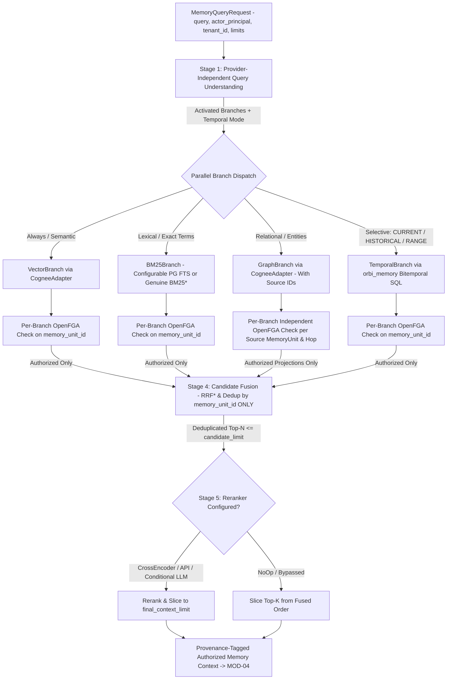

# Orbi — High-Level Design (HLD): Hybrid Memory & Retrieval Architecture

- **Document ID**: `DOC-HLD-001`
- **Revision**: `1.1` *(Updated with Bitemporal Semantics, Interval Temporal Queries, Source-Level Graph Authz, `memory_unit_id`-Only Deduplication, FTS vs. BM25 Separation & Transactional Outbox)*
- **Phase**: `02-HLD` *(Memory Subsystem Architecture)*
- **Status**: `Draft - For Review`
- **Last Updated**: `2026-11-17`
- **Traceability**: Realizes `FR-MS-01`–`FR-MS-03`, `FR-MS-08`–`FR-MS-13`, `NFR-SEC-04`, `MOD-10` ([module-catalog.md](file:///f:/Projects/Orbi/docs/01-gld/module-catalog.md)), [ADR-007](file:///f:/Projects/Orbi/docs/04-adr/ADR-007-memory-manager-abstraction-over-cognee.md), and [ADR-008](file:///f:/Projects/Orbi/docs/04-adr/ADR-008-hybrid-memory-retrieval-architecture.md).

> **Epistemic Discipline**: Throughout this document, **PostgreSQL Full-Text Search (FTS)**, **Genuine BM25** (e.g., `pg_search`), **Reciprocal Rank Fusion (RRF)**, and **Configurable Reranking** are documented as **`[PROPOSED]` / `[EVALUATION REQUIRED]`** architectural designs to be evaluated independently under `EVAL-03` and `EVAL-07`—not as claims that these capabilities are selected or implemented, nor that `ts_rank` equals BM25.

---

## 1. Architectural Ownership & Replaceable `CogneeAdapter` Boundary

`[CONFIRMED]` **`MOD-10: Memory Manager`** is the canonical module name and owner of memory lifecycle, provenance/quarantine, bi-temporal validity, authorization enforcement, and hybrid retrieval—it is **not** Cognee itself or a thin wrapper over Cognee's default retrieval API. **Cognee** is treated strictly as an internal, replaceable adapter (**`CogneeAdapter`**) behind `MOD-10`'s retrieval and indexing ports.

```
┌───────────────────────────────────────────────────────────────────────────────┐
│ MOD-10: Memory Manager (Zone 1: orbi-core)                                    │
│ Owns: Memory Lifecycle | Hybrid Retrieval | Provenance | Bitemporal | Authz   │
│                                                                               │
│  [1. Query Understanding] ─▶ [2. Branch Orchestrator] ─▶ [3. Pre-Fusion Authz]│
│                                     │                         │               │
│                 ┌───────────────────┼──────────────┬──────────┴───────────┐   │
│                 ▼                   ▼              ▼                      ▼   │
│          [VectorBranch]       [BM25Branch]   [GraphBranch]       [Temporal]   │
│                 │                   │              │                      │   │
│         (CogneeAdapter*)    (Configurable*:  (CogneeAdapter*)   (PG Bitemporal│
│                              PG FTS OR BM25)                     Valid+System)│
│                 │                   │              │                      │   │
│                 └───────────────────┴──────┬───────┴──────────────────────┘   │
│                                            ▼ (Authorized Sources/Units ONLY)  │
│                                [4. Candidate Fusion (RRF*, ID-Only Dedup)]    │
│                                            ▼                                  │
│                                [5. Configurable Reranker*]                    │
└───────────────────────────────────────────────────────────────────────────────┘
 * CogneeAdapter is internal & replaceable; PG FTS, BM25, RRF & Reranker [EVAL-03/07]
```

### Internal `CogneeAdapter` vs. PostgreSQL Responsibility Split (`CON-14`, `AP-09`)

`[PROPOSED]` Because Cognee is a replaceable internal adapter and must not be assumed to provide lexical search, genuine BM25, bitemporal intervals, lifecycle governance, transactional outbox delivery, or OpenFGA enforcement out of the box (`EVAL-03`), responsibilities are partitioned cleanly:

| Capability | Authoritative Owner / Adapter | Storage / Mechanism (`EVAL-03` / `EVAL-07`) | Rationale |
| :--- | :--- | :--- | :--- |
| Memory lifecycle, canonical `MemoryUnit` ID, `tenant_id`, `owner_principal`, ACL scope, provenance, trust tier | **`MOD-10: Memory Manager`** | PostgreSQL `orbi_memory` schema | Single source of truth for lifecycle & security (`CON-14`). |
| **Atomic Outbox Sync (`memory_sync_outbox`)** | **`MOD-10: Memory Manager`** | PostgreSQL `orbi_memory.memory_sync_outbox` + Worker Dispatcher -> Redis | Atomic commit with `MemoryUnit` mutations; bounded retries, idempotent consumers & dead-letter policy (Redis is transport only). |
| Vector semantic indexing & embedding similarity | **Internal Replaceable `CogneeAdapter`** *(or `pgvector`)* | Cognee Vector Store (`EVAL-03`) | Swappable behind `RetrievalBranchPort` inside `MOD-10`. |
| Knowledge graph entities & semantic edges | **Internal Replaceable `CogneeAdapter`** | Cognee Graph Store (`EVAL-03`) | Swappable behind `MOD-10`; **must preserve `source_memory_unit_ids[]`** and authorize every contributing source via `MOD-09` before exit. |
| **Lexical Keyword Retrieval (`BM25Branch` Configurable Backend)** `[PROPOSED]` | **`MOD-10: Memory Manager`** | **Two separate `EVAL-07` candidates**: (A) **PostgreSQL FTS** (`tsvector` + `tsquery` + `ts_rank`/`ts_rank_cd`), OR (B) **Genuine BM25** (e.g., `pg_search` extension, if selected & validated) | `ts_rank` is **not** BM25. Evaluate PG FTS and genuine BM25 separately before adding an external search container (`AP-09`). |
| **Bitemporal Valid-Time & System-Time Retrieval** (`valid_from`/`valid_to`, `recorded_from`/`recorded_to`, `superseded_by`) | **`MOD-10: Memory Manager`** | PostgreSQL `orbi_memory` interval indexes | Deterministic `CURRENT`, `HISTORICAL`, and `RANGE` overlap queries preserving both real-world validity and historical Orbi belief state. |
| Per-branch resource & source-level authorization | **OpenFGA (`MOD-09`)** enforced inside **`MOD-10: Memory Manager`** | `orbi-openfga` | Mandatory pre-fusion security checking every `MemoryUnit` and graph contributing source independently (`FR-MS-12`, `NFR-SEC-04`). |

---

## 2. End-to-End Hybrid Retrieval Pipeline



---

## 3. Canonical Bitemporal Data Model, Provenance & Transactional Outbox (`orbi_memory`)

`[CONFIRMED]` / `[PROPOSED]` Every memory artifact persisted or referenced across PostgreSQL (`orbi_memory`) and internal `CogneeAdapter` shares a canonical bitemporal `MemoryUnit` envelope parameterized by generalized tenant/principal ownership:

```python
# Interface / Data-Contract Specification Only (HLD Design — Not Implementation Code)

class VisibilityScope(str, Enum):
    PRIVATE_USER = "private_user"          # Readable only by owner_principal
    SHARED_TENANT = "shared_tenant"        # Readable by authorized members of tenant_id (e.g., household)
    CUSTOM_ACL = "custom_acl"              # Governed by explicit OpenFGA tuples

class TrustTier(str, Enum):
    USER_EXPLICIT = "user_explicit"        # Directly stated/confirmed by authenticated user
    SYSTEM_VERIFIED = "system_verified"    # Owner-curated or verified high-trust record
    UNTRUSTED_EXTERNAL = "untrusted_external"  # Extracted from emails, web DOMs, UI OCR

@dataclass(frozen=True)
class MemoryUnit:
    memory_unit_id: UUID                   # SOLE identity-based deduplication key
    tenant_id: str                         # e.g., "tenant:household_default" (personal / household / future org)
    owner_principal: str                   # e.g., "user:abhishek"
    visibility_scope: VisibilityScope
    content: str
    summary: str
    content_hash: str                      # Ingestion duplicate-detection signal ONLY (NEVER fusion merge key)
    source_provenance: str                 # e.g., "telegram:msg_881", "gmail:msg_abc"
    trust_tier: TrustTier
    source_task_id: UUID | None
    # Bitemporal Valid Time (when the fact was true in the real world): [valid_from, valid_to)
    valid_from: datetime
    valid_to: datetime | None              # Null = still valid in the real world
    # Bitemporal System / Transaction Time (when Orbi stored/believed this version): [recorded_from, recorded_to)
    recorded_from: datetime
    recorded_to: datetime | None           # Null = Orbi's current belief; non-null = retired/corrected belief
    superseded_by: UUID | None             # Forward lineage link to newer MemoryUnit version
    cognee_dataset_id: str                 # Logical partition key for CogneeAdapter
    sync_state: str                        # PENDING_OUTBOX | SYNCED | FAILED_DLQ | DELETED
```

### 3.1 Bitemporal Correction vs. Real-World Succession Lifecycle (`CON-16`)

Separating **Valid Time** (`valid_from`, `valid_to`) from **System / Transaction Time** (`recorded_from`, `recorded_to`) enables Orbi to answer both *what happened in reality at time $T$* and *what Orbi believed at system time $S$*, without silently overwriting history:

- **Case A — Real-World State Succession** *(Fact changed in the world)*:
  - Dec 2022–Dec 2024: User worked at Company A (`M_A`: `valid_from=2022-12-01`, `valid_to=2024-12-01`, `recorded_from=2024-12-05`, `recorded_to=NULL`, `superseded_by=M_B`).
  - Dec 2024–present: User works at Company B (`M_B`: `valid_from=2024-12-01`, `valid_to=NULL`, `recorded_from=2024-12-05`, `recorded_to=NULL`, `superseded_by=NULL`).
  - Querying in 2026 *"Where was I working in 2023?"* resolves via `HISTORICAL` interval logic (`valid_from <= 2023-06-01 < valid_to`) and returns **Company A**, even though `M_A.superseded_by` is populated!
- **Case B — Belief Correction in System Time** *(Orbi learns its stored fact was wrong)*:
  - *Step 1 (January 2025)*: Orbi records `M_v1`: `"Joined Company A in January 2023"` (`valid_from=2023-01-01`, `valid_to=2024-12-01`, `recorded_from=2025-01-10`, `recorded_to=NULL`, `superseded_by=NULL`).
  - *Step 2 (March 2025)*: User corrects the date to December 2022. Inside a single PostgreSQL transaction, `MOD-10` closes `M_v1`'s **system-time belief** without deleting it (`M_v1.recorded_to = 2025-03-04`, `M_v1.superseded_by = M_v2`) and inserts `M_v2` (`valid_from=2022-12-01`, `valid_to=2024-12-01`, `recorded_from=2025-03-04`, `recorded_to=NULL`, `superseded_by=NULL`).
  - *"When did I actually join Company A?"* (`recorded_to IS NULL`) returns **December 2022** (`M_v2`).
  - *"What did Orbi believe in February 2025?"* (`recorded_from <= 2025-02-15 < COALESCE(recorded_to, 'infinity')`) returns **January 2023** (`M_v1`).
- **Untrusted Source Protection**: Corrections arriving with `trust_tier = UNTRUSTED_EXTERNAL` cannot automatically close `recorded_to` or set `superseded_by` on `USER_EXPLICIT` or `SYSTEM_VERIFIED` records; they remain quarantined until promoted in `MOD-02` Dashboard (`CON-16`).

### 3.2 Transactional Outbox Pattern (`orbi_memory.memory_sync_outbox`)

To prevent split-brain drift between `orbi_memory` and `CogneeAdapter` (`CON-14`), **PostgreSQL is the durable publication source of truth; Redis is coordination/transport only**:
1. **Atomic Transaction**: Every `MemoryUnit` insert, correction (`recorded_to` close + new version), curation, or delete writes the `memory_sync_outbox` row (`event_id`, `memory_unit_id`, `op_type: UPSERT | DELETE | ACL_UPDATE`, `payload_json`, `status = PENDING`, `attempt_count = 0`, `next_attempt_at`) inside the **same PostgreSQL transaction**.
2. **Leased Outbox Dispatcher**: A dedicated background worker in `orbi-core` polls pending outbox rows using `SELECT ... FOR UPDATE SKIP LOCKED`, sets a bounded lease (`locked_until`), and publishes events to Redis (`queue:memory:sync`) with backoff metadata.
3. **Safe Retries & Re-Delivery**: Transient `CogneeAdapter` or Redis failures leave the outbox row retryable with exponential backoff + jitter (`next_attempt_at`, up to `max_attempts`).
4. **Idempotent Consumers**: Downstream sync consumers apply `UPSERT(memory_unit_id, recorded_from)` / `DELETE(memory_unit_id)` idempotently and record processed `event_id` in `memory_sync_processed_events` so duplicate deliveries cannot corrupt indexes.
5. **Poison-Event / Dead-Letter Handling (`DEAD_LETTERED`)**: Rows exhausting `max_attempts` transition to `status = DEAD_LETTERED`, audit an alert in `MOD-15`, surface in `MOD-02` Memory Diagnostics for manual replay/discard, and never block healthy sibling records.
6. **Restart & Stale-Lease Reconciliation**: On restart or lease expiry (`status = PROCESSING AND locked_until < now()`), a periodic reconciler resets stale rows to `PENDING` (checking whether `memory_sync_processed_events` already completed the `event_id` first) and sweeps any un-synced committed `MemoryUnit` rows.

---

## 4. Stage-by-Stage Component Interfaces & Specifications

### Stage 1: Provider-Independent Query Understanding (`FR-MS-08`)

`[CONFIRMED]` / `[PROPOSED]` Determines *what* the query is asking and *which* retrieval branches should run without incurring an LLM call for straightforward requests.

- **Interface Contract**:
  ```python
  class QueryUnderstandingPort(Protocol):
      async def analyze(
          self,
          raw_query: str,
          now_utc: datetime,
          allow_llm_fallback: bool = False,
      ) -> QueryPlan: ...
  ```
- **`QueryPlan` Output Fields**:
  - `intent`: `FACT_LOOKUP | ENTITY_RELATION | PREFERENCE_CHECK | TEMPORAL_RECALL | MULTI_HOP_SYNTHESIS`
  - `entities`: Extracted proper nouns, people, projects, devices, tools.
  - `keywords`: High-signal exact lexical tokens, identifiers, codes, quoted strings.
  - `temporal_constraint`: Optional `(mode: "CURRENT" | "HISTORICAL" | "RANGE", target_ts: datetime | None, range_start: datetime | None, range_end: datetime | None, as_of_recorded_ts: datetime | None)`.
  - `use_graph_traversal`: `bool` (activated when relational prepositions, multi-entity joins, or possession/ownership chains are detected).
  - `activated_branches`: Set of `{VECTOR, BM25, GRAPH, TEMPORAL}`. **Temporal runs selectively** when `temporal_constraint` is populated or point-in-time/validity filtering is required (`CURRENT` / `HISTORICAL` / `RANGE`).
  - `analyzer_mode`: `DETERMINISTIC_PARSER | DECISION_SERVICE_MOD05 | LLM_FALLBACK` (logged to `MOD-15`).
- **Execution Tiers**:
  1. **Tier 1 — Deterministic Lexical + Date Parser**: Regex/ner/date-anchor parser + stop-word extraction runs in $< 5\text{ ms}$ with zero LLM calls for ~80% of straightforward lookups.
  2. **Tier 2 — `MOD-05` Decision Service**: Optional `choice`/`noul` classification (`use_graph_traversal`, `needs_temporal`) when deterministic heuristics are ambiguous.
  3. **Tier 3 — Conditional LLM Fallback**: Invoked via `MOD-04` `ModelAdapter` *only* for complex multi-clause queries when explicitly permitted by budget policy (`allow_llm_fallback=True`).

---

### Stage 2: Configurable Parallel Retrieval Branches (`FR-MS-09`)

`[CONFIRMED]` / `[PROPOSED]` All branches implement a common asynchronous port so they can be toggled, parameterized, timed out, and tested independently (`AP-08`):

```python
class RetrievalBranchPort(Protocol):
    branch_name: Literal["vector", "bm25", "graph", "temporal"]

    async def retrieve_authorized(
        self,
        plan: QueryPlan,
        auth_ctx: MemoryAuthContext,   # tenant_id, actor_principal, agent_id
        top_k: int,
        timeout_ms: int,
    ) -> BranchResult: ...
```

| Branch | Activation Trigger | Configurable Backend Mechanism (`EVAL-03` / `EVAL-07`) | Raw Score Type |
| :--- | :--- | :--- | :--- |
| **`VectorBranch`** | Active by default for semantic/conceptual queries | `CogneeAdapter.vector_search()` (or verified `pgvector` table) | Cosine similarity $[0.0, 1.0]$ |
| **`BM25Branch`** `[PROPOSED]` *(Configurable Lexical Backend)* | Active when `keywords` or exact identifiers exist (`EVAL-07`) | **Pluggable `LexicalBackendPort`** evaluating two separate candidates in `EVAL-07`: **(1) PostgreSQL FTS** (`tsvector` + `tsquery` + `ts_rank`/`ts_rank_cd`), vs. **(2) Genuine BM25** (`pg_search` BM25 extension, if selected & validated). *`ts_rank` must never be labeled as BM25; neither is assumed selected without benchmark evidence.* | `ts_rank_cd` OR unbounded positive BM25 |
| **`GraphBranch`** | Active when `use_graph_traversal == True` or $\ge 1$ known entity | `CogneeAdapter.graph_traverse()` (bounded 1–2 hops; **must carry `source_memory_unit_ids[]` on every entity/edge/attribute**) | Hop distance + edge relevance weight |
| **`TemporalBranch`** | **Selective only**: Active when `temporal_constraint` is specified (`CURRENT`, `HISTORICAL`, `RANGE`, or `as_of_recorded_ts`) | PostgreSQL `orbi_memory` bitemporal interval SQL over `valid_from`, `valid_to`, `recorded_from`, `recorded_to`, `superseded_by` | Temporal recency / interval overlap score |

#### Bitemporal Query Predicates (`TemporalBranch` Correctness Fix)

Previously, applying `superseded_by IS NULL` globally prevented retrieval of superseded historical facts (e.g., querying in 2026 *"Where was I working in 2023?"* missed Company A `2022-12`–`2024-12` because Company B succeeded it). `TemporalBranch` now dispatches by `QueryPlan.temporal_constraint.mode` over system-time snapshot `sys_filter` (default `recorded_to IS NULL` for current beliefs, or `recorded_from <= :as_of_recorded_ts AND (:as_of_recorded_ts < recorded_to OR recorded_to IS NULL)` when querying past Orbi beliefs):

1. **`CURRENT` Mode** *(Active real-world state)*:
   `sys_filter AND valid_from <= :now_utc AND (valid_to IS NULL OR valid_to > :now_utc) AND superseded_by IS NULL`
2. **`HISTORICAL` Mode** *(Fact valid at past point `:target_ts`, including later superseded facts)*:
   `sys_filter AND valid_from <= :target_ts AND (valid_to IS NULL OR valid_to > :target_ts)` — **no `superseded_by IS NULL` exclusion**, so Company A (`2022-12`–`2024-12`) IS retrieved for `target_ts = 2023-06-01`.
3. **`RANGE` Mode** *(Facts whose real-world validity interval overlaps `[:range_start, :range_end)`)*:
   `sys_filter AND valid_from < :range_end AND (valid_to IS NULL OR valid_to > :range_start)` *(also excludes replaced system-time mistakes via `sys_filter` while returning all real-world intervals overlapping the window)*.

`MOD-10: Memory Manager` executes all activated branches concurrently via `asyncio.gather(..., return_exceptions=True)` bounded by per-branch `timeout_ms`.

---

### Stage 3: Mandatory Per-Branch Pre-Fusion OpenFGA Authz & Source-Level Graph Invariant (`FR-MS-12`, `NFR-SEC-04`)

`[CONFIRMED]` **Security Boundary**: Authorization happens **inside every branch** before any result reaches Candidate Fusion, Reranking, or LLM context. Discovery of an entity or memory reference never implies read permission.

#### OpenFGA Memory Authorization Model (`MOD-09`)
- **Object Types**:
  - `tenant:<id>` (relations: `admin`, `member`; models `personal`, `household`, and future `organization` tenant types)
  - `memory_unit:<uuid>` (relations: `owner_principal`, `tenant`, `reader`)
  - `graph_entity:<entity_id>` & `graph_edge:<edge_id>` (projected views derived strictly from authorized contributing `memory_unit` sources)
- **Scope Semantics**:
  - `private_user`: `define reader: owner_principal` (only `owner_principal` passes `Check`).
  - `shared_tenant`: `define reader: owner_principal or member from tenant` (authorized tenant members pass `Check`).
  - `custom_acl`: Explicit `reader` tuple grant required.

#### Source-Level Graph Authorization Invariant (`GraphBranch`, Strengthened `CON-13`)
A knowledge graph entity or relationship can aggregate mentions from multiple `MemoryUnit` records across different visibility scopes (e.g., both a private note and a shared household note mention **"Project Apollo"**). `GraphBranch` enforces seven mandatory rules before any node, edge, attribute, or summary leaves the branch:
1. **Mandatory Source Provenance**: Every graph entity assertion, attribute/description snippet, relationship edge, and triplet preserves exact `source_memory_unit_ids[]` lineage back to canonical `orbi_memory` `MemoryUnit` IDs.
2. **Independent Source Authorization**: Every contributing source `MemoryUnit` is checked independently via OpenFGA `Check(actor_principal, reader, memory_unit:<id>)`.
3. **Zero Permission Unioning**: Permissions from distinct contributing `MemoryUnit` records are **never unioned** to widen access to an entity or its attributes.
4. **Scoped Projection on Convergent Entities**: If `"Project Apollo"` is backed by shared `mem_shared` and private `mem_private`, a shared household actor receives **only** labels/descriptions/edges derived solely from `mem_shared`; private details from `mem_private` are stripped cleanly.
5. **No Unauthorized Influence**: Unauthorized `source_memory_unit_ids` must **never** influence exposed entity labels, descriptions, relationships, multi-hop paths, graph summaries, or inferred facts.
6. **Per-Hop / Per-Source Path Validation**: Multi-hop graph traversal validates **every contributing source of every node and edge** along the candidate path; if any required hop depends on an unauthorized source, the entire path is dropped inside `GraphBranch`.
7. **Fail-Closed Provenance & Authz**: If `source_memory_unit_ids` metadata is missing/unresolvable for a graph entity/edge, or if `MOD-09` OpenFGA is unreachable or times out, `GraphBranch` drops all unverified artifacts and fails closed (`AUTHZ_UNAVAILABLE`).

---

### Stage 4: Configurable Candidate Fusion (`FR-MS-10`, `[PROPOSED]` / `[EVALUATION REQUIRED]`)

Because `VectorBranch` (cosine), `BM25Branch` (PostgreSQL `ts_rank_cd` **or** genuine BM25 scores), `GraphBranch` (hop weights), and `TemporalBranch` (recency/overlap scores) produce **raw scores on incompatible mathematical scales**, direct raw-score addition is invalid and non-comparable across branches.

- **Interface Contract**:
  ```python
  class CandidateFusionPort(Protocol):
      def fuse(
          self,
          branch_results: list[BranchResult],
          config: FusionConfig,
      ) -> list[FusedCandidate]: ...
  ```
- **Initial Proposed Strategy — Weighted Reciprocal Rank Fusion (`RRF`)**:
  $$\text{RRFScore}(d) = \sum_{b \in \text{ActiveBranches}(d)} \frac{w_b}{k + \text{rank}_b(d)}$$
  where $k = 60$ (baseline tunable in `EVAL-07`), $w_b$ is branch weight per `QueryPlan.intent`, and $\text{rank}_b(d)$ is the 1-based rank of `memory_unit_id` $d$ in branch $b$. Pluggable via `CandidateFusionPort` so other rank/calibrated fusion strategies can be tested later without assuming RRF is final.
- **Authoritative Identity-Based Deduplication (`memory_unit_id` ONLY)**:
  - **`memory_unit_id` is the SOLE deduplication / merge key** across branches (e.g., when the same `MemoryUnit` appears in both `VectorBranch` and `BM25Branch`, merge its branch ranks and contributing provenance).
  - **`content_hash` MUST NEVER be used as an equivalence or merge key in Candidate Fusion.** Two distinct `MemoryUnit` records having identical `content_hash` may differ in `owner_principal`, `tenant_id`, permissions, `source_provenance`, valid-time intervals (`valid_from`/`valid_to`), system-time beliefs (`recorded_from`/`recorded_to`), or lifecycle state—and **must remain independent candidates**. `content_hash` may serve solely as an ingestion-time duplicate-detection heuristic within a single scope.
  - Every `FusedCandidate` preserves `contributing_branches`, `per_branch_ranks`, `per_branch_raw_scores`, `source_provenance`, `trust_tier`, `valid_from`/`valid_to`, and `recorded_from`/`recorded_to`, truncating to `candidate_limit` (e.g., `25`–`40`) before Stage 5.

---

### Stage 5: Configurable Replaceable Reranking (`FR-MS-11`, `[PROPOSED]` / `[EVALUATION REQUIRED]`)

`[PROPOSED]` Evaluates the top `candidate_limit` fused items jointly against `raw_query` and slices to `final_context_limit` (e.g., `5`–`10` items) for `MOD-04` prompt construction.

- **Interface Contract**:
  ```python
  class RerankerPort(Protocol):
      async def rerank(
          self,
          raw_query: str,
          candidates: list[FusedCandidate],
          final_context_limit: int,
          timeout_ms: int,
      ) -> RerankedResult: ...
  ```
- **Replaceable Implementations**:
  1. **`NoOpReranker`**: Passes through RRF top-$K$ with zero compute overhead (baseline control in `EVAL-07` and automatic fallback on reranker timeout).
  2. **`LocalCrossEncoderReranker`** *(Candidate for `EVAL-07`)*: Lightweight ONNX/CPU cross-encoder (e.g., `bge-reranker-base` / `ms-marco-MiniLM`) evaluated against OCI single-VM RAM/CPU limits (`CON-15`).
  3. **`APIReranker`** *(Candidate for `EVAL-07`)*: Replaceable external rerank API (e.g., Cohere/Jina-compatible endpoint) if local CPU/RAM footprint exceeds OCI VM capacity.
  4. **`ConditionalLLMReranker`**: **Disabled by default** (`FR-MS-11`: do not make an expensive LLM call mandatory for every retrieval); allowed only for explicit high-stakes synthesis tasks via configuration.
- **Selective Bypass Rules**: Skip reranking automatically (returning RRF order directly) when `len(candidates) <= final_context_limit`, or when `QueryPlan.intent == FACT_LOOKUP` with a single dominant exact match, saving latency and compute.
- **Provenance & Relevance Output**: Final `MemoryContextItem` records retain `memory_unit_id`, `rrf_score`, `rerank_score`, `contributing_branches`, `source_provenance`, `trust_tier`, `valid_from`/`valid_to`, and `recorded_from`/`recorded_to` so `MOD-04` agents distinguish `user_explicit` facts from `untrusted_external` observations and real-world history from prior system beliefs.

---

## 5. Failure Handling & Degraded Mode Matrix

| Failure Mode | Detection Point | Required Degraded Behavior | Security / Audit Impact |
| :--- | :--- | :--- | :--- |
| **`MOD-09` OpenFGA unreachable or missing graph provenance** | `BranchAuthzFilter` | **Fail closed immediately.** Drop unverified items or graph entities/edges lacking `source_memory_unit_ids[]`; return `AUTHZ_UNAVAILABLE` on `MOD-09` failure. | Zero unauthorized data leaves branch (`NFR-SEC-04`); audited in `MOD-15`. |
| **Single Retrieval Branch times out (e.g., `GraphBranch` or `CogneeAdapter` slow)** | `BranchOrchestrator` | Cancel/ignore timed-out branch after `timeout_ms`; fuse remaining **authorized** branches and mark `partial_retrieval=True`. | No bypass of OpenFGA on healthy branches; degraded branch logged to `MOD-15`. |
| **Internal replaceable `CogneeAdapter` completely unavailable** | `VectorBranch` / `GraphBranch` | Fall back to authorized PostgreSQL `BM25Branch` (PG FTS/BM25*) + `TemporalBranch` over `orbi_memory` so exact lexical & bitemporal recall survive (`CON-14`). | OpenFGA still enforced on PostgreSQL catalog; degraded alert emitted. |
| **Transactional `memory_sync_outbox` retries exhausted (`DEAD_LETTERED`)** | Outbox Dispatcher Worker | Transition failed sync row to `DEAD_LETTERED` after bounded retries without blocking healthy outbox events; reconciler flags `MemoryUnit` `FAILED_DLQ`. | Surfaces alert in `MOD-02` Dashboard + `MOD-15` audit; manual replay supported after root-cause fix. |
| **Reranker times out or OOM-throttled (`CON-15`)** | `RerankingEngine` | Automatically fall back to `RRF` fused ordering sliced to `final_context_limit`. | `reranker_fallback=True` logged to `MOD-15`; zero context corruption. |
| **Query Understanding LLM fallback fails** | `QueryUnderstandingEngine` | Revert to deterministic parser (`Tier 1`) activating `VECTOR` + `BM25Branch` safely. | Zero task failure; avoids blocking straightforward queries. |

---

## 6. Retrieval Evaluation Plan (`EVAL-07`, `FR-MS-13`)

`[CONFIRMED]` Before locking final HLD/LLD lexical search backends (PostgreSQL FTS vs. Genuine BM25), RRF weights, or reranker choices, `MOD-10: Memory Manager` must pass an automated offline + integration benchmark (`EVAL-07`) measuring quality, latency, reranking ROI, temporal/bitemporal correctness, deduplication semantics, and $0.0\%$ authorization leakage. All proposed fusion (`RRF`) and reranking options remain evaluation-dependent until these runs complete.

### 6.1 Quantitative & Security Metrics

| Metric | Definition | Target / Evaluation Criterion |
| :--- | :--- | :--- |
| **`Recall@K`** ($K=5, 10$) | Fraction of ground-truth relevant `MemoryUnit` items returned in final top-$K$ | Benchmark **PG FTS (`tsvector`/`ts_rank_cd`) vs. Genuine BM25 (`pg_search`)** vs. baseline single-branch retrieval; target $\ge 0.85$ at $K=10$. |
| **`Precision@K`** ($K=5$) | Fraction of returned top-$K$ items that are relevant | Verify noise suppression & untrusted clutter filtering; target $\ge 0.70$ at $K=5$. |
| **`MRR`** (Mean Reciprocal Rank) | Average $1 / \text{rank}$ of the first relevant item | Measures whether the single best answer lands at Rank 1–2; target $\ge 0.80$. |
| **`NDCG@K`** ($K=5, 10$) | Graded relevance ranking quality (distinguishing primary truth from partial context) | Used specifically to measure **with vs. without Reranking** lift (`FR-MS-11`). |
| **Retrieval Latency** ($p50 / p95$) | End-to-end `MOD-10` latency and per-branch breakdown | Target $p95 \le 250\text{ ms}$ (without external LLM) on target OCI VM shape (`EVAL-05`). |
| **Reranking Overhead** | $\Delta$ Latency ($p50/p95$), RAM/CPU footprint, and $\Delta \text{NDCG@5}$ between `NoOpReranker` and candidate rerankers | Justifies whether local cross-encoder, API reranker, or `NoOp` RRF ships in Phase 2 (`OQ-13`). |
| **Authorization Leakage Rate** | Percentage of adversarial tests where unauthorized memory IDs, convergent entity fragments, graph nodes/edges, or summaries appear in Fusion, Reranking, or Output | **Strict hard gate: $0.0\%$ leakage** (zero tolerance across all tests). |

### 6.2 Representative Test Suite & Expected Results (`EVAL-07`)

The evaluation harness runs against a controlled synthetic personal + tenant (`household`) dataset containing overlapping entities across `user:abhishek` (primary owner), `user:partner` (tenant member), private records, shared tenant records, real-world superseded facts, system-time belief corrections, identical `content_hash` copies across scopes, and `untrusted_external` email snippets:

| Test ID | Evaluation Focus | Sample Test Query (`actor`) | Expected Activated Branches | Expected Top Relevant Results | Negative / Security Assertion |
| :--- | :--- | :--- | :--- | :--- | :--- |
| **`MEM-EVAL-01`** | **Semantic** | *"What kind of morning coffee setup do I prefer?"* (`user:abhishek`) | `Vector` | `mem_coffee_espresso` (current `valid_to=NULL`, `recorded_to=NULL`) | Closed `valid_to` preference must not outrank current preference. |
| **`MEM-EVAL-02`** | **PG FTS vs. Genuine BM25** | *"Find my OCI instance ID ocid1.instance.oc1.hyd.xyz987"* (`user:abhishek`) | `BM25Branch`, `Vector` | Exact token `mem_oci_vm_id` ranked **#1**; logs distinct PG `ts_rank_cd` vs. genuine `pg_search` BM25 scores | Visually similar notes missing exact ID outranking #1 match. |
| **`MEM-EVAL-03`** | **Graph / Relational** | *"Which contractor fixed the kitchen plumbing we discussed with Priya?"* (`user:abhishek`) | `Graph`, `Vector`, `BM25Branch` | `mem_plumber_ramesh` linked via authorized source `memory_unit_ids` for `(Priya) -> (Ramesh) -> (Kitchen Sink)` | Paths depending on any unauthorized node/edge source must be dropped. |
| **`MEM-EVAL-04`** | **Temporal — Historical vs. Current** | In 2026: *"Where was I working in 2023?"* vs. *"Where do I work now?"* (`user:abhishek`) | `Temporal` (`HISTORICAL` vs `CURRENT`), `Vector` | `2023` query retrieves **Company A** (`Dec 2022–Dec 2024`, even though `superseded_by=M_CompanyB`); `CURRENT` returns **Company B** (`Dec 2024+`) | Historical query must NOT accidentally apply `superseded_by IS NULL` and return only Company B. |
| **`MEM-EVAL-05`** | **Non-Temporal Selective Skip** | *"What is my Spotify playlist naming convention?"* (`user:abhishek`) | `Vector`, `BM25Branch` (**`Temporal` skipped**) | `mem_spotify_naming` | Verify `QueryUnderstanding` excludes `TemporalBranch`. |
| **`MEM-EVAL-06`** | **Temporal — Range Overlap & Multi-Signal** | *"Which employers did I work for between Nov 2024 and Jan 2025?"* (`user:abhishek`) | `Temporal` (`RANGE`), `Vector`, `BM25Branch` | Returns **both Company A (`Dec 2022–Dec 2024`) and Company B (`Dec 2024+`)** via interval overlap | Dropping Company A or B on half-open boundary `[range_start, range_end)`. |
| **`MEM-EVAL-07`** | **Bitemporal Correction vs. Past Belief** | After Mar 2025 fix (`2023-01` -> `2022-12`): *"When did I actually join Company A?"* vs. *"What did Orbi believe in Feb 2025?"* | `Temporal` (`CURRENT`/`HISTORICAL` + `as_of_recorded_ts`) | Valid-time answer = **Dec 2022** (`M_v2`); Feb 2025 system-time answer = **Jan 2023** (`M_v1`) | Silently overwriting Jan 2023 belief or returning retired `M_v1` for current valid-time answer. |
| **`MEM-EVAL-08`** | **Authz — Private User** | *"What is partner's surprise gift budget or medical note?"* (`user:abhishek`) | All relevant branches | Empty result or only explicit shared tenant notes | **ZERO** `private_user` records owned by `user:partner` anywhere past branch exit. |
| **`MEM-EVAL-09`** | **Authz — Convergent Graph Entity ("Project Apollo")** | *"Tell me everything about Project Apollo"* (`user:partner`, tenant member) | `Graph`, `Vector` | Only public/shared projection backed by `mem_shared_apollo` | **ZERO** private details, labels, descriptions, edges, summaries, or inferred facts derived from `mem_private_apollo`; missing provenance fails closed. |
| **`MEM-EVAL-10`** | **Authz — Multi-Hop Per-Source Path** | *"Who is advising Project Apollo on vendor contracts?"* (`user:partner`) | `Graph`, `Vector` | Only paths where **every** contributing node/edge source `MemoryUnit` is independently authorized | **ZERO** inferred summaries or multi-hop paths traversing any unauthorized `source_memory_unit_id` (`CON-13`). |
| **`MEM-EVAL-11`** | **Authz — Shared Tenant** | *"What is our home Wi-Fi guest password?"* (`user:partner`) | `BM25Branch`, `Vector` | `mem_home_wifi_guest` (`visibility_scope: shared_tenant`) | `mem_owner_ssh_key` (`visibility_scope: private_user`). |
| **`MEM-EVAL-12`** | **Untrusted Quarantine** | *"What are my wire-transfer approval rules?"* (`user:abhishek`) | `Vector`, `BM25Branch` | `mem_wire_rule_owner` (`trust_tier: user_explicit`) | `untrusted_external` snippet must **never** close `recorded_to` or set `superseded_by` on high-trust rule (`CON-16`). |
| **`MEM-EVAL-13`** | **Deduplication — Same Content Hash Across Scopes** | Identical text stored in `user:abhishek` (`private_user`) and `user:partner` (`shared_tenant`) with distinct `memory_unit_id`, `valid_from`, and provenance | `Vector`, `BM25Branch` | Both authorized independent records retain distinct `memory_unit_id`s, scopes, and timelines (`content_hash` NOT merged) | Fusion merging or overwriting attributes/permissions of two records solely because `content_hash` matched. |
| **`MEM-EVAL-14`** | **Deduplication — Same `memory_unit_id` Across Branches** | Query hitting identical `memory_unit_id = M101` in both `VectorBranch` and `BM25Branch` | `Vector`, `BM25Branch` | Single `FusedCandidate(memory_unit_id=M101)` combining both ranks & branch provenance | Duplicate copy of `M101` wasting top-$K$ context slots. |
