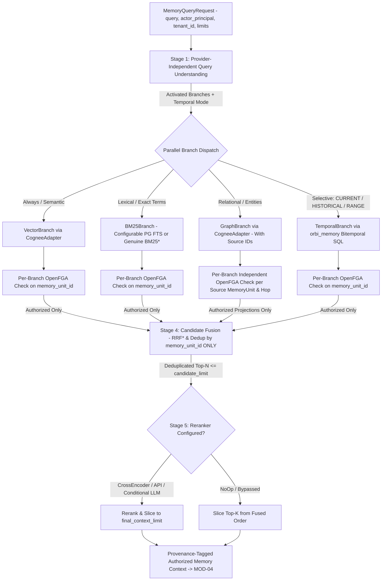
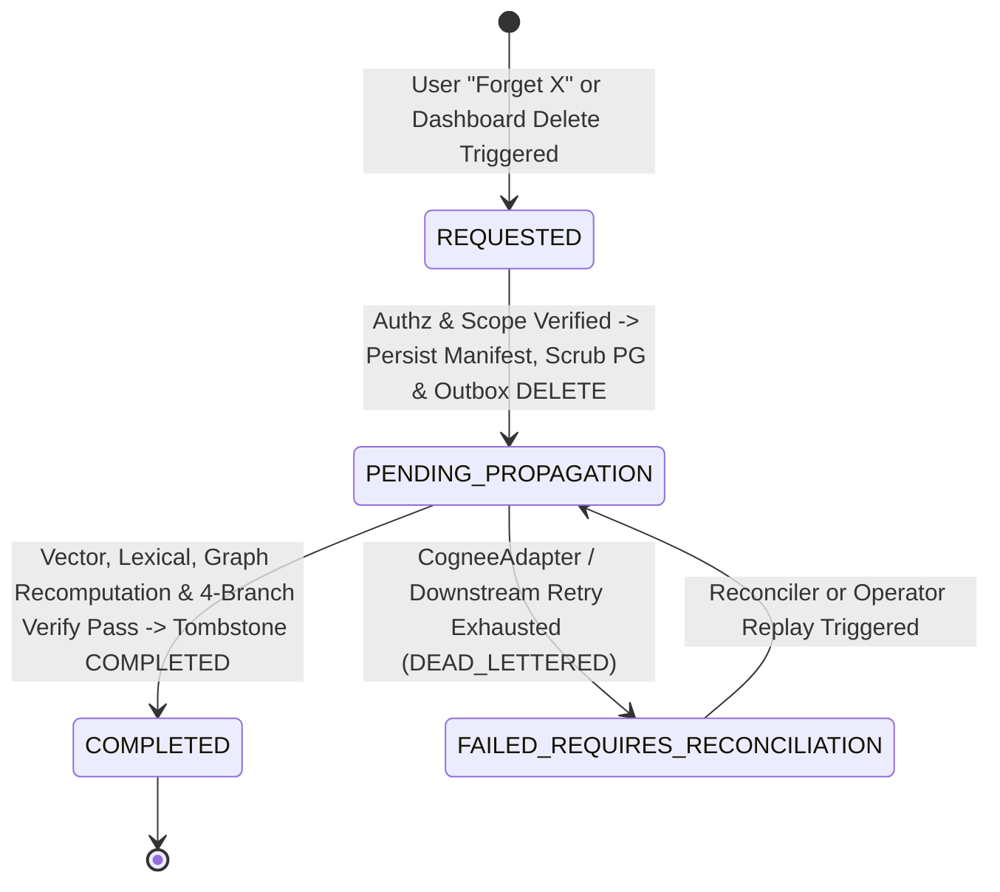

# Orbi — High-Level Design (HLD): Hybrid Memory & Retrieval Architecture

- **Document ID**: `DOC-HLD-001`
- **Revision**: `1.3` *(Final HLD Safety Refinement: Authoritative 4-Branch Pre-Fusion Deletion/Tombstone Gate, Pre-Scrub `deletion_dependency_manifest`, Terminal Tombstone State `COMPLETED` & HITL `NEEDS_CLARIFICATION` Integration)*
- **Phase**: `02-HLD` *(Memory Subsystem Architecture)*
- **Status**: `Draft - For Review`
- **Last Updated**: `2026-11-17`
- **Traceability**: Realizes `FR-MS-01`–`FR-MS-03`, `FR-MS-08`–`FR-MS-14`, `FR-TM-06`, `NFR-SEC-04`, `MOD-10` & `MOD-03` (`HumanInteractionManager`) ([module-catalog.md](file:///f:/Projects/Orbi/docs/01-gld/module-catalog.md)), [ADR-007](file:///f:/Projects/Orbi/docs/04-adr/ADR-007-memory-manager-abstraction-over-cognee.md), and [ADR-008](file:///f:/Projects/Orbi/docs/04-adr/ADR-008-hybrid-memory-retrieval-architecture.md).

> **Epistemic Discipline**: Throughout this document, **PostgreSQL Full-Text Search (FTS)**, **Genuine BM25** (e.g., `pg_search`), **Reciprocal Rank Fusion (RRF)**, and **Configurable Reranking** are documented as **`[PROPOSED]` / `[EVALUATION REQUIRED]`** architectural designs to be evaluated independently under `EVAL-03` and `EVAL-07`—not as claims that these capabilities are selected or implemented, nor that `ts_rank` equals BM25.

---

## 1. Architectural Ownership & Replaceable `CogneeAdapter` Boundary

`[CONFIRMED]` **`MOD-10: Memory Manager`** is the canonical module name and owner of memory lifecycle, provenance/quarantine, bi-temporal validity, authorization enforcement, and hybrid retrieval—it is **not** Cognee itself or a thin wrapper over Cognee's default retrieval API. **Cognee** is treated strictly as an internal, replaceable adapter (**`CogneeAdapter`**) behind `MOD-10`'s retrieval and indexing ports.

```
┌───────────────────────────────────────────────────────────────────────────────┐
│ MOD-10: Memory Manager (Zone 1: orbi-core)                                    │
│ Owns: Lifecycle & Resolution | Hybrid Retrieval | Provenance | Bitemporal |   │
│       Authorization Enforcement | Explicit Deletion                           │
│                                                                               │
│ WRITE / LIFECYCLE PATH (§5–§6):                                               │
│  [Candidate] ─▶ [MemoryResolutionEngine] ─▶ CREATE|REINFORCE|REFINE|SUPERSEDE │
│                       │                  └─▶ NEEDS_CLARIFICATION              │
│  [Forget Req] ─▶ [ExplicitDeletionOrchestrator] ─▶ REQUESTED -> PENDING -> OK │
│                       └─▶ (Atomic PG orbi_memory + memory_sync_outbox)        │
│                                                                               │
│ READ / HYBRID RETRIEVAL PATH (§2, §4):                                        │
│  [1. Query Understanding] ─▶ [2. Branch Orchestrator] ─▶ [3. Pre-Fusion Authz]│
│                                     │                         │               │
│                 ┌───────────────────┼──────────────┬──────────┴───────────┐   │
│                 ▼                   ▼              ▼                      ▼   │
│          [VectorBranch]       [BM25Branch]   [GraphBranch]       [Temporal]   │
│         (CogneeAdapter*)    (Configurable*:  (CogneeAdapter*)   (PG Bitemporal│
│                              PG FTS OR BM25)                     Valid+System)│
│                 └───────────────────┴──────┬───────┴──────────────────────┘   │
│                                            ▼ (Authorized Sources/Active Only) │
│                                [4. Candidate Fusion (RRF*, ID-Only Dedup)]    │
│                                            ▼                                  │
│                                [5. Configurable Reranker*]                    │
└───────────────────────────────────────────────────────────────────────────────┘
 * CogneeAdapter is internal & replaceable; PG FTS, BM25, RRF & Reranker [EVAL-03/07]
```

### Internal `CogneeAdapter` vs. PostgreSQL Responsibility Split (`CON-14`, `AP-09`)

`[PROPOSED]` Because Cognee is a replaceable internal adapter and must not be assumed to provide lexical search, genuine BM25, bitemporal intervals, memory resolution, explicit deletion workflows, transactional outbox delivery, or OpenFGA enforcement out of the box (`EVAL-03`), responsibilities are partitioned cleanly:

| Capability | Authoritative Owner / Adapter | Storage / Mechanism (`EVAL-03` / `EVAL-07`) | Rationale |
| :--- | :--- | :--- | :--- |
| Memory lifecycle, **Memory Resolution Engine** (`CREATE`/`REINFORCE`/`REFINE`/`SUPERSEDE`/`NEEDS_CLARIFICATION`), **Explicit Deletion** (`REQUESTED`->`COMPLETED`), canonical `MemoryUnit` ID, `tenant_id`, `owner_principal`, provenance, trust tier | **`MOD-10: Memory Manager`** | PostgreSQL `orbi_memory` schema (`memory_units`, `memory_resolution_candidates`, `memory_deletion_requests`) | Internal `MOD-10` responsibility; single authoritative system of record (`CON-14`). |
| **Atomic Outbox Sync (`memory_sync_outbox`)** | **`MOD-10: Memory Manager`** | PostgreSQL `orbi_memory.memory_sync_outbox` + Worker Dispatcher -> Redis | Atomic commit with every resolution & deletion mutation; bounded retries, idempotent consumers & dead-letter policy. |
| Vector semantic indexing & embedding similarity | **Internal Replaceable `CogneeAdapter`** *(or `pgvector`)* | Cognee Vector Store (`EVAL-03`) | Swappable behind `RetrievalBranchPort` inside `MOD-10`. |
| Knowledge graph entities & semantic edges | **Internal Replaceable `CogneeAdapter`** | Cognee Graph Store (`EVAL-03`) | Swappable behind `MOD-10`; **must preserve `source_memory_unit_ids[]`** and authorize every contributing source via `MOD-09` before exit. |
| **Lexical Keyword Retrieval (`BM25Branch` Configurable Backend)** `[PROPOSED]` | **`MOD-10: Memory Manager`** | **Two separate `EVAL-07` candidates**: (A) **PostgreSQL FTS** (`tsvector` + `tsquery` + `ts_rank`/`ts_rank_cd`), OR (B) **Genuine BM25** (e.g., `pg_search` extension, if selected & validated) | `ts_rank` is **not** BM25. Evaluate PG FTS and genuine BM25 separately before adding an external search container (`AP-09`). |
| **Bitemporal Valid-Time & System-Time Retrieval** (`valid_from`/`valid_to`, `recorded_from`/`recorded_to`, `superseded_by`) | **`MOD-10: Memory Manager`** | PostgreSQL `orbi_memory` interval indexes | Deterministic `CURRENT`, `HISTORICAL`, and `RANGE` overlap queries preserving both real-world validity and historical Orbi belief state. |
| Per-branch resource & source-level authorization | **OpenFGA (`MOD-09`)** enforced inside **`MOD-10: Memory Manager`** | `orbi-openfga` | Mandatory pre-fusion security checking every `MemoryUnit` and graph contributing source independently (`FR-MS-12`, `NFR-SEC-04`). |

---

## 2. End-to-End Hybrid Retrieval Pipeline



---

## 3. Canonical Bitemporal Data Model, Provenance & Transactional Outbox (`orbi_memory`)

`[CONFIRMED]` / `[PROPOSED]` Every memory artifact persisted or referenced across PostgreSQL (`orbi_memory`) and internal `CogneeAdapter` shares a canonical bitemporal `MemoryUnit` envelope parameterized by generalized tenant/principal ownership:

```python
# Interface / Data-Contract Specification Only (HLD Design — Not Implementation Code)

class VisibilityScope(str, Enum):
    PRIVATE_USER = "private_user"          # Readable only by owner_principal
    SHARED_TENANT = "shared_tenant"        # Readable by authorized members of tenant_id (e.g., household)
    CUSTOM_ACL = "custom_acl"              # Governed by explicit OpenFGA tuples

class TrustTier(str, Enum):
    USER_EXPLICIT = "user_explicit"        # Directly stated/confirmed by authenticated user
    SYSTEM_VERIFIED = "system_verified"    # Owner-curated or verified high-trust record
    UNTRUSTED_EXTERNAL = "untrusted_external"  # Extracted from emails, web DOMs, UI OCR

class ResolutionOrigin(str, Enum):
    CREATE = "CREATE"
    REINFORCE = "REINFORCE"
    REFINE = "REFINE"
    SUPERSEDE_SUCCESSION = "SUPERSEDE_SUCCESSION"
    SUPERSEDE_CORRECTION = "SUPERSEDE_CORRECTION"

class DeletionState(str, Enum):
    ACTIVE = "ACTIVE"
    REQUESTED = "REQUESTED"
    PENDING_PROPAGATION = "PENDING_PROPAGATION"
    COMPLETED = "COMPLETED"
    FAILED_REQUIRES_RECONCILIATION = "FAILED_REQUIRES_RECONCILIATION"

@dataclass(frozen=True)
class MemoryUnit:
    memory_unit_id: UUID                   # SOLE identity-based deduplication key
    tenant_id: str                         # e.g., "tenant:household_default" (personal / household / future org)
    owner_principal: str                   # e.g., "user:abhishek"
    visibility_scope: VisibilityScope
    content: str
    summary: str
    content_hash: str                      # Ingestion duplicate-detection signal ONLY (NEVER fusion merge key)
    source_provenance: str                 # Primary source, e.g., "telegram:msg_881", "gmail:msg_abc"
    corroborating_provenance: list[str]    # Additional independent sources confirming via REINFORCE
    confirmation_count: int                # Incremented atomically by REINFORCE (default: 1)
    last_confirmed_at: datetime | None     # Timestamp of latest independent confirmation
    trust_tier: TrustTier
    source_task_id: UUID | None
    resolution_origin: ResolutionOrigin
    # Bitemporal Valid Time (when the fact was true in the real world): [valid_from, valid_to)
    valid_from: datetime
    valid_to: datetime | None              # Null = still true in the real world
    # Bitemporal System / Transaction Time (when Orbi stored/believed this version): [recorded_from, recorded_to)
    recorded_from: datetime
    recorded_to: datetime | None           # Null = Orbi's active belief; non-null = retired/closed belief
    # Forward Lineage Pointer (DISTINCT from recorded_to): points to newer replacement MemoryUnit ID
    superseded_by: UUID | None
    cognee_dataset_id: str                 # Logical partition key for CogneeAdapter
    deletion_state: DeletionState          # ACTIVE | REQUESTED | PENDING_PROPAGATION | COMPLETED | FAILED_REQUIRES_RECONCILIATION
    sync_state: str                        # PENDING_OUTBOX | SYNCED | FAILED_DLQ
```

### 3.1 Explicit Bitemporal Semantics & `superseded_by` Invariants (`CON-16`)

Orbi explicitly separates **two independent temporal dimensions** plus forward version lineage—none of these fields replaces another:
- **Valid Time (`valid_from`, `valid_to`)**: When the fact was true in the **real world** (e.g., employment start/end dates). Closing `valid_to` records that a state ended in reality.
- **System / Transaction Time (`recorded_from`, `recorded_to`)**: When **Orbi recorded or believed** that `MemoryUnit` version. Closing `recorded_to` retires a prior belief without erasing what Orbi believed earlier.
- **Forward Lineage (`superseded_by`)**: Identifies the newer replacement `memory_unit_id`. Where a correction or succession supersedes an old belief, both `recorded_to` and `superseded_by` are updated atomically in the same transaction, **but their meanings remain distinct** (`recorded_to` bounds system-time validity; `superseded_by` links the lineage chain).
- **`CURRENT` Query Lifecycle Invariant**: Every active current-belief record (`recorded_to IS NULL AND deletion_state = 'ACTIVE'`) MUST preserve `superseded_by IS NULL`. When **real-world succession** occurs (*"Left Company A in Dec 2024 and joined Company B"*), `MOD-10` performs: (1) retire `M_A_open` (`valid_to=NULL`) by closing `recorded_to = now`, setting `superseded_by = M_A_closed`, and inserting `M_A_closed` (`valid_from=2022-12, valid_to=2024-12, recorded_to=NULL, superseded_by=NULL`); and (2) insert `M_B` (`valid_from=2024-12, valid_to=NULL, recorded_to=NULL, superseded_by=NULL`). Because both `M_A_closed` and `M_B` have `superseded_by IS NULL` and `valid_to` accurately bounds reality, **`CURRENT` queries never accidentally hide valid active facts, and `HISTORICAL` queries retrieve Company A accurately without excluding historical beliefs.**

- **Worked Case A — Real-World State Succession**:
  - `M_A_closed`: `valid_from=2022-12-01, valid_to=2024-12-01, recorded_from=2024-12-05, recorded_to=NULL, superseded_by=NULL`
  - `M_B`: `valid_from=2024-12-01, valid_to=NULL, recorded_from=2024-12-05, recorded_to=NULL, superseded_by=NULL`
  - Asking in 2026 *"Where was I working in 2023?"* (`HISTORICAL`, `target_ts=2023-06-01`) returns **Company A**.
- **Worked Case B — Combined Valid-Time + System-Time Belief Query**:
  - *Step 1 (January 2025)*: Orbi learns `M_v1`: `"Joined Company A in January 2023"` (`valid_from=2023-01-01, valid_to=2024-12-01, recorded_from=2025-01-10, recorded_to=NULL, superseded_by=NULL`).
  - *Step 2 (March 2025)*: User corrects joining date to December 2022. Atomically: `M_v1.recorded_to = 2025-03-04`, `M_v1.superseded_by = M_v2`; `M_v2` inserted (`valid_from=2022-12-01, valid_to=2024-12-01, recorded_from=2025-03-04, recorded_to=NULL, superseded_by=NULL`).
  - *"When did I actually join Company A?"* (`as_of_recorded_ts=NULL`) -> **December 2022** (`M_v2`).
  - *"What did Orbi believe on February 1, 2025, about where I worked on June 1, 2023?"* requires **both dimensions simultaneously**:
    - **`QueryPlan.temporal_constraint`**: `(mode="HISTORICAL", target_ts="2023-06-01T00:00:00Z", as_of_recorded_ts="2025-02-01T00:00:00Z")`
    - **PostgreSQL `TemporalBranch` Predicate**:
      ```sql
      SELECT * FROM orbi_memory.memory_units
      WHERE deletion_state = 'ACTIVE'
        AND recorded_from <= '2025-02-01T00:00:00Z'
        AND (recorded_to IS NULL OR recorded_to > '2025-02-01T00:00:00Z')
        AND valid_from    <= '2023-06-01T00:00:00Z'
        AND (valid_to IS NULL OR valid_to > '2023-06-01T00:00:00Z');
      -- NOTE: No superseded_by IS NULL filter! Returns M_v1 (January 2023 join date belief).
      ```
- **Untrusted Source Protection**: Corrections arriving with `trust_tier = UNTRUSTED_EXTERNAL` cannot automatically close `recorded_to`, set `superseded_by`, or close `valid_to` on `USER_EXPLICIT` or `SYSTEM_VERIFIED` records; they route to `NEEDS_CLARIFICATION` quarantine (`CON-16`).

### 3.2 Transactional Outbox Pattern (`orbi_memory.memory_sync_outbox`)

To prevent split-brain drift between `orbi_memory` and `CogneeAdapter` (`CON-14`), **PostgreSQL is the durable publication source of truth; Redis is coordination/transport only**:
1. **Atomic Transaction**: Every `MemoryUnit` insert, correction (`recorded_to` close + new version), curation, or delete writes the `memory_sync_outbox` row (`event_id`, `memory_unit_id`, `op_type: UPSERT | DELETE | ACL_UPDATE`, `payload_json`, `status = PENDING`, `attempt_count = 0`, `next_attempt_at`) inside the **same PostgreSQL transaction**.
2. **Leased Outbox Dispatcher**: A dedicated background worker in `orbi-core` polls pending outbox rows using `SELECT ... FOR UPDATE SKIP LOCKED`, sets a bounded lease (`locked_until`), and publishes events to Redis (`queue:memory:sync`) with backoff metadata.
3. **Safe Retries & Re-Delivery**: Transient `CogneeAdapter` or Redis failures leave the outbox row retryable with exponential backoff + jitter (`next_attempt_at`, up to `max_attempts`).
4. **Idempotent Consumers**: Downstream sync consumers apply `UPSERT(memory_unit_id, recorded_from)` / `DELETE(memory_unit_id)` idempotently and record processed `event_id` in `memory_sync_processed_events` so duplicate deliveries cannot corrupt indexes.
5. **Poison-Event / Dead-Letter Handling (`DEAD_LETTERED`)**: Rows exhausting `max_attempts` transition to `status = DEAD_LETTERED`, audit an alert in `MOD-15`, surface in `MOD-02` Memory Diagnostics for manual replay/discard, and never block healthy sibling records.
6. **Restart & Stale-Lease Reconciliation**: On restart or lease expiry (`status = PROCESSING AND locked_until < now()`), a periodic reconciler resets stale rows to `PENDING` (checking whether `memory_sync_processed_events` already completed the `event_id` first) and sweeps any un-synced committed `MemoryUnit` rows.

---

## 4. Stage-by-Stage Component Interfaces & Specifications

### Stage 1: Provider-Independent Query Understanding (`FR-MS-08`)

`[CONFIRMED]` / `[PROPOSED]` Determines *what* the query is asking and *which* retrieval branches should run without incurring an LLM call for straightforward requests.

- **Interface Contract**:
  ```python
  class QueryUnderstandingPort(Protocol):
      async def analyze(
          self,
          raw_query: str,
          now_utc: datetime,
          allow_llm_fallback: bool = False,
      ) -> QueryPlan: ...
  ```
- **`QueryPlan` Output Fields**:
  - `intent`: `FACT_LOOKUP | ENTITY_RELATION | PREFERENCE_CHECK | TEMPORAL_RECALL | MULTI_HOP_SYNTHESIS`
  - `entities`: Extracted proper nouns, people, projects, devices, tools.
  - `keywords`: High-signal exact lexical tokens, identifiers, codes, quoted strings.
  - `temporal_constraint`: Optional `(mode: "CURRENT" | "HISTORICAL" | "RANGE", target_ts: datetime | None, range_start: datetime | None, range_end: datetime | None, as_of_recorded_ts: datetime | None)`.
  - `use_graph_traversal`: `bool` (activated when relational prepositions, multi-entity joins, or possession/ownership chains are detected).
  - `activated_branches`: Set of `{VECTOR, BM25, GRAPH, TEMPORAL}`. **Temporal runs selectively** when `temporal_constraint` is populated or point-in-time/validity filtering is required (`CURRENT` / `HISTORICAL` / `RANGE`).
  - `analyzer_mode`: `DETERMINISTIC_PARSER | DECISION_SERVICE_MOD05 | LLM_FALLBACK` (logged to `MOD-15`).
- **Execution Tiers**:
  1. **Tier 1 — Deterministic Lexical + Date Parser**: Regex/ner/date-anchor parser + stop-word extraction runs in $< 5\text{ ms}$ with zero LLM calls for ~80% of straightforward lookups.
  2. **Tier 2 — `MOD-05` Decision Service**: Optional `choice`/`noul` classification (`use_graph_traversal`, `needs_temporal`) when deterministic heuristics are ambiguous.
  3. **Tier 3 — Conditional LLM Fallback**: Invoked via `MOD-04` `ModelAdapter` *only* for complex multi-clause queries when explicitly permitted by budget policy (`allow_llm_fallback=True`).

---

### Stage 2: Configurable Parallel Retrieval Branches (`FR-MS-09`)

`[CONFIRMED]` / `[PROPOSED]` All branches implement a common asynchronous port so they can be toggled, parameterized, timed out, and tested independently (`AP-08`):

```python
class RetrievalBranchPort(Protocol):
    branch_name: Literal["vector", "bm25", "graph", "temporal"]

    async def retrieve_authorized(
        self,
        plan: QueryPlan,
        auth_ctx: MemoryAuthContext,   # tenant_id, actor_principal, agent_id
        top_k: int,
        timeout_ms: int,
    ) -> BranchResult: ...
```

| Branch | Activation Trigger | Configurable Backend Mechanism (`EVAL-03` / `EVAL-07`) | Raw Score Type |
| :--- | :--- | :--- | :--- |
| **`VectorBranch`** | Active by default for semantic/conceptual queries | `CogneeAdapter.vector_search()` (or verified `pgvector` table) | Cosine similarity $[0.0, 1.0]$ |
| **`BM25Branch`** `[PROPOSED]` *(Configurable Lexical Backend)* | Active when `keywords` or exact identifiers exist (`EVAL-07`) | **Pluggable `LexicalBackendPort`** evaluating two separate candidates in `EVAL-07`: **(1) PostgreSQL FTS** (`tsvector` + `tsquery` + `ts_rank`/`ts_rank_cd`), vs. **(2) Genuine BM25** (`pg_search` BM25 extension, if selected & validated). *`ts_rank` must never be labeled as BM25; neither is assumed selected without benchmark evidence.* | `ts_rank_cd` OR unbounded positive BM25 |
| **`GraphBranch`** | Active when `use_graph_traversal == True` or $\ge 1$ known entity | `CogneeAdapter.graph_traverse()` (bounded 1–2 hops; **must carry `source_memory_unit_ids[]` on every entity/edge/attribute**) | Hop distance + edge relevance weight |
| **`TemporalBranch`** | **Selective only**: Active when `temporal_constraint` is specified (`CURRENT`, `HISTORICAL`, `RANGE`, or `as_of_recorded_ts`) | PostgreSQL `orbi_memory` bitemporal interval SQL over `valid_from`, `valid_to`, `recorded_from`, `recorded_to`, `superseded_by` | Temporal recency / interval overlap score |

#### Bitemporal Query Predicates & Authoritative Pre-Fusion Deletion/Tombstone Gate

Previously, applying `superseded_by IS NULL` globally prevented retrieval of superseded historical facts (e.g., querying in 2026 *"Where was I working in 2023?"* missed Company A `2022-12`–`2024-12`). All read branches enforce **`deletion_state = 'ACTIVE'`** (backed by the authoritative Stage 3 PostgreSQL tombstone gate before candidates leave any branch), and `TemporalBranch` dispatches by `QueryPlan.temporal_constraint.mode` over system-time snapshot `sys_filter` (default `recorded_to IS NULL` for active beliefs, or `recorded_from <= :as_of_recorded_ts AND (:as_of_recorded_ts < recorded_to OR recorded_to IS NULL)` for past beliefs, as shown in the `2025-02-01` / `2023-06-01` combined query in §3.1):

1. **`CURRENT` Mode** *(Active real-world state — requires §3.1 invariant so retired belief versions stay hidden while active facts stay visible)*:
   `deletion_state = 'ACTIVE' AND sys_filter AND valid_from <= :now_utc AND (valid_to IS NULL OR valid_to > :now_utc) AND superseded_by IS NULL`
2. **`HISTORICAL` Mode** *(Fact valid at past point `:target_ts` under belief time `sys_filter`)*:
   `deletion_state = 'ACTIVE' AND sys_filter AND valid_from <= :target_ts AND (valid_to IS NULL OR valid_to > :target_ts)` — **no `superseded_by IS NULL` exclusion**, so historical facts from closed intervals remain retrievable even if a later belief replacement occurred in system time.
3. **`RANGE` Mode** *(Facts whose real-world validity interval overlaps `[:range_start, :range_end)`)*:
   `deletion_state = 'ACTIVE' AND sys_filter AND valid_from < :range_end AND (valid_to IS NULL OR valid_to > :range_start)` *(excludes deleted items and replaced beliefs via `sys_filter` while returning all real-world intervals overlapping the window)*.

`MOD-10: Memory Manager` executes all activated branches concurrently via `asyncio.gather(..., return_exceptions=True)` bounded by per-branch `timeout_ms`.

---

### Stage 3: Mandatory Per-Branch Pre-Fusion OpenFGA Authz, Deletion/Tombstone Gate & Source-Level Graph Invariant (`FR-MS-12`, `NFR-SEC-04`)

`[CONFIRMED]` **Security & Erasure Boundary**: OpenFGA authorization and **authoritative deletion/tombstone suppression** execute **inside every branch** (`VectorBranch`, `BM25Branch`, `GraphBranch`, and `TemporalBranch`) before any candidate reaches Candidate Fusion, Reranking, or LLM context. Discovery of an entity or memory reference never implies read permission, and stale derived indexes never leak forgotten data.

#### Authoritative 4-Branch Pre-Fusion Deletion / Tombstone Gate (`PART 7.1`)
Because `CogneeAdapter` (`VectorBranch`, `GraphBranch`) updates asynchronously via `memory_sync_outbox`, a memory can sit in `PENDING_PROPAGATION` or `FAILED_REQUIRES_RECONCILIATION` while stale vectors or graph assertions still exist downstream. Therefore, `BranchAuthzFilter` enforces inside **every** branch prior to exit:
1. Cross-check every candidate `memory_unit_id` (and every `source_memory_unit_id` on graph nodes, edges, attributes, and multi-hop paths) directly against authoritative `orbi_memory.memory_units` (`deletion_state = 'ACTIVE'`) and ensure no active/completed tombstone matches in `orbi_memory.memory_deletion_requests`.
2. Immediately drop any non-active/deleted vector or lexical candidate, and strip non-active/deleted `source_memory_unit_ids[]` from graph projections (dropping any graph entity, edge, summary, or multi-hop path whose remaining active authorized sources become empty).

#### OpenFGA Memory Authorization Model (`MOD-09`)
- **Object Types**:
  - `tenant:<id>` (relations: `admin`, `member`; models `personal`, `household`, and future `organization` tenant types)
  - `memory_unit:<uuid>` (relations: `owner_principal`, `tenant`, `reader`)
  - `graph_entity:<entity_id>` & `graph_edge:<edge_id>` (projected views derived strictly from authorized active contributing `memory_unit` sources)
- **Scope Semantics**:
  - `private_user`: `define reader: owner_principal` (only `owner_principal` passes `Check`).
  - `shared_tenant`: `define reader: owner_principal or member from tenant` (authorized tenant members pass `Check`).
  - `custom_acl`: Explicit `reader` tuple grant required.

#### Source-Level Graph Authorization Invariant (`GraphBranch`, Strengthened `CON-13`)
A knowledge graph entity or relationship can aggregate mentions from multiple `MemoryUnit` records across different visibility scopes (e.g., both a private note and a shared household note mention **"Project Apollo"**). `GraphBranch` enforces seven mandatory rules before any node, edge, attribute, or summary leaves the branch:
1. **Mandatory Source Provenance**: Every graph entity assertion, attribute/description snippet, relationship edge, and triplet preserves exact `source_memory_unit_ids[]` lineage back to canonical `orbi_memory` `MemoryUnit` IDs.
2. **Independent Source Authorization & Active Tombstone Check**: Every contributing source `MemoryUnit` must pass **both** `deletion_state == 'ACTIVE'` in `orbi_memory` and OpenFGA `Check(actor_principal, reader, memory_unit:<id>)`.
3. **Zero Permission Unioning**: Permissions from distinct contributing `MemoryUnit` records are **never unioned** to widen access to an entity or its attributes.
4. **Scoped Projection on Convergent Entities**: If `"Project Apollo"` is backed by shared `mem_shared` and private `mem_private`, a shared household actor receives **only** labels/descriptions/edges derived solely from active `mem_shared`; private or deleted details from `mem_private` are stripped cleanly.
5. **No Unauthorized Influence**: Unauthorized or deleted `source_memory_unit_ids` must **never** influence exposed entity labels, descriptions, relationships, multi-hop paths, graph summaries, or inferred facts.
6. **Per-Hop / Per-Source Path Validation**: Multi-hop graph traversal validates **every contributing active source of every node and edge** along the candidate path; if any required hop depends on a deleted or unauthorized source, the entire path is dropped inside `GraphBranch`.
7. **Fail-Closed Provenance, Deletion & Authz**: If `source_memory_unit_ids` metadata is missing/unresolvable for a graph entity/edge, if `orbi_memory` tombstone status cannot be verified, or if `MOD-09` OpenFGA is unreachable or times out, `GraphBranch` drops all unverified artifacts and fails closed (`AUTHZ_UNAVAILABLE`).

---

### Stage 4: Configurable Candidate Fusion (`FR-MS-10`, `[PROPOSED]` / `[EVALUATION REQUIRED]`)

Because `VectorBranch` (cosine), `BM25Branch` (PostgreSQL `ts_rank_cd` **or** genuine BM25 scores), `GraphBranch` (hop weights), and `TemporalBranch` (recency/overlap scores) produce **raw scores on incompatible mathematical scales**, direct raw-score addition is invalid and non-comparable across branches.

- **Interface Contract**:
  ```python
  class CandidateFusionPort(Protocol):
      def fuse(
          self,
          branch_results: list[BranchResult],
          config: FusionConfig,
      ) -> list[FusedCandidate]: ...
  ```
- **Initial Proposed Strategy — Weighted Reciprocal Rank Fusion (`RRF`)**:
  $$\text{RRFScore}(d) = \sum_{b \in \text{ActiveBranches}(d)} \frac{w_b}{k + \text{rank}_b(d)}$$
  where $k = 60$ (baseline tunable in `EVAL-07`), $w_b$ is branch weight per `QueryPlan.intent`, and $\text{rank}_b(d)$ is the 1-based rank of `memory_unit_id` $d$ in branch $b$. Pluggable via `CandidateFusionPort` so other rank/calibrated fusion strategies can be tested later without assuming RRF is final.
- **Authoritative Identity-Based Deduplication (`memory_unit_id` ONLY)**:
  - **`memory_unit_id` is the SOLE deduplication / merge key** across branches (e.g., when the same `MemoryUnit` appears in both `VectorBranch` and `BM25Branch`, merge its branch ranks and contributing provenance).
  - **`content_hash` MUST NEVER be used as an equivalence or merge key in Candidate Fusion.** Two distinct `MemoryUnit` records having identical `content_hash` may differ in `owner_principal`, `tenant_id`, permissions, `source_provenance`, valid-time intervals (`valid_from`/`valid_to`), system-time beliefs (`recorded_from`/`recorded_to`), or lifecycle state—and **must remain independent candidates**. `content_hash` may serve solely as an ingestion-time duplicate-detection heuristic within a single scope.
  - Every `FusedCandidate` preserves `contributing_branches`, `per_branch_ranks`, `per_branch_raw_scores`, `source_provenance`, `trust_tier`, `valid_from`/`valid_to`, and `recorded_from`/`recorded_to`, truncating to `candidate_limit` (e.g., `25`–`40`) before Stage 5.

---

### Stage 5: Configurable Replaceable Reranking (`FR-MS-11`, `[PROPOSED]` / `[EVALUATION REQUIRED]`)

`[PROPOSED]` Evaluates the top `candidate_limit` fused items jointly against `raw_query` and slices to `final_context_limit` (e.g., `5`–`10` items) for `MOD-04` prompt construction.

- **Interface Contract**:
  ```python
  class RerankerPort(Protocol):
      async def rerank(
          self,
          raw_query: str,
          candidates: list[FusedCandidate],
          final_context_limit: int,
          timeout_ms: int,
      ) -> RerankedResult: ...
  ```
- **Replaceable Implementations**:
  1. **`NoOpReranker`**: Passes through RRF top-$K$ with zero compute overhead (baseline control in `EVAL-07` and automatic fallback on reranker timeout).
  2. **`LocalCrossEncoderReranker`** *(Candidate for `EVAL-07`)*: Lightweight ONNX/CPU cross-encoder (e.g., `bge-reranker-base` / `ms-marco-MiniLM`) evaluated against OCI single-VM RAM/CPU limits (`CON-15`).
  3. **`APIReranker`** *(Candidate for `EVAL-07`)*: Replaceable external rerank API (e.g., Cohere/Jina-compatible endpoint) if local CPU/RAM footprint exceeds OCI VM capacity.
  4. **`ConditionalLLMReranker`**: **Disabled by default** (`FR-MS-11`: do not make an expensive LLM call mandatory for every retrieval); allowed only for explicit high-stakes synthesis tasks via configuration.
- **Selective Bypass Rules**: Skip reranking automatically (returning RRF order directly) when `len(candidates) <= final_context_limit`, or when `QueryPlan.intent == FACT_LOOKUP` with a single dominant exact match, saving latency and compute.
- **Provenance & Relevance Output**: Final `MemoryContextItem` records retain `memory_unit_id`, `rrf_score`, `rerank_score`, `contributing_branches`, `source_provenance`, `trust_tier`, `valid_from`/`valid_to`, and `recorded_from`/`recorded_to` so `MOD-04` agents distinguish `user_explicit` facts from `untrusted_external` observations and real-world history from prior system beliefs.

---

## 5. Memory Resolution Lifecycle *(Internal `MOD-10: Memory Manager` Stage)*

`[CONFIRMED]` Incoming candidate facts extracted during conversation turns, document ingestion, or background consolidation (`queue:memory:consolidation`) must pass through an internal **Memory Resolution** stage owned by **`MOD-10: Memory Manager`** before mutating canonical state. Resolution is an internal `MOD-10` subsystem responsibility—not a separate top-level module.

### 5.1 Five Resolution Outcomes

| Outcome | Triggering Condition | Authoritative Behavior & Invariants |
| :--- | :--- | :--- |
| **`CREATE`** | Candidate expresses a genuinely new fact matching no active existing `MemoryUnit` in scope. | Allocate new `memory_unit_id`; persist `source_provenance`, `trust_tier`, `tenant_id`, `owner_principal`, `visibility_scope`, valid-time `[valid_from, valid_to)`, system-time `recorded_from = now_utc, recorded_to = NULL`, `superseded_by = NULL`, `confirmation_count = 1`, `resolution_origin = CREATE`; commit `memory_sync_outbox` `UPSERT` atomically. |
| **`REINFORCE`** | Candidate independently confirms an existing active fact in the same scope (e.g., repeated user statement or second corroborating email within identical `visibility_scope`). | **No duplicate `MemoryUnit` created.** Update the existing `MemoryUnit`'s `confirmation_count += 1`, `last_confirmed_at = now_utc`, and append to `corroborating_provenance[]` while preserving original `source_provenance` and valid/system history. Never cross or widen `visibility_scope` / `tenant_id`. Commit metadata sync to `memory_sync_outbox` atomically. |
| **`REFINE`** | Candidate adds precision or non-contradictory detail (e.g., *"works in engineering"* -> *"works as Staff Infrastructure Engineer on the Search team"*). | Evaluated by semantic significance: *(a) minor additive detail*: update in-place only if historical wording need not remain independently recoverable; *(b) semantically significant refinement*: version cleanly in system time (`old.recorded_to = now_utc, old.superseded_by = new_id` and insert refined version with `recorded_from = now_utc`, preserving original `source_provenance` lineage in audit) so prior understanding remains historically recoverable. Commit atomically with `memory_sync_outbox`. |
| **`SUPERSEDE`** | Existing active belief is replaced by newer state or corrected understanding. Must explicitly separate two temporal events: **(1) Real-World Succession** vs. **(2) Belief Correction**. | **(1) Real-World Succession** (*e.g., worked at Company A, now joined Company B*): Close prior open-ended belief in system time and insert bounded historical interval for Company A (`valid_from..t_change, recorded_to=NULL, superseded_by=NULL`) alongside new current Company B fact (`valid_from=t_change, valid_to=NULL, recorded_to=NULL, superseded_by=NULL`) so `HISTORICAL` queries still find Company A and `CURRENT` finds Company B (§3.1 Invariant).<br>**(2) Belief Correction** (*e.g., Mar 2025 fix of Jan 2025 belief*): Close prior version's `recorded_to = now_utc`, set `superseded_by = new_id`, and insert replacement `MemoryUnit` with `recorded_from = now_utc, recorded_to = NULL, superseded_by = NULL` (`valid_from`/`valid_to` corrected). Both commit in **one PostgreSQL transaction** + `memory_sync_outbox`. |
| **`NEEDS_CLARIFICATION`** | Candidate is ambiguous, conflicts directly with a higher/equal-trust active memory, or originates from an untrusted/low-confidence source (`UNTRUSTED_EXTERNAL`). | **Zero overwrite or premature exposure in active retrieval.** Persist candidate + conflict target(s) + `original_source_provenance` + `original_trust_tier` in `orbi_memory.memory_resolution_candidates` (`status = PENDING_CLARIFICATION`), initiate a centralized `INFORMATION_REQUEST` (`clarification_kind = "MEMORY_NEEDS_CLARIFICATION"`) through `MOD-03`'s `HumanInteractionManager` -> `MOD-18` (`MOD-01` Telegram / `MOD-02` Dashboard Quarantine), and execute final resolution only via verified callback `MOD-10.submit_clarification_decision()`. |

### 5.2 Resolution Decision Policy & Governance Boundary

1. **Candidate Lookup**: `MemoryResolutionEngine` queries `MOD-10`'s internal candidate finder (scoped strictly to `(tenant_id, actor_principal)` via OpenFGA) matching signals across: **entity identity**, **semantic similarity** (`VectorBranch`), **lexical similarity** (`BM25Branch`), **relationship compatibility** (`GraphBranch`), and **valid-time interval overlap** (`TemporalBranch`).
2. **Deterministic Validation vs. Semantic Interpretation**:
   - *Semantic Proposal*: An LLM node (`MOD-04`) or `MOD-05` Decision Service may classify whether a candidate *confirms*, *refines*, *succeeds*, or *contradicts* candidate matches and emit a `ResolutionProposal(outcome, confidence, target_memory_unit_id?, reason)`.
   - *Deterministic Governance (`MOD-10` Owns Final Commit)*: **No LLM or Cognee component directly commits memory mutations.** `MOD-10: Memory Manager` deterministically enforces:
     - **Scope & OpenFGA Check**: Candidate may only reinforce/refine/supersede a target `MemoryUnit` within an authorized compatible `(tenant_id, visibility_scope)`; cross-user or private-vs-shared cross-mutations are rejected cleanly (`CREATE` separately or `NEEDS_CLARIFICATION`).
     - **Trust-Tier Dominance Rule (`CON-16`)**: `UNTRUSTED_EXTERNAL` can auto-`CREATE` only as quarantined untrusted context (never automatically closing `recorded_to`, closing `valid_to`, or setting `superseded_by` on `USER_EXPLICIT` or `SYSTEM_VERIFIED` records -> forces `NEEDS_CLARIFICATION`).
     - **Confidence & Contradiction Gates**: Automatic resolution (`CREATE`, `REINFORCE`, minor `REFINE`, explicit `SUPERSEDE_SUCCESSION`/`CORRECTION`) is permitted only when actor trust satisfies the rule (`USER_EXPLICIT` / `SYSTEM_VERIFIED`), semantic/entity/temporal match confidence exceeds configured threshold, and scope matches. Ambiguous multi-target matches, low-confidence contradictions, or trust conflicts deterministically transition to `NEEDS_CLARIFICATION`.

### 5.3 Per-Outcome Transactional Consistency & Outbox Propagation

| Resolution Outcome | Atomic PostgreSQL Writes (`orbi_memory` Single Transaction) | `memory_sync_outbox` Event(s) | Downstream `CogneeAdapter`, Lexical & Verification Behavior |
| :--- | :--- | :--- | :--- |
| **`CREATE`** | `INSERT memory_units` + `INSERT memory_sync_outbox` (`UPSERT`) | `MEMORY_CREATED_UPSERT` (`event_id`, `memory_unit_id`) | Leased dispatcher pushes to Redis -> idempotent worker updates `CogneeAdapter` vectors/graph (with `source_memory_unit_ids[]`) & PG FTS/BM25 index; retries w/ backoff -> `DEAD_LETTERED` on exhaustion. |
| **`REINFORCE`** | `UPDATE memory_units SET confirmation_count, last_confirmed_at, corroborating_provenance` + `INSERT memory_sync_outbox` (`METADATA_UPDATE`) | `MEMORY_REINFORCED` | Idempotent sync updates confirmation metadata on existing node/record without duplicating vectors or altering canonical `memory_unit_id`. |
| **`REFINE`** | In-place metadata/summary update OR atomic close (`recorded_to`, `superseded_by`) + `INSERT` new version + `INSERT memory_sync_outbox` | `MEMORY_REFINED` (`RETIRE_BELIEF` + `UPSERT` if versioned) | Downstream indexes retire old belief visibility from active vectors/lexical view (while keeping PG bitemporal history) and index new version. |
| **`SUPERSEDE`** | Atomic `UPDATE` (`recorded_to = now`, `superseded_by = new_id`) + `INSERT` replacement `MemoryUnit`(s) + `INSERT memory_sync_outbox` + `MOD-15` audit ref | `MEMORY_SUPERSEDED` (retired version ID + active `UPSERT` IDs) | Downstream vector/graph indexes mark prior belief version retired and upsert active valid/historical projections; reconciler verifies PG vs. `CogneeAdapter` state alignment. |
| **`NEEDS_CLARIFICATION`** | `INSERT memory_resolution_candidates` (`status = PENDING_CLARIFICATION`, linked `interaction_id`) — **zero mutation to active `memory_units`** | Centralized HITL request persisted in `MOD-03` (`orbi_app.interaction_requests`) + `task_lifecycle_outbox` (`DELIVER_INTERACTION_PROMPT`, then `MEMORY_CLARIFICATION_DECIDED` on resolve) | Pending candidate never enters `memory_units`, `CogneeAdapter`, PG lexical index, or active retrieval results until `MOD-10.submit_clarification_decision()` commits idempotently. |

### 5.4 End-to-End `NEEDS_CLARIFICATION` Human-in-the-Loop Workflow (`PART 7.4`)

`[CONFIRMED]` `NEEDS_CLARIFICATION` integrates cleanly with Orbi's centralized Human-in-the-Loop lifecycle (`DOC-HLD-002` §E.5) without introducing bespoke clarification queues outside `MOD-10` and `MOD-03`, while preserving strict cross-module failure reliability:
1. **Ownership of Pending Candidates (`MOD-10`)**: `MOD-10: Memory Manager` exclusively owns `orbi_memory.memory_resolution_candidates` storing `candidate_id`, `tenant_id`, `owner_principal`, `visibility_scope`, `proposed_content`, `proposed_valid_from`, `proposed_valid_to`, `original_source_provenance`, `original_trust_tier`, `conflicting_memory_unit_ids[]`, `proposed_outcome`, `interaction_id`, and `status` (`PENDING_CLARIFICATION | RESOLVED_COMMITTED | REJECTED_DISCARDED | EXPIRED`).
2. **Zero Premature Exposure**: Pending candidates in `memory_resolution_candidates` never write to `memory_units`, `memory_sync_outbox`, `CogneeAdapter`, or PG lexical indexes and can never surface as established facts in any retrieval branch.
3. **Centralized HITL Prompt Presentation (`MOD-03` -> `MOD-18` -> `MOD-01`/`MOD-02`)**: `MOD-10` calls `MOD-03` (`HumanInteractionManager`) to open a channel-agnostic `INFORMATION_REQUEST` (`clarification_kind = "MEMORY_NEEDS_CLARIFICATION"`) referencing `(candidate_id, task_id?, target_principal, tenant_id, response_schema)`. `MOD-03` persists `orbi_app.interaction_requests` and publishes `DELIVER_INTERACTION_PROMPT` atomically via `orbi_app.task_lifecycle_outbox` -> `MOD-18` to `MOD-01` (Telegram concise prompt + choices/deep-link) and/or `MOD-02` (Dashboard Memory Quarantine workspace showing conflicting records side-by-side).
4. **Reliable Outbox-Backed Callback Delivery (`orbi_app.task_lifecycle_outbox` -> `MOD-10`)**:
   - When the user responds, `MOD-03` authenticates the responder, checks `MOD-09` OpenFGA **before** any mutation (`responder` on `interaction_request:<id>` and `can_curate` on memory scope—if `DENY`, logs security audit and leaves `PENDING_USER` untouched), executes the 3-step `interaction_version` CAS (`RESPONSE_RECEIVED -> VALIDATING -> RESOLVED`), and atomically inserts a **`MEMORY_CLARIFICATION_DECIDED`** event (`event_id`, `interaction_id`, `memory_candidate_id`, `idempotency_key = sha256(memory_candidate_id, interaction_id)`, `verified_actor`, `decision_payload`) into **`orbi_app.task_lifecycle_outbox`** inside the **same PostgreSQL transaction** (`+ RESUME_TASK` if a task is `WAITING_FOR_USER`).
   - **Retry & Dead-Letter Policy**: A leased `task_lifecycle_outbox` dispatcher invokes `MOD-10.submit_clarification_decision(...)`. If `MOD-10` or DB I/O is transiently unavailable or fails, `task_lifecycle_outbox` retries with exponential backoff + jitter; rows exhausting `max_attempts` transition to `DEAD_LETTERED`, emit a high-priority `MOD-15` alert + `MOD-02` Diagnostics alert for operator/reconciler replay, and never lose the resolved user decision.
5. **Idempotent `MOD-10` Callback Processing (Zero Duplicate Memory Mutations)**:
   - Inside a single `orbi_memory` PostgreSQL transaction, `MOD-10.submit_clarification_decision(candidate_id, interaction_id, idempotency_key, verified_actor, decision_payload)` first checks `orbi_memory.memory_sync_processed_events` (`idempotency_key`) and `memory_resolution_candidates.status == 'PENDING_CLARIFICATION'`.
   - Duplicate deliveries (from outbox retries or reconciler replays) observe the committed `idempotency_key` / non-pending status and return an idempotent success ack without inserting duplicate `MemoryUnit` rows or duplicate `memory_sync_outbox` events.
6. **Periodic Cross-Schema Reconciliation (`RESOLVED` vs. `PENDING_CLARIFICATION`)**:
   - A periodic reconciler joins `orbi_memory.memory_resolution_candidates WHERE status = 'PENDING_CLARIFICATION'` with `orbi_app.interaction_requests`:
     - Any candidate whose linked interaction is `RESOLVED` triggers idempotent replay of `MEMORY_CLARIFICATION_DECIDED` against `MOD-10` (recovering missed/dead-lettered callbacks);
     - Any candidate whose linked interaction is `EXPIRED` or `CANCELLED` transitions cleanly to `EXPIRED` or `REJECTED_DISCARDED` with zero `memory_units` mutation.
7. **Original Provenance & Trust Preservation**: Upon confirmation (`RESOLVED_COMMITTED`), `MOD-10` commits the chosen `CREATE` / `REFINE` / `SUPERSEDE` mutation into `memory_units` + `memory_sync_outbox`, preserving `original_source_provenance` (e.g., `"gmail:msg_abc"`) and `original_trust_tier` in lineage metadata while appending the human confirmation (`"hitl_clarification:<interaction_id> by <actor_principal>"`) to `corroborating_provenance[]` and setting `trust_tier = USER_EXPLICIT` strictly on the confirmed assertion. On user rejection or expiry (`REJECTED_DISCARDED` / `EXPIRED`), `memory_units` remains untouched and `MOD-15` records the disposition.

---

## 6. Memory Correction vs. Explicit Memory Deletion Lifecycle

`[CONFIRMED]` Correcting/updating factual history and explicitly forgetting a memory are fundamentally distinct lifecycles. **Marking a memory as superseded (`superseded_by` / `recorded_to`) must NEVER be treated as deletion.**

### 6.1 Memory Correction vs. Explicit Forgetting

- **Memory Correction / Succession Example** (*User: "I no longer work at Company A. I joined Company B."*):
  - Triggers `SUPERSEDE` (Real-World Succession): Company A's real-world validity closes (`valid_to = transition_ts`) while Company B is recorded as active (`valid_from = transition_ts, valid_to = NULL`).
  - **Company A remains preserved** in `orbi_memory` (`deletion_state = ACTIVE`) so `HISTORICAL` queries (*"Where did I work in 2023?"*) accurately return Company A.
- **Explicit Memory Deletion Example** (*User: "Forget that I worked at Company A."*):
  - Triggers the **Explicit Memory Deletion Workflow** (§6.2). Once initiated (`PENDING_PROPAGATION`), Company A must become **immediately non-retrievable across ALL branches**—including `VectorBranch`, `BM25Branch`, `GraphBranch`, and `HISTORICAL` `TemporalBranch` queries—enforced by the Stage 3 authoritative pre-fusion deletion/tombstone gate (§4 Stage 3) regardless of downstream propagation lag.

### 6.2 Nine-Step Explicit Memory Deletion Workflow & State Machine



`MOD-10: Memory Manager` executes the following nine-step sequence:
1. **Candidate Identification**: Search matching active `MemoryUnit` record(s) and linked belief lineage versions within the requester's scope.
2. **Ambiguity Disambiguation**: If multiple distinct facts match (*e.g., two different roles at Company A or private vs. shared copy*), pause in `REQUESTED` and ask the user via `MOD-03`'s `HumanInteractionManager` (`INFORMATION_REQUEST`) -> `MOD-18` (`MOD-01`/`MOD-02`) to confirm exact targets.
3. **Authentication & OpenFGA Scope Authorization**: Verify requester identity via `MOD-01`/`MOD-02` and check `MOD-09` (`can_delete` on each targeted `memory_unit_id` within `tenant_id` — a shared member cannot silently delete another user's private memory).
4. **Scope & Dependent Representation Enumeration**: Resolve target `memory_unit_id`(s) and enumerate all derived representations prior to any destructive mutation: PG FTS/BM25 index entries, `CogneeAdapter` dataset/vector point IDs, graph entity/edge IDs and summaries referencing `source_memory_unit_ids[]`, `BlobStoragePort` raw source keys, and `MOD-09` tuple keys. **Cross-Scope Safety**: Never cascade deletion onto another user's independently sourced `MemoryUnit` that happens to mention the same entity or share identical `content_hash`.
5. **Pre-Scrub Manifest Capture & Authoritative Deletion Transaction (`REQUESTED` -> `PENDING_PROPAGATION`)**: Inside **one PostgreSQL transaction**, **first** persist the non-plaintext **`deletion_dependency_manifest`** (`target_memory_unit_ids[]`, `cognee_dataset_id`, `vector_point_ids[]`, `graph_entity_ids[]`, `graph_edge_ids[]`, `blob_storage_keys[]`, `openfga_tuple_keys[]`, and `content_hash` digest—with zero conversational plaintext) inside `orbi_memory.memory_deletion_requests` and the `memory_sync_outbox` `DELETE` payload **before** erasing source provenance; **then immediately in the same transaction**, set `deletion_state = 'PENDING_PROPAGATION'`, scrub `content = NULL`, `summary = NULL`, `source_provenance = NULL`, and `corroborating_provenance = '[]'` on `memory_units`, ensuring all 4 retrieval branches block access via the Stage 3 authoritative tombstone gate.
6. **Derived Representation Propagation & Graph Recomputation**: Leased outbox dispatcher pushes `DELETE` jobs (carrying `deletion_dependency_manifest`) via Redis to: (a) remove PG lexical entries, (b) delete vectors in `CogneeAdapter`, (c) **recompute or prune graph entities/edges**: strip the deleted `memory_unit_id` from `source_memory_unit_ids[]` on any surviving entities/relationships, recomputing entity labels/descriptions/summaries strictly from remaining authorized active sources, or removing entities/edges whose `source_memory_unit_ids[]` becomes empty, and (d) purge/detach blobs & OpenFGA tuples.
7. **Progress Tracking**: Record per-store propagation status (`pg_lexical_done`, `cognee_vector_done`, `cognee_graph_recomputed_done`, `blob_done`, `openfga_done`) on `orbi_memory.memory_deletion_requests`.
8. **Zero-Retrievability Verification & Terminal Tombstone (`COMPLETED`)**: Run internal verification probes across all 4 branches confirming deleted IDs and private graph fragments no longer resolve, then transition **`orbi_memory.memory_units.deletion_state = 'COMPLETED'`** *(terminal tombstone retaining only `memory_unit_id`, `tenant_id`, `owner_principal`, `deletion_state = 'COMPLETED'`, `deleted_at`, `deletion_request_id` to permanently block late out-of-order re-ingestion or backup replay with zero sensitive payload)* and mark `memory_deletion_requests.status = 'COMPLETED'`.
9. **Retry & Reconciliation Guarantee**: While `CogneeAdapter` or another downstream store is unavailable or lagging (`PENDING_PROPAGATION` or `FAILED_REQUIRES_RECONCILIATION` / `DEAD_LETTERED`), Stage 3 authoritative pre-fusion tombstone checks in PG immediately drop all stale vector/lexical/graph hits before fusion/reranking/LLM context, while the outbox reconciler / operator replay retries using the persisted `deletion_dependency_manifest` until Step 8 passes.

### 6.3 Deletion Audit, Redaction & Backup Retention Guarantees

| Layer | Handling on Explicit Deletion | Documented Guarantee & Limitation |
| :--- | :--- | :--- |
| **Authoritative DB (`orbi_memory.memory_units`)** | Capture `deletion_dependency_manifest` first, scrub `content`, `summary`, `source_provenance`, and `corroborating_provenance` atomically when entering `PENDING_PROPAGATION`; transition row to terminal **`COMPLETED`** tombstone once Step 8 passes. | **Immediate logical & retrieval erasure** guaranteed upon PostgreSQL transaction commit; terminal tombstone (`COMPLETED`) permanently blocks re-ingestion/replay with zero plaintext retained. |
| **Derived Search, Vectors & Graph (`CogneeAdapter` / Lexical)** | Asynchronous removal of vectors/lexical rows + removal of deleted `source_memory_unit_id` with graph recomputation/pruning driven from durable `deletion_dependency_manifest`. | **Eventual propagation guaranteed** via transactional `memory_sync_outbox` + reconciliation; intermediate `PENDING_PROPAGATION` / `FAILED_REQUIRES_RECONCILIATION` window blocked across **all 4 branches** by Stage 3 authoritative tombstone gate. |
| **Audit Ledger (`MOD-15` & `memory_deletion_requests`)** | Appends redacted `MEMORY_FORGOTTEN` audit record storing only `correlation_id`, `actor_principal`, `memory_unit_id`, `content_hash` digest, manifest resource-type counts, affected store flags, and `completed_at`. | **Zero forgotten plaintext retained in audit logs**, preserving cryptographic proof that deletion occurred (`AP-07`, `FR-AU-02`). |
| **PostgreSQL Point-in-Time Backups & Snapshots** | Existing physical VM snapshots / WAL archives are **not** rewritten in place when a deletion occurs. | **Architectural Limitation**: Backups expire naturally per configured retention TTL (e.g., 7–30 days). Any disaster-recovery restore MUST replay committed `memory_deletion_requests` / `COMPLETED` tombstones against restored state before exposing `MOD-04` read paths. |

---

## 7. Failure Handling & Degraded Mode Matrix

| Failure Mode | Detection Point | Required Degraded Behavior | Security / Audit Impact |
| :--- | :--- | :--- | :--- |
| **`MOD-09` OpenFGA unreachable or missing graph provenance** | `BranchAuthzFilter` | **Fail closed immediately.** Drop unverified items or graph entities/edges lacking `source_memory_unit_ids[]`; return `AUTHZ_UNAVAILABLE` on `MOD-09` failure. | Zero unauthorized data leaves branch (`NFR-SEC-04`); audited in `MOD-15`. |
| **Single Retrieval Branch times out (e.g., `GraphBranch` or `CogneeAdapter` slow)** | `BranchOrchestrator` | Cancel/ignore timed-out branch after `timeout_ms`; fuse remaining **authorized** branches and mark `partial_retrieval=True`. | No bypass of OpenFGA on healthy branches; degraded branch logged to `MOD-15`. |
| **Internal replaceable `CogneeAdapter` completely unavailable** | `VectorBranch` / `GraphBranch` / Deletion Reconciler | Read path falls back to authorized PostgreSQL `BM25Branch` (PG FTS/BM25*) + `TemporalBranch` (`deletion_state='ACTIVE'`). Writes/deletions stay blocked from reads immediately and queue reliably in `memory_sync_outbox`. | Zero stale deleted-item reads (`CON-14`); degraded alert emitted. |
| **Transactional `memory_sync_outbox` retries exhausted (`DEAD_LETTERED`)** | Outbox Dispatcher Worker | Transition failed sync/deletion row to `DEAD_LETTERED` without blocking healthy outbox events; deletion state moves to `FAILED_REQUIRES_RECONCILIATION`. | Surfaces alert in `MOD-02` Dashboard + `MOD-15` audit; manual/reconciler replay supported after root-cause fix. |
| **`MOD-10` unavailable or crashes after `MOD-03` resolves `NEEDS_CLARIFICATION`** | `task_lifecycle_outbox` / Reconciler | `orbi_app.task_lifecycle_outbox` preserves `MEMORY_CLARIFICATION_DECIDED` durably and retries with backoff (`DEAD_LETTERED` on exhaustion); periodic cross-schema reconciler replays `RESOLVED` vs. `PENDING_CLARIFICATION` safely via `idempotency_key`. | Zero duplicate `MemoryUnit` commits (`memory_sync_processed_events`), zero premature exposure, original provenance preserved. |
| **Reranker times out or OOM-throttled (`CON-15`)** | `RerankingEngine` | Automatically fall back to `RRF` fused ordering sliced to `final_context_limit`. | `reranker_fallback=True` logged to `MOD-15`; zero context corruption. |
| **Query Understanding LLM fallback fails** | `QueryUnderstandingEngine` | Revert to deterministic parser (`Tier 1`) activating `VECTOR` + `BM25Branch` safely. | Zero task failure; avoids blocking straightforward queries. |

---

## 8. Retrieval, Resolution & Deletion Evaluation Plan (`EVAL-07`, `FR-MS-13`, `FR-MS-14`)

`[CONFIRMED]` Before locking final HLD/LLD lexical search backends (PostgreSQL FTS vs. Genuine BM25), RRF weights, reranker choices, or resolution/deletion thresholds, `MOD-10: Memory Manager` must pass an automated offline + integration benchmark (`EVAL-07`) measuring quality, latency, reranking ROI, temporal/bitemporal correctness, resolution accuracy, deletion propagation, and $0.0\%$ authorization leakage. All proposed fusion (`RRF`) and reranking options remain evaluation-dependent until these runs complete.

### 8.1 Quantitative & Security Metrics

| Metric | Definition | Target / Evaluation Criterion |
| :--- | :--- | :--- |
| **`Recall@K`** ($K=5, 10$) | Fraction of ground-truth relevant `MemoryUnit` items returned in final top-$K$ | Benchmark **PG FTS (`tsvector`/`ts_rank_cd`) vs. Genuine BM25 (`pg_search`)** vs. baseline single-branch retrieval; target $\ge 0.85$ at $K=10$. |
| **`Precision@K`** ($K=5$) | Fraction of returned top-$K$ items that are relevant | Verify noise suppression & untrusted clutter filtering; target $\ge 0.70$ at $K=5$. |
| **`MRR`** (Mean Reciprocal Rank) | Average $1 / \text{rank}$ of the first relevant item | Measures whether the single best answer lands at Rank 1–2; target $\ge 0.80$. |
| **`NDCG@K`** ($K=5, 10$) | Graded relevance ranking quality (distinguishing primary truth from partial context) | Used specifically to measure **with vs. without Reranking** lift (`FR-MS-11`). |
| **Retrieval Latency** ($p50 / p95$) | End-to-end `MOD-10` latency and per-branch breakdown | Target $p95 \le 250\text{ ms}$ (without external LLM) on target OCI VM shape (`EVAL-05`). |
| **Reranking Overhead** | $\Delta$ Latency ($p50/p95$), RAM/CPU footprint, and $\Delta \text{NDCG@5}$ between `NoOpReranker` and candidate rerankers | Justifies whether local cross-encoder, API reranker, or `NoOp` RRF ships in Phase 2 (`OQ-13`). |
| **Authorization Leakage Rate** | Percentage of adversarial tests where unauthorized memory IDs, convergent entity fragments, deleted fragments, graph nodes/edges, or summaries appear | **Strict hard gate: $0.0\%$ leakage** (zero tolerance across all retrieval, resolution, and deletion tests). |

### 8.2 Retrieval Benchmark Suite (`MEM-EVAL-01` – `MEM-EVAL-14`)

The evaluation harness runs against a controlled synthetic personal + tenant (`household`) dataset containing overlapping entities across `user:abhishek` (primary owner), `user:partner` (tenant member), private records, shared tenant records, real-world superseded facts, system-time belief corrections, identical `content_hash` copies across scopes, and `untrusted_external` email snippets:

| Test ID | Evaluation Focus | Sample Test Query (`actor`) | Expected Activated Branches | Expected Top Relevant Results | Negative / Security Assertion |
| :--- | :--- | :--- | :--- | :--- | :--- |
| **`MEM-EVAL-01`** | **Semantic** | *"What kind of morning coffee setup do I prefer?"* (`user:abhishek`) | `Vector` | `mem_coffee_espresso` (current `valid_to=NULL`, `recorded_to=NULL`) | Closed `valid_to` preference must not outrank current preference. |
| **`MEM-EVAL-02`** | **PG FTS vs. Genuine BM25** | *"Find my OCI instance ID ocid1.instance.oc1.hyd.xyz987"* (`user:abhishek`) | `BM25Branch`, `Vector` | Exact token `mem_oci_vm_id` ranked **#1**; logs distinct PG `ts_rank_cd` vs. genuine `pg_search` BM25 scores | Visually similar notes missing exact ID outranking #1 match. |
| **`MEM-EVAL-03`** | **Graph / Relational** | *"Which contractor fixed the kitchen plumbing we discussed with Priya?"* (`user:abhishek`) | `Graph`, `Vector`, `BM25Branch` | `mem_plumber_ramesh` linked via authorized source `memory_unit_ids` for `(Priya) -> (Ramesh) -> (Kitchen Sink)` | Paths depending on any unauthorized node/edge source must be dropped. |
| **`MEM-EVAL-04`** | **Temporal — Historical vs. Current** | In 2026: *"Where was I working in 2023?"* vs. *"Where do I work now?"* (`user:abhishek`) | `Temporal` (`HISTORICAL` vs `CURRENT`), `Vector` | `2023` query retrieves **Company A** (`Dec 2022–Dec 2024`, even after leaving); `CURRENT` returns **Company B** (`Dec 2024+`) | Historical query must NOT accidentally apply `superseded_by IS NULL` and return only Company B. |
| **`MEM-EVAL-05`** | **Non-Temporal Selective Skip** | *"What is my Spotify playlist naming convention?"* (`user:abhishek`) | `Vector`, `BM25Branch` (**`Temporal` skipped**) | `mem_spotify_naming` | Verify `QueryUnderstanding` excludes `TemporalBranch`. |
| **`MEM-EVAL-06`** | **Temporal — Range Overlap & Multi-Signal** | *"Which employers did I work for between Nov 2024 and Jan 2025?"* (`user:abhishek`) | `Temporal` (`RANGE`), `Vector`, `BM25Branch` | Returns **both Company A (`Dec 2022–Dec 2024`) and Company B (`Dec 2024+`)** via interval overlap | Dropping Company A or B on half-open boundary `[range_start, range_end)`. |
| **`MEM-EVAL-07`** | **Combined Valid-Time + System-Time Query** | After Mar 2025 fix (`2023-01` -> `2022-12`): *"When did I actually join Company A?"* vs. *"What did Orbi believe on Feb 1, 2025 about June 1, 2023?"* | `Temporal` (`HISTORICAL` + `as_of_recorded_ts`) | Valid-time current-belief answer = **Dec 2022** (`M_v2`); Combined Feb 1, 2025 system-time / June 1, 2023 valid-time answer = **Company A (Jan 2023 start, `M_v1`)** | Silently overwriting `M_v1` or dropping retired beliefs during past system-time reconstruction. |
| **`MEM-EVAL-08`** | **Authz — Private User** | *"What is partner's surprise gift budget or medical note?"* (`user:abhishek`) | All relevant branches | Empty result or only explicit shared tenant notes | **ZERO** `private_user` records owned by `user:partner` anywhere past branch exit. |
| **`MEM-EVAL-09`** | **Authz — Convergent Graph Entity ("Project Apollo")** | *"Tell me everything about Project Apollo"* (`user:partner`, tenant member) | `Graph`, `Vector` | Only public/shared projection backed by `mem_shared_apollo` | **ZERO** private details, labels, descriptions, edges, summaries, or inferred facts derived from `mem_private_apollo`; missing provenance fails closed. |
| **`MEM-EVAL-10`** | **Authz — Multi-Hop Per-Source Path** | *"Who is advising Project Apollo on vendor contracts?"* (`user:partner`) | `Graph`, `Vector` | Only paths where **every** contributing node/edge source `MemoryUnit` is independently authorized | **ZERO** inferred summaries or multi-hop paths traversing any unauthorized `source_memory_unit_id` (`CON-13`). |
| **`MEM-EVAL-11`** | **Authz — Shared Tenant** | *"What is our home Wi-Fi guest password?"* (`user:partner`) | `BM25Branch`, `Vector` | `mem_home_wifi_guest` (`visibility_scope: shared_tenant`) | `mem_owner_ssh_key` (`visibility_scope: private_user`). |
| **`MEM-EVAL-12`** | **Untrusted Quarantine** | *"What are my wire-transfer approval rules?"* (`user:abhishek`) | `Vector`, `BM25Branch` | `mem_wire_rule_owner` (`trust_tier: user_explicit`) | `untrusted_external` snippet must **never** close `recorded_to` or set `superseded_by` on high-trust rule (`CON-16`). |
| **`MEM-EVAL-13`** | **Deduplication — Same Content Hash Across Scopes** | Identical text stored in `user:abhishek` (`private_user`) and `user:partner` (`shared_tenant`) with distinct `memory_unit_id`, `valid_from`, and provenance | `Vector`, `BM25Branch` | Both authorized independent records retain distinct `memory_unit_id`s, scopes, and timelines (`content_hash` NOT merged) | Fusion merging or overwriting attributes/permissions of two records solely because `content_hash` matched. |
| **`MEM-EVAL-14`** | **Deduplication — Same `memory_unit_id` Across Branches** | Query hitting identical `memory_unit_id = M101` in both `VectorBranch` and `BM25Branch` | `Vector`, `BM25Branch` | Single `FusedCandidate(memory_unit_id=M101)` combining both ranks & branch provenance | Duplicate copy of `M101` wasting top-$K$ context slots. |

### 8.3 Memory Resolution Evaluation Scenarios (`MEM-RES-01` – `MEM-RES-10`)

| Test ID | Scenario | Expected Resolution & Security Acceptance Criteria |
| :--- | :--- | :--- |
| **`MEM-RES-01`** | **New Fact -> `CREATE`** | Novel fact creates a single new `MemoryUnit` (`confirmation_count=1`) + atomic `memory_sync_outbox` `UPSERT`. |
| **`MEM-RES-02`** | **Repeated Confirmation -> `REINFORCE`** | Corroborating confirmation updates `confirmation_count`, `last_confirmed_at`, and `corroborating_provenance[]` on the existing unit without creating a duplicate `MemoryUnit` or crossing scopes. |
| **`MEM-RES-03`** | **Non-Conflicting Precision -> `REFINE`** | Adding detailed role/context refines the existing memory cleanly while preserving original provenance and recoverable history. |
| **`MEM-RES-04`** | **Verified Correction -> `SUPERSEDE`** | Verified user correction atomically closes prior `recorded_to`, sets `superseded_by = new_id`, and inserts the corrected `MemoryUnit` + atomic outbox event. |
| **`MEM-RES-05`** | **Ambiguous Conflict -> Outbox-Backed `NEEDS_CLARIFICATION` HITL Flow** | Low-confidence or ambiguous contradiction (`untrusted_external` or unclear match) writes pending candidate to `memory_resolution_candidates` (`PENDING_CLARIFICATION`, zero premature visibility across all 4 branches), initiates `INFORMATION_REQUEST` via `MOD-03` -> `MOD-18`, commits `MEMORY_CLARIFICATION_DECIDED` in `task_lifecycle_outbox`, verifies retry/reconciliation when `MOD-10` restarts and idempotent deduplication (`memory_sync_processed_events`, zero duplicate `MemoryUnit`s on replay), and preserves `original_source_provenance` & `original_trust_tier` upon commit (`HITL-EVAL-23`). |
| **`MEM-RES-06`** | **Untrusted Source Dominance Guard** | `UNTRUSTED_EXTERNAL` email claim cannot overwrite/supersede a `USER_EXPLICIT` preference or fact (`CON-16`). |
| **`MEM-RES-07`** | **Real-World Succession vs. Belief Correction** | *"Left Company A, joined B"* produces closed `valid_to` Company A + active Company B (`SUPERSEDE_SUCCESSION`), distinct from March 2025 belief fix (`SUPERSEDE_CORRECTION`). |
| **`MEM-RES-08`** | **Historical Query Over Superseded Intervals** | Query in 2026 for 2023 employment accurately returns Company A via interval overlap despite succession. |
| **`MEM-RES-09`** | **Combined Valid-Time + System-Time Reconstruction** | Feb 1, 2025 belief query about June 1, 2023 returns Jan 2023 start belief (`M_v1`) even after Mar 2025 correction (`M_v2`). |
| **`MEM-RES-10`** | **Identical Content Across Private & Shared Scopes** | Resolving/reinforcing `"Project Apollo"` update in private scope never merges, widens, or exposes shared scope copies (`content_hash` non-equivalence). |

### 8.4 Memory Deletion Evaluation Scenarios (`MEM-DEL-01` – `MEM-DEL-06`)

| Test ID | Scenario | Expected Deletion & Security Acceptance Criteria |
| :--- | :--- | :--- |
| **`MEM-DEL-01`** | **Explicit Deletion Lifecycle & Manifest Capture** | *"Forget Company A"* captures non-plaintext `deletion_dependency_manifest` **before** scrubbing `content`/`summary`/`source_provenance`, transitions `REQUESTED -> PENDING_PROPAGATION -> COMPLETED` (setting terminal `memory_units.deletion_state = 'COMPLETED'` tombstone), and retains redacted `MOD-15` deletion audit (`MEMORY_FORGOTTEN`). |
| **`MEM-DEL-02`** | **4-Branch Authoritative Pre-Fusion Tombstone Gate** | Deleted `MemoryUnit` (including while in `PENDING_PROPAGATION`) is blocked by the authoritative `orbi_memory` deletion/tombstone gate in `BranchAuthzFilter` before fusion/reranking/LLM across `VectorBranch`, `BM25Branch`, `GraphBranch`, and `TemporalBranch` (`0.0%` leakage). |
| **`MEM-DEL-03`** | **Graph Source Pruning & Recomputation** | Deleting `mem_private` removes its `source_memory_unit_id` from graph entities/edges, recomputing surviving shared labels or pruning orphaned nodes cleanly. |
| **`MEM-DEL-04`** | **Downstream Outage Retry, Pre-Fusion Block & Reconciliation** | Simulated `CogneeAdapter` outage returning stale vector/graph hits moves outbox to retry / `FAILED_REQUIRES_RECONCILIATION` while the 4-branch authoritative PG tombstone gate still drops 100% of deleted/stale hits pre-fusion; recovery reconciler drains `deletion_dependency_manifest` and sets terminal `COMPLETED`. |
| **`MEM-DEL-05`** | **Cross-Scope Deletion Isolation** | Deleting `user:abhishek`'s private Company A record never deletes `user:partner`'s independently sourced memory mentioning Company A. |
| **`MEM-DEL-06`** | **Non-Recoverability via Historical Queries** | Explicitly deleted memory cannot be retrieved by `HISTORICAL` or `as_of_recorded_ts` queries once deleted (distinct from `SUPERSEDE`; point-in-time backups obey tombstone replay on restore per §6.3). |
