# Orbi — Overall System High-Level Design (HLD)

- **Document ID**: `DOC-HLD-002`
- **Revision**: `1.0`
- **Phase**: `02-HLD`
- **Status**: `Draft - For Review`
- **Last Updated**: `2026-11-16`
- **Authoritative Sources**:
  - Product Baseline: [vision.md](file:///f:/Projects/Orbi/docs/00-product/vision.md) (`DOC-PRD-001`), [requirements.md](file:///f:/Projects/Orbi/docs/00-product/requirements.md) (`DOC-PRD-002`), [scope-and-roadmap.md](file:///f:/Projects/Orbi/docs/00-product/scope-and-roadmap.md) (`DOC-PRD-003`)
  - General Level Design: [system-overview.md](file:///f:/Projects/Orbi/docs/01-gld/system-overview.md) (`DOC-GLD-001`), [module-catalog.md](file:///f:/Projects/Orbi/docs/01-gld/module-catalog.md) (`DOC-GLD-002`), [functional-responsibilities.md](file:///f:/Projects/Orbi/docs/01-gld/functional-responsibilities.md) (`DOC-GLD-003`)
  - Architecture Decision Records: [ADR-001](file:///f:/Projects/Orbi/docs/04-adr/ADR-001-modular-monolith-and-resource-isolation.md) through [ADR-008](file:///f:/Projects/Orbi/docs/04-adr/ADR-008-hybrid-memory-retrieval-architecture.md)
  - Memory Subsystem Authority: [memory-architecture.md](file:///f:/Projects/Orbi/docs/02-hld/memory-architecture.md) (`DOC-HLD-001`)

> **Epistemic Discipline**: Every confirmed decision (`[CONFIRMED]`), proposed HLD design (`[PROPOSED]`), evaluation-gated capability (`[EVALUATION REQUIRED]` `EVAL-01`–`07`), and unresolved open question (`[OPEN QUESTION]` `OQ-01`–`14`) preserves strict alignment with the Product/GLD Rev 1.2 baseline and ADRs. Untested proposals (e.g., Jev provider efficacy, Cognee backend selection, BM25/RRF/reranking parameters, OCI Always-Free VM adequacy, Dashboard UI framework, Skill script sandbox runtime) are never represented as finalized facts.

---

## A. Overall Architecture

### A.1 System Context & External Actors

`[CONFIRMED]` Orbi is a personal AI agent platform connecting conversational channels, an operator dashboard, deterministic task governance, hybrid knowledge memory, external SaaS APIs, cloud browser automation, and local Windows desktop interaction—while preserving clean extension boundaries for future household members (`ADR-002`), Home Assistant/MQTT IoT (`ADR-006`), and a Developer Agent (`AP-10`).

#### Diagram 1: Overall System Context

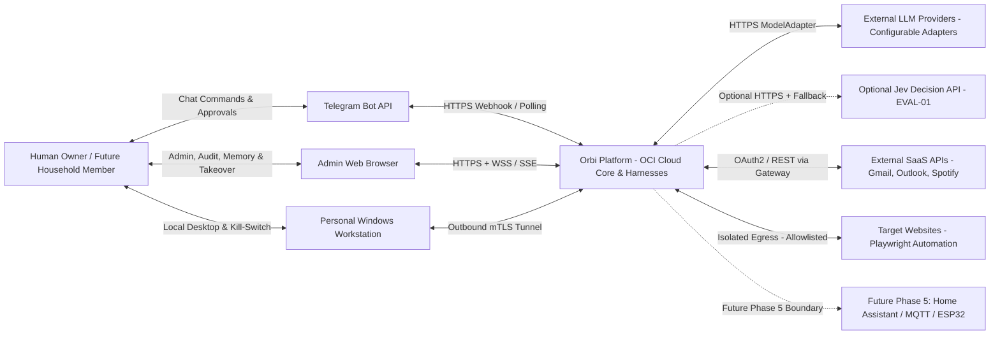

### A.2 Four-Plane Logical Architecture (`CON-21` Reconciliation)

To satisfy `AP-08` (modularity) and `AP-09` (no unnecessary microservices), Orbi maps its 15 core modules (`MOD-01`–`MOD-15`, plus `MOD-16-EXT`) across **four logical planes** aligned 1-to-1 with the **three physical isolation zones** defined in [ADR-001](file:///f:/Projects/Orbi/docs/04-adr/ADR-001-modular-monolith-and-resource-isolation.md):

| Logical HLD Plane | Mapped GLD Modules | Physical Execution Zone (`ADR-001`) | Architectural Responsibility |
| :--- | :--- | :--- | :--- |
| **1. Control Plane** | `MOD-01`, `MOD-02` (BFF + UI), `MOD-03`, `MOD-04`, `MOD-05`, `MOD-08`, `MOD-11` (Manager) | Zone 1 (`orbi-core` API/Worker) + Zone 2b (`orbi-dashboard`) | User ingress, deterministic task FSM, bounded cognitive turns, Decision Service, Gateway enforcement, skill lifecycle control. |
| **2. Trusted Data & Policy Plane** | `MOD-06`, `MOD-07`, `MOD-09`, `MOD-10` (Orchestrator + Catalog), `MOD-15`, Postgres, Redis, Blob Store | Zone 1 (`MOD-06`/`07`/`10`/`15` facades) + Zone 2b (`orbi-openfga`, `orbi-postgres`, `orbi-redis`) | Authoritative task state, agent/tool/skill registries, OpenFGA ReBAC policies, canonical memory catalog & audit ledger, secret vault. |
| **3. Isolated Execution Plane** | `MOD-12` (Stateless SaaS), `MOD-13` (Playwright), `MOD-11-SANDBOX` (Future Scripts), `Cognee` Stores | Zone 1 Gateway-mediated (`MOD-12`) + Zone 2a (`orbi-browser`, `MOD-11-SANDBOX`) + Zone 2b (`Cognee` backends) | Executes side-effecting APIs, untrusted DOM rendering, future skill scripts, and Cognee vector/graph processing outside `MOD-04` trust. |
| **4. Local Execution Plane** | `MOD-14` (Windows Companion), Future `MOD-16-EXT` (IoT Bridge) | Zone 3 (Off-Cloud Local Workstation / Home LAN) | Outbound mTLS client executing Native API -> UIA (`agent-desktop`) -> Controlled Vision Fallback under local kill-switch & app policies. |

#### Diagram 2: Logical Architecture Across the Four Planes

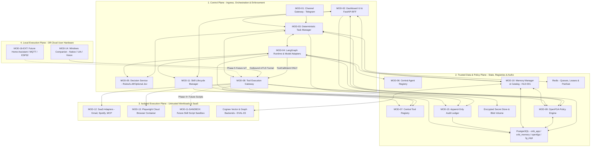

### A.3 Deployment Topology & Trust Boundaries

`[CONFIRMED]` Cloud services deploy via **Docker Compose on a single Oracle Cloud Infrastructure (OCI) VM** (`ADR-001`, VM hardware sizing gated by `EVAL-05` rather than assuming Always-Free adequacy).

#### Diagram 3: Deployment Topology & Trust Boundaries

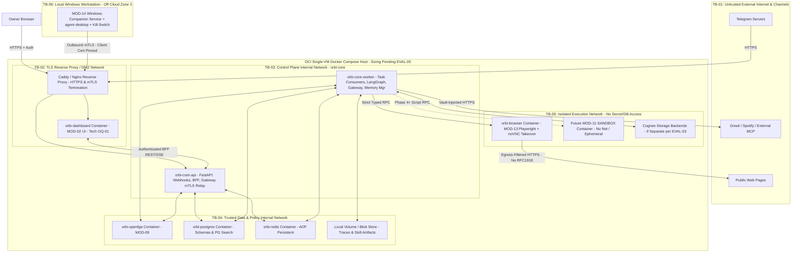

### A.4 Module Communication Patterns & Trust Boundary Rules

| Boundary Crossing | Transport Mechanism | Authentication / Enforcement |
| :--- | :--- | :--- |
| **`TB-01` -> `TB-02` (Telegram)** | HTTPS Webhook (or outbound polling fallback) | Telegram secret token header + `MOD-01` sender allowlist mapped to OpenFGA `user:<id>` (`ASM-07`). |
| **`TB-02` -> `TB-03` (Dashboard)** | HTTPS REST + WebSocket / SSE via FastAPI BFF | Authenticated session cookie / WebAuthn + CSRF check + OpenFGA owner/member verification. |
| **`TB-03` Internal (`orbi-core`)** | Typed Python `Protocol` calls (in-process) & Redis streams (`API <-> Worker`) | Static/runtime architectural boundary tests (`AP-08`); `MOD-04` has zero import access to `MOD-12` secrets or DB write handles for `tasks`. |
| **`TB-03` -> `TB-04` (OpenFGA & Data)** | Internal Docker bridge network (unexposed to host public IP) | Dedicated DB credentials per schema (`orbi_app`, `orbi_memory`, `openfga`); fail-closed OpenFGA gRPC/HTTP client. |
| **`TB-03` -> `TB-05` (Playwright / Sandbox)** | Internal isolated Docker network (`--internal` for `MOD-11-SANDBOX`) | `MOD-13` container has zero DB, Redis, or secret-vault network routes and blocks RFC1918/link-local SSRF targets. |
| **`TB-06` -> `TB-02/03` (Windows Companion)** | Outbound-initiated persistent WebSocket/gRPC stream over mTLS (`ASM-05`) | Client X.509 device certificate pinned in `MOD-09` + per-command signed envelope + local Windows kill-switch. |

---

## B. Agent Architecture (`MOD-04`, `MOD-05`, `MOD-06`)

`[CONFIRMED]` Orbi separates deterministic routing/orchestration (`MOD-03`, `MOD-05`) from cognitive reasoning (`MOD-04` LangGraph), ensuring agents are declarative identities with strictly bounded capabilities.

### B.1 Central Agent Registry (`MOD-06`) & Agent Profiles

Every agent in Orbi must exist as an active record in `orbi_app.agent_definitions`:
- **Core Fields**: `agent_id` (e.g., `agent:manager`, `agent:email`, `agent:media`, `agent:browser`, `agent:desktop`, `agent:skill_author`), `version`, `status` (`ACTIVE | DEPRECATED | DISABLED`), `role_summary`, `system_prompt_ref`, `model_profile_id`, `max_turns_per_step`, `configured_tool_ids[]`, `configured_skill_ids[]`, and `openfga_principal`.
- **Future Extensible Personas (`AP-10`)**: `agent:iot` (Phase 5 Home Assistant/MQTT) and `agent:developer` (Phase 5 isolated coding workspace).

### B.2 Agent Router, Decision Service (`MOD-05`) & Manager/Planner Agent

1. **Request Triage (`MOD-03` + `MOD-05`)**: When a task starts, `MOD-03` optionally invokes `MOD-05` (**Provider-Independent Decision Service**, [ADR-003](file:///f:/Projects/Orbi/docs/04-adr/ADR-003-provider-independent-decision-and-llm-adapters.md)) to classify complexity (`direct_qa`, `single_agent_tool`, `multi_step_plan`) and urgency (`noul`).
   - `MOD-05` tries deterministic heuristics first, optionally calls **Jev by TypeSafe** (`EVAL-01`) under a strict timeout (`timeout_ms`), and falls back transparently to `LLMDecisionProvider` if Jev is disabled, slow, or low-confidence (`CON-12`).
2. **Simple Requests vs. Complex Multi-Agent Tasks**:
   - **Simple Single-Domain Request**: If triage confidently routes to one specialized agent (e.g., `agent:media` for Spotify playback), `MOD-03` dispatches a bounded turn directly to that agent, avoiding unnecessary Manager planner overhead.
   - **Complex / Cross-Domain Task**: `MOD-03` dispatches to **`ManagerAgent`**, which decomposes the user goal into an explicit `SubGoalPlan`, delegates individual sub-tasks to specialized agents (`EmailAgent`, `BrowserAgent`, `DesktopAgent`), synthesizes intermediate observations, and checks completion criteria.

### B.3 LangGraph Runtime & Provider-Independent Model Adapters

- `MOD-04` executes each bounded turn inside a LangGraph `StateGraph` (`Reason -> SelectToolIntent -> ObserveToolResult -> ConcludeOrYield`).
- **Model Adapter Port (`ADR-003`)**: Graph nodes never call OpenAI/Anthropic/Gemini SDKs directly. They invoke `ModelAdapterPort.generate(messages, authorized_tools, budget_remaining)` which tracks token usage per step and feeds `MOD-03` budget accounting (`OQ-04`).
- **Turn Yield Rules (`AP-03`)**: LangGraph exits a turn and returns control to `MOD-03` whenever: (a) a final answer is ready, (b) `MOD-08` returns `REQUIRES_APPROVAL` or `HUMAN_TAKEOVER_REQUIRED`, (c) clarification from the user is required, or (d) `max_turns_per_step` is reached.

### B.4 Mandatory Initialization & Authorized Tool Discovery (`ADR-002`)

Every time `MOD-04` initializes an agent—whether top-level or delegated by `ManagerAgent`—it enforces the exact 7-step discovery pipeline:
1. Manager (or Router) selects `agent_id` from `MOD-06`.
2. `MOD-04` initializes the agent runtime with `ModelAdapter` and task budget.
3. `MOD-04` fetches `configured_tool_ids` metadata and JSON schemas from `MOD-07`.
4. `MOD-04` invokes `MOD-09` (OpenFGA) to filter candidate tools against `(user_id, household_id, agent_id, instance_id)` permissions (`Stage-1 Filtering`).
5. `MOD-04` binds **only** the authorized tool definitions and schemas into LangGraph's tool-calling schema list.
6. The LLM selects from the authorized list (`ToolCallIntent`).
7. Every invocation passes through `MOD-08` (**Tool Execution Gateway**).

### B.5 Agent-to-Agent Delegation & Context Construction

- **Delegation via Bounded Sub-Invocations**: When `ManagerAgent` delegates a sub-goal to `SpecializedAgent`, the runtime creates a child cognitive turn scoped strictly to the delegated sub-goal. `SpecializedAgent` performs its **own independent 7-step tool discovery** (`MOD-06` -> `MOD-07` -> `MOD-09`); child agents never inherit `ManagerAgent` prompts or unconstrained tool handles.
- **Context Construction & Injection Fencing**:
  - `MOD-04` constructs prompts in separated structural sections: `[1. System Role]`, `[2. Authorized Skill Instructions (SKILL.md)]`, `[3. Provenance-Tagged Memory Context from MOD-10]`, `[4. Authenticated User Request]`, and `[5. Fenced Untrusted Observations]`.
  - Any content tagged `untrusted_external` (emails, web DOMs, UI OCR) is wrapped in explicit data delimiters and flagged as untrusted data, never elevated into system/developer instruction blocks.

#### Diagram 4: Agent Request Lifecycle

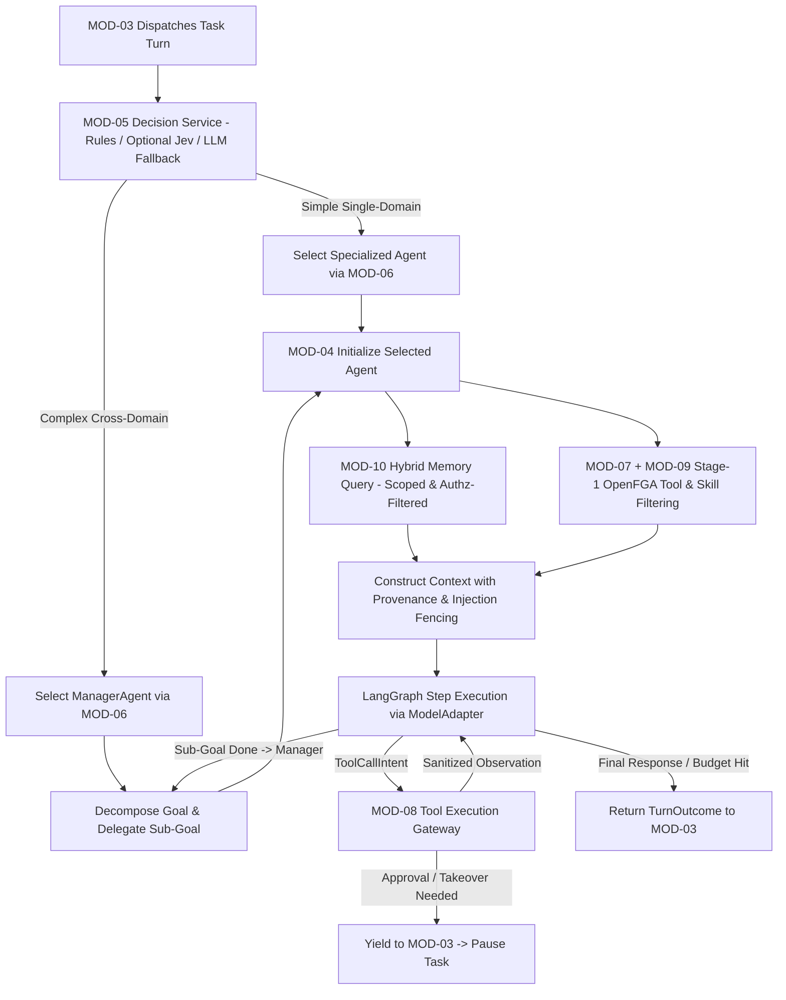

---

## C. Tool Platform (`MOD-07`, `MOD-08`, `MOD-09`, `MOD-12`, `MOD-15`)

`[CONFIRMED]` No agent, LangGraph node, or skill script can perform external I/O directly. All capabilities are governed through `MOD-07` and `MOD-08`.

### C.1 Central Tool Registry (`MOD-07`), Schemas & Versioning

Each tool definition in `orbi_app.tool_definitions` stores:
- **Identity & Pinning**: `tool_id` (e.g., `gmail.send_email`), immutable `tool_version` (`1.2.0`), `adapter_type` (`NATIVE_PYTHON | API_SDK | PLAYWRIGHT_RPC | WINDOWS_COMPANION | MCP_CLIENT | SKILL_SCRIPT`), `isolation_zone`.
- **Contracts**: JSON Schema for `input_schema` and `output_schema`.
- **Semantic vs. Volatile Argument Split (`CON-10`)**: Declares which input fields are *semantic action fields* hashed into approval digests (`to`, `subject`, `body`, `target_resource`) versus ephemeral execution metadata (`snapshot_epoch`, `pagination_cursor`).
- **Governance Metadata**: `sensitivity_tier` (`READ_ONLY`, `LOW_RISK_WRITE`, `SENSITIVE_WRITE`, `IRREVERSIBLE`), `idempotent` (`bool`), `timeout_ms`, `rate_limit_bucket`.

### C.2 Tool Execution Gateway (`MOD-08`) & Adapter Architecture (`CON-19`)

`MOD-08` exposes a single `execute_tool_intent()` pipeline enforcing seven deterministic gates in sequence:
1. **Existence & Schema Gate**: Reject unknown `tool_id` (preventing invented tool IDs) and validate arguments strictly against `MOD-07` JSON Schema.
2. **Idempotency Gate**: Check `(task_id, step_id, idempotency_key)` in Redis/PostgreSQL to prevent duplicate side effects on worker retry.
3. **Stage-2 OpenFGA Gate (`MOD-09`)**: Query `Check(user_id, household_id, agent_id, execute, tool_id, target_resource)` and retrieve current `policy_version`. Fail closed if OpenFGA is unreachable (`NFR-REL-02`).
4. **Sensitivity & Approval Gate (`MOD-03` / `ADR-004`)**: If `sensitivity_tier` is `SENSITIVE_WRITE` or `IRREVERSIBLE` (or OpenFGA policy / `MOD-05` risk signal escalates the call), check for a valid consumed-pending `ApprovalRequest` matching the exact canonical payload digest. If absent, trigger `MOD-03` pause (`AWAITING_APPROVAL`).
5. **Credential Injection**: Fetch encrypted OAuth2 tokens or API keys from the OCI Secret Store inside `MOD-08` / `MOD-12`—never visible to `MOD-04`.
6. **Typed Adapter Dispatch (`CON-19`)**: Route to the registered adapter implementation:
   - **Native Python Adapter**: Deterministic, pure in-process utilities (date math, safe formatting, local registry queries).
   - **API / SDK Adapter (`MOD-12`)**: Typed HTTP/SDK wrappers for Gmail, Outlook, Spotify, etc., with token refresh and rate limiting.
   - **MCP Client Adapter (`[PROPOSED]`)**: Connects strictly from behind `MOD-08` to external/local MCP servers. Discovered MCP tools must be explicitly imported, schema-pinned, and assigned a `sensitivity_tier` in `MOD-07` before any agent can see or invoke them—agents **never** hold raw MCP client sessions.
   - **Isolated Harness Dispatch**: RPC to `MOD-13` (Playwright container), `MOD-11-SANDBOX` (future script sandbox), or mTLS command to `MOD-14` (Windows Companion).
7. **Sanitization, Provenance Tagging & Audit (`MOD-15`)**: Strip secret regex patterns, enforce payload size caps, attach `untrusted_external` provenance tags to external responses, and write an immutable audit record (`FR-AU-01`).

#### Diagram 5: Tool Discovery & Execution Pipeline

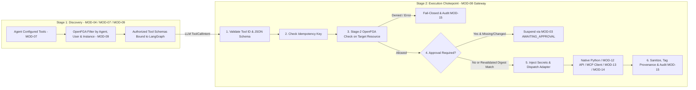

---

## D. Task Orchestration (`MOD-03`, `MOD-04`, PostgreSQL & Redis)

`[CONFIRMED]` `MOD-03` (**Deterministic Task Manager**) is the authoritative owner of macro-task state (`AP-03`).

### D.1 Task Lifecycle & Authoritative State Store

All durable task data lives in PostgreSQL (`orbi_app.tasks`, `task_steps`, `task_budgets`, `approval_requests`):
- **States**: `CREATED` -> `QUEUED` -> `RUNNING` -> `{AWAITING_APPROVAL | AWAITING_HUMAN_TAKEOVER}` -> `RUNNING` -> `{COMPLETED | FAILED | CANCELLED | EXPIRED}`.
- **Budget Enforcement (`FR-TM-04`)**: Every task carries hard caps (`max_steps`, `max_llm_tokens`, `max_cost_usd`, `task_ttl_seconds`). `MOD-03` increments counters deterministically after every `MOD-04` turn and transitions to `FAILED` (`BUDGET_EXCEEDED`) or `EXPIRED` on breach.

#### Diagram 7: Task Lifecycle State Machine

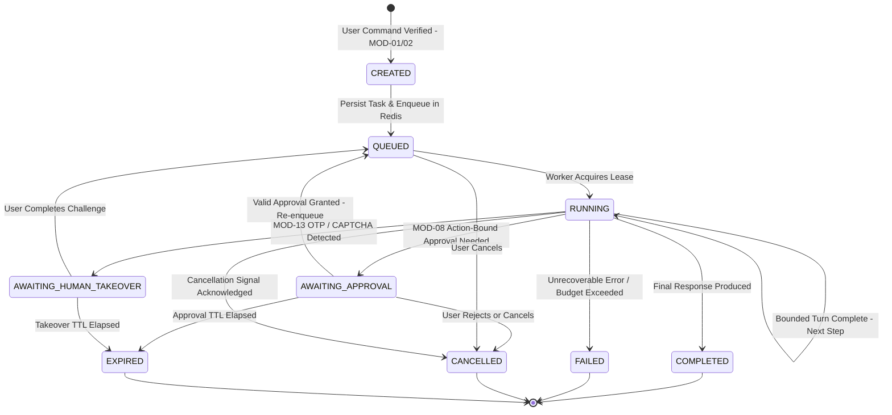

### D.2 PostgreSQL Authoritative State vs. Scoped LangGraph Checkpoints (`CON-18`, `EVAL-04`)

- **`orbi_app.tasks` (Source of Truth)**: Authorizes whether a task is runnable, tracks step budgets, owns `AWAITING_APPROVAL` and `AWAITING_HUMAN_TAKEOVER` suspensions, and records curated step summaries.
- **`langgraph_checkpoints` (Subordinate Intra-Turn State)**: Stores LangGraph graph-node scratchpad state **only** for the duration of an active turn or structured pause resumption (`EVAL-04`). LangGraph checkpoints **never** hold approval authority, task status, or retry budgets, and cannot resume execution unless `MOD-03` explicitly transitions the authoritative task to `RUNNING` and dispatches the turn.

### D.3 Redis Responsibilities, Retries, Cancellation & Recovery

- **Redis Roles**:
  1. *Durable Dispatch Queues*: Priority Redis lists/streams (`queue:tasks:interactive`, `queue:tasks:background`, `queue:memory:consolidation`).
  2. *Worker Leases & Heartbeats*: Short-TTL keys (`lease:task:<id>`) preventing split execution across workers.
  3. *Cancellation & Wakeup Signals*: Pub/Sub channel (`chan:task:cancel:<id>`) checked between LangGraph steps and before `MOD-08` dispatches.
  4. *Companion Presence*: Live heartbeat metadata (`presence:companion:<device_id>`) for `MOD-14`.
- **Retry & Recovery Rules**:
  - *Transient I/O*: `MOD-08` retries `READ_ONLY` and declared `idempotent=true` calls with jittered exponential backoff; non-idempotent failed writes halt cleanly and notify the user rather than blindly re-executing.
  - *Worker Crash Recovery*: On container restart or lease expiration, a background reconciler scans PostgreSQL `orbi_app.tasks WHERE status IN ('QUEUED', 'RUNNING')` with stale heartbeats and safely re-queues or transitions them—guaranteeing zero lost tasks (`NFR-REL-01`).

---

## E. Identity, Authorization & Approvals (`MOD-01`, `MOD-02`, `MOD-03`, `MOD-08`, `MOD-09`)

### E.1 User & Household Identity Model (`ADR-002`)

`[CONFIRMED]` Orbi runs single-owner initially while establishing normalized identity tables and OpenFGA tuples designed for seamless future household expansion:
- **`user:<id>`**: Authenticated human identity (`orbi_app.users`).
- **`household:<id>`**: Shared group entity (`orbi_app.households`) linking owner and future family members (`member`, `admin` relations).
- **`agent:<id>`** & **`instance:<id>`**: Delegated cognitive principal and runtime deployment/companion scope.

### E.2 Channel Identity Mapping & Dashboard Authentication

1. **Telegram Identity Mapping (`MOD-01`, `ASM-07`)**:
   - Telegram updates carry numeric `from.id` and `chat.id`. `MOD-01` resolves `(telegram_user_id, chat_id)` against `orbi_app.channel_bindings` (`status = ACTIVE`). Unbound or suspended Telegram IDs are rejected before creating tasks and logged to `MOD-15`.
   - Group chats (if enabled later) require explicit `household:<id>` chat registration and per-sender `user:<id>` verification so untrusted third parties in a chat cannot hijack owner permissions.
2. **Dashboard Authentication (`MOD-02`, `[PROPOSED]`)**:
   - Browser authentication uses secure operator credentials (Passkey/WebAuthn or password + TOTP MFA) backed by `HttpOnly`, `Secure`, `SameSite=Lax` session cookies, strict CSRF tokens, and short idle timeouts.
   - Sensitive governance actions (creating OpenFGA tuples, approving `IRREVERSIBLE` tasks, publishing skills, launching browser Human Takeover) require recent MFA/re-auth verification.

### E.3 OpenFGA Relationship Model (`MOD-09`)

`[CONFIRMED]` / `[PROPOSED]` `orbi-openfga` stores the authoritative authorization model (`policy_version` tracked monotonically on schema/policy updates):
- **`type household`**: `relations: admin, member`
- **`type user`**: Identity principal
- **`type instance`**: `relations: household, operator` (identifies OCI core or a specific companion machine)
- **`type agent`**: `relations: owner, allowed_user, configured_tool`
- **`type tool`**: `relations: owner, allowed_agent, allowed_user`
- **`type skill`**: `relations: owner, published_reader, invoker` (note: skills never grant tool permissions; tools remain independently checked)
- **`type resource`**: `relations: owner, household, reader, writer, approver` (covers email accounts, Spotify sessions, browser profiles, Windows Companion devices, future IoT devices)
- **`type memory_unit`**: `relations: owner, household, reader` (private `owner` vs. `member from household` per [memory-architecture.md](file:///f:/Projects/Orbi/docs/02-hld/memory-architecture.md))
- **`type approval_request`**: `relations: owner, approver` (`approver` restricted strictly to resource/task owner or delegated household admin)

### E.4 Cryptographically Protected, Action-Bound Approvals (`ADR-004`)

`[CONFIRMED]` Human approvals protect against TOCTOU bait-and-switch attacks (`CON-10`):
1. **Canonical Digest Construction**: When `MOD-08` blocks a `SENSITIVE_WRITE` or `IRREVERSIBLE` call (or policy-escalated action), it constructs a canonical JSON structure containing:
   - `user_id` (authorized approver)
   - `task_id`
   - `tool_id` and `tool_version`
   - `canonical_arguments_hash` (`SHA-256` of sorted, normalized semantic fields per `MOD-07`, excluding volatile epoch tokens per `CON-10`)
   - `target_resource`
   - `policy_version` (current OpenFGA model/policy version)
   - `expires_at` (UTC timestamp)
2. **Integrity Signature (`[PROPOSED]`)**: `MOD-03` computes `binding_digest = SHA-256(canonical_payload)` and an internal `HMAC-SHA256(approval_hmac_key, approval_id || binding_digest)` stored in `orbi_app.approval_requests`.
3. **One-Time Consumption & Replay Protection**:
   - Approval buttons in Telegram (`MOD-01`) or Dashboard (`MOD-02`) submit `(approval_id, actor_user_id, expected_digest)`.
   - `MOD-03` executes an atomic PostgreSQL compare-and-swap (`UPDATE ... SET status = 'APPROVED', decided_at = now() WHERE approval_id = $1 AND status = 'PENDING' AND expires_at > now()`), preventing duplicate clicks across Telegram and Dashboard (`CON-06`).
4. **Immediate Pre-Execution Revalidation (`MOD-08`)**:
   - When `MOD-03` resumes the task, `MOD-08` **immediately revalidates** prior to adapter dispatch:
     1. Recompute `binding_digest` from the live `ToolCallIntent` about to execute and verify equality + HMAC;
     2. Verify `now() < expires_at`;
     3. Query `MOD-09` for live `policy_version` and verify OpenFGA still returns `ALLOW`;
     4. Atomically transition `status = 'APPROVED'` -> `'CONSUMED'` (`single-use token`).
   - **Any mismatch, expiration, or policy-version bump** rejects execution (`APPROVAL_INVALIDATED`), logs to `MOD-15`, and initiates a fresh approval request.

#### Diagram 6: Approval Lifecycle State Machine

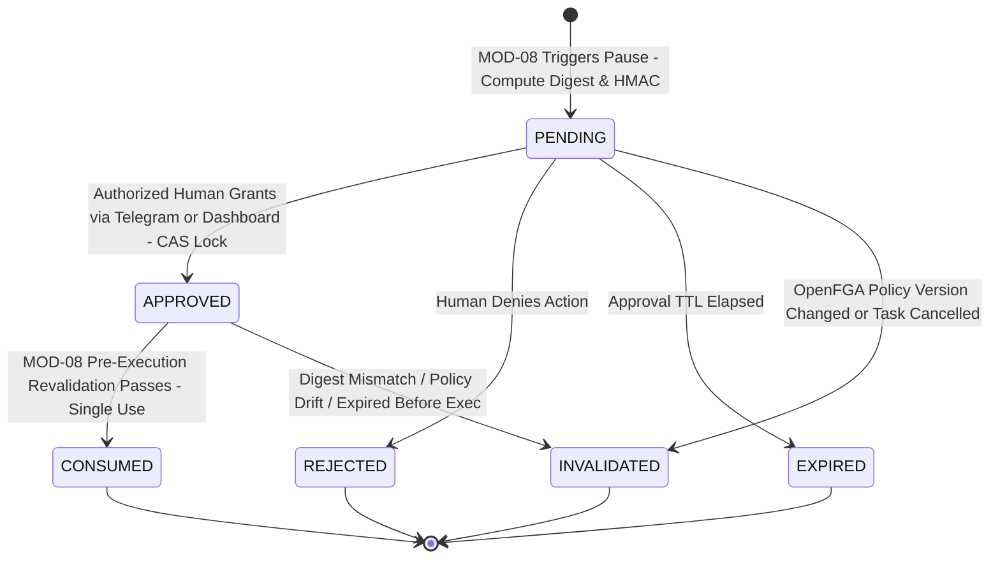

---

## F. Memory Architecture Integration (`MOD-10` — Referencing `DOC-HLD-001`)

`[CONFIRMED]` Detailed memory internals, retrieval formulas, data contracts, and evaluation plans reside in [memory-architecture.md](file:///f:/Projects/Orbi/docs/02-hld/memory-architecture.md) (`DOC-HLD-001`). At the overall system level, Orbi integrates with the Memory Manager as follows:

1. **System Integration Points**:
   - **`MOD-04` (Read Path)**: During context assembly (`Section B.5`), agents call `MOD-10.retrieve_hybrid_memory(query, user_id, household_id, budget)`. `MOD-10` runs its 5-stage pipeline—(1) Query Understanding without mandatory LLMs, (2) parallel Vector / BM25 `[PROPOSED]` / Graph / selective Temporal branches, (3) **mandatory per-branch OpenFGA resource checks**, (4) deduplicating RRF `[PROPOSED]` fusion, and (5) configurable replaceable reranking `[PROPOSED]`—returning provenance-tagged items.
   - **`MOD-03` + `MOD-10` (Write & Consolidation Path)**: Post-turn or via Redis `queue:memory:consolidation` workers, candidate facts are written first to PostgreSQL `orbi_memory` (authoritative `MemoryUnit` catalog) with `source_provenance`, `trust_tier` (`user_explicit`, `system_verified`, or `untrusted_external`), and bi-temporal markers (`event_time`, `valid_from`, `valid_to`, `superseded_by`). `MOD-10` then asynchronously triggers `CogneeAdapter` ECL pipelines (`CON-14`).
   - **`MOD-02` (Dashboard Curation)**: Authorized users search, inspect provenance/graph links, approve/promote quarantined `untrusted_external` memories, or delete memories (`MOD-10` cascades deletions across `orbi_memory`, Cognee stores, and OpenFGA tuples).
2. **Cognee Boundary & Minimal Infrastructure (`ADR-007`, `ADR-008`)**:
   - Cognee sits strictly behind `CogneeAdapter` inside `MOD-10`. Capabilities not verified or missing in Cognee during `EVAL-03` (such as BM25 search evaluated first via PostgreSQL FTS/BM25 in `EVAL-07`, and bi-temporal validity) are owned directly by `MOD-10` over `orbi_memory`.
3. **Security & Provenance Invariants**:
   - OpenFGA (`MOD-09`) constrains **every retrieval branch** (`private_user`, `shared_household`, custom scopes) prior to Candidate Fusion or Reranking.
   - `untrusted_external` facts cannot automatically supersede `user_explicit` facts (`CON-16`).

#### Diagram 8: Memory Retrieval & Consolidation Integration

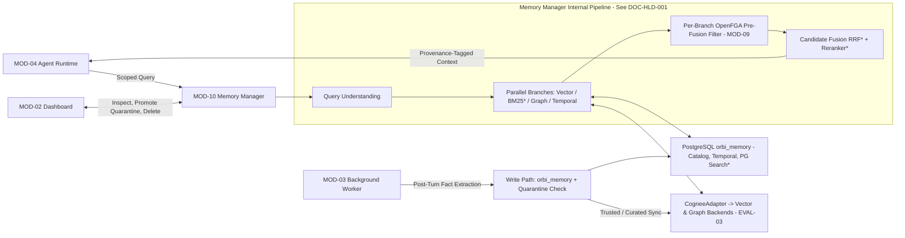
*(\* Proposed / Evaluation Required under `EVAL-03`, `EVAL-07`)*

---

## G. Skill Lifecycle Manager (`MOD-11`, `ADR-005`, `CON-17`)

`[CONFIRMED]` Reusable procedural skills are strictly separated from factual knowledge memory (`AP-04`) and are **never** allowed to grant permissions or bypass `MOD-08` (`AP-01`, `AP-02`).

### G.1 Skill Registry & Package Structure (`SKILL.md`)

`orbi_app.skill_packages` and `skill_versions` store immutable, semantically versioned packages centered around a **`SKILL.md`** file:
- **YAML Frontmatter**: `skill_id`, `version` (`semver`), `title`, `author_actor`, `required_tools[]` (must match `MOD-07` entries), `approval_policy_notes`, `package_mode` (`MARKDOWN_ONLY` initially vs. `WITH_SANDBOXED_SCRIPTS` future).
- **Markdown Body**: Structured workflow instructions, edge-case handling, and composition guidance over existing Gateway tools.
- **Optional Package Companion Artifacts**: `examples/`, JSON `schemas/`, and deterministic `tests/` (golden input/expected-intent fixtures).

### G.2 Skill Discovery, Loading & Creation/Evaluation Flow

1. **Discovery & Loading**: During agent initialization (`Section B.4`), `MOD-04` queries `MOD-11` for `PUBLISHED` skills allowed by OpenFGA (`MOD-09`) and whose `required_tools` are a **subset** of the agent's Stage-1 authorized tools. `SKILL.md` instructions load strictly as procedural guidance; loading a skill adds **zero** new tool authorizations.
2. **Creation & Automated Evaluation**:
   - Either the human owner (in `MOD-02`) or `SkillAuthorAgent` drafts a `DRAFT` skill package.
   - `MOD-11` executes the package's `tests/` fixtures in dry-run mode against mocked `MOD-08` Gateway tools (`EVALUATED`), verifying schema validity, zero unauthorized tool references, and deterministic output assertions.
3. **Human Approval & Versioning**:
   - Passing skills enter `AWAITING_PUBLISH_APPROVAL` and appear in `MOD-02` Dashboard with full Markdown diff, fixture pass report, and required tool list.
   - Explicit owner approval promotes the immutable version (`PUBLISHED`, e.g., `skill:weekly_expense_digest@1.0.0`), registers any declarative trigger entry in `MOD-07`, and records the event in `MOD-15`.

### G.3 Initial Markdown-Only Scope vs. Future Sandboxed Scripts (`CON-17`)

- **Initial Implementation (Phase 4 Baseline)**: Skills operate strictly in **`MARKDOWN_ONLY` mode**—`SKILL.md` procedural instructions + JSON schemas + fixture tests orchestrating existing `MOD-07`/`MOD-08` tools. Any package attempting to declare executable script artifacts is rejected by schema policy until sandbox validation completes.
- **Future Capability (Post-`EVAL-06`)**: Optional supporting executable scripts inside a skill package will run strictly inside **`MOD-11-SANDBOX`** (Zone 2a isolated container/microVM, `OQ-11`), with zero ambient credentials, no host filesystem access, and Gateway-only callbacks to `MOD-08`.

#### Diagram 11: Skill Lifecycle

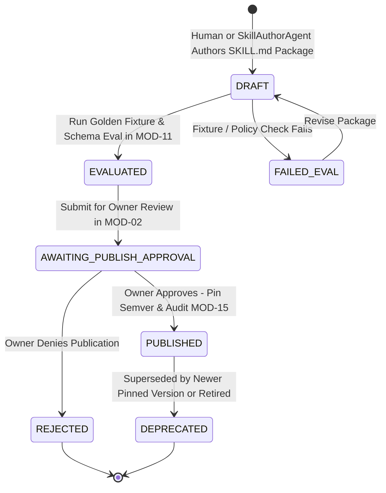

---

## H. Cloud Browser Execution (`MOD-13`)

`[CONFIRMED]` For web workflows lacking SaaS APIs, `MOD-08` dispatches structured browser intents to `orbi-browser` (`MOD-13`), a dedicated container running **Playwright + Chromium** inside Isolated Execution Zone 2a (`TB-05`).

### H.1 Isolation, Session Lifecycle & Cloud vs. Local Boundary

1. **Container & Network Isolation**:
   - `orbi-browser` runs non-root with strict CPU/RAM cgroup caps (`EVAL-05`), zero DB/Redis/Vault credentials, and egress filtering blocking private/link-local/metadata IP ranges (SSRF guard against `169.254.169.254` and Docker internal networks).
2. **Browser Session Lifecycle**:
   - **`EPHEMERAL_CLEAN`** *(Default)*: Fresh incognito `BrowserContext` created per task and destroyed on completion.
   - **`PERSISTENT_ENCRYPTED_PROFILE`** *(Opt-in per authorized site)*: Encrypted storage-state blob saved via `BlobStoragePort` and bound to `(user_id, site_domain)` in OpenFGA (`MOD-09`), decrypted transiently into `orbi-browser` only during an authorized session.
3. **Cloud Browser vs. Local Browser (`MOD-14`)**:
   - *Use Cloud Browser (`MOD-13`)* for public web research, headless form automation, and isolated web accounts without touching the user's workstation.
   - *Use Local Windows Browser (`MOD-14`)* only when the site explicitly requires local intranet access, hardware security keys attached to the PC, or pre-authenticated local browser profiles—always governed by `MOD-14` local policies and `MOD-09`.

### H.2 Human Takeover, OTP/CAPTCHA Handling & Sensitive Approvals (`CON-20`)

- **Strict Anti-Bypass Policy**: Orbi **never** solves, computes, or automatically bypasses CAPTCHAs, Cloudflare Turnstile, or anti-bot gates.
- **OTP & CAPTCHA Human Takeover Flow**:
  1. When `MOD-13` encounters a login challenge, 2FA/OTP prompt, or CAPTCHA, it returns `HUMAN_TAKEOVER_REQUIRED(reason, screenshot_redacted, session_id)` to `MOD-08`/`MOD-03`.
  2. `MOD-03` transitions the task to `AWAITING_HUMAN_TAKEOVER` and alerts the owner via Telegram (`MOD-01`) and Dashboard (`MOD-02`).
  3. **Takeover Options**:
     - For numeric OTPs: owner enters the one-time code via secure Dashboard prompt (never logged in plain audit).
     - For interactive CAPTCHAs/logins: owner opens the authenticated **Browser Sessions** tab in `MOD-02`, which proxies a time-limited, OpenFGA-authorized **noVNC / WebRTC interactive view** directly to the paused `orbi-browser` context (`CON-20`). Once complete, the owner clicks *Return Control to Orbi*, and `MOD-03` re-queues the task.
- **Approval & DOM Verification for Sensitive Web Actions**: Browser tools (`browser.click_submit`, `browser.purchase`, `browser.delete_account`) carry `SENSITIVE_WRITE` / `IRREVERSIBLE` tiers. Before clicking, `MOD-08` captures the target element label, target URL domain, and action summary into an action-bound approval (`ADR-004`) and verifies the page domain/element has not drifted upon resume.
- **Failure Recovery**: On page crash or timeout, `MOD-13` captures DOM/screenshot error artifacts to `BlobStoragePort`, tears down the hung context, and returns a clean structured error to `MOD-08`.

#### Diagram 9: Cloud Browser Execution & Human Takeover Lifecycle

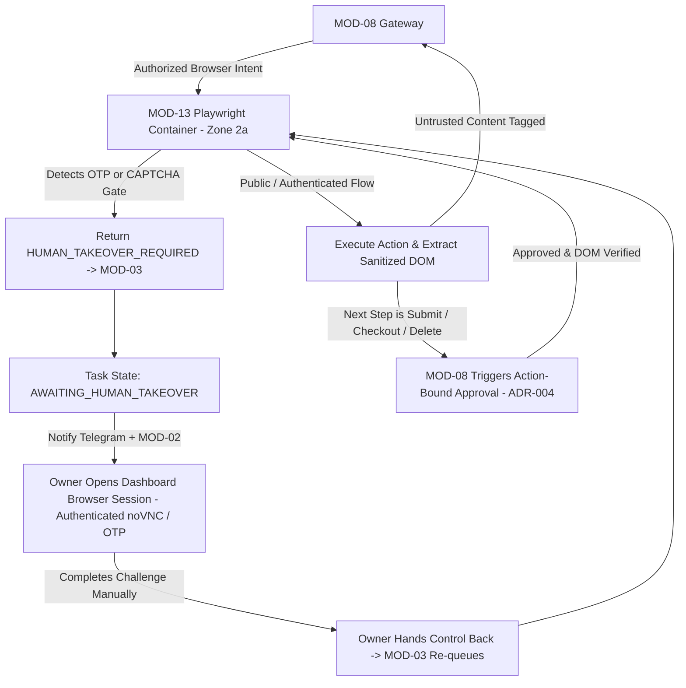

---

## I. Windows Local Companion (`MOD-14`, `ADR-006`)

`[CONFIRMED]` `MOD-14` extends Orbi onto the user's personal Windows 10/11 PC while enforcing strict cloud-to-local sovereignty (`AP-05`).

### I.1 Companion Architecture, Outbound Connection & Heartbeat

1. **Daemon Architecture**: Lightweight local background service + minimal system-tray status/kill-switch applet running under the active Windows user desktop session (required for UI Automation access).
2. **Outbound Authenticated mTLS Connection (`ASM-04`, `ASM-05`)**:
   - The Windows Companion **never** opens inbound internet ports. At startup, it initiates an outbound persistent **WebSocket/gRPC over mTLS** connection to the OCI Gateway Relay (`orbi-core-api`).
   - Authentication uses a per-device X.509 client certificate registered in `orbi_app.companion_devices` and bound to `instance:<device_id>` in OpenFGA (`MOD-09`).
3. **Heartbeat & Reconnect**:
   - `MOD-14` sends signed `HEARTBEAT` frames every 15 seconds; `MOD-08`/`orbi-core-api` updates Redis (`presence:companion:<device_id>`, TTL 45s) with active capabilities (`native_apis`, `agent_desktop_uia`, `vision_fallback`) and kill-switch status.
   - On network drop or laptop sleep/wake, `MOD-14` reconnects using jittered exponential backoff and invalidates any pre-sleep `snapshot_id` epochs (`CON-05`).

### I.2 Command Dispatch, Acknowledgement & Layered Execution (`Decision 9`)

1. **Dispatch & Ack Protocol**:
   - `MOD-08` sends a signed `CompanionCommand(command_id, task_id, idempotency_key, action, args, snapshot_epoch, approval_token_id)` over the mTLS stream.
   - `MOD-14` immediately returns `CMD_ACK` (received), executes locally under timeout, and streams `CMD_RESULT` (`status`, `tier_used`, `confidence`, redacted observation).
2. **Strict 3-Tier Execution Precedence (`ADR-006`)**:
   - **Tier 1 — Native OS / App APIs**: Attempted first via explicitly allowlisted local adapters (e.g., approved file read/move inside permitted workspace paths, Windows toast/clipboard API, COM/app CLI).
   - **Tier 2 — UI Automation (`vercel-labs/agent-desktop`, `EVAL-02`)**: When no Tier 1 adapter exists, invoke `agent-desktop` to inspect the Windows UIA tree as structured JSON and perform `ref`-based clicks/inputs bound to a short-lived `snapshot_id` epoch (`CON-05`).
   - **Tier 3 — Controlled Vision Fallback**: Permitted **only** when Tier 1 and Tier 2 return empty/unresolvable UIA nodes (e.g., custom canvas/Electron views). Captures **only** the allowlisted target window, applies local sensitive-region masking before any cloud vision grounding call, and binds actions to `(window_identity, target_label, perceptual_hash)` (`CON-09`).
3. **Safe Confidence Stop & Uniform Policy**:
   - If UIA matching or Vision grounding confidence falls below configured thresholds (`EVAL-02`, `OQ-12`), `MOD-14` aborts cleanly (`STOP_INSUFFICIENT_CONFIDENCE`) with zero clicks/keystrokes.
   - Sensitive operations require Stage-2 OpenFGA authorization + action-bound approval (`ADR-004`) **regardless** of whether Tier 1, Tier 2, or Tier 3 executes them.

### I.3 Local Filesystem, Process Restrictions & Offline Behavior

- **Local Hard Guardrails (`MOD-14` Local Config — Unoverridable by Cloud)**:
  - *Process & Window Denylist*: Password managers (e.g., 1Password, Bitwarden, KeePass), Windows UAC/Credential prompts, `regedit`, unrestricted `cmd.exe`/`powershell.exe`, banking portals, and `.ssh`/browser-vault directories are blocked locally.
  - *Filesystem Allowlist*: Tier 1 file operations are restricted strictly to configured user workspace directories.
  - *Instant Kill-Switch*: System-tray click or global hotkey immediately halts active execution, rejects incoming cloud commands (`LOCAL_KILL_SWITCH_ACTIVE`), and notifies `MOD-08`.
- **Laptop Unavailable / Offline Behavior**:
  - `MOD-08` checks Redis `presence:companion:<device_id>` before dispatching.
  - For interactive/real-time desktop commands, `MOD-08` fails fast with `COMPANION_OFFLINE` so `MOD-03` notifies the user immediately without blocking workers.
  - Optionally (for deferred tasks explicitly flagged `allow_queue_until_online=True`), `MOD-03` may hold the task with a bounded TTL and re-dispatch upon `HEARTBEAT` reconnection—mandatory **pre-execution approval & snapshot revalidation** (`ADR-004`) always runs before execution.

#### Diagram 10: Windows Companion Architecture & Execution Flow

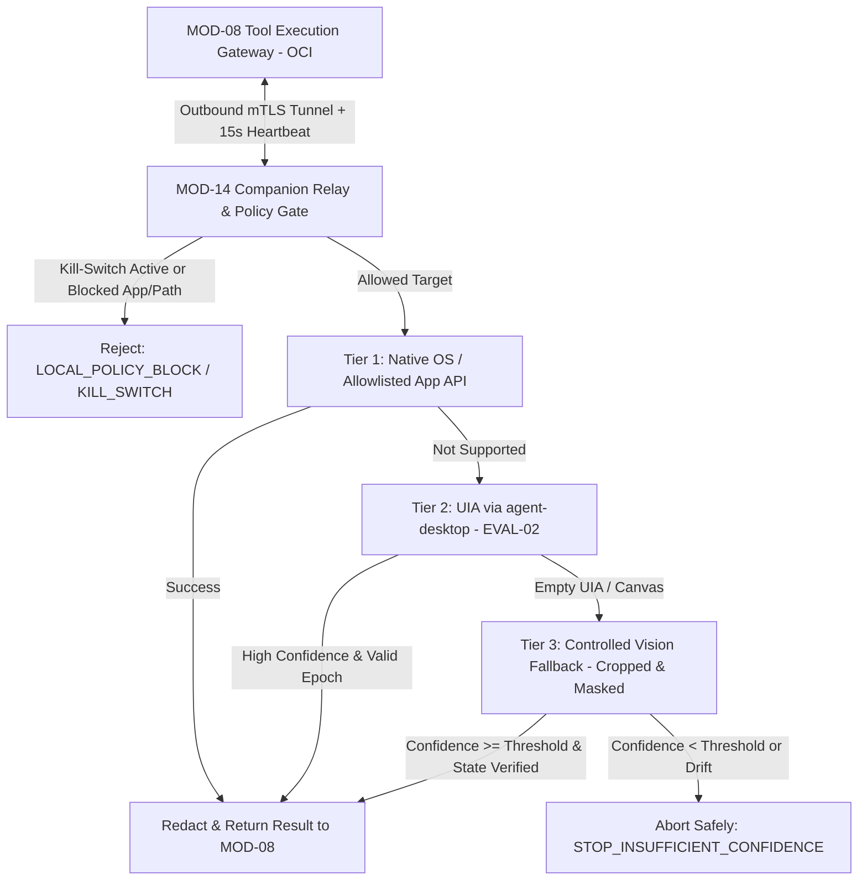

---

## J. External Integrations (`MOD-01`, `MOD-12`, `MOD-16-EXT`)

`[CONFIRMED]` Orbi strictly distinguishes **initial implementation scope** (Phases 1–4) from **future architectural extension boundaries** (Phase 5+, `AP-10`):

| Integration | Scope | Adapter / Module | Boundary & Governance Pattern |
| :--- | :--- | :--- | :--- |
| **Telegram** | **Initial (Phase 1)** | `MOD-01` Channel Gateway | Webhook/polling ingress mapped to verified `user:<id>`/`household:<id>` (`ASM-07`); delivers summaries and interactive action-bound approval prompts. |
| **Gmail / Outlook** | **Initial (Phase 2)** | `MOD-12` SaaS Connectors | OAuth2 refresh tokens isolated in OCI Secret Vault, injected solely in `MOD-08`; read operations `READ_ONLY`, send/delete/forward `SENSITIVE_WRITE`/`IRREVERSIBLE` (`OQ-08`); email bodies tagged `untrusted_external`. |
| **Spotify** | **Initial (Phase 2)** | `MOD-12` SaaS Connectors | Scoped OAuth2 connector behind `MOD-08`; playback/search `READ_ONLY`/`LOW_RISK_WRITE`, account/playlist deletion higher tier. |
| **Other SaaS Connectors & MCP Tools** | **Extensible (Phase 2–4)** | `MOD-12` / `MOD-08` MCP Adapter | Plugged behind typed `SaaSConnectorPort` or `MOD-08` MCP Client Adapter (`CON-19`), cataloged and risk-tiered in `MOD-07`. |
| **Home Assistant / MQTT & ESP32 (`MOD-16-EXT`)** | **Future (Phase 5 — Boundary Only)** | `MOD-16-EXT` IoT Bridge | Interface slots preserved in `MOD-07` (`FUTURE_IOT`), `MOD-08`, and `MOD-09` (`iot_device`, `household` ownership). Two patterns preserved without premature lock-in: (a) local Home Assistant/MQTT bridge over outbound mTLS tunnel (reusing `ASM-05`), or (b) authenticated Home Assistant REST/WebSocket endpoint. High-impact physical actions (door locks, alarms, heating overrides, ESP32 relays) map to `SENSITIVE_WRITE`/`IRREVERSIBLE`. |
| **Future Developer Agent** | **Future (Phase 5 — Boundary Only)** | `MOD-06` (`agent:developer`) + Isolated Workspace Sandbox | Planned specialized agent operating strictly inside an isolated cloud container workspace (separate git worktree/container, zero host credentials) behind `MOD-08`, with `git push`, PR merge, and production deploys gated by `ADR-004` approvals. |

---

## K. Dashboard (`MOD-02`, `OQ-01`)

### K.1 Frontend / Backend Interaction

- **Backend-for-Frontend (BFF)**: FastAPI endpoints inside `orbi-core-api` expose authenticated REST APIs (`/api/v1/...`) and real-time Server-Sent Events (SSE) / WebSocket streams (`/api/v1/stream`) backed directly by `MOD-03`, `MOD-06`, `MOD-07`, `MOD-09`, `MOD-10`, `MOD-11`, `MOD-13`, and `MOD-15`.
- **Frontend Stack (`OQ-01` Open for HLD Finalization)**: `orbi-dashboard` runs as an isolated container (`Zone 2b`) communicating solely via HTTPS/WSS to `orbi-core-api` BFF—never touching PostgreSQL, Redis, or OpenFGA directly. *(Framework alternatives and recommendation documented in Section O.)*

### K.2 Dashboard Functional Workspaces

| Workspace | Backing Modules | Core Capabilities |
| :--- | :--- | :--- |
| **1. Members & Access** | `MOD-01`, `MOD-09` | Manage primary owner and future household members, Telegram/email channel bindings (`ASM-07`), paired Windows Companion certificates, and inspect/edit OpenFGA relationship tuples (`policy_version` audited). |
| **2. Agents & Tools** | `MOD-06`, `MOD-07`, `MOD-09` | View Central Agent Registry definitions, model/budget bindings, Tool Registry JSON schemas, sensitivity tiers (`READ_ONLY`–`IRREVERSIBLE`), and test effective Stage-1 OpenFGA permissions per `(user, agent)`. |
| **3. Memory Management** | `MOD-10` | Hybrid search debugger (`QueryPlan`, active branches, RRF/rerank scores), knowledge graph inspector, provenance/trust filter, quarantine review queue (promote/reject `untrusted_external` facts), bi-temporal history, and manual edit/purge (`DOC-HLD-001`). |
| **4. Tasks & Monitoring** | `MOD-03`, `MOD-04`, `MOD-05` | Live task list (`RUNNING`, `AWAITING_APPROVAL`, `AWAITING_HUMAN_TAKEOVER`, `FAILED`), LangGraph step traces, Decision Service provider/fallback logs, token/cost budget meters, and one-click task cancellation. |
| **5. Approvals & Audit** | `MOD-03`, `MOD-08`, `MOD-15` | Full-context queue of pending action-bound approvals displaying canonical JSON arguments, target resource, SHA-256 `binding_digest`, `policy_version`, and expiration countdown; searchable append-only `MOD-15` audit explorer. |
| **6. Browser Sessions** | `MOD-13`, `MOD-03` | Monitor active `orbi-browser` Playwright sessions, domain allowlist status, error trace screenshots, and launch time-bounded authenticated **Human Takeover** (noVNC/WebRTC or OTP entry) for paused tasks (`Section H.2`). |
| **7. System Settings** | `MOD-04`, `MOD-05`, `MOD-12`, `MOD-14` | Configure provider-independent `ModelAdapter` profiles, per-agent/daily cost caps, `MOD-05` Decision Service fallback thresholds (and optional Jev toggle), SaaS OAuth connection status, and Windows Companion live heartbeat / remote disconnect. |
| **8. Developer Workspace** | `MOD-11`, `MOD-10`, Future `DevAgent` | Author/diff `SKILL.md` packages, run golden fixture evaluations (`EVALUATED`), approve skill publication (`PUBLISHED`), execute the `EVAL-07` hybrid retrieval benchmark suite, and host the future Developer Agent console (`Phase 5`). |

---

## L. Data Architecture

### L.1 Storage Responsibilities & Logical Isolation (`AP-04`, `AP-09`, `ASM-06`)

To uphold `AP-04` (separation of operational state, knowledge memory, and skills) without multi-cluster sprawl (`AP-09`), a single `orbi-postgres` container hosts **four strictly isolated PostgreSQL schemas** with distinct database roles:

| Store / Schema | Authoritative Owner | Contents | Ownership & Isolation Rules |
| :--- | :--- | :--- | :--- |
| **`PostgreSQL: orbi_app`** | `MOD-01`, `MOD-03`, `MOD-06`, `MOD-07`, `MOD-08`, `MOD-11`, `MOD-15` | `users`, `households`, `channel_bindings`, `companion_devices`, `tasks`, `task_steps`, `task_budgets`, `approval_requests`, `agent_definitions`, `tool_definitions`, `skill_packages`, `skill_versions`, `skill_eval_runs`, `secret_envelopes`, `audit_events`. | Authoritative system of record for tasks, approvals, registries, skills, and immutable audit trails. `audit_events` role has `INSERT`/`SELECT` only (no `UPDATE`/`DELETE`). |
| **`PostgreSQL: orbi_memory`** | `MOD-10` Memory Manager | `memory_units` (canonical ID, `owner_user_id`, `household_id`, `visibility_scope`, `trust_tier`, `source_provenance`, `event_time`, `valid_from`, `valid_to`, `superseded_by`), PostgreSQL FTS/BM25 index (`EVAL-07`), `cognee_sync_outbox`. | Separate schema & DB role (`CON-14`). Never shares foreign keys with `orbi_app.tasks` or `orbi_app.approval_requests`. |
| **`PostgreSQL: openfga`** | `MOD-09` OpenFGA Container | OpenFGA internal tuple store, authorization model versions (`policy_version`). | Accessible **only** by `orbi-openfga` container; `orbi-core` interacts strictly via OpenFGA APIs. |
| **`PostgreSQL: langgraph_checkpoints`** | `MOD-04` Agent Runtime | Ephemeral intra-turn LangGraph graph state (`CON-18`, `EVAL-04`). | Subordinate to `orbi_app.tasks`; purged on task completion/expiry/cancellation; never consulted as lifecycle truth (`AP-03`). |
| **`Redis (orbi-redis)`** | `MOD-03`, `MOD-08`, `MOD-14` | Task queues (`queue:tasks:*`), worker heartbeat leases, cancellation pub/sub, idempotency locks, Windows Companion `presence:companion:*` keys. | Ephemeral coordination & durable AOF queue transport only; PostgreSQL remains authoritative on restart recovery (`NFR-REL-01`). |
| **`Cognee Backends` (`EVAL-03`)** | `MOD-10` (`CogneeAdapter`) | Vector embeddings and Knowledge Graph entities/edges keyed by `memory_unit_id`. | Backends verified in `EVAL-03`; every retrieved node/edge/vector requires `orbi_memory` + OpenFGA verification before exit (`DOC-HLD-001`). |
| **`Object / Blob Storage` (`CON-22`)** | `MOD-10`, `MOD-11`, `MOD-13`, `MOD-15` | Raw uploaded documents, Playwright error screenshots/HAR traces, persistent encrypted browser state blobs, archived skill tarballs. | Abstracted behind `BlobStoragePort`: initially local OCI encrypted Docker volume (zero extra infra per `AP-09`), extensible to OCI Object Storage buckets. |

### L.2 Core Entity Relationships & Key Identifiers

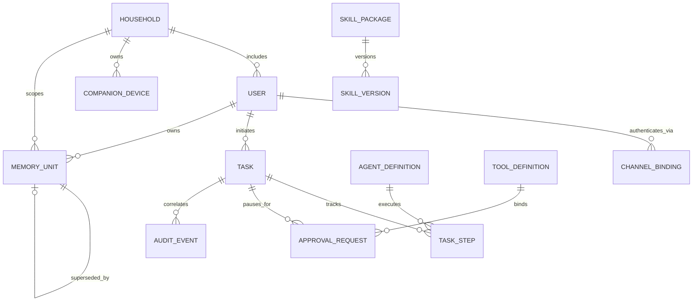

- **Canonical Key Taxonomy**: Every cross-module flow propagates `correlation_id` (root request trace UUID), `task_id` (UUID), `user_id` (`user:<uuid>`), `household_id` (`household:<uuid>`), `agent_id`, `tool_id@version`, `approval_id`, `memory_unit_id`, `skill_id@semver`, and `audit_event_id`.

### L.3 Retention, Deletion & Right-to-Forget (`[PROPOSED]`)

- **Memories**: User deletion in `MOD-02` marks `memory_units` deleted in `orbi_memory`, enqueues cascading removal in `CogneeAdapter` (vectors + orphaned graph entities/edges) and `BlobStoragePort`, removes OpenFGA `memory_unit` tuples, and appends a redacted `MEMORY_PURGED` event in `MOD-15`.
- **Ephemeral Browser/Checkpoint Artifacts**: `langgraph_checkpoints` and ephemeral Playwright screenshots auto-expire via configurable retention TTLs (e.g., 7–30 days), while `audit_events` retain redacted digests longer per audit policy.

---

## M. Security & Reliability Architecture

| Concern | Threat / Risk | Architectural Control & Enforcing Module(s) |
| :--- | :--- | :--- |
| **Threat Boundaries (`TB-01`–`TB-06`)** | Compromise of external channels, public web DOMs, or local PC pivoting into OCI core or secret vaults. | Six explicit trust boundaries (`Diagram 3`). `orbi-browser` (`MOD-13`) and future `MOD-11-SANDBOX` sit in isolated Docker networks with zero DB/Redis/Vault routes; `MOD-14` connects outbound via device-pinned mTLS. |
| **Untrusted Content & Indirect Prompt Injection** | Malicious instructions embedded inside emails, web DOMs, or desktop screen text hijacking agent control flow (`CON-07`). | `MOD-08` tags all external inputs `untrusted_external`; `MOD-04` wraps them in fenced data delimiters; Stage-1 Discovery + Stage-2 OpenFGA + Action-Bound Approvals operate entirely deterministically outside LLM reasoning (`AP-02`). |
| **Memory Poisoning** | External prompt injections persisting fake user preferences or rules into Cognee (`CON-16`). | `MOD-10` quarantines `untrusted_external` extractions; untrusted records cannot supersede (`superseded_by`) `user_explicit` facts (`DOC-HLD-001`). |
| **Tool Abuse & Hallucination** | Agent inventing tool IDs, elevating permissions, or running direct network/OS calls (`AP-01`). | 7-step Stage-1 OpenFGA discovery strips unauthorized schemas; `MOD-08` validates registered `tool_id` + JSON Schema, re-checks OpenFGA on exact target resource, and blocks any unregistered or bypassed invocation. |
| **Credential Isolation** | LLM prompting, logs, skill scripts, or `MOD-13` leaking OAuth tokens/API keys. | Secrets encrypted at rest in `orbi_app.secret_envelopes` (envelope encryption with OCI KMS or master KEK), decrypted and injected solely inside `MOD-08`/`MOD-12` at call time, and scrubbed from outputs/audits (`FR-AU-02`). |
| **Execution Sandboxing** | Browser exploits, SSRF against OCI metadata, or malicious skill scripts. | `MOD-13` runs non-root with resource limits and SSRF IP blocking; initial Phase 4 skills are `MARKDOWN_ONLY`, with future supporting scripts confined to `MOD-11-SANDBOX` (`EVAL-06`, zero ambient network/secrets). |
| **Sensitive Data & Screen Privacy** | Desktop screenshots or audit logs exposing passwords, banking screens, or PII (`CON-09`). | `MOD-14` hard-blocks password managers/UAC/banking apps locally, crops Tier 3 vision captures strictly to allowlisted windows with local masking, and `MOD-15` stores digests/redacted payloads only. |
| **Failure Isolation & Graceful Degradation** | Jev outage, OpenFGA outage, single memory branch timeout, or laptop offline stalling entire platform. | Bulkhead timeouts per adapter/branch; fail-closed OpenFGA (`NFR-REL-02`); `MOD-05` fallback to rules/LLM (`ADR-003`); `MOD-10` multi-branch partial degradation (`DOC-HLD-001`); fast `COMPANION_OFFLINE` detection via Redis presence. |
| **Observability & Auditability (`AP-07`)** | Inability to trace why an agent acted or verify compliance. | Every stage emits `correlation_id`/`task_id`-linked events to append-only `MOD-15` ledger plus OpenTelemetry structured metrics/traces exposed in `MOD-02` Dashboard. |

---

## N. Required End-to-End Sequence Diagrams

### Sequence 1: Simple Request Invoking One Tool *(e.g., "Play my Focus playlist on Spotify")*

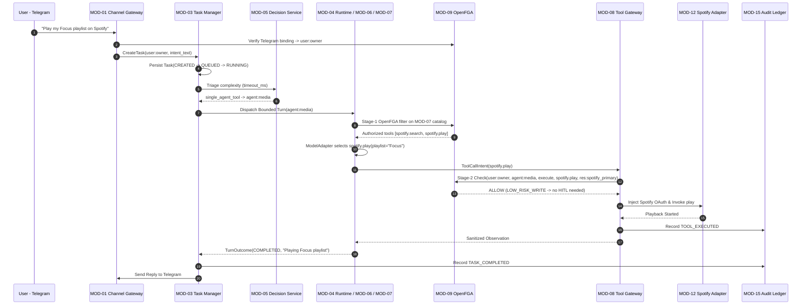

### Sequence 2: Complex Multi-Agent & Multi-Tool Task *(e.g., "Summarize unread project emails from Priya and log action items to Notion via Browser")*

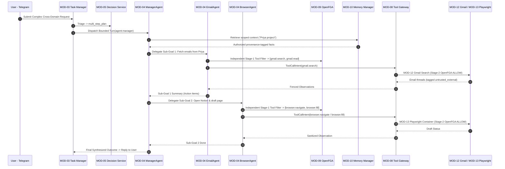

### Sequence 3: Sensitive Action Requiring Cryptographic Approval & Pre-Execution Revalidation *(e.g., "Send reply email to client")*

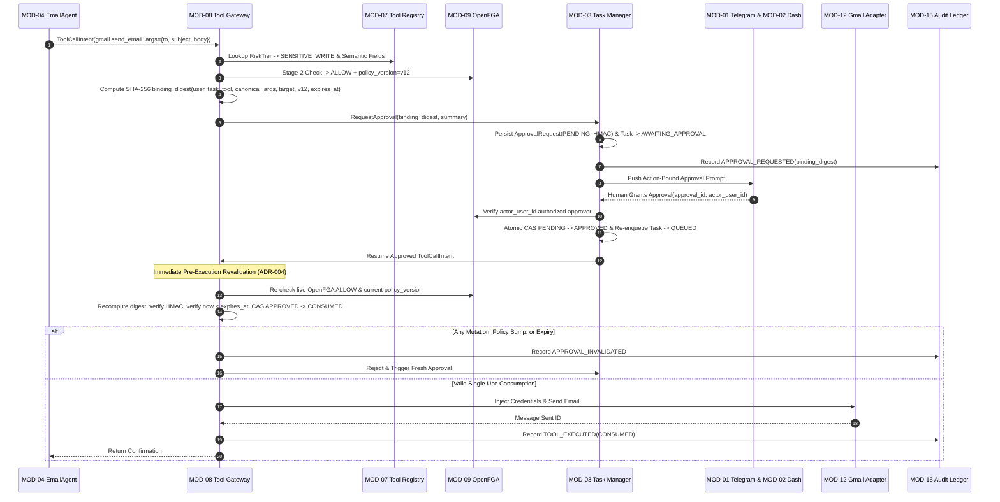

### Sequence 4: Hybrid Memory Retrieval Request *(See [memory-architecture.md](file:///f:/Projects/Orbi/docs/02-hld/memory-architecture.md) for full internal contracts)*

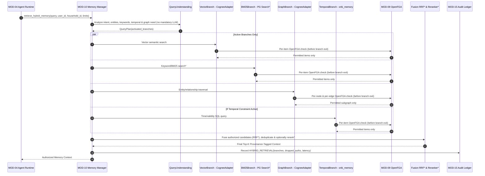
*(\* Proposed / Evaluation Required under `EVAL-03`, `EVAL-07`)*

### Sequence 5: Task Involving the Windows Local Companion

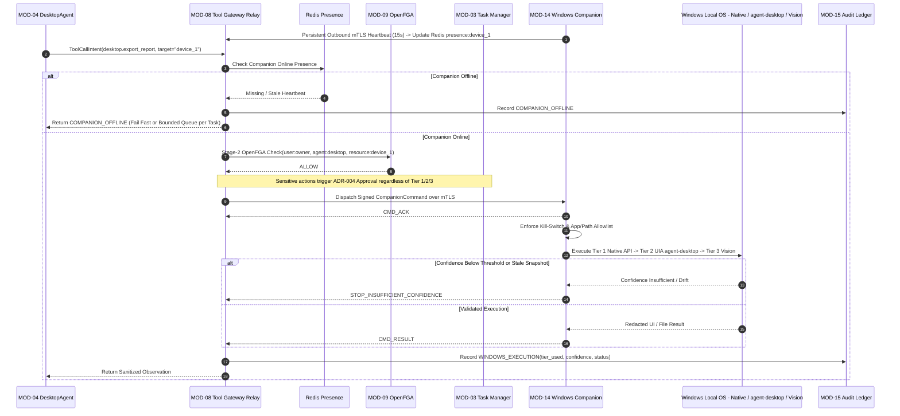

---

## O. Unresolved Architectural Choices — Alternatives, Trade-Offs & Recommendations

To avoid locking untested assumptions prior to spike validation (`EVAL-01`–`EVAL-07`) and HLD sign-off, all open questions (`OQ-01`–`OQ-14`) carry structured evaluations below:

| Open Question / Spike | Candidate Alternatives | Trade-Offs | Architect Recommendation | Evaluation / Exit Criteria |
| :--- | :--- | :--- | :--- | :--- |
| **`OQ-01` Dashboard Frontend Stack** | (A) **Next.js / React SPA** (`orbi-dashboard` container) (B) **HTMX + Jinja2/Tailwind** served by FastAPI (C) **Vite + React/TS** static SPA | (A)/(C) deliver richer graph visualization (`MOD-10` memory graph) and WebRTC/noVNC takeover UI (`MOD-13`), at the cost of Node build tooling; (B) minimizes containers (`AP-09`) but limits interactive graph/canvas UX. | **(C) Vite + React + TypeScript** static build served behind reverse proxy calling FastAPI BFF. Keeps SSR complexity zero while supporting rich graph/takeover/diff UIs. | Owner confirmation on frontend stack prior to LLD (`Phase 2`). |
| **`OQ-04` Initial LLM Providers & Budgets** | (A) Frontier Cloud APIs (Anthropic/OpenAI/Gemini) via LiteLLM/custom `ModelAdapter` (B) Local Ollama + Cloud hybrid | Cloud APIs maximize reasoning reliability for LangGraph tool selection without GPU RAM overhead on OCI; local models reduce marginal cost but cannot fit cleanly on CPU-only OCI VMs. | **Cloud Frontier APIs behind `ModelAdapter`** with small fast tier for simple tasks and configurable daily/per-task USD & token caps in `MOD-03`. | Owner sets starter provider keys & daily/per-task spend thresholds. |
| **`OQ-05` / `EVAL-05` OCI VM Sizing** | (A) OCI Always-Free ARM (`VM.Standard.A1.Flex` up to 4 OCPU / 24 GB RAM if capacity available) (B) Paid OCI Flex VM (`16–32 GB RAM`) | Always Free ARM saves cost (`\$0`) but suffers regional capacity scarcity and ARM64 container compatibility checks (`agent-desktop`/Playwright/ONNX); paid Flex ensures availability & predictable IOPS. | **Never assume Always Free suffices.** Run Docker Compose memory/CPU load benchmark (`EVAL-05`) with Postgres, Redis, OpenFGA, `orbi-core`, Playwright, and Cognee backends before choosing shape. | Measured idle & peak RAM/CPU under concurrent browser + memory workloads. |
| **`OQ-06` / `EVAL-03` / `EVAL-07` Cognee Backends & Search** | (A) Cognee on `orbi-postgres` (`pgvector`) + embedded graph (Kuzu) + PG FTS/BM25 (`pg_search`) (B) Dedicated Neo4j/Qdrant/Meilisearch containers | (A) honors `AP-09` minimal containers on 1 VM; (B) adds 3+ stateful JVM/Rust containers blowing single-VM RAM, though potentially richer native graph/BM25 features. | **Test (A) first** in `EVAL-03` & `EVAL-07`; introduce extra graph/search containers **only** if Cognee lacks support or PG search fails `EVAL-07` quality/latency targets. | Pass `EVAL-03` 6-dimension audit + `EVAL-07` `Recall@10 >= 0.85`, `MRR >= 0.80`, $0\%$ leakage. |
| **`OQ-08` Sensitivity Matrix & Approval TTLs** | (A) Strict conservative defaults (all external writes/sends `SENSITIVE_WRITE`, deletes/payments `IRREVERSIBLE`, 15m interactive TTL) (B) Permissive auto-drafts | Conservative defaults prevent accidental external messages/purchases (`AP-06`) at slight friction; permissive risks silent unwanted side effects. | **Conservative defaults** (`READ_ONLY` auto; internal drafts `LOW_RISK_WRITE`; sending emails, public posts, desktop submissions `SENSITIVE_WRITE` w/ 15m–1h TTL; deletes/purchases `IRREVERSIBLE` w/ 15m TTL). | Owner sign-off on per-tool tier table before Phase 1 LLD. |
| **`OQ-11` / `EVAL-06` Skill Script Sandbox** | (A) Ephemeral unprivileged Docker container (`--network=none`, `--read-only`) (B) gVisor / Firecracker microVM (C) Restricted Pyodide / WASM | Docker `--network=none` is straightforward on OCI Compose; gVisor adds stronger kernel isolation if nested cleanly on OCI VM; WASM avoids container cold start but limits Python C-extensions. | **Launch Phase 4 with `MARKDOWN_ONLY` skills (`CON-17`)**, then evaluate **(A)/(B)** vs. **(C)** in `EVAL-06` before enabling supporting scripts. | Security escape test pass + invocation latency $< 500\text{ ms}$. |
| **`OQ-12` / `EVAL-02` Windows UIA & Vision Thresholds** | (A) Native -> `agent-desktop` UIA -> Multimodal Vision API fallback (B) Local lightweight grounding model | Cloud multimodal grounding on cropped/redacted windows avoids shipping large vision models on user's laptop while preserving `STOP_INSUFFICIENT_CONFIDENCE`; local grounding keeps pixels offline at higher laptop GPU cost. | **Native API -> `agent-desktop` UIA -> Window-Cropped/Redacted Cloud Vision** with strict confidence floor (`>= 0.85` proposed), perceptual hash check, and zero silent retries. | Pass `EVAL-02` Windows app matrix + PII redaction verification. |
| **`OQ-13` / `EVAL-07` Memory Reranker Mode** | (A) `NoOp` RRF only (B) Local CPU ONNX cross-encoder (C) External Rerank API | `NoOp` costs `0 ms` & `0 MB RAM`; local cross-encoder adds ~`1–2 GB RAM` + CPU latency on OCI VM; API reranker keeps VM lean at small per-call cost. | **Benchmark (A) vs. (B) vs. (C)** in `EVAL-07`; ship `NoOp` or API reranker in Phase 2 unless local ONNX fits comfortably inside `EVAL-05` RAM budget. | $\Delta \text{NDCG@5}$ lift vs. latency & RAM overhead in `EVAL-07`. |
| **`OQ-14` Bi-Temporal Supersession Policy** | (A) Auto-close `valid_to` on `user_explicit` facts (B) Queue all contradictions for Dashboard review | Auto-closing keeps current preference queries accurate immediately while preserving history; review queue guarantees zero silent errors on ambiguous edits. | **Hybrid**: Auto-close `valid_to` (`superseded_by`) for explicit user corrections; hold `untrusted_external` contradictions in quarantine for Dashboard review (`CON-16`). | Validated in `MEM-EVAL-04` and `MEM-EVAL-10`. |
| **`EVAL-01` Optional Jev Provider** | (A) Enable `JevDecisionProvider` + fallback (B) `DeterministicRule` + fast `LLMDecisionProvider` only | Jev promises fast calibrated `noul`/`choice`/`score`, but adds an external vendor dependency requiring benchmark validation from OCI. | Keep Jev strictly behind `DecisionService` (`MOD-05`) and deploy Phase 1 with rules + LLM fallback until `EVAL-01` proves positive ROI. | Latency, accuracy & calibration benchmark across 30+ triage/risk prompts. |
| **`EVAL-04` LangGraph Turn Checkpointing** | (A) Stateless per-turn invocation + `MOD-03` summary state (B) Scoped `langgraph_checkpoints` cleaned on completion | Scoped checkpoints allow clean intra-turn recovery while keeping `MOD-03` authoritative over `AWAITING_APPROVAL` (`CON-18`). | **Scoped `langgraph_checkpoints`** subordinated strictly to `orbi_app.tasks` (`AP-03`). | Verified pause/restart/approval-resume test with zero split-brain state. |
