# Orbi — Overall System High-Level Design (HLD)

- **Document ID**: `DOC-HLD-002`
- **Revision**: `1.4` *(Final HLD Refinement: Centralized Human-in-the-Loop Interaction & Execution Suspension, Multi-Channel Secure Input/Takeover, and Remaining Memory/Automation Safety Clarifications)*
- **Phase**: `02-HLD`
- **Status**: `Draft - For Review`
- **Last Updated**: `2026-11-17`
- **Authoritative Sources**:
  - Product Baseline: [vision.md](file:///f:/Projects/Orbi/docs/00-product/vision.md) (`DOC-PRD-001`), [requirements.md](file:///f:/Projects/Orbi/docs/00-product/requirements.md) (`DOC-PRD-002`), [scope-and-roadmap.md](file:///f:/Projects/Orbi/docs/00-product/scope-and-roadmap.md) (`DOC-PRD-003`)
  - General Level Design: [system-overview.md](file:///f:/Projects/Orbi/docs/01-gld/system-overview.md) (`DOC-GLD-001`), [module-catalog.md](file:///f:/Projects/Orbi/docs/01-gld/module-catalog.md) (`DOC-GLD-002`), [functional-responsibilities.md](file:///f:/Projects/Orbi/docs/01-gld/functional-responsibilities.md) (`DOC-GLD-003`)
  - Architecture Decision Records: [ADR-001](file:///f:/Projects/Orbi/docs/04-adr/ADR-001-modular-monolith-and-resource-isolation.md) through [ADR-009](file:///f:/Projects/Orbi/docs/04-adr/ADR-009-autonomous-agent-automation-platform.md)
  - Memory Subsystem Authority: [memory-architecture.md](file:///f:/Projects/Orbi/docs/02-hld/memory-architecture.md) (`DOC-HLD-001`)

> **Epistemic Discipline**: Every confirmed decision (`[CONFIRMED]`), proposed HLD design (`[PROPOSED]`), evaluation-gated capability (`[EVALUATION REQUIRED]` `EVAL-01`–`08`), and unresolved open question (`[OPEN QUESTION]` `OQ-01`–`17`) preserves strict alignment with the Product/GLD Rev 1.4 baseline and ADRs. Untested proposals (e.g., Jev provider efficacy, Cognee backend selection, BM25/RRF/reranking parameters, OCI Always-Free VM adequacy, Dashboard UI framework, Skill script sandbox runtime, future credential manager integration, and Automation quotas/condition DSL) are never represented as finalized facts, nor are documented architectures claimed to be implemented in code.

---

## A. Overall Architecture

### A.1 System Context & External Actors

`[CONFIRMED]` Orbi is a personal AI agent platform connecting conversational channels, an operator dashboard, deterministic task governance, hybrid knowledge memory, external SaaS APIs, cloud browser automation, and local Windows desktop interaction—while preserving clean extension boundaries for future household members (`ADR-002`), Home Assistant/MQTT IoT (`ADR-006`), and a Developer Agent (`AP-10`).

#### Diagram 1: Overall System Context

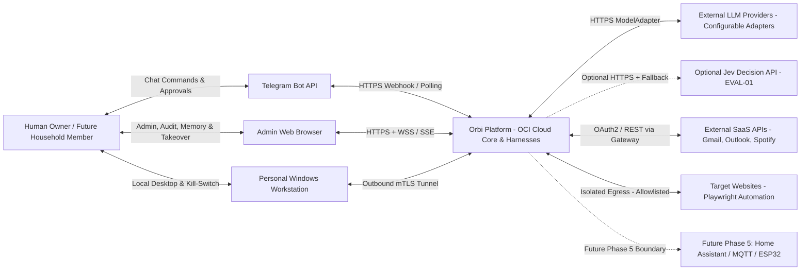

### A.2 Four-Plane Logical Architecture (`CON-21` Reconciliation)

To satisfy `AP-08` (modularity) and `AP-09` (no unnecessary microservices), Orbi maps its 17 core modules (`MOD-01`–`MOD-15`, `MOD-17`, `MOD-18`, plus `MOD-16-EXT`) across **four logical planes** aligned 1-to-1 with the **three physical isolation zones** defined in [ADR-001](file:///f:/Projects/Orbi/docs/04-adr/ADR-001-modular-monolith-and-resource-isolation.md):

| Logical HLD Plane | Mapped GLD Modules | Physical Execution Zone (`ADR-001`) | Architectural Responsibility |
| :--- | :--- | :--- | :--- |
| **1. Control Plane** | `MOD-01`, `MOD-02` (BFF + UI), `MOD-03`, `MOD-04`, `MOD-05`, `MOD-08`, `MOD-11` (Manager), `MOD-17` (Automation Platform), `MOD-18` (Result & Delivery) | Zone 1 (`orbi-core` API/Worker) + Zone 2b (`orbi-dashboard`) | User ingress, deterministic task FSM, autonomous triggers/condition monitors/responsibilities (`MOD-17` Phabric-reusable core), bounded cognitive turns, Decision Service, Gateway enforcement, result/callback delivery, skill lifecycle control. |
| **2. Trusted Data & Policy Plane** | `MOD-06`, `MOD-07`, `MOD-09`, `MOD-10: Memory Manager`, `MOD-15`, `orbi_automation` store, Postgres, Redis, Blob Store | Zone 1 (`MOD-06`/`07`/`10`/`15`/`17` facades) + Zone 2b (`orbi-openfga`, `orbi-postgres`, `orbi-redis`) | Authoritative task state, persistent automations/responsibilities/versions, agent/tool/skill registries, OpenFGA ReBAC policies (incl. 3-point delegation checks), canonical memory catalog (`orbi_memory`) & audit ledger, secret vault. |
| **3. Isolated Execution Plane** | `MOD-12` (Stateless SaaS), `MOD-13` (Playwright), `MOD-11-SANDBOX` (Future Scripts), Internal Replaceable `CogneeAdapter` Stores | Zone 1 Gateway-mediated (`MOD-12`) + Zone 2a (`orbi-browser`, `MOD-11-SANDBOX`) + Zone 2b (`CogneeAdapter` backends) | Executes side-effecting APIs, untrusted DOM rendering, future skill scripts, and swappable Cognee vector/graph processing outside `MOD-04` trust. |
| **4. Local Execution Plane** | `MOD-14` (Windows Companion), Future `MOD-16-EXT` (IoT Bridge) | Zone 3 (Off-Cloud Local Workstation / Home LAN) | Outbound mTLS client executing Native API -> UIA (`agent-desktop`) -> Controlled Vision Fallback under local kill-switch & app policies; future IoT event/sensor boundary. |

#### Diagram 2: Logical Architecture Across the Four Planes

```mermaid
flowchart TB
    subgraph CP["1. Control Plane - Ingress, Orchestration, Automation & Enforcement"]
        MOD01["MOD-01: Channel Gateway - Telegram"]
        MOD02["MOD-02: Dashboard UI & FastAPI BFF"]
        MOD03["MOD-03: Deterministic Task Manager"]
        MOD04["MOD-04: LangGraph Runtime & Model Adapters"]
        MOD05["MOD-05: Decision Service - Rules/LLM/Optional Jev"]
        MOD08["MOD-08: Tool Execution Gateway"]
        MOD11["MOD-11: Skill Lifecycle Manager"]
        MOD17["MOD-17: Autonomous Automation Platform - Phabric Port"]
        MOD18["MOD-18: Result & Delivery Manager"]
    end

    subgraph TDPP["2. Trusted Data & Policy Plane - State, Registries & Authz"]
        MOD06["MOD-06: Central Agent Registry"]
        MOD07["MOD-07: Central Tool Registry"]
        MOD09["MOD-09: OpenFGA Policy Engine"]
        MOD10["MOD-10: Memory Manager - HLD-001"]
        MOD15["MOD-15: Append-Only Audit Ledger"]
        PG["PostgreSQL - orbi_app / orbi_memory / orbi_automation / openfga / lg_ckpt"]
        REDIS["Redis - Queues, Timers, Leases & PubSub"]
        VAULT["Encrypted Secret Store & Blob Volume"]
    end

    subgraph IEP["3. Isolated Execution Plane - Untrusted Workloads & SaaS"]
        MOD12["MOD-12: SaaS Adapters - Gmail, Spotify, MCP"]
        MOD13["MOD-13: Playwright Cloud Browser Container"]
        MOD11_SB["MOD-11-SANDBOX: Future Skill Script Sandbox"]
        COGNEE["Internal Replaceable CogneeAdapter Backends - EVAL-03"]
    end

    subgraph LEP["4. Local Execution Plane - Off-Cloud User Hardware"]
        MOD14["MOD-14: Windows Companion - Native / UIA / Vision"]
        MOD16["MOD-16-EXT: Future Home Assistant / MQTT / ESP32"]
    end

    MOD01 --> MOD03
    MOD02 <--> MOD03
    MOD02 <--> MOD09
    MOD02 <--> MOD10
    MOD02 <--> MOD11
    MOD02 <--> MOD17
    MOD02 --> MOD15

    MOD03 <--> REDIS
    MOD03 <--> PG
    MOD03 <--> MOD04
    MOD03 --> MOD05
    MOD03 --> MOD15
    MOD03 --> MOD18

    MOD04 --> MOD05
    MOD04 --> MOD06
    MOD04 --> MOD07
    MOD04 --> MOD09
    MOD04 <--> MOD10
    MOD04 <--> MOD11
    MOD04 -- "ToolCallIntent ONLY - incl. automation.*" --> MOD08

    MOD08 --> MOD07
    MOD08 --> MOD09
    MOD08 <--> MOD03
    MOD08 --> VAULT
    MOD08 --> MOD15
    MOD08 <--> MOD17

    MOD17 -- "Dispatch Normal Task" --> MOD03
    MOD17 --> MOD06
    MOD17 --> MOD09
    MOD17 <--> PG
    MOD17 <--> REDIS
    MOD17 --> MOD15

    MOD18 --> MOD01
    MOD18 --> MOD02
    MOD18 -- "Completion Callbacks" --> MOD17
    MOD18 --> MOD15

    MOD08 --> MOD12
    MOD08 --> MOD13
    MOD08 -. "Phase 4+ Future Scripts" .-> MOD11_SB
    MOD14 -- "Outbound mTLS Tunnel" --> MOD08
    MOD16 -. "Phase 5 Future IoT" .-> MOD08

    MOD09 <--> PG
    MOD10 <--> PG
    MOD10 <--> MOD09
    MOD10 <--> COGNEE
    MOD15 --> PG
    MOD11 --> PG
    MOD11 --> MOD07
```

### A.3 Deployment Topology & Trust Boundaries

`[CONFIRMED]` Cloud services deploy via **Docker Compose on a single Oracle Cloud Infrastructure (OCI) VM** (`ADR-001`, VM hardware sizing gated by `EVAL-05` rather than assuming Always-Free adequacy).

#### Diagram 3: Deployment Topology & Trust Boundaries

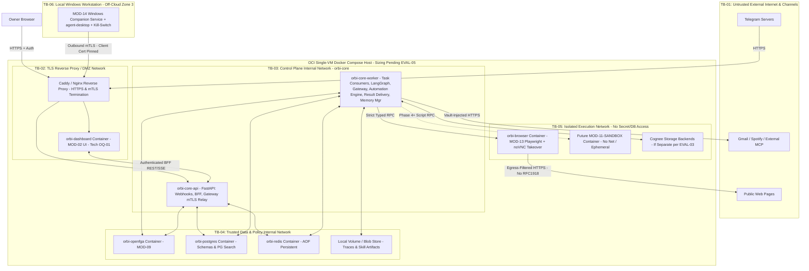

### A.4 Module Communication Patterns & Trust Boundary Rules

| Boundary Crossing | Transport Mechanism | Authentication / Enforcement |
| :--- | :--- | :--- |
| **`TB-01` -> `TB-02` (Telegram)** | HTTPS Webhook (or outbound polling fallback) | Telegram secret token header + `MOD-01` sender allowlist mapped to OpenFGA `user:<id>` (`ASM-07`). |
| **`TB-02` -> `TB-03` (Dashboard)** | HTTPS REST + WebSocket / SSE via FastAPI BFF | Authenticated session cookie / WebAuthn + CSRF check + OpenFGA owner/member verification. |
| **`TB-03` Internal (`orbi-core`)** | Typed Python `Protocol` calls (in-process) & Redis streams (`API <-> Worker`) | Static/runtime architectural boundary tests (`AP-08`); `MOD-04` has zero import access to `MOD-12` secrets or DB write handles for `tasks`. |
| **`TB-03` -> `TB-04` (OpenFGA & Data)** | Internal Docker bridge network (unexposed to host public IP) | Dedicated DB credentials per schema (`orbi_app`, `orbi_memory`, `orbi_automation`, `openfga`); fail-closed OpenFGA gRPC/HTTP client. |
| **`TB-03` -> `TB-05` (Playwright / Sandbox)** | Internal isolated Docker network (`--internal` for `MOD-11-SANDBOX`) | `MOD-13` container has zero DB, Redis, or secret-vault network routes and blocks RFC1918/link-local SSRF targets. |
| **`TB-06` -> `TB-02/03` (Windows Companion)** | Outbound-initiated persistent WebSocket/gRPC stream over mTLS (`ASM-05`) | Client X.509 device certificate pinned in `MOD-09` + per-command signed envelope + local Windows kill-switch. |

---

## B. Agent Architecture (`MOD-04`, `MOD-05`, `MOD-06`)

`[CONFIRMED]` Orbi separates deterministic routing/orchestration (`MOD-03`, `MOD-05`) from cognitive reasoning (`MOD-04` LangGraph), ensuring agents are declarative identities with strictly bounded capabilities.

### B.1 Central Agent Registry (`MOD-06`) & Agent Profiles

Every agent in Orbi must exist as an active record in `orbi_app.agent_definitions`:
- **Core Fields**: `agent_id` (e.g., `agent:manager`, `agent:email`, `agent:media`, `agent:browser`, `agent:desktop`, `agent:skill_author`, plus extensible domain specialists such as `agent:plant_care`), `version`, `status` (`ACTIVE | DEPRECATED | DISABLED`), `role_summary`, `system_prompt_ref`, `model_profile_id`, `max_turns_per_step`, `configured_tool_ids[]`, `configured_skill_ids[]`, `automation_delegation_policy` (`can_create_automations`, `allowed_execution_targets[]`, `max_trigger_depth`), and `openfga_principal`.
- **Future Extensible Personas (`AP-10`)**: `agent:iot` (Phase 5 Home Assistant/MQTT) and `agent:developer` (Phase 5 isolated coding workspace).

### B.2 Agent Router, Decision Service (`MOD-05`), Manager/Planner Agent & Autonomous Scheduling

1. **Request Triage (`MOD-03` + `MOD-05`)**: When a task starts, `MOD-03` optionally invokes `MOD-05` (**Provider-Independent Decision Service**, [ADR-003](file:///f:/Projects/Orbi/docs/04-adr/ADR-003-provider-independent-decision-and-llm-adapters.md)) to classify complexity (`direct_qa`, `single_agent_tool`, `multi_step_plan`) and urgency (`noul`).
   - `MOD-05` tries deterministic heuristics first, optionally calls **Jev by TypeSafe** (`EVAL-01`) under a strict timeout (`timeout_ms`), and falls back transparently to `LLMDecisionProvider` if Jev is disabled, slow, or low-confidence (`CON-12`).
2. **Simple Requests vs. Complex Multi-Agent Tasks**:
   - **Simple Single-Domain Request**: If triage confidently routes to one specialized agent (e.g., `agent:media` for Spotify playback), `MOD-03` dispatches a bounded turn directly to that agent, avoiding unnecessary Manager planner overhead.
   - **Complex / Cross-Domain Task**: `MOD-03` dispatches to **`ManagerAgent`**, which decomposes the user goal into an explicit `SubGoalPlan`, delegates individual sub-tasks to specialized agents (`EmailAgent`, `BrowserAgent`, `DesktopAgent`, or a domain specialist orchestrating an ongoing `AgentResponsibility`), synthesizes intermediate observations, and checks completion criteria.
3. **Autonomous Recognition of Future & Ongoing Work (`ADR-009`)**:
   - When an agent's reasoning concludes that its goal spans time, external events, or monitored conditions—either during task planning, after completing a step, or upon receiving new observations—it emits structured `ToolCallIntent` calls to `automation.*` (`MOD-08` -> `MOD-17`) to arrange follow-ups, recurring schedules, event subscriptions, or non-LLM condition monitors, and to update/pause/cancel automations it owns without waiting for repeated user prompting.

### B.3 LangGraph Runtime & Provider-Independent Model Adapters

- `MOD-04` executes each bounded turn inside a LangGraph `StateGraph` (`Reason -> SelectToolIntent -> ObserveToolResult -> ConcludeOrYield`).
- **Model Adapter Port (`ADR-003`)**: Graph nodes never call OpenAI/Anthropic/Gemini SDKs directly. They invoke `ModelAdapterPort.generate(messages, authorized_tools, budget_remaining)` which tracks token usage per step and feeds `MOD-03` budget accounting (`OQ-04`).
- **Turn Yield Rules (`AP-03`, `ADR-009`)**: LangGraph exits a turn via structured checkpoint/interrupt and returns control to `MOD-03` whenever: (a) a final answer is ready, (b) the agent delegates future work/monitoring to `MOD-17` via `automation.*` and finishes the current planning cycle (**never** keeping an LLM session alive merely to wait for time or events), (c) human intervention is needed via any of the five centralized HITL types (`INFORMATION_REQUEST`, `APPROVAL_REQUEST`, `SECURE_INPUT_REQUEST`, `HUMAN_TAKEOVER`, `PHYSICAL_ACTION_REQUEST`) -> `MOD-03` persists `InteractionRequest` and transitions task to **`WAITING_FOR_USER`**, releasing the worker cleanly, or (d) `max_turns_per_step` is reached.

### B.4 Mandatory Initialization & Authorized Tool Discovery (`ADR-002`)

Every time `MOD-04` initializes an agent—whether top-level, delegated inline by `ManagerAgent`, or invoked asynchronously by a `MOD-17` automation dispatch—it enforces the exact 7-step discovery pipeline:
1. Manager, Router, or `MOD-17` Automation Target selects `agent_id` from `MOD-06`.
2. `MOD-04` initializes the agent runtime with `ModelAdapter` and task budget (and, for automation-triggered tasks, the explicit `PermissionEnvelope` — **never** inheriting creator permissions).
3. `MOD-04` fetches `configured_tool_ids` metadata and JSON schemas from `MOD-07` (including any authorized `automation.*` tools).
4. `MOD-04` invokes `MOD-09` (OpenFGA) to filter candidate tools against `(tenant_id, owner_principal, agent_id, instance_id)` and active `PermissionEnvelope` permissions (`Stage-1 Filtering`).
5. `MOD-04` binds **only** the authorized tool definitions and schemas into LangGraph's tool-calling schema list.
6. The LLM selects from the authorized list (`ToolCallIntent`).
7. Every invocation passes through `MOD-08` (**Tool Execution Gateway**).

### B.5 Agent-to-Agent Delegation & Context Construction

- **Synchronous Sub-Goal Delegation (`ManagerAgent -> SpecializedAgent`)**: When `ManagerAgent` delegates an immediate sub-goal, the runtime creates a child cognitive turn scoped strictly to that sub-goal. `SpecializedAgent` performs its **own independent 7-step tool discovery** (`MOD-06` -> `MOD-07` -> `MOD-09`); child agents never inherit `ManagerAgent` prompts or unconstrained tool handles.
- **Asynchronous Automation Delegation (`MOD-04 -> MOD-08 -> MOD-17`)**: When an agent schedules future work or condition triggers targeting an `execution_target` (`AGENT`, `WORKFLOW` if registered; `SCRIPT` disabled until `EVAL-06`), `MOD-17` records separated `tenant_id`, `owner_principal`, `creator_principal`, `execution_target`, and immutable `PermissionEnvelope` bounds, enforcing 3-point OpenFGA authorization (`Section D.8`). When the trigger fires, `execution_target` wakes in a fresh bounded turn under its own identity intersected with the active envelope—with zero inherited creator privileges.
- **Context Construction & Injection Fencing**:
  - `MOD-04` constructs prompts in separated structural sections: `[1. System Role]`, `[2. Authorized Skill Instructions (SKILL.md)]`, `[3. Scoped Responsibility / Automation Context]`, `[4. Provenance-Tagged Memory Context from MOD-10: Memory Manager]`, `[5. Authenticated User Request or Trigger Payload]`, and `[6. Fenced Untrusted Observations]`.
  - Graph-derived context items returned by `MOD-10: Memory Manager` contain strictly scope-authorized projections backed by verified `source_memory_unit_ids[]` (`DOC-HLD-001` §4 Stage 3); unauthorized sources never influence labels, summaries, or relationships.
  - Any content tagged `untrusted_external` (emails, web DOMs, UI OCR) is wrapped in explicit data delimiters and flagged as untrusted data, never elevated into system/developer instruction blocks.
  - Sensitive credentials entered during `SECURE_INPUT_REQUEST` **never** enter `MOD-04` context construction, message history, or `langgraph_checkpoints` (`Section E.5`).

#### Diagram 4: Agent Request Lifecycle

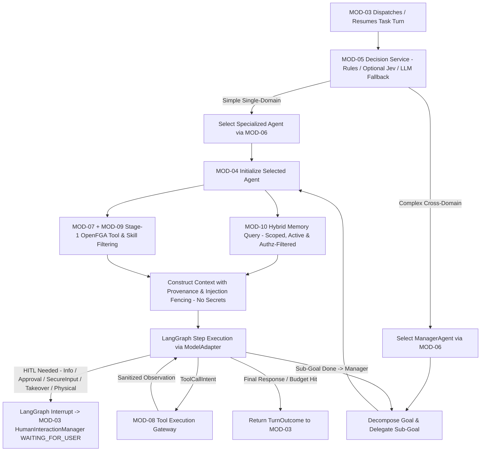

---

## C. Tool Platform (`MOD-07`, `MOD-08`, `MOD-09`, `MOD-12`, `MOD-15`)

`[CONFIRMED]` No agent, LangGraph node, or skill script can perform external I/O directly. All capabilities are governed through `MOD-07` and `MOD-08`.

### C.1 Central Tool Registry (`MOD-07`), Schemas & Versioning

Each tool definition in `orbi_app.tool_definitions` stores:
- **Identity & Pinning**: `tool_id` (e.g., `gmail.send_email`, `automation.create_condition_monitor`), immutable `tool_version` (`1.2.0`), `adapter_type` (`NATIVE_PYTHON | API_SDK | AUTOMATION_PLATFORM | PLAYWRIGHT_RPC | WINDOWS_COMPANION | MCP_CLIENT | SKILL_SCRIPT`), `isolation_zone`.
- **Contracts**: JSON Schema for `input_schema` and `output_schema`.
- **Semantic vs. Volatile Argument Split (`CON-10`)**: Declares which input fields are *semantic action fields* hashed into approval digests (`to`, `subject`, `body`, `target_resource`) versus ephemeral execution metadata (`snapshot_epoch`, `pagination_cursor`).
- **Governance & External Idempotency Metadata**: `sensitivity_tier` (`READ_ONLY`, `LOW_RISK_WRITE`, `SENSITIVE_WRITE`, `IRREVERSIBLE`), `idempotent` (`bool`), `external_idempotency_mode` (`PROVIDER_IDEMPOTENCY_KEY | RECONCILABLE_READ_PROBE | NON_IDEMPOTENT_NO_RECONCILE`), `idempotency_window_seconds` *(optional documented provider dedup TTL)*, `reconciliation_probe_tool_id` *(optional `READ_ONLY` probe for status verification)*, `timeout_ms`, `rate_limit_bucket`.

### C.2 Tool Execution Gateway (`MOD-08`) & Adapter Architecture (`CON-19`, `PART 7.2`)

`MOD-08` exposes two tightly governed ingress entry points—`execute_tool_intent()` (from `MOD-04` / `MOD-11-SANDBOX`, plus ephemeral secret handle injection for `SECURE_INPUT_REQUEST`) and `execute_readonly_probe()` (exclusively for `MOD-17`'s non-LLM `ConditionEvaluator` checking `READ_ONLY` sensor/API/inference probes per `CON-24`)—enforcing eight deterministic gates in sequence:
1. **Existence & Schema Gate**: Reject unknown `tool_id` (preventing invented tool IDs) and validate arguments strictly against `MOD-07` JSON Schema. Probe calls from `MOD-17` additionally fail closed if `sensitivity_tier != READ_ONLY`.
2. **Idempotency, Immutable Action Identity & Write-Ahead Step-Receipt Gate**: Compute and persist the stable **`action_idempotency_key`** (`sha256(tenant_id, task_id, execution_id, logical_step_id, tool_id, tool_version, canonical_arguments_hash, target_resource, approval_id?)`) inside `orbi_app.step_execution_receipts` (`PREPARED` state) prior to Gate 5 dispatch:
   - **Durable Receipt States (`ReceiptStatus`)**:
     - `PREPARED`: Registered locally with immutable action identity; zero bytes transmitted externally.
     - `DISPATCHING`: Write-ahead state committed in PG inside Gate 5 **immediately before** network/harness transmission (`dispatched_at`, `dispatched_claim_epoch`, `provider_correlation_token`).
     - `CONFIRMED_SUCCESS`: Provider (or status reconciliation probe) confirmed success; stores sanitized result + provider reference ID (`approval_requests` finalized `CONSUMED`).
     - `CONFIRMED_FAILURE_SAFE_TO_RETRY` / `CONFIRMED_FAILURE_TERMINAL`: Transport or provider deterministically confirmed zero side effect occurred (e.g., pre-send validation error or explicit 4xx rejection).
     - `UNKNOWN_OUTCOME`: Entered on post-transmission timeout, network drop, ambiguous 5xx, OR when a replacement worker recovers a stale `RUNNING` lease and discovers an unfinalized `DISPATCHING` receipt.
   - **Immutable Retry Invariant**: Any retry or recovery of `(task_id, logical_step_id)` MUST match the persisted receipt's `(tool_id, tool_version, canonical_arguments_hash, target_resource, approval_id, action_idempotency_key)` byte-for-byte; retries can **never** mutate approved arguments, target resource, or logical action identity.
   - **Disposition Before Re-Dispatch**:
     - If `CONFIRMED_SUCCESS`: immediately return stored sanitized output (`0` external calls).
     - If `PREPARED`: never transmitted; revalidate Gate 5 and dispatch using the stored `action_idempotency_key`.
     - If `DISPATCHING` (on stale-lease recovery -> transition to `UNKNOWN_OUTCOME` first) or `UNKNOWN_OUTCOME`: follow the **Uncertain-Outcome Reconciliation & No-Blind-Retry Protocol** in Gate 5 below—never blindly re-executing a non-idempotent side effect.
3. **Stage-2 OpenFGA Gate (`MOD-09`)**: Query `Check(user_id, household_id, agent_id, execute, tool_id, target_resource)` (plus `automation` scope & Point-1/Point-2 authorization for `automation.*` calls) and retrieve current `policy_version`. Fail closed if OpenFGA is unreachable (`NFR-REL-02`).
4. **Sensitivity & Action-Bound HITL Gate (`MOD-03` / `ADR-004`)**: If `sensitivity_tier` is `SENSITIVE_WRITE` or `IRREVERSIBLE` (or OpenFGA policy / `MOD-05` risk signal escalates the call), check for a valid `APPROVED` `ApprovalRequest` linked to `HumanInteractionManager` matching the exact canonical payload digest (ordinary `INFORMATION_REQUEST` replies never satisfy this gate). If absent, trigger `MOD-03` pause (`WAITING_FOR_USER` / `APPROVAL_REQUEST`). Similarly, active `HUMAN_TAKEOVER` freezes `MOD-08` dispatches to the target session until the owner yields control back.
5. **Pre-Dispatch Cancellation, Generation, Claim-Epoch & Write-Ahead Receipt Gate (`PART 7.2`)**: Immediately before credential injection and adapter dispatch for *every* action, `MOD-08` executes an authoritative check in PostgreSQL + `MOD-09` and commits write-ahead `DISPATCHING`:
   - Verify `orbi_app.tasks`: `status == 'RUNNING'`, `cancellation_requested == false`, matching `task_version`, **live `claim_epoch == intent.claim_epoch`**, **`lease_expires_at > now()`**, and matching non-null `resume_token_id` when executing inside a resumed HITL turn (immediately rejecting woken zombie workers whose lease expired with `STALE_CLAIM_EPOCH_FENCED`);
   - If automation-triggered (`automation_execution_id IS NOT NULL`), verify `orbi_automation.automation_definitions`: `status == 'ACTIVE'` and matching `schedule_version` & `generation`;
   - Revalidate live `MOD-09` OpenFGA `policy_version`, consume single-use approval (`APPROVED -> CONSUMED`, if applicable), and atomically transition `step_execution_receipts` `PREPARED | CONFIRMED_FAILURE_SAFE_TO_RETRY -> DISPATCHING` **before** calling the external adapter.
   - **Limits of `claim_epoch` & Approval Consumption**: `claim_epoch` fences Orbi-internal PostgreSQL writes and pre-dispatch Gateway calls (`STALE_CLAIM_EPOCH_FENCED`), and `approval_requests` consumption bounds single-use authorization, **but neither mechanism can recall, cancel, or prove completion of an external provider request once `DISPATCHING` has crossed the network boundary**.
   - **Uncertain-Outcome (`DISPATCHING -> UNKNOWN_OUTCOME`) Recovery Rules**:
     - *`RECONCILABLE_READ_PROBE`*: Invoke `reconciliation_probe_tool_id` (`READ_ONLY`) first. If the provider confirms execution succeeded, record `EXTERNAL_OUTCOME_RECONCILED_SUCCESS` (`MOD-15`) and transition `UNKNOWN_OUTCOME -> CONFIRMED_SUCCESS` without re-sending; if the probe proves the side effect did not occur, transition `CONFIRMED_FAILURE_SAFE_TO_RETRY` and retry with the exact `action_idempotency_key` and immutable arguments/target.
     - *`PROVIDER_IDEMPOTENCY_KEY`*: Within documented `idempotency_window_seconds`, pass the **identical `action_idempotency_key`** (e.g., `Idempotency-Key` header/parameter) and verified immutable arguments/target to the provider so the provider deduplicates and returns the original outcome (`UNKNOWN_OUTCOME -> CONFIRMED_SUCCESS`).
     - *`NON_IDEMPOTENT_NO_RECONCILE` (or inconclusive probe / expired deduplication window)*: **Blind automatic retry is strictly prohibited.** Retain `UNKNOWN_OUTCOME`, audit `EXTERNAL_ACTION_OUTCOME_UNKNOWN` in `MOD-15`, and escalate via `MOD-03` (`HumanInteractionManager` -> `MOD-18` -> `MOD-01`/`MOD-02`) by pausing into `WAITING_FOR_USER` (`UNCERTAIN_EXECUTION_RECONCILIATION`) so the human verifies external state and submits `CONFIRM_ALREADY_EXECUTED`, `AUTHORIZE_EXPLICIT_RETRY`, or `ABORT_TASK`.
   - **Cancellation vs. Dispatch Race Semantics**:
     - *Cancelled before adapter transmission*: Aborts immediately (`CANCELLED`, zero external side effect, `MOD-15` audited).
     - *Cancelled during interruptible harness execution (`MOD-13` / `MOD-14`)*: Propagates cooperative abort signal over browser RPC / Companion mTLS stream to halt prior to commit where supported.
     - *Cancelled after non-interruptible external transmission (`MOD-12` HTTP/API send already sent)*: **Orbi NEVER claims rollback of a committed external side effect.** `MOD-08` records the exact external outcome, blocks all subsequent tool calls in the turn, audits `TOOL_COMPLETED_DURING_CANCELLATION_RACE` (`MOD-15`), and transitions the task to **`CANCELLED_AFTER_EXTERNAL_COMMIT`**.
6. **Credential & Ephemeral Secret Injection**: Fetch encrypted OAuth2 tokens / API keys from OCI Secret Store (or short-lived single-use `ephemeral_secret_handle` collected via `SECURE_INPUT_REQUEST`) inside `MOD-08` / `MOD-12` / isolated browser input binding—**never** visible to `MOD-04`, LangGraph checkpoints, `MOD-10` memory, `MOD-15` plaintext logs, or `MOD-17` predicates; immediately wipe ephemeral secret buffers after use.
7. **Typed Adapter Dispatch (`CON-19`)**: Route to the registered adapter implementation:
   - **Native Python Adapter**: Deterministic, pure in-process utilities (date math, safe formatting, local registry queries).
   - **Automation Platform Adapter (`MOD-17`)**: Translates authorized `automation.*` calls (`create`, `schedule`, `subscribe_to_event`, `create_condition_monitor`, `schedule_followup`, `update`, `pause`, `resume`, `cancel`, `delete`, `get_execution_history`) to `AutomationPlatformPort` (`CON-26`).
   - **API / SDK Adapter (`MOD-12`)**: Typed HTTP/SDK wrappers for Gmail, Outlook, Spotify, ML inference endpoints, etc., with token refresh and rate limiting.
   - **MCP Client Adapter (`[PROPOSED]`)**: Connects strictly from behind `MOD-08` to external/local MCP servers. Discovered MCP tools must be explicitly imported, schema-pinned, and assigned a `sensitivity_tier` in `MOD-07` before any agent can see or invoke them—agents **never** hold raw MCP client sessions.
   - **Isolated Harness Dispatch**: RPC to `MOD-13` (Playwright container), `MOD-11-SANDBOX` (future script sandbox), or mTLS command to `MOD-14` (Windows Companion).
8. **Sanitization, Provenance Tagging & Audit (`MOD-15`)**: Strip secret regex patterns and ephemeral `SECURE_INPUT_REQUEST` values, enforce payload size caps, attach `untrusted_external` provenance tags to external responses, and write an immutable audit record (`FR-AU-01`).

#### Diagram 5: Tool Discovery & Execution Pipeline

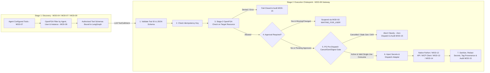

---

## D. Task Orchestration, Autonomous Automation Platform & Result Delivery (`MOD-03`, `MOD-17`, `MOD-18`)

`[CONFIRMED]` `MOD-03` (**Deterministic Task Manager**) is the authoritative owner of macro-task execution (`AP-03`), `MOD-17` (**Autonomous Automation Platform**) owns durable autonomous triggers, condition monitors, and ongoing responsibilities (`ADR-009`), and `MOD-18` (**Result & Delivery Manager**) owns user notifications and completion callbacks. Triggered automations **always** dispatch into `MOD-03`—no competing task engine exists.

### D.1 Task Lifecycle, Centralized `HumanInteractionManager` & Authoritative State Store

All durable task and centralized HITL interaction data lives in PostgreSQL (`orbi_app.tasks` with `task_version`, `pending_checkpoint_id`, `verified_checkpoint_id`, `resume_token_id`, `claim_epoch`, `lease_expires_at`, `claimed_by_worker_id`; `task_steps`; `task_budgets`; `step_execution_receipts`; **`interaction_requests`**; `approval_requests`; encrypted short-TTL `ephemeral_secret_handles`; **`task_lifecycle_outbox`** with `claim_epoch`, `lease_expires_at`, `claimed_by_worker_id`; and **`task_lifecycle_processed_events`**):
- **Canonical Task States**: `CREATED` -> `QUEUED` -> `RUNNING` *(bounded lease + monotonic `claim_epoch`; `resume_token_id` retained until post-resume turn outcome commits)* -> **`SUSPENDING_FOR_USER`** *(durable preparation state while saving/verifying LangGraph checkpoint)* -> `WAITING_FOR_USER` *(covering `waiting_reason: INFORMATION_REQUEST | APPROVAL_REQUEST | SECURE_INPUT_REQUEST | HUMAN_TAKEOVER | PHYSICAL_ACTION_REQUEST`)* -> `QUEUED` -> `RUNNING` *(or epoch-fenced stale-lease takeover `RUNNING (claim_epoch + 1)`)* -> `{COMPLETED | FAILED | CANCELLED | CANCELLED_AFTER_EXTERNAL_COMMIT | EXPIRED}`.
  - Note: Legacy references to `AWAITING_APPROVAL` and `AWAITING_HUMAN_TAKEOVER` map cleanly as sub-reasons (`waiting_reason`) of the single authoritative **`WAITING_FOR_USER`** suspension state managed jointly with `MOD-03`'s internal **`HumanInteractionManager`** (`Section E.5`).
  - **Preparation Rollback**: If writing or verifying the LangGraph checkpoint fails before `WAITING_FOR_USER` commits, `SUSPENDING_FOR_USER` rolls back cleanly to `QUEUED` (retry turn) or `FAILED` (`MOD-18` notified) without leaving a stranded unresumable `WAITING_FOR_USER` task.
- **Budget Enforcement (`FR-TM-04`)**: Every task—whether user-submitted or triggered by `MOD-17`—carries hard caps (`max_steps`, `max_llm_tokens`, `max_cost_usd`, `task_ttl_seconds`). `MOD-03` increments counters deterministically after every `MOD-04` turn and transitions to `FAILED` (`BUDGET_EXCEEDED`) or `EXPIRED` on breach. On terminal transition, `MOD-03` hands the outcome to `MOD-18` for user delivery and `MOD-17` completion callbacks.

#### Diagram 7: Task Lifecycle State Machine

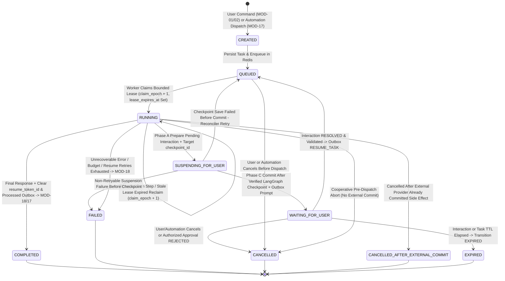

### D.2 PostgreSQL Authoritative State vs. Scoped LangGraph Checkpoints (`CON-18`, `EVAL-04`)

- **`orbi_app.tasks` + `orbi_app.interaction_requests` (Source of Truth)**: Authorizes whether a task is runnable (`task_version`), owns `SUSPENDING_FOR_USER` preparation and `WAITING_FOR_USER` suspensions across all 5 interaction types without keeping any worker or LLM stream alive, owns `approval_requests`, `step_execution_receipts`, and `task_lifecycle_outbox`, and records curated step summaries and `automation_execution_id` / `automation_generation` lineage.
- **`langgraph_checkpoints` (Subordinate Intra-Turn State)**: Stores LangGraph graph-node scratchpad and structured `interrupt()` continuation state **only** for active turn execution and `WAITING_FOR_USER` checkpoint resumption (`EVAL-04`). **PostgreSQL (`orbi_app`) and `langgraph_checkpoints` are NOT assumed to share a single distributed atomic transaction**: `MOD-03` never transitions a task to `WAITING_FOR_USER` or an interaction to `PENDING_USER` until `verified_checkpoint_id` has been saved and verified in `langgraph_checkpoints`. LangGraph checkpoints **never** store `SECURE_INPUT_REQUEST` secrets (OTPs/passwords), never hold approval or responder authority, task status, future trigger timers, or retry budgets, and cannot resume execution unless `MOD-03` validates PostgreSQL + OpenFGA + `task_version` + `interaction_version`, commits `WAITING_FOR_USER -> QUEUED` + `task_lifecycle_outbox` (`RESUME_TASK`), and a worker acquires a bounded `RUNNING` lease via monotonic `claim_epoch` CAS (retaining `resume_token_id` while `RUNNING` and clearing `resume_token_id = NULL` only when the post-resume turn commits its outcome alongside `task_lifecycle_processed_events` in `§E.5.4`). Any external tool execution inside a turn is governed independently by write-ahead `orbi_app.step_execution_receipts` (`PREPARED -> DISPATCHING -> CONFIRMED_SUCCESS | CONFIRMED_FAILURE_* | UNKNOWN_OUTCOME`) keyed by immutable `action_idempotency_key`; while `claim_epoch` fences Orbi-side workers and PG/Gateway calls, it cannot undo or prove completion of an already-transmitted external provider request.

### D.3 Redis Responsibilities, Transactional Outbox Transport, Retries & Crash Recovery

- **PostgreSQL Is Authoritative; Redis Is Coordination/Transport Only**: Idempotency keys alone do **not** guarantee reliable event publication (`CON-14`). All durable domain mutations requiring asynchronous event propagation commit atomically alongside an outbox record inside PostgreSQL (**`orbi_app.task_lifecycle_outbox`** for `DELIVER_INTERACTION_PROMPT`, `RESUME_TASK`, and `MEMORY_CLARIFICATION_DECIDED`; **`orbi_automation.automation_outbox`**; **`orbi_memory.memory_sync_outbox`**) before a leased dispatcher publishes to Redis (`D.9`).
- **Redis Roles**:
  1. *Durable Dispatch & Outbox Transport Streams*: Priority Redis lists/streams (`queue:tasks:interactive`, `queue:tasks:background`, `queue:memory:sync`, `queue:automation:eval`, `queue:delivery:outbound`).
  2. *Worker Leases, Timers & Heartbeats*: Short-TTL keys (`lease:task:<id>`, `lease:auto_eval:<id>`, `zset:auto:due_timers`) preventing split execution across workers.
  3. *Cancellation & Event Signals*: Pub/Sub channels (`chan:task:cancel:<id>`, `stream:events:domain`) for immediate task abort and discrete event propagation.
  4. *Companion Presence & Delivery Dedup*: Live heartbeat metadata (`presence:companion:<device_id>`) for `MOD-14` and transient deduplication caches backing persistent PostgreSQL outbox/consumer ledgers.
- **Retry & Three-Part Crash Recovery Reconciler**:
  - *Transient I/O & Uncertain External Outcomes*: `MOD-08` commits write-ahead `step_execution_receipts(DISPATCHING, action_idempotency_key)` before every external call (`§C.2`). If a call or crashed worker leaves `DISPATCHING` / `UNKNOWN_OUTCOME`: `PROVIDER_IDEMPOTENCY_KEY` retries within `idempotency_window_seconds` using the identical `action_idempotency_key` and immutable args/target; `RECONCILABLE_READ_PROBE` runs its `READ_ONLY` probe first; `NON_IDEMPOTENT_NO_RECONCILE` **prohibits blind automatic retry** and escalates to human reconciliation (`WAITING_FOR_USER` / `UNCERTAIN_EXECUTION_RECONCILIATION`).
  - *Three-Part Startup / Periodic Crash Reconciler*:
    1. **Incomplete Suspensions (`SUSPENDING_FOR_USER`)**: Scans `orbi_app.tasks WHERE status = 'SUSPENDING_FOR_USER'` with expired worker lease: if `pending_checkpoint_id` exists cleanly in `langgraph_checkpoints` AND the task was not cancelled/expired, completes Phase C (`WAITING_FOR_USER` + `interaction_requests = 'PENDING_USER'` + `task_lifecycle_outbox`); if checkpoint write never landed, cancels the uncommitted `CREATED` interaction (`FAILED` cleanup) and restores `QUEUED` (or `FAILED` if max attempts exceeded).
    2. **Unpublished `PENDING` Outbox, Unclaimed `QUEUED` & Stale `RUNNING` Resumes (`task_lifecycle_outbox`)**: Reclaims expired dispatcher/worker leases (`lease_expires_at < now()` or `locked_until < now()`), republishes unpublished `PENDING` `DELIVER_INTERACTION_PROMPT`, `RESUME_TASK`, and `MEMORY_CLARIFICATION_DECIDED` rows, and recovers **stale `RUNNING` `RESUME_TASK` claims** (`o.status = 'RUNNING' AND o.lease_expires_at < now()`): first checking `task_lifecycle_processed_events` (marking `PROCESSED` with zero re-run if already completed before ack) and checking `step_execution_receipts` (replaying `CONFIRMED_SUCCESS` or moving unfinalized `DISPATCHING` -> `UNKNOWN_OUTCOME` per `external_idempotency_mode`), then revalidating cancellation/expiry/`task_version`/`automation_generation`, and reclaiming via monotonic `claim_epoch + 1` CAS (`DEAD_LETTERED` -> task `FAILED` once `attempt_count >= max_attempts`).
    3. **Orphaned Checkpoints (`langgraph_checkpoints`)**: Purges stale `checkpoint_id` records whose PG transaction rolled back or whose parent task is terminal (`COMPLETED | FAILED | CANCELLED | CANCELLED_AFTER_EXTERNAL_COMMIT | EXPIRED`) so orphaned checkpoints can never be replayed (`NFR-REL-01`, `NFR-REL-04`).

### D.4 Five-Way Ownership Separation & Phabric Reusability Boundary (`MOD-17`, `MOD-18`, `ADR-009`)

| Component | Exclusive Responsibilities | Explicitly Prohibited |
| :--- | :--- | :--- |
| **`MOD-04` Agent Runtime** | Domain reasoning, goal decomposition, recognizing need for future/recurring/event/condition execution or plan adaptation, invoking `automation.*` via `MOD-08`. | Never runs timers in-memory, keeps sleeping LLM sessions alive waiting on triggers (`FR-AT-09`), mutates `orbi_automation` tables directly, or grants self-permissions. |
| **`MOD-17` Automation Platform** *(Phabric-Reusable Core)* | Persistent `AgentResponsibility` aggregates, `AutomationDefinition` rules, immutable `ScheduleVersion` history, 6 trigger types, event matching, deterministic LLM-free `ConditionEvaluator`, cycle/quota guards, and dispatching due runs to `MOD-03`. | Never executes tasks directly (zero competing task engine), never wakes LLMs just to check conditions, never runs writes bypassing `MOD-08`, and holds zero LangGraph/Telegram imports (`CON-26`). |
| **`MOD-03` Task Manager** | Owns runtime execution lifecycle of every user and automation task, enforces step/token/cost budgets, handles `ADR-004` approval pauses, emits terminal outcomes to `MOD-18`. | Never stores persistent cron/event/condition definitions or runs trigger polling loops. |
| **`MOD-08` Tool Gateway** | Mediates 100% of agent `automation.*` calls AND 100% of `MOD-17` `ConditionEvaluator` `READ_ONLY` state probes (`CON-24`), enforcing `MOD-07` schemas, Stage-2 OpenFGA, approvals, secret injection, and `MOD-15` audit. | Never bypasses 3-point OpenFGA checks or permits condition probes on write tools. |
| **`MOD-18` Result & Delivery Manager** | Normalizes redacted task outcomes, delivers formatted alerts/summaries to `MOD-01` (Telegram) and `MOD-02` (Dashboard), and posts completion callbacks back to `MOD-17` (enabling `schedule_followup` and `task.completed` event matching). | Never mutates task FSM states (`MOD-03`) or executes external tools directly. |

- **Phabric Cross-Product Domain Boundary (`CON-26`, `OQ-17`)**: `MOD-17` is implemented as a cleanly factored pure-Python module boundary (`phabric_automation` / `AutomationPlatformPort`) inside `orbi-core` (`AP-09`). It interacts with host services strictly via typed `Protocol` ports (`TaskDispatchPort`, `ReadOnlyProbePort`, `AuthorizationPort`, `DeliveryCallbackPort`, `AuditPort`) and its own PostgreSQL schema (`orbi_automation`). Future Phabric products can plug in their own task/authz/probe adapters without rewriting scheduler, trigger, responsibility, or guard logic, while Orbi's agents serve as its first consumers.

### D.5 Standard Agent Automation Runtime API (`automation.*`, Illustrative Contracts)

Registered in `MOD-07` (`isolation_zone = ZONE_1_AUTOMATION`), Stage-1 filtered per `(user, agent, instance)` by `MOD-09`, and executed exclusively through `MOD-08`:

| Operation *(Illustrative)* | Primary Intent & Required Inputs | Validation & Governance Behavior |
| :--- | :--- | :--- |
| `automation.create()` | Generic creation of a new automation rule separating `tenant_id`, `owner_principal`, `creator_principal`, typed `execution_target`, `trigger_spec`, `task_template`, `permission_envelope`, and `responsibility_id?`. | Enforces Point-1 OpenFGA (`can_create`, `can_delegate`), binds initial authorized `PermissionEnvelope`, checks `min_interval_seconds`, cycle graph, and `max_trigger_depth`, and writes `ScheduleVersion` `v1`. |
| `automation.schedule()` | Convenience contract for `CRON`, `INTERVAL`, or `ONE_TIME` recurring/delayed runs (with `timezone`, `misfire_policy`, `concurrency_policy`) within authorized envelope bounds. | Rejects sub-minimum intervals (`CON-23`) or envelope frequency breaches; computes deterministic `next_run_at` in UTC; persists schedule version. |
| `automation.subscribe_to_event()` | Subscribes `execution_target` to an authorized event topic (`event_topic`, `filter_expr`, `debounce_ms`, `payload_projection`). | Verifies topic subscription permission in `MOD-09`, checks event-to-event cycle graph and depth budget, and registers matching rule. |
| `automation.create_condition_monitor()` | Registers an LLM-free periodic probe (`probe_tool_id`, `probe_args`, `eval_interval_sec`, `predicate_dsl`, `sustained_for_sec`, `cooldown_sec`, `execution_target`). | Verifies `probe_tool_id` has `sensitivity_tier == READ_ONLY` in `MOD-07` and target resource permission in `MOD-09`; evaluates without LLM turns until `TRUE`. |
| `automation.schedule_followup()` | Schedules a deferred follow-up check (`delay_sec` or `run_at`, optional `after_task_id` callback link) preserving propagated `correlation_id`, `trigger_chain_ids[]`, and `trigger_depth`. | Increments `trigger_depth` counter cleanly; rejects chains exceeding `max_trigger_depth`, cycle detection, or `PermissionEnvelope` budget. |
| `automation.update()` | Adapts an existing automation's schedule interval, cron expression, predicate thresholds, or parameters (`reason` mandatory for audit). | **Envelope Gate & Generation Bump**: Checks Point-2 OpenFGA (`can_modify`), verifies proposed changes remain inside current authorized `PermissionEnvelope` (any expansion requires renewed OpenFGA/owner approval), atomically increments `schedule_version` + `generation`, and writes `ScheduleVersion` `vN+1` so stale queued ticks cannot execute. |
| `automation.pause()` | Suspends future dispatches and condition probes cleanly while preserving config, lineage, and schedule versions. | Enforces Point-2 OpenFGA, increments `generation`, transitions status -> `PAUSED`, rejects queued stale events, and audits in `MOD-15`. |
| `automation.resume()` | Re-activates a `PAUSED` or `PAUSED_SAFETY_TRIP` automation, applying `misfire_policy` for elapsed intervals and re-verifying live OpenFGA & envelope permissions. | Enforces Point-2 OpenFGA + fresh cycle/quota/envelope check (operator reset required for `PAUSED_SAFETY_TRIP`), increments `generation`, and applies configured `misfire_policy` (`SKIP` / `RUN_LATEST` / `CATCH_UP_BOUNDED`). |
| `automation.cancel()` | Permanently terminates future trigger generation & invalidates queued/stale runs while retaining config and execution history (`CANCELLED`). | Enforces Point-2 OpenFGA, increments `generation`, sets `status = CANCELLED`, triggers cooperative abort for any in-flight `MOD-03` task, rejects pre-queued Redis events via PostgreSQL generation fence, and audits in `MOD-15`. |
| `automation.delete()` | Explicitly removes an automation configuration & un-retained metadata per retention policy (`DELETED`, distinct from `CANCELLED`). | Enforces Point-2 OpenFGA + owner confirmation, cancels active schedules/queued events first, scrubs configuration/template payloads, retains redacted audit ledger (`MOD-15`) & execution references per policy, and updates `status = DELETED`. |
| `automation.get_execution_history()` | Retrieves execution ledger (`execution_id`, `correlation_id`, `trigger_type`, `probe_snapshot`, linked `task_id`, status, cost/token totals, `schedule_version`, `generation`) scoped to `responsibility_id` or `automation_id`. | Read-only OpenFGA filter ensures principals only inspect history for automations/responsibilities within their authorized `tenant_id` scope. |

### D.6 Common 6-Trigger Abstraction & Event Occurrence vs. Non-LLM Condition Evaluation

`MOD-17` normalizes all triggers under a single `TriggerSpec` taxonomy while maintaining a hard boundary between **event occurrence** and **condition evaluation** (`FR-AT-03`):

| Trigger Type | Evaluation Mechanism | Live LLM Needed to Wait? | Typical Use Cases |
| :--- | :--- | :---: | :--- |
| **`CRON`** | Calendar/timezone-aware cron schedule evaluated by `MOD-17` timer wheel (`next_run_at` in PostgreSQL). | **No** | Daily 08:00 briefing, weekly plant care summary, periodic ML re-inference (`0 */12 * * *`). |
| **`INTERVAL`** | Fixed duration ticker (`every N seconds`, clamped by `>= min_interval_seconds`). | **No** | Polling authorized API feeds every 30 minutes, periodic health/sensor snapshots. |
| **`ONE_TIME`** | Single timestamp trigger (`run_at_utc`) with auto-completion (`COMPLETED`) after firing. | **No** | Agent self-scheduled follow-up 4 hours after watering or waiting for shipping window. |
| **`EVENT`** | Reactive matcher listening to `stream:events:domain` for discrete event occurrences (`email.received`, `iot.telemetry_alert`, `task.completed`, `skill.published`) filtered by declarative predicate & debounce window. | **No** | Wake `EmailAgent` on VIP sender email; react when moisture alarm packet arrives; chain `schedule_followup` on task finish. |
| **`CONDITION`** | **LLM-Free Periodic Probe Evaluator**: Every `eval_interval_sec`, `MOD-17` calls `MOD-08.execute_readonly_probe()` for registered `READ_ONLY` probe data, evaluates a deterministic `predicate_dsl` (`OQ-16`, e.g., numeric comparator, hysteresis band, sustained window), and triggers `MOD-03` **only** on edge transition `FALSE -> TRUE` (respecting `cooldown_sec`). | **No** *(Probes & predicates run 100% deterministically in Zone 1 worker)* | Wake `PlantCareAgent` only when `soil_moisture < 22%` sustained for `15 min` OR predicted stress score `> 0.75`. |
| **`MANUAL`** | Explicit user click in `MOD-02` Dashboard ("Run Now") or `/run` Telegram command authorized by OpenFGA. | **No** | Ad-hoc operator re-run of a recurring workflow without mutating its normal schedule. |

### D.7 Ongoing Agent Responsibilities (`AgentResponsibility`) & Domain-General Plant Care Walkthrough

To prevent scattered orphan cron jobs, `MOD-17` groups related schedules, event subscriptions, condition monitors, dispatched tasks, and adaptive follow-ups into an **`AgentResponsibility`** record representing a delegated ongoing work plan:
- **Core Fields**: `responsibility_id`, `tenant_id` (`PERSONAL | HOUSEHOLD | ORGANIZATION_FUTURE`), `owner_principal`, `primary_execution_target` (`target_type=AGENT`, `target_id`, `target_version?`), `permission_envelope_id`, `objective_summary`, `status` (`ACTIVE | PAUSED | COMPLETED | SUSPENDED_BUDGET | PAUSED_SAFETY_TRIP`), `plan_version`, `plan_document_json`, `linked_automation_ids[]`, `aggregate_budget` (daily/monthly token, run, and USD limits), and `last_reassessed_at`.
- **Illustrative General Walkthrough — Plant Care Agent (`agent:plant_care`)**:
  1. Owner asks Orbi: *"Look after my balcony and living-room plants."* `ManagerAgent` delegates creation of an ongoing `AgentResponsibility` (`resp:plant_care_01`) under `tenant:household_default` assigned to `execution_target(AGENT, "agent:plant_care")` (`MOD-06`) within a bounded `PermissionEnvelope`.
  2. `agent:plant_care` runs its initial LangGraph turn via `MOD-04`: calls `MOD-08` to inspect available telemetry (`iot.read_moisture_light` / environmental inputs) and reads configured species metadata/history from `MOD-10: Memory Manager`.
  3. `agent:plant_care` consults a configured ML stress/evapotranspiration inference tool (`READ_ONLY` prediction endpoint mediated via `MOD-08` / `MOD-12`) to compute an initial care baseline.
  4. `agent:plant_care` persists a structured care plan on `resp:plant_care_01` and invokes `automation.*` tools via `MOD-08` to arrange ongoing autonomous execution—then **terminates its LLM turn cleanly** (zero sleeping LLM sessions):
     - *Recurring Sensor Checks*: `automation.schedule(INTERVAL=4h, tool=iot.read_sensors)` collecting readings;
     - *Periodic ML Model Inference*: `automation.schedule(CRON="0 7,19 * * *", execution_target=AGENT("agent:plant_care"), intent="recompute_care_plan")`;
     - *Condition Monitors*: `automation.create_condition_monitor(probe="iot.read_soil_moisture", eval_interval=15m, predicate="moisture_pct < 24.0 for 2 checks", cooldown=6h, execution_target=AGENT("agent:plant_care"))`.
  5. While conditions stay healthy (`moisture_pct >= 24.0`), `MOD-17` evaluates sensor probes via `MOD-08` with **zero LLM invocations**.
  6. When soil moisture drops below `24.0%` for two consecutive checks, `MOD-17` atomically records the trigger event + `automation_outbox` dispatch, verifies Point-3 OpenFGA & `PermissionEnvelope` bounds, and creates a normal task in `MOD-03` waking `agent:plant_care` with the probe telemetry.
  7. `agent:plant_care` assesses updated weather/sensor context and emits an authorized physical watering action (`iot.activate_drip_valve`) or user notification (`MOD-18`). Because physical actuation is classified `SENSITIVE_WRITE` / `IRREVERSIBLE` (`MOD-07`), `MOD-08` + `MOD-03` deterministically suspend for `ADR-004` human approval before valve actuation. Upon completion, `agent:plant_care` optionally calls `automation.schedule_followup(delay=2h)` to confirm post-watering moisture recovery.
  8. Later, if heatwave forecasts arrive or seasonal light shifts during a periodic reassessment run, `agent:plant_care` autonomously calls `automation.update()` to tighten the moisture monitor frequency *within its pre-authorized `PermissionEnvelope`* (e.g., `eval_interval: 15m -> 10m`, within authorized floor `>= 5m`), recording `ScheduleVersion` `v2`. Attempting to raise budget or add new actuators triggers mandatory re-authorization.
  *(All constructs above—`AgentResponsibility`, triggers, `ConditionEvaluator`, `PermissionEnvelope`, `automation_outbox`, `MOD-03` dispatch, `MOD-08` probes, and `ADR-004` approvals—are 100% domain-agnostic; plant care uses zero special-case platform code.)*

### D.8 Generalized Ownership, Typed Execution Targets, Permission Envelopes & Event-Loop Protection

Every `AutomationDefinition` record in `MOD-17` enforces explicit identity, target-type governance, immutable authorization bounds, and cohesive anti-loop controls:

1. **Generalized Tenant/Principal Model & Typed Execution Targets (`CON-25`)**:
   - **`tenant_id` (`tenant_type: PERSONAL | HOUSEHOLD | ORGANIZATION_FUTURE`)**: Models household sharing uniformly as a tenant type rather than a hard-coded special ownership model, while leaving clean schema extension room for future organizational tenants without building org admin features now.
   - **`owner_principal`**: Human/billing-accountable principal within `tenant_id` holding budget accountability and revoke rights.
   - **`creator_principal`**: Originating actor (`user:<id>` or `agent:<id>` + `originating_task_id` + `correlation_id`) recorded strictly for provenance and cycle tracking—never for permission inheritance.
   - **Typed `execution_target` `(target_type, target_id, target_version?)`**:
     - **`AGENT`** *(Initially Enabled)*: Dispatches a bounded `MOD-03` task executing the `MOD-06` agent (`target_id`) under its own non-inherited identity.
     - **`WORKFLOW`** *(Conditionally Allowed)*: Permitted **only** when a registered, deterministic workflow execution model (`target_id@target_version`) is explicitly defined in `MOD-07`/`MOD-11`; otherwise rejected at creation.
     - **`SCRIPT`** *(Disabled Initially)*: Explicitly **disabled** across `MOD-17` and `MOD-07` until `EVAL-06` evaluates and approves `MOD-11-SANDBOX` isolation.
2. **Immutable `PermissionEnvelope` Constraints**:
   An automation never gains extra authority simply because it recurs or runs autonomously. Every automation binds an explicit, versioned **`PermissionEnvelope`** (`envelope_version`, established at creation or explicit approval time) constraining all eight dimensions:
   - `permitted_tools_and_capabilities` (explicit allowlisted tool IDs/verbs subset);
   - `resource_scope` (explicit OpenFGA object IDs inside `tenant_id`);
   - `execution_frequency_bounds` (`min_interval_seconds`, `max_runs_per_hour`, `max_runs_per_day`);
   - `budget_ceiling` (per-run & rolling aggregate `max_steps`, `max_tokens`, `max_cost_usd`);
   - `concurrency_policy` (`SKIP | QUEUE_ONE | PARALLEL_BOUNDED(max_n)`);
   - `allowed_execution_target` (exact `(target_type, target_id, target_version)` pinned);
   - `approval_requirements` (inherits `MOD-07` `SENSITIVE_WRITE`/`IRREVERSIBLE` floors plus any stricter owner policy).
   - **Adaptation vs. Expansion Rule**: An `automation.update()` modification remaining strictly inside the active `PermissionEnvelope` (e.g., slowing cron cadence or adjusting interval within `execution_frequency_bounds`) proceeds under standard Point-2 OpenFGA policy (`MOD-09`). **Any request that expands** frequency beyond floor, raises budget, widens `resource_scope`, adds tools/capabilities, loosens concurrency, changes `execution_target`, or relaxes `approval_requirements` is rejected as an envelope breach and **requires renewed Point-1/Point-2 authorization and explicit owner approval (`ADR-004`)**. An automation can **never** expand its own envelope, and every dispatched run revalidates live OpenFGA + envelope permissions before creating a `MOD-03` task.
3. **Zero Permission Inheritance & Three-Point OpenFGA Checks (`FR-AT-05`, `FR-AT-06`)**:
   - `EffectivePermissions = OpenFGA(owner_principal, execution_target) INTERSECT permission_envelope.permitted_tools_and_resource_scope INTERSECT MOD-06/07(target_definitions)`.
   - Checked deterministically at **(1) Creation & Delegation**, **(2) Lifecycle Modification**, and **(3) Every Execution Dispatch** prior to `MOD-03` task creation.
4. **Cohesive 8-Control Event-Loop Protection Pipeline (`CON-23`)**:
   Rather than independent isolated checks, every event/condition/schedule flow enforces an integrated control pipeline end-to-end:
   1. *Correlation & Chain Propagation*: Every trigger, outbox message, `MOD-03` task, and `MOD-18` completion event propagates `correlation_id`, `root_automation_id`, `trigger_chain_ids[]` (ancestors), and monotonically incremented `trigger_depth`.
   2. *Idempotent Event Deduplication*: Stable `event_id` is deduplicated atomically in PostgreSQL (`automation_processed_events`) so at-least-once outbox redelivery never double-triggers a workflow.
   3. *Cycle & Depth Gate*: At both creation (`Point-1`) and runtime dispatch (`Point-3`), `MOD-17` blocks any trigger if `automation_id IN trigger_chain_ids[]` (direct or indirect cycle `A -> B -> C -> A`) or if `trigger_depth > max_trigger_depth`.
   4. *Minimum Interval & Cooldown Guard*: Rejects trigger creation below `min_interval_seconds` and enforces post-fire cooldown windows on condition/event subscriptions so burst inputs coalesce instead of re-arming immediately.
   5. *Per-Automation Quota & Envelope Budget Gate*: Enforces rolling run counts and USD/token spend caps from `PermissionEnvelope` before queueing work into `MOD-03`.
   6. *Bounded Retries Without Re-Triggering*: Outbox publication and task delivery retries are strictly bounded (`max_attempts`) and dead-lettered cleanly; retry/failure notifications never re-fire the originating event topic recursively.
   7. *Indirect-Loop Circuit Breaker*: A sliding-window detector monitors triggers per `(correlation_id, responsibility_id)` and `(event_topic, tenant_id)`; anomalous burst velocity (indicating an unforeseen multi-hop semantic loop, e.g., agent editing a watched resource cleanly bypassing simple ID cycles) trips the breaker immediately.
   8. *Deterministic Termination Behavior*: On cycle, depth breach, quota overrun, or circuit-breaker trip, `MOD-17` **terminates the chain without creating a `MOD-03` task**, transitions offending automations to `PAUSED_SAFETY_TRIP` (`status`), writes an immutable audit event (`MOD-15`), and pushes a high-priority explanation & recovery prompt via `MOD-18` requiring explicit owner intervention to resume.

### D.9 Persistence, Transactional Outbox (`automation_outbox`), Misfire Recovery & Result Delivery (`MOD-18`)

- **Immutable Schedule Versioning**: Every `automation.create()` or `automation.update()` appends an immutable row in `orbi_automation.automation_schedule_versions` capturing `version`, `envelope_version`, `changed_by_principal`, `change_reason`, and `trigger_spec` diff.
- **Transactional Outbox Guarantees (`orbi_automation.automation_outbox`)**:
  1. **Atomic Write**: Updating trigger state (`last_fired_at`, `next_run_at`, `automation_executions`) or committing a `MOD-03`/`MOD-18` domain event commits the corresponding `automation_outbox` record (`event_id`, `correlation_id`, `trigger_chain_ids`, `trigger_depth`, `status = PENDING`) inside the **exact same PostgreSQL transaction**.
  2. **Leased Dispatcher -> Redis**: A background dispatcher polls `PENDING` rows with `SELECT ... FOR UPDATE SKIP LOCKED`, claims a bounded lease (`locked_until`), and publishes messages to Redis (`stream:events:domain` / `queue:automation:eval`). PostgreSQL outbox—not Redis—is the durable publication record.
  3. **Safe Retries & Idempotent Consumers**: Failed Redis/downstream dispatches back off exponentially; consumers record `event_id` in `automation_processed_events` inside the consumer transaction for strict idempotent deduplication.
  4. **Poison-Event / Dead-Letter Policy & Recovery Reconciliation**: Events exceeding `max_attempts` move to `DEAD_LETTERED` (triggering `MOD-15` audit + `MOD-02` alert without stalling sibling automations). On worker restart, a periodic reconciler reclaims stale `PROCESSING` leases (`locked_until < now()`), sweeps missed schedule windows per `misfire_policy` (`SKIP`, `RUN_LATEST`, `CATCH_UP_BOUNDED`), and avoids duplicate execution via committed `automation_executions` keys.
- **Result & Delivery Integration (`MOD-18`)**: When any `MOD-03` task reaches `COMPLETED` or `FAILED`, `MOD-18` formats a redacted outcome summary, delivers notifications to authorized Telegram/Dashboard channels, commits completion callbacks via the outbox/callback path to `MOD-17`, and carries forward `correlation_id` + `trigger_depth`.

#### Diagram 12: Autonomous Automation Platform, Permission Envelope, Transactional Outbox & Loop-Protection Architecture

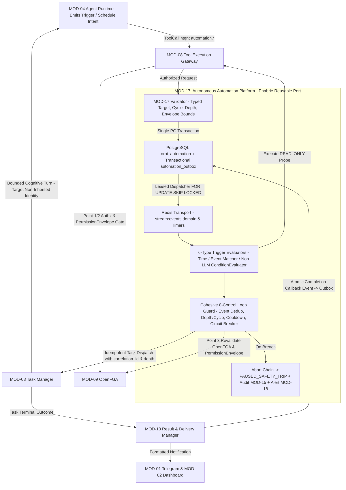

### D.10 Complete Automation Lifecycle (`CREATE`–`DELETE`) & Cancellation Race Protection

`MOD-17` governs the complete lifecycle of both agent-arranged and user-created automations without introducing duplicate modules or shifting task ownership away from `MOD-03`:

1. **Six Lifecycle Operations (Illustrative Reminder Flow)**:
   - **`CREATE`** (*"Every morning at 8 AM, remind me to water the plants"*): Resolves `tenant_id`, `owner_principal`, `creator_principal`, `execution_target(AGENT, ...)`, `TriggerSpec(CRON="0 8 * * *")`, immutable initial `PermissionEnvelope`, approval requirements, frequency/concurrency/budget caps, `schedule_version = 1`, `generation = 1`, and commits definition + initial `automation_outbox` record atomically.
   - **`UPDATE`** (*"Change the reminder to 9 AM"*): Matches the existing automation (`automation_id`) after OpenFGA Point-2 authorization; updates the rule **in place rather than creating a duplicate**; validates against active `PermissionEnvelope` (requiring renewed authorization + explicit owner approval if expanding frequency, budget, scope, tools, target, or relaxing approvals); increments `schedule_version` (`v1 -> v2`) and monotonic **`generation`** (`g1 -> g2`); and persists an immutable `automation_schedule_versions` entry so any older queued trigger is fenced out.
   - **`PAUSE`**: Temporarily suspends scheduling and probes (`status = PAUSED`), increments `generation`, prevents new trigger generation, and causes any already-queued pre-pause trigger event in Redis to fail worker revalidation cleanly while retaining configuration and history.
   - **`RESUME`**: Revalidates Point-2 OpenFGA, cycle/depth/quota rules, and `PermissionEnvelope`; increments `generation`; and reconciles elapsed downtime strictly via the automation's declared **`misfire_policy`** (`SKIP` default for frequent reminders/polls, `RUN_LATEST` bounded by `misfire_grace_sec`, or `CATCH_UP_BOUNDED`)—never blindly replaying every missed tick.
   - **`CANCEL`** (*"Stop reminding me to water the plants"*): Authorizes the matching automation, sets terminal `status = CANCELLED`, increments `generation += 1`, halts future trigger generation, rejects queued pre-cancel Redis events at worker & `MOD-08` pre-dispatch validation, cascades `CANCELLED` to active `MOD-03` tasks and any `WAITING_FOR_USER` `interaction_requests` / `approval_requests`, and retains configuration/history/audit per policy.
   - **`DELETE`** (*Authoritative 6-Step Ordering — `PART 7.3`*): Distinct from `CANCEL` (which retains configuration and history for inspection). Must execute in strictly ordered authoritative stages before asynchronous cleanup:
     1. Atomically set `orbi_automation.automation_definitions.status = 'DELETED'`, `next_run_at = NULL`, and increment monotonic **`generation += 1`** in PostgreSQL.
     2. Fence all stale queued Redis events immediately via the incremented `generation` and `DELETED` status.
     3. Publish `AUTOMATION_DELETED_CLEANUP` atomically through **`orbi_automation.automation_outbox`** in the same PostgreSQL transaction.
     4. Asynchronously clean up schedules, Redis timers (`zset:auto:due_timers`), event subscriptions, condition monitor state, and sensitive task-template payloads.
     5. Reconcile pending and in-flight `MOD-03` tasks and cascade `CANCELLED` to any `WAITING_FOR_USER` `interaction_requests` / `approval_requests` (honoring `CANCELLED_AFTER_EXTERNAL_COMMIT` honestly if a non-interruptible external action already transmitted).
     6. Retain only permitted non-sensitive execution ledger summary history and redacted `MOD-15` `AUTOMATION_DELETED` audit evidence.

#### Diagram 13: Automation Lifecycle & Generation-Fenced Cancellation State Machine

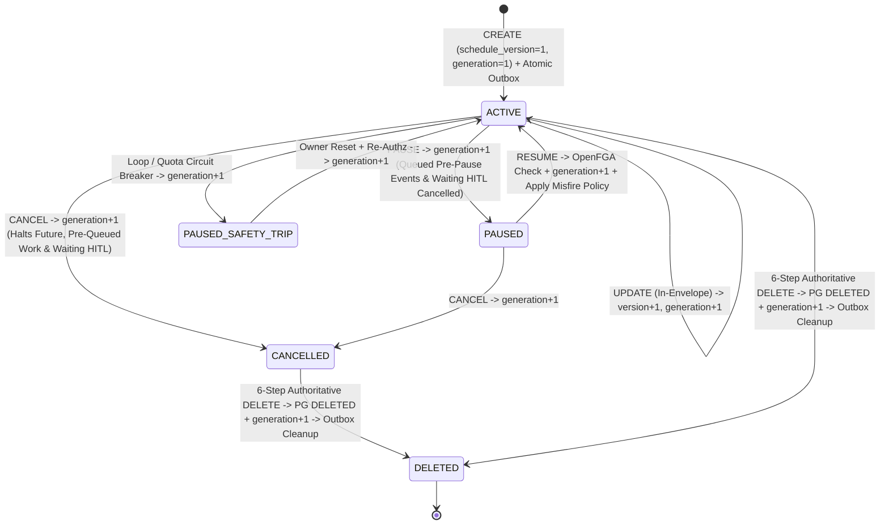

2. **Queued-Event vs. User-Cancel / Pause / Update Race Protection (`Part 5`)**:
   Consider the race where (1) an automation triggers at `08:00`, (2) the outbox dispatcher pushes its event (`automation_id`, `schedule_version=v1`, `generation=g1`, `event_id`, `execution_id`) into Redis, (3) the user immediately runs **Cancel** (or **Update** to `9 AM` / **Pause** / **Delete**), and (4) a worker dequeues that older Redis event milliseconds later:
   - **Authoritative PostgreSQL Generation Fence**: On `CANCEL`, `PAUSE`, `UPDATE`, or `DELETE`, `MOD-17` atomically updates `orbi_automation.automation_definitions` (`status`, `schedule_version`, monotonic `generation += 1`) inside PostgreSQL. Redis remains transport only—never authoritative.
   - **Worker & `MOD-08` Pre-Dispatch Revalidation**: Immediately before creating a `MOD-03` task (and again inside `MOD-08` Gate 5 prior to every adapter execution), Orbi revalidates PostgreSQL and `MOD-09` OpenFGA verifying:
     1. `automation_definitions.status == 'ACTIVE'` *(not `PAUSED`, `PAUSED_SAFETY_TRIP`, `CANCELLED`, or `DELETED`)* AND `tasks.cancellation_requested == false`;
     2. `current.schedule_version == event.schedule_version` AND `current.generation == event.generation`;
     3. Live `MOD-09` OpenFGA authorization and `PermissionEnvelope` bounds still pass;
     4. Deterministic `idempotency_key` (`sha256(automation_id, schedule_version, generation, trigger_bucket_or_event_id)`) has not already been consumed in `automation_executions`.
   - **Deterministic Drop**: If any check fails (e.g., cancelled or updated generation), the worker/Gateway aborts dispatch, records `SKIPPED_CANCELLED` or `SKIPPED_STALE_GENERATION` in `automation_executions` + `MOD-15`, commits `event_id` dedup, and performs **zero execution**.
3. **In-Flight Running Execution Semantics**:
   - Once a `MOD-03` task is `RUNNING`, `CANCEL` publishes `chan:task:cancel:<id>` and sets PostgreSQL `tasks.cancellation_requested = true`.
   - Between LangGraph steps and inside `MOD-08` Gate 5 immediately before every tool dispatch, `MOD-03`/`MOD-04`/`MOD-08` check cancellation and abort before issuing any further actions (`CANCELLED`). Interruptible harnesses (`MOD-13` browser, `MOD-14` companion) receive cooperative abort signals.
   - **External Commit Honesty**: If cancellation arrives *after* a non-interruptible external operation (`MOD-12` HTTP email/API send) was already transmitted to the external provider, Orbi **does not claim rollback**—it prevents any subsequent tool calls, audits `TOOL_COMPLETED_DURING_CANCELLATION_RACE`, and marks the step/task `CANCELLED_AFTER_EXTERNAL_COMMIT`.
4. **Integration Between Automation Lifecycle and `WAITING_FOR_USER` HITL Interactions (`PART 6`)**:
   - **Automation Awaiting Approval, Clarification, Secure Input or Takeover**: When an automation-triggered `MOD-03` task encounters a sensitive action (`APPROVAL_REQUEST`), ambiguous instruction (`INFORMATION_REQUEST`), OTP/password challenge (`SECURE_INPUT_REQUEST`), or CAPTCHA/login gate (`HUMAN_TAKEOVER`), `MOD-03` transitions both `tasks` and `automation_executions` to `WAITING_FOR_USER`, suspends LangGraph cleanly (zero idle workers), and tracks both `(interaction_id, task_id, task_version, automation_id, automation_generation)`.
   - **Concurrency Protection While Waiting**: Recurring schedules default to `concurrency_policy = SKIP` while an earlier execution of that `automation_id` is `WAITING_FOR_USER` unless overridden inside its `PermissionEnvelope`.
   - **Automation Paused / Cancelled / Updated / Deleted While Waiting**: Transitioning the parent automation (`PAUSE`, `CANCEL`, schedule `UPDATE` incrementing `generation`, or 6-step `DELETE`) atomically cascades `CANCELLED` to open `WAITING_FOR_USER` tasks, `interaction_requests`, and `approval_requests` so obsolete prompts are closed immediately (`MOD-01`/`MOD-02` notified).
   - **Interaction Expires While Automation Active**: If `expires_at` elapses (`EXPIRED`), only that `InteractionRequest` + `MOD-03` task instance expires (`EXPIRED`); the active `AutomationDefinition` remains `ACTIVE` for subsequent future triggers.
   - **Late Response After Automation Cancellation/Supersession**: If a user answers a delayed notification after the automation was paused, cancelled, updated (`generation += 1`), or deleted, `MOD-03`'s `HumanInteractionManager` revalidates live PostgreSQL `automation_definitions.status == 'ACTIVE' AND current.generation == interaction.automation_generation` + `tasks.status == 'WAITING_FOR_USER'`, rejecting resumption cleanly with `STALE_AUTOMATION_GENERATION_REJECTED`.

### D.11 Automation Lifecycle, Cancellation & Concurrency Evaluation Suite (`EVAL-08`: `AUTO-EVAL-01` – `AUTO-EVAL-12`)

Before locking LLD schemas under `EVAL-08`, `MOD-17`, `MOD-18`, `MOD-03`, and `MOD-08` must pass these 12 lifecycle, HITL integration, and race-protection scenarios:

| Test ID | Scenario | Expected Behavior & Security Acceptance Criteria |
| :--- | :--- | :--- |
| **`AUTO-EVAL-01`** | **In-Place `UPDATE` No Duplicate** | *"Change 8 AM reminder to 9 AM"* modifies the existing `automation_id`, bumps `schedule_version` & `generation`, and leaves `0` duplicate schedules active. |
| **`AUTO-EVAL-02`** | **`PAUSE` Prevents Dispatches** | Pausing sets `PAUSED`, bumps `generation`, and prevents new timer fires until explicit `RESUME`. |
| **`AUTO-EVAL-03`** | **`RESUME` Misfire Policy** | Resuming after simulated 6-hour outage honors `SKIP` (`0` catch-up spam) or `CATCH_UP_BOUNDED(N)` (`<= N` runs)—never uncontrolled flood. |
| **`AUTO-EVAL-04`** | **Race: Pre-Queued Redis Event vs. `CANCEL`** | Event queued in Redis under `g1`, user runs `CANCEL` (`g2`, `CANCELLED`), worker dequeues `g1` event -> pre-dispatch PostgreSQL revalidation drops task creation (`SKIPPED_CANCELLED`). |
| **`AUTO-EVAL-05`** | **Race: Old Version Queued Before `UPDATE`** | Event queued under `v1`/`g1`, user updates schedule (`v2`/`g2`), worker dequeues `v1` event -> dropped cleanly as `SKIPPED_STALE_GENERATION`. |
| **`AUTO-EVAL-06`** | **Unauthorized `UPDATE` / `CANCEL` / `DELETE`** | Secondary/unauthorized principal attempting to pause/modify/cancel another owner's automation fails Point-2 OpenFGA (`AUTHZ_DENIED`), logged to `MOD-15`. |
| **`AUTO-EVAL-07`** | **Gateway Pre-Dispatch Cancellation & External-Commit Race** | Cancelling mid-turn stops subsequent LangGraph steps and blocks pending `MOD-08` dispatches at Gate 5 (`task_version`/`cancellation_requested`/`generation`); non-interruptible external sends already transmitted never claim rollback and record `CANCELLED_AFTER_EXTERNAL_COMMIT`. |
| **`AUTO-EVAL-08`** | **Redis Duplicate Event Delivery** | Replaying identical `event_id` twice on Redis stream triggers at most 1 execution via atomic `automation_processed_events` + `idempotency_key` ledger. |
| **`AUTO-EVAL-09`** | **Outbox Retries No Duplicate Dispatch** | Simulated transient dispatcher/Redis failure retries safely via `automation_outbox` + stale lease recovery without creating duplicate `MOD-03` tasks. |
| **`AUTO-EVAL-10`** | **Indirect Trigger Loop & Depth Bounding** | Cyclic event chain (`A -> B -> A`) and excessive `trigger_depth` trips the cohesive 8-control guard (`PAUSED_SAFETY_TRIP`), blocks task dispatch, and alerts owner via `MOD-18`. |
| **`AUTO-EVAL-11`** | **Authoritative 6-Step Automation `DELETE` Ordering** | Explicit `automation.delete()` commits `status = 'DELETED'` + `generation + 1` + `automation_outbox` cleanup event *before* async timer/payload purge, fencing any concurrent Redis tick and preserving only permitted summary history + redacted `MOD-15` proof. |
| **`AUTO-EVAL-12`** | **Automation Cancelled / Updated While Waiting for HITL (`PART 6`)** | Automation-triggered task suspends at `WAITING_FOR_USER` (`APPROVAL_REQUEST` / `INFORMATION_REQUEST` / `SECURE_INPUT_REQUEST`); user cancels or updates automation (`generation + 1`) -> pending interaction cascades `CANCELLED` and any late response is rejected (`STALE_AUTOMATION_GENERATION_REJECTED`). |

---

## E. Identity, Authorization & Approvals (`MOD-01`, `MOD-02`, `MOD-03`, `MOD-08`, `MOD-09`)

### E.1 Tenant, Principal & Household Identity Model (`ADR-002`, `ADR-009`)

`[CONFIRMED]` Orbi runs single-owner initially while establishing normalized tenant and principal tables designed for household sharing and future organizational tenants without structural redesign:
- **`tenant:<id>` (`tenant_type: PERSONAL | HOUSEHOLD | ORGANIZATION_FUTURE`)**: Represents the shared boundary (`orbi_app.tenants`), modeling household tenancy cleanly as a tenant type alongside personal tenancy while reserving clean schema extension room for future organizational tenants.
- **`user:<id>` (`owner_principal`)**: Authenticated human identity (`orbi_app.users`) belonging to one or more tenants (`admin | member`).
- **`execution_target` / `agent:<id>` & `instance:<id>`**: Typed autonomous executor (`AGENT | WORKFLOW | SCRIPT`) and deployment/companion instance scope.

### E.2 Channel Identity Mapping & Dashboard Authentication

1. **Telegram Identity Mapping (`MOD-01`, `ASM-07`)**:
   - Telegram updates carry numeric `from.id` and `chat.id`. `MOD-01` resolves `(telegram_user_id, chat_id)` against `orbi_app.channel_bindings` (`status = ACTIVE`). Unbound or suspended Telegram IDs are rejected before creating tasks and logged to `MOD-15`.
   - Group chats (if enabled later) require explicit `household:<id>` chat registration and per-sender `user:<id>` verification so untrusted third parties in a chat cannot hijack owner permissions.
2. **Dashboard Authentication (`MOD-02`, `[PROPOSED]`)**:
   - Browser authentication uses secure operator credentials (Passkey/WebAuthn or password + TOTP MFA) backed by `HttpOnly`, `Secure`, `SameSite=Lax` session cookies, strict CSRF tokens, and short idle timeouts.
   - Sensitive governance actions (creating OpenFGA tuples, approving `IRREVERSIBLE` tasks, publishing skills, launching browser Human Takeover) require recent MFA/re-auth verification.

### E.3 OpenFGA Relationship Model (`MOD-09`)

`[CONFIRMED]` / `[PROPOSED]` `orbi-openfga` stores the authoritative authorization model (`policy_version` tracked monotonically on schema/policy updates):
- **`type tenant`**: `relations: admin, member` *(tenant types: `personal`, `household`, reserving extension room for future `organization` tenants without implementing org admin now)*
- **`type user`**: Identity principal
- **`type instance`**: `relations: tenant, operator` (identifies OCI core or a specific companion machine)
- **`type agent`**: `relations: owner, allowed_user, configured_tool`
- **`type tool`**: `relations: owner, allowed_agent, allowed_user`
- **`type skill`**: `relations: owner, published_reader, invoker` (note: skills never grant tool permissions; tools remain independently checked)
- **`type resource`**: `relations: owner, tenant, reader, writer, approver` (covers email accounts, Spotify sessions, browser profiles, Windows Companion devices, future IoT devices)
- **`type memory_unit`**: `relations: owner_principal, tenant, reader` (`private_user`: `owner_principal`; `shared_tenant`: `owner_principal or member from tenant`; source-level authorization verified independently for every graph source `MemoryUnit` and checked against active `deletion_state == 'ACTIVE'` per [memory-architecture.md](file:///f:/Projects/Orbi/docs/02-hld/memory-architecture.md))
- **`type interaction_request`**: `relations: owner_principal, tenant, responder, approver, session_controller, canceller` *(governs private vs. explicitly shared household HITL responses, `APPROVAL_REQUEST` vs. `INFORMATION_REQUEST` separation, `HUMAN_TAKEOVER` stream custody, and interaction cancellation; household members cannot answer a private interaction unless explicitly granted `responder`)*
- **`type approval_request`**: `relations: owner, approver` (`approver` restricted strictly to resource/task owner or delegated tenant admin)
- **`type responsibility`**: `relations: owner_principal, tenant, primary_target, delegated_creator, manager` (governs ongoing `AgentResponsibility` ownership, plan updates within `PermissionEnvelope`, and pause/cancel control)
- **`type automation`**: `relations: owner_principal, creator_principal, execution_target, scoped_resource, executor, modifier` (enforces 3-point checks + `PermissionEnvelope` bounds: `modifier` allows in-envelope `update/pause/resume/cancel`; envelope expansions require renewed authorization + approval; `executor` requires `owner_principal` grant AND direct `execution_target` access to `scoped_resource`, explicitly blocking inheritance from `creator_principal`)

### E.4 Cryptographically Protected, Action-Bound Approvals (`ADR-004`)

`[CONFIRMED]` Human approvals protect against TOCTOU bait-and-switch attacks (`CON-10`) and integrate inside the centralized `HumanInteractionManager` (`APPROVAL_REQUEST` linking 1-to-1 with `orbi_app.interaction_requests`):
1. **Canonical Digest Construction**: When `MOD-08` blocks a `SENSITIVE_WRITE` or `IRREVERSIBLE` call (or policy-escalated action), it constructs a canonical JSON structure containing:
   - `user_id` (authorized approver)
   - `task_id` and `execution_id` *(plus `automation_generation` if automation-triggered)*
   - `tool_id` and `tool_version`
   - `canonical_arguments_hash` (`SHA-256` of sorted, normalized semantic fields per `MOD-07`, excluding volatile epoch tokens per `CON-10`)
   - `target_resource`
   - `policy_version` (current OpenFGA model/policy version)
   - `expires_at` (UTC timestamp)
2. **Integrity Signature (`[PROPOSED]`)**: `MOD-03` computes `binding_digest = SHA-256(canonical_payload)` and an internal `HMAC-SHA256(approval_hmac_key, approval_id || binding_digest)` stored in `orbi_app.approval_requests`.
3. **One-Time Consumption & Replay Protection**:
   - Approval actions in Telegram (`MOD-01`) or Dashboard (`MOD-02`) submit `(interaction_id, approval_id, actor_user_id, expected_digest)` via `HumanInteractionManager`. Ordinary `INFORMATION_REQUEST` replies never implicitly satisfy `APPROVAL_REQUEST`.
   - `MOD-03` executes an atomic PostgreSQL compare-and-swap (`UPDATE ... SET status = 'APPROVED', decided_at = now() WHERE approval_id = $1 AND status = 'PENDING' AND expires_at > now()`), preventing duplicate clicks across Telegram and Dashboard (`CON-06`).
4. **Immediate Pre-Execution Revalidation (`MOD-08`)**:
   - When `MOD-03` resumes the task, `MOD-08` Gate 5 **immediately revalidates** prior to adapter dispatch:
     1. Verify `tasks.status == 'RUNNING'`, `cancellation_requested == false`, matching `task_version`, and active `automation.generation` (if automation-triggered);
     2. Recompute `binding_digest` from the live `ToolCallIntent` about to execute and verify equality + HMAC;
     3. Verify `now() < expires_at`;
     4. Query `MOD-09` for live `policy_version` and verify OpenFGA still returns `ALLOW`;
     5. Atomically transition `status = 'APPROVED'` -> `'CONSUMED'` (`single-use token`).
   - **Failure Semantics**:
     - **Unauthorized responder (`AUTHZ_DENIED`)**: If a caller fails the pre-mutation OpenFGA / identity-binding check before mutating state, `MOD-03`/`MOD-08` returns `403 AUTHZ_DENIED`, logs to `MOD-15`, and **leaves the `PENDING` approval and interaction untouched** (preventing DoS invalidation by unauthorized responders).
     - **Explicit authorized denial (`REJECTED`)**: Only an authorized approver's explicit denial transitions `PENDING -> REJECTED` and cancels the suspended step.
     - **Integrity/drift mismatch (`INVALIDATED`)**: Any `binding_digest`/HMAC mismatch, target/argument drift, cancellation, generation bump, TTL expiry after `APPROVED`, or OpenFGA `policy_version` bump transitions to `INVALIDATED`, rejects execution (`APPROVAL_INVALIDATED`), logs the exact reason to `MOD-15`, and triggers a fresh approval request if still permitted.

#### Diagram 6: Approval Lifecycle State Machine

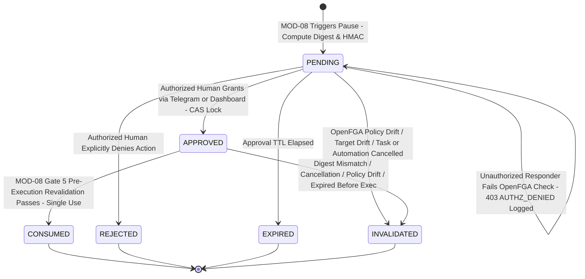

### E.5 Human-in-the-Loop Interaction and Execution Suspension (`MOD-03` `HumanInteractionManager`)

#### E.5.1 Centralized Ownership Justification & Module Mapping (`PART 1.1`, `PART 5`)
`[CONFIRMED]` Rather than introducing an unnecessary top-level module (`MOD-19`), centralized Human-in-the-Loop (HITL) interaction orchestration lives inside **`MOD-03: Deterministic Task Manager`** as **`HumanInteractionManager`**. Placing it inside `MOD-03` allows macro-task state (`orbi_app.tasks`, `WAITING_FOR_USER`, `task_version`), `orbi_app.interaction_requests`, `orbi_app.approval_requests`, and notification/outbox events to commit inside a **single ACID PostgreSQL transaction**—eliminating split-brain task-vs-interaction states during suspension, timeout, or cancellation (`AP-03`, `AP-09`).

| Responsibility | Owning / Enforcing Module | Exact Role |
| :--- | :--- | :--- |
| **Create Interaction Request** | `MOD-04`, `MOD-08`, `MOD-10`, `MOD-13`/`MOD-14` | Emits structured `InteractionCreateIntent` (`INFORMATION_REQUEST`, `APPROVAL_REQUEST`, `SECURE_INPUT_REQUEST`, `HUMAN_TAKEOVER`, `PHYSICAL_ACTION_REQUEST`) when human intervention is needed; never manages its own wait loop. |
| **Persist & Own Interaction Lifecycle** | **`MOD-03` (`HumanInteractionManager`)** | Allocates `interaction_id`, persists `orbi_app.interaction_requests`, links `task_id`/`execution_id`/`automation_generation`, transitions task -> `WAITING_FOR_USER`, enforces optimistic CAS (`interaction_version`), validates schema, handles expiry/cancellation/duplicates. |
| **Deliver Prompts & Handoff Links** | `MOD-18` Result & Delivery Manager | Routes concise prompts to `MOD-01` (Telegram) / `MOD-02` (Dashboard), attaches short-lived replay-protected Dashboard handoff deep-links when `SECURE_INPUT_REQUEST` or `HUMAN_TAKEOVER` is needed. |
| **Receive Authenticated Responses** | `MOD-01` (Telegram) & `MOD-02` (Dashboard BFF) | Authenticates user on the ingress channel (`channel_bindings` or Dashboard WebAuthn/MFA session) and forwards normalized response / approval / takeover completion to `MOD-03` (or secret bypass to `MOD-02 -> MOD-08` ephemeral buffer). |
| **Enforce Authorization** | `MOD-09` (OpenFGA) | Checks `interaction_request:<id>` (`responder`, `approver`, `session_controller`, `canceller`) and target resource/task ownership deterministically outside LLM context. |
| **Resume Task / Callback** | `MOD-03` (-> `MOD-04`, `MOD-08`, `MOD-10`) | Atomically marks `interaction_requests` `RESOLVED`, verifies task/automation status & generation, transitions task `WAITING_FOR_USER -> QUEUED`, resumes LangGraph from saved `checkpoint_id`, or invokes `MOD-10.submit_clarification_decision()`. |
| **Manage Browser / Desktop Takeover & Ephemeral Secrets** | `MOD-02` + `MOD-08` + `MOD-13` / `MOD-14` | `MOD-02` terminates authenticated noVNC/WebRTC view or secret input form; `MOD-08` enforces agent session lockout during `TAKEOVER_ACTIVE`, injects short-TTL single-use `ephemeral_secret_handle` with field masking, and runs verification probes on handback. |

#### E.5.2 Five Distinct Interaction Types & Security Contracts (`PART 1.2`)

| Interaction Type | Concrete Example | Supported Payload & Validation Rules | Hard Security Invariants & Prohibitions |
| :--- | :--- | :--- | :--- |
| **`INFORMATION_REQUEST`** | *"Which train class would you prefer?"* / Memory `NEEDS_CLARIFICATION` | Supports free text, JSON-Schema structured forms, single-choice, multi-choice, required/optional fields, strict regex/enum/type validation, `VALIDATION_FAILED_RETRYABLE` feedback, and follow-up clarifications. | **Never** implicitly counts as an `APPROVAL_REQUEST` for any `SENSITIVE_WRITE`/`IRREVERSIBLE` tool. Stored plaintext only for authorized task/memory context. |
| **`APPROVAL_REQUEST`** | *"I have prepared the email. Should I send it?"* | Links 1-to-1 with `orbi_app.approval_requests`; displays tool name, canonical arguments preview, target resource, policy version, expiry TTL, Approve/Reject actions. | Binds immutably (`ADR-004`) to `(user_id, task_id, execution_id, tool_id, tool_version, canonical_arguments_hash, target_resource, policy_version, expires_at)` with one-time `APPROVED -> CONSUMED` CAS. Argument/target/policy changes invalidate prior approval. |
| **`SECURE_INPUT_REQUEST`** | OTP, application password, temporary 2FA auth code | Collected **solely** via authenticated `MOD-02` Dashboard form or direct isolated browser session; binds a short-lived single-use **`ephemeral_secret_handle`** (`ttl_seconds`, `target_execution_id`, `target_tool_id`) cleared immediately after `MOD-08` injection. *(Future credential manager integration preserved behind a `[PROPOSED]` Vault/SecretPort interface — not assumed available today.)* | **Must NEVER use Telegram.** **Must NEVER enter** LLM prompts, `MOD-04` message histories, `langgraph_checkpoints`, `MOD-10` long-term memory, `orbi_app` ordinary response columns, plaintext screenshots, HAR traces, or `MOD-15` audit logs. Browser inputs masked in logs/traces and never readable by unrelated tools/agents. |
| **`HUMAN_TAKEOVER`** | CAPTCHA challenge, website SSO/MFA gate, complex desktop prompt | Establishes an OpenFGA `session_controller`-verified, short-lived, single-session WebSocket/noVNC (`MOD-13`) or local consent (`MOD-14`) takeover lease (`TAKEOVER_ACTIVE`) preserving browser cookies/DOM/app window state; **agent `MOD-08` commands to that session are locked out** while human holds control. Upon manual handback, agent verifies expected post-challenge state via deterministic `READ_ONLY` DOM/UIA probe before continuing. | **Never** designs or performs CAPTCHA solving, Turnstile bypass, or auth circumvention. Forced session disconnect + stream token revocation immediately on timeout or cancellation (`CON-20`). |
| **`PHYSICAL_ACTION_REQUEST`** | *"Please switch on the device and confirm when ready."* | Accepts structured user confirmation (`confirmed: true/false`, optional note/timestamp) across Telegram (`MOD-01`) or Dashboard (`MOD-02`). | User reply records strictly `user_reported_confirmation`—**NEVER** treated as authoritative physical-state proof unless confirmed by an independent `READ_ONLY` sensor/telemetry probe executed via `MOD-08` (e.g., IoT/device readiness check). |

#### E.5.3 Centralized Interaction Lifecycle, Schema & 3-Step Atomic CAS Protocol (`PART 2`, `Items 1 & 2`)

```python
# Interface / Data-Contract Specification Only (HLD Design — Not Implementation Code)

class InteractionType(str, Enum):
    INFORMATION_REQUEST = "INFORMATION_REQUEST"
    APPROVAL_REQUEST = "APPROVAL_REQUEST"
    SECURE_INPUT_REQUEST = "SECURE_INPUT_REQUEST"
    HUMAN_TAKEOVER = "HUMAN_TAKEOVER"
    PHYSICAL_ACTION_REQUEST = "PHYSICAL_ACTION_REQUEST"

class InteractionStatus(str, Enum):
    CREATED = "CREATED"                               # Prepared under SUSPENDING_FOR_USER before checkpoint verify
    PENDING_USER = "PENDING_USER"                     # Committed AFTER verified LangGraph checkpoint + prompt outbox
    TAKEOVER_ACTIVE = "TAKEOVER_ACTIVE"               # Short-lived HUMAN_TAKEOVER custody active
    RESPONSE_RECEIVED = "RESPONSE_RECEIVED"           # Claimed via CAS Transition 1
    VALIDATING = "VALIDATING"                         # Locked for deterministic checks via CAS Transition 2
    VALIDATION_FAILED_RETRYABLE = "VALIDATION_FAILED_RETRYABLE"
    RESOLVED = "RESOLVED"                             # Validation passed -> Task QUEUED + outbox RESUME_TASK / clarify
    EXPIRED = "EXPIRED"
    CANCELLED = "CANCELLED"
    REJECTED = "REJECTED"                             # Authorized user explicitly denied APPROVAL_REQUEST / prompt
    INVALIDATED = "INVALIDATED"                       # Digest, target, or OpenFGA policy_version mismatch
    FAILED = "FAILED"                                 # Non-retryable internal failure / checkpoint prepare abort
    ESCALATED = "ESCALATED"

@dataclass(frozen=True)
class InteractionRequest:
    interaction_id: UUID
    task_id: UUID | None                              # Nullable only for out-of-band MOD-10 background curation
    task_version: int | None
    execution_id: UUID | None
    automation_id: UUID | None
    automation_generation: int | None
    verified_checkpoint_id: str | None                # Non-null once LangGraph interrupt() checkpoint is verified
    memory_candidate_id: UUID | None                  # Populated for MOD-10 NEEDS_CLARIFICATION
    approval_id: UUID | None                          # Linked ADR-004 ApprovalRequest for APPROVAL_REQUEST
    interaction_type: InteractionType
    requesting_agent: str
    target_principal: str                             # e.g., "user:<uuid>"
    tenant_id: str                                    # PERSONAL | HOUSEHOLD | ORGANIZATION_FUTURE
    visibility_scope: str                             # private_user | shared_tenant
    status: InteractionStatus
    allowed_response_channels: tuple[str, ...]        # e.g., ("dashboard",) for SECURE_INPUT_REQUEST
    resolved_via_channel: str | None
    prompt_payload: dict                              # Redacted non-secret structured prompt + deep-link ref
    response_schema: dict                             # JSON Schema for validation (empty/opaque ref for SECURE_INPUT)
    sanitized_response_payload: dict | None           # Null / ephemeral handle ref only for SECURE_INPUT_REQUEST
    response_idempotency_key: str | None              # Deduplicates duplicate/concurrent submissions
    created_at: datetime
    expires_at: datetime
    resolved_at: datetime | None
    interaction_version: int                          # Monotonic CAS concurrency guard
```
*(Secret Invariant: `prompt_payload`, `sanitized_response_payload`, `orbi_app.tasks`, `langgraph_checkpoints`, and `MOD-15` must NEVER store plaintext `SECURE_INPUT_REQUEST` secrets.)*

**Pre-Mutation Authorization Gate & 3-Step Atomic CAS Protocol (`MOD-03` `HumanInteractionManager`)**:
1. **Step 0 — Pre-Mutation AuthN, Channel & OpenFGA Check (`Item 2.A`, No State Mutation on Unauthz)**:
   - Channel ingress (`MOD-01` / `MOD-02`) authenticates the acting human and confirms `channel IN allowed_response_channels`.
   - Before touching `orbi_app.interaction_requests`, `MOD-03` verifies live `MOD-09` OpenFGA authorization (`responder`, `approver` for `APPROVAL_REQUEST`, or `session_controller` for `HUMAN_TAKEOVER` on `interaction_request:<id>`).
   - If OpenFGA returns `DENY`, `MOD-03` **rejects immediately with `403 AUTHZ_DENIED`**, records `UNAUTHORIZED_INTERACTION_ATTEMPT` in `MOD-15`, and **performs ZERO database mutation**: the legitimate user's `interaction_requests.status` (`PENDING_USER` / `TAKEOVER_ACTIVE` / `VALIDATION_FAILED_RETRYABLE`) and `interaction_version` remain unchanged so unauthorized actors can never cancel or invalidate an active prompt.
2. **Idempotent Retry Short-Circuit**:
   - If the submitted `response_idempotency_key` equals an already-committed `interaction_requests.response_idempotency_key` for the same `actor_principal`, return the stored acceptance receipt cleanly without re-executing validation or creating duplicate resume jobs.
3. **CAS Transition 1 — Claim Active Interaction (`PENDING_USER | TAKEOVER_ACTIVE | VALIDATION_FAILED_RETRYABLE -> RESPONSE_RECEIVED`, `v -> v + 1`)**:
   ```sql
   UPDATE orbi_app.interaction_requests
   SET status = 'RESPONSE_RECEIVED',
       interaction_version = interaction_version + 1,
       response_idempotency_key = :idempotency_key,
       resolved_via_channel = :channel
   WHERE interaction_id = :interaction_id
     AND interaction_version = :expected_version
     AND status IN ('PENDING_USER', 'TAKEOVER_ACTIVE', 'VALIDATION_FAILED_RETRYABLE')
     AND expires_at > now()
   RETURNING interaction_version;  -- v_received = expected_version + 1
   ```
   If `0` rows match (already claimed, expired, cancelled, or concurrent writer bumped `interaction_version`), reject cleanly with `409 Conflict` (`ALREADY_CLAIMED_OR_STALE`) without altering state.
4. **CAS Transition 2 — Acquire Validation Lock (`RESPONSE_RECEIVED -> VALIDATING`, `v + 1 -> v + 2`)**:
   ```sql
   UPDATE orbi_app.interaction_requests
   SET status = 'VALIDATING',
       interaction_version = interaction_version + 1
   WHERE interaction_id = :interaction_id
     AND interaction_version = :v_received
     AND status = 'RESPONSE_RECEIVED'
     AND expires_at > now()
   RETURNING interaction_version;  -- v_validating = expected_version + 2
   ```
   Isolates deterministic validation (JSON Schema check, `ADR-004` digest/HMAC/OpenFGA `policy_version` check, `task_version` & `automation.generation` check, or `READ_ONLY` post-takeover probe verification) so concurrent threads cannot double-validate.
5. **CAS Transition 3 — Commit Validation Outcome (`WHERE interaction_id = :interaction_id AND status = 'VALIDATING' AND interaction_version = :v_validating`, `v + 2 -> v + 3`)**:
   - **Outcome `VALIDATING -> RESOLVED` (`interaction_version = v + 3`)**: When all checks pass and parent `tasks` / `automation_definitions` remain active/unexpired, one ACID PostgreSQL transaction sets `interaction_requests.status = 'RESOLVED'`, sets `approval_requests.status = 'APPROVED'` (for `APPROVAL_REQUEST`), transitions `orbi_app.tasks` `WAITING_FOR_USER -> QUEUED` (`task_version += 1`, allocates `resume_token_id`), and inserts `RESUME_TASK` (or `MEMORY_CLARIFICATION_DECIDED` for `MOD-10` clarifications) into **`orbi_app.task_lifecycle_outbox`**.
   - **Outcome `VALIDATING -> VALIDATION_FAILED_RETRYABLE` (`interaction_version = v + 3`)**: When schema validation fails with retries remaining, clears `response_idempotency_key = NULL`, increments `interaction_version = v + 3`, keeps parent task `WAITING_FOR_USER`, and emits an outbox validation-feedback prompt via `MOD-18`.
   - **Outcome `VALIDATING -> REJECTED` (`interaction_version = v + 3`, `Item 2.B`)**: When an OpenFGA-authorized human **explicitly denies** an `APPROVAL_REQUEST` (or declines a blocking request), atomically updates `approval_requests.status = 'REJECTED'` and `interaction_requests.status = 'REJECTED'`, transitions `orbi_app.tasks.status = 'CANCELLED'` (zero tool execution), audits `APPROVAL_REJECTED` in `MOD-15`, and notifies via `MOD-18`.
   - **Outcome `VALIDATING -> INVALIDATED` (`interaction_version = v + 3`, `Item 2.C`)**: When `ADR-004` `binding_digest`, `target_resource`, `tool_version`, or OpenFGA `policy_version` has drifted since prompt issuance, atomically sets `approval_requests.status = 'INVALIDATED'` and `interaction_requests.status = 'INVALIDATED'`, audits the exact invalidation reason in `MOD-15`, guarantees the external action cannot execute, and re-enqueues or requests a fresh approval if the task remains active.
   - **Outcome `VALIDATING -> CANCELLED` (`interaction_version = v + 3`)**: If parent `tasks` or `automation_definitions` was cancelled/superseded during validation, commits `status = 'CANCELLED'` and aborts resumption cleanly.

#### Diagram 14: Centralized Human Interaction Lifecycle State Machine

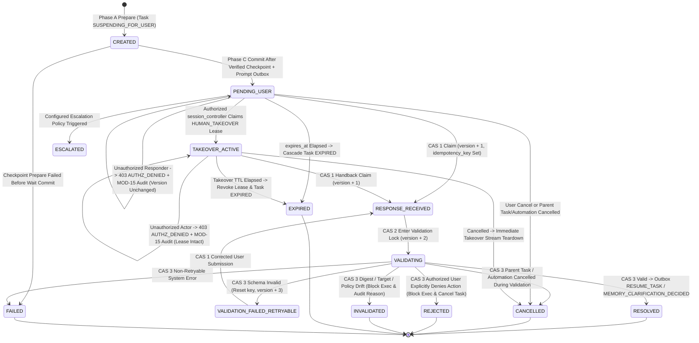

#### E.5.4 Crash-Consistent Two-Phase Task Suspension & Lease-Fenced Outbox Resumption (`PART 3`, `Item 3`)

Because PostgreSQL (`orbi_app`) and `langgraph_checkpoints` do **not** share a single distributed atomic transaction, Orbi uses a **Four-Phase Checkpoint-First Suspension & Bounded-Lease Outbox Resumption Protocol** so no task enters `WAITING_FOR_USER` without a verified checkpoint and no `RESUME_TASK` can double-execute or hang indefinitely on worker crash:

1. **Mandatory Invariants**:
   - **No Resumable Wait Without Verified Checkpoint**: `orbi_app.tasks.status` MUST NEVER enter `WAITING_FOR_USER` (and `interaction_requests.status` MUST NEVER enter `PENDING_USER`) until `pending_checkpoint_id` has been saved and read-verified in `langgraph_checkpoints`.
   - **No Stale or Cancelled Recovery**: Both worker claim / stale-`RUNNING` lease recovery (`MOD-03`) and `MOD-08` Gate 5 revalidate authoritative PostgreSQL `cancellation_requested`, `expires_at`, `task_version`, `claim_epoch`, and `automation.generation` before executing.
   - **Bounded Ownership, Epoch Fencing Limits & Write-Ahead External Receipts**: Every `RESUME_TASK` claim acquires a bounded PostgreSQL lease (`lease_expires_at`, `claimed_by_worker_id`) fenced by monotonic `claim_epoch`, while `tasks.resume_token_id` stays retained (`NOT NULL`) across `RUNNING` until turn completion commits. **`claim_epoch` fences Orbi-internal PostgreSQL writes and pre-dispatch Gateway calls (`STALE_CLAIM_EPOCH_FENCED`), and consuming an `ApprovalRequest` binds one logical action—neither mechanism can recall, cancel, or prove completion of an already-transmitted external provider request.** External calls therefore follow write-ahead `orbi_app.step_execution_receipts` (`PREPARED -> DISPATCHING -> CONFIRMED_SUCCESS | CONFIRMED_FAILURE_* | UNKNOWN_OUTCOME`) keyed by immutable `action_idempotency_key` (`§C.2`).
   - **Zero Indefinite Waiting Workers**: Immediately after Phase C commits `WAITING_FOR_USER`, the worker releases all execution threads, memory, and LLM connections cleanly.

2. **Four-Phase Suspension & Resumption Protocol**:
   - **Phase A — Prepare Suspension (`orbi_app` Transaction 1)**: When a LangGraph turn yields via `interrupt()` (or `MOD-08`/`MOD-13`/`MOD-14` requests HITL intervention), `MOD-03` atomically transitions `tasks.status = 'SUSPENDING_FOR_USER'` (`waiting_reason`, allocates `pending_checkpoint_id`), inserts `orbi_app.interaction_requests` (`status = 'CREATED'`, `verified_checkpoint_id = NULL`, plus linked `approval_requests` if `APPROVAL_REQUEST`), and commits PostgreSQL.
   - **Phase B — Save & Verify LangGraph Checkpoint (`langgraph_checkpoints`)**: `MOD-04` writes the structured `interrupt()` state (with **zero** `SECURE_INPUT_REQUEST` secrets) under `pending_checkpoint_id` and performs an immediate read-back existence/integrity check.
     - *If Phase B fails*: Worker (or timeout reconciler) rolls back `tasks.status` (`SUSPENDING_FOR_USER -> QUEUED` retry or `FAILED`), marks the `CREATED` interaction `FAILED`, and purges any partial checkpoint.
     - *If worker crashes after Phase B succeeds (before Phase C)*: Crash reconciler inspects expired `SUSPENDING_FOR_USER` leases, finds valid `pending_checkpoint_id` in `langgraph_checkpoints` (and verifies task was not cancelled/expired), and executes Phase C idempotently.
   - **Phase C — Commit Resumable Wait & Outbox Prompt (`orbi_app` Transaction 2)**: In one PostgreSQL transaction checking `tasks.status == 'SUSPENDING_FOR_USER' AND cancellation_requested == false`: set `tasks.status = 'WAITING_FOR_USER'` (`task_version += 1`, `verified_checkpoint_id = pending_checkpoint_id`), set `interaction_requests.status = 'PENDING_USER'`, `verified_checkpoint_id = pending_checkpoint_id`, and insert `DELIVER_INTERACTION_PROMPT` into **`orbi_app.task_lifecycle_outbox`**. Only *after* Phase C commits does the worker exit and release compute; the leased outbox dispatcher pushes the prompt to `MOD-18` (`MOD-01` / `MOD-02`).
   - **Phase D — Validated Resolution, Bounded-Lease `RESUME_TASK` Claim & Stale-`RUNNING` Recovery**:
     1. *Interaction Validation*: Human responds; `MOD-03` (`HumanInteractionManager`) enforces Step 0 OpenFGA gate + 3-step `interaction_version` CAS (`§E.5.3`).
     2. *Commit `QUEUED` & Outbox `RESUME_TASK`*: On valid pass, one ACID transaction sets `interaction_requests.status = 'RESOLVED'`, `tasks.status = 'QUEUED'` (`task_version += 1`, allocates `resume_token_id = uuid4()`, `claim_epoch = 0`), and inserts `RESUME_TASK` (`status = 'PENDING'`, `expected_task_version = tasks.task_version`, `resume_token_id`, `claim_epoch = 0`) into **`orbi_app.task_lifecycle_outbox`** (+ `MEMORY_CLARIFICATION_DECIDED` for `MOD-10` items).
     3. *Bounded-Lease Claim (`PENDING -> RUNNING` & `QUEUED -> RUNNING`)*: When a worker picks up `RESUME_TASK` (via Redis `queue:tasks:interactive` or reconciler), it executes a single-winner SQL CAS across `task_lifecycle_outbox` and `tasks` retaining `resume_token_id` while active:
        ```sql
        UPDATE orbi_app.task_lifecycle_outbox AS o
        SET status = 'RUNNING',
            claim_epoch = o.claim_epoch + 1,
            claimed_by_worker_id = :worker_id,
            lease_expires_at = now() + (:lease_ttl_seconds * interval '1 second'),
            attempt_count = o.attempt_count + 1
        FROM orbi_app.tasks AS t
        WHERE o.event_id = :event_id
          AND o.task_id = t.task_id
          AND o.claim_epoch = :expected_claim_epoch
          AND (
              (o.status = 'PENDING' AND t.status = 'QUEUED')
              OR (o.status = 'RUNNING' AND o.lease_expires_at < now() AND t.status = 'RUNNING')
          )
          AND NOT EXISTS (
              SELECT 1 FROM orbi_app.task_lifecycle_processed_events AS p
              WHERE p.idempotency_key = o.idempotency_key
          )
          AND t.resume_token_id = o.resume_token_id
          AND t.task_version = o.expected_task_version
          AND t.cancellation_requested = false
          AND (t.expires_at IS NULL OR t.expires_at > now());
        -- Paired in the same PG tx: update orbi_app.tasks SET status = 'RUNNING',
        -- claim_epoch = new_epoch, claimed_by_worker_id = :worker_id,
        -- lease_expires_at = new_expiry (leaving tasks.resume_token_id INTACT).
        ```
        Active workers renew `lease_expires_at` via heartbeats gated on `WHERE task_id = :id AND claim_epoch = :worker_claim_epoch AND cancellation_requested = false`.
     4. *Stale `RUNNING` Detection, PG Revalidation & Post-Resume Crash-Before-Ack Recovery*: `MOD-03`'s reconciler scans `o.event_type = 'RESUME_TASK' AND o.status = 'RUNNING' AND o.lease_expires_at < now()`:
        - **Already Processed Before Ack**: If `task_lifecycle_processed_events` already holds `o.idempotency_key` (or `tasks.resume_token_id IS NULL` / `task_version > expected_task_version`), the prior worker completed the logical resume commit before crashing prior to outbox ack; the reconciler transitions `o.status = 'PROCESSED'` cleanly with **zero re-execution**.
        - **Pre-Recovery Cancellation, Expiry, Version & Superseded-Automation Check**: Before reclaiming, `MOD-03` inspects live PostgreSQL state. If `tasks.cancellation_requested = true` or terminal `CANCELLED*` -> mark outbox `CANCELLED`, clear `resume_token_id = NULL`, preserve `CANCELLED_AFTER_EXTERNAL_COMMIT` if `step_execution_receipts` records a committed external action; if `tasks.expires_at <= now()` -> transition task `EXPIRED`, mark outbox `CANCELLED`; if `tasks.task_version != o.expected_task_version` or linked `orbi_automation.automation_definitions` (`status != 'ACTIVE'` or `generation != tasks.automation_generation`) was superseded -> mark outbox `CANCELLED` (`STALE_TASK_VERSION_ABORT` / `SKIPPED_STALE_GENERATION`); if `attempt_count >= max_attempts` -> move outbox to `DEAD_LETTERED`, mark task `FAILED` (`RESUME_RETRIES_EXHAUSTED`), audit `MOD-15`, alert `MOD-02`.
        - **Safe Replacement Reclaim, Immutable Receipt Reconciliation & No-Blind-Retry Rule**: If active and within budget, the replacement worker claims `claim_epoch + 1` via the SQL CAS above (incrementing `attempt_count` so a waking zombie worker fails every subsequent heartbeat, `MOD-08` Gate 5 check, and commit with `STALE_CLAIM_EPOCH_FENCED`). When rehydrating from the latest verified checkpoint and inspecting `orbi_app.step_execution_receipts` (`§C.2`), `MOD-08` enforces byte-for-byte immutable `(tool_id, tool_version, canonical_arguments_hash, target_resource, approval_id, action_idempotency_key)`:
          - `CONFIRMED_SUCCESS`: immediately replay stored sanitized receipt (`0` external calls);
          - `PREPARED`: never crossed network; revalidate Gate 5, mark `DISPATCHING`, and invoke with stored `action_idempotency_key`;
          - `DISPATCHING` (left unfinalized by crashed W1 -> transition `DISPATCHING -> UNKNOWN_OUTCOME` first, since `claim_epoch` and `approval_requests` consumption do **not** undo or prove completion of external calls): execute `READ_ONLY` status probe (`RECONCILABLE_READ_PROBE`), pass the **identical `action_idempotency_key`** (`PROVIDER_IDEMPOTENCY_KEY` within window), or **strictly prohibit blind automatic retry** for `NON_IDEMPOTENT_NO_RECONCILE` / inconclusive / expired-window calls and escalate via `MOD-03` (`WAITING_FOR_USER` / `UNCERTAIN_EXECUTION_RECONCILIATION`).
     5. *Atomic Turn Completion & Single-Use Token Consumption*: When the resumed turn concludes, one ACID PostgreSQL transaction asserts `WHERE tasks.task_id = :id AND claim_epoch = :worker_claim_epoch AND resume_token_id = :token`: inserts `task_lifecycle_processed_events(idempotency_key)`, marks `task_lifecycle_outbox.status = 'PROCESSED'`, clears `tasks.resume_token_id = NULL` and `lease_expires_at = NULL`, increments `tasks.task_version += 1`, and commits the next task state (`COMPLETED`, `RUNNING` next step, or `SUSPENDING_FOR_USER`).

3. **Mandatory Suspension, Resumption & Crash Recovery Matrix**:

| Scenario | Deterministic Platform Behavior |
| :--- | :--- |
| **1. User does not respond** | Task remains `WAITING_FOR_USER` in PostgreSQL with zero active workers; optional `MOD-18` reminder/escalation rules notify without keeping threads open. |
| **2. Interaction expires (`expires_at`)** | Background TTL sweeper in `MOD-03` atomically marks `interaction_requests = EXPIRED` and transitions waiting task to `EXPIRED`, releasing takeover leases and notifying user via `MOD-18`. |
| **3. User cancels interaction request** | `HumanInteractionManager` validates OpenFGA `canceller`, transitions interaction `CANCELLED`, closes `approval_requests`/`takeover` stream, cancels/fails waiting task cleanly, audits in `MOD-15`. |
| **4. Parent task cancelled while waiting** | `MOD-03.cancel_task()` atomically sets `tasks.status = CANCELLED`, increments `task_version`, and cascades `CANCELLED` to all open `interaction_requests` / `approval_requests` in the same PG transaction. |
| **5. Checkpoint saved, then worker crashes BEFORE Phase C PG commit** | Task remains `SUSPENDING_FOR_USER`; startup/lease reconciler verifies `pending_checkpoint_id` exists in `langgraph_checkpoints` and task is non-cancelled, then rolls forward cleanly to `WAITING_FOR_USER` + `PENDING_USER` + `DELIVER_INTERACTION_PROMPT`. |
| **6. Checkpoint save fails AFTER Phase A PG `SUSPENDING_FOR_USER` commit** | No task ever enters `WAITING_FOR_USER`. Worker (or reconciler) sees missing/corrupt checkpoint, marks `CREATED` interaction `FAILED`, transitions task `SUSPENDING_FOR_USER -> QUEUED` (or `FAILED`), and purges partial checkpoint data. |
| **7. Worker crashes AFTER Phase C `WAITING_FOR_USER` commit (or server restarts)** | Zero in-memory wait state exists; PostgreSQL retains `WAITING_FOR_USER`, `interaction_requests`, and verified `langgraph_checkpoints`, while `task_lifecycle_outbox` ensures `DELIVER_INTERACTION_PROMPT` still reaches `MOD-18`. |
| **8. Crash AFTER interaction `RESOLVED` BEFORE initial Redis publish / claim** | `task_lifecycle_outbox` (`PENDING` `RESUME_TASK`) committed atomically with `RESOLVED` + `QUEUED`; reconciler republishes and one worker acquires `claim_epoch = 1` via bounded-lease CAS cleanly. |
| **9. Worker crashes AFTER claiming `RUNNING` (`RESUME_TASK`) — pre-commit, post-dispatch before receipt, or post-resume pre-ack** | `tasks.resume_token_id` stays retained across `RUNNING`. Once `lease_expires_at < now()`: (a) if PG already committed `task_lifecycle_processed_events` / cleared token, reconciler marks `outbox = PROCESSED` (`0` re-run); (b) else reconciler revalidates cancellation/expiry/`task_version`/`automation.generation`, W2 wins `claim_epoch + 1` CAS (fencing zombie W1 with `STALE_CLAIM_EPOCH_FENCED`), and `MOD-08` enforces write-ahead `step_execution_receipts`: replaying `CONFIRMED_SUCCESS`, transitioning unfinalized `DISPATCHING -> UNKNOWN_OUTCOME` and retrying `PROVIDER_IDEMPOTENCY_KEY` with immutable `action_idempotency_key`, running `RECONCILABLE_READ_PROBE`, or refusing blind retry and escalating `NON_IDEMPOTENT_NO_RECONCILE` to `WAITING_FOR_USER` (`UNCERTAIN_EXECUTION_RECONCILIATION`). |
| **10. Duplicate `RESUME_TASK` delivery or zombie worker awakening** | Duplicate Redis delivery hits committed `task_lifecycle_processed_events` or `claim_epoch` mismatch and drops idempotently; woken old worker holding `claim_epoch = 1` fails heartbeats, `MOD-08` Gate 5 dispatch, and completion CAS (`STALE_CLAIM_EPOCH_FENCED`). |
| **11. Orphaned checkpoints accumulated from crashed prepares or terminal tasks** | Background reconciler purges any `langgraph_checkpoints` row whose parent task is terminal (`COMPLETED \| FAILED \| CANCELLED \| CANCELLED_AFTER_EXTERNAL_COMMIT \| EXPIRED`) or rolled back from `SUSPENDING_FOR_USER`. |
| **12. User responds through another authorized channel** | Permitted when `channel IN allowed_response_channels` AND user authenticates independently on that channel + passes OpenFGA; same `interaction_id` resolves cleanly via 3-step CAS. |
| **13. Duplicate or concurrent response submissions** | Identical `response_idempotency_key` returns stored receipt; concurrent submission fails `interaction_version` CAS (`409 Conflict`) with zero duplicate `RESUME_TASK`. |
| **14. Unauthorized responder submission** | Fails Step 0 OpenFGA gate (`403 AUTHZ_DENIED`), logs security audit (`MOD-15`), leaves `PENDING_USER` and `interaction_version` completely untouched. |
| **15. Authorized denial vs. Digest/policy mismatch** | Explicit user denial transitions interaction & approval -> `REJECTED` (cancels task); digest/target/policy mismatch transitions both -> `INVALIDATED` (blocks action, audits reason, optionally triggers fresh request). |
| **16. Stale response arrives after task/automation changed** | Revalidation of `tasks.status == 'WAITING_FOR_USER'`, `task_version`, `automation.status == 'ACTIVE'`, and `automation.generation` rejects resumption cleanly (`STALE_INTERACTION_REJECTED` / `STALE_AUTOMATION_GENERATION_REJECTED`). |

#### E.5.5 Multi-Channel Interaction Matrix & Authenticated Handoff (`PART 4`)

| Interaction Type | `MOD-01` Telegram | `MOD-02` Web Dashboard | Future Mobile / Voice (`AP-10`) | Cross-Channel Rule |
| :--- | :---: | :---: | :---: | :--- |
| **`INFORMATION_REQUEST`** | **Supported** | **Supported** | Via `ChannelAdapterPort` | Same `interaction_id` & `response_schema`; first valid OpenFGA-authorized reply wins CAS. |
| **`APPROVAL_REQUEST`** | **Supported** *(concise digest summary)* | **Supported** *(full canonical payload view)* | Policy-gated | `IRREVERSIBLE` / recent-MFA policies may require Dashboard (`OQ-08`). |
| **`SECURE_INPUT_REQUEST`** | **BLOCKED (Notify + Deep-Link ONLY)** | **Mandatory (Authenticated Form / Session)** | **Authenticated Biometric/WebView Only** | Telegram must **never** accept OTPs/passwords; accidental chat text matching active challenge triggers security warning + immediate prompt scrub advisory. |
| **`HUMAN_TAKEOVER`** | **BLOCKED (Notify + Deep-Link ONLY)** | **Mandatory (Authenticated noVNC / WebRTC / UI)** | **Future Dedicated App View** | Short-lived single-use `handoff_nonce` -> Dashboard requires live session auth + OpenFGA check before opening stream. |
| **`PHYSICAL_ACTION_REQUEST`** | **Supported** | **Supported** | Via `ChannelAdapterPort` | Records `user_reported_confirmation` only; independent `READ_ONLY` probe validates physical state when hardware exists. |

- **Cross-Channel Handoff Security (`Telegram -> Dashboard -> Telegram`)**:
  1. Notification sent over `MOD-01` includes an opaque HMAC-signed URL referencing `(interaction_id, handoff_nonce, expires_at)` — bearing **zero** login credentials and granting **zero** authentication trust on its own.
  2. Opening the Dashboard link requires full Dashboard authentication (`WebAuthn / password + MFA`) and verifies `MOD-09` OpenFGA permission for the logged-in Dashboard `user_id` against `interaction_request.target_principal` (blocking privilege transfer even if someone obtains the deep-link).
  3. Consuming `handoff_nonce` is one-time and short-lived; completion updates `MOD-03`, resumes the same `task_id` & `execution_id`, and `MOD-18` reports final task outcome back to the originating Telegram thread.

#### E.5.6 Interaction Authorization & Privacy Boundaries (`PART 5`)
- **Strict Principal Isolation**: Private (`visibility_scope = private_user`) interactions grant `responder` / `approver` / `session_controller` exclusively to `target_principal`; other household members in `HOUSEHOLD` tenants fail Step 0 `MOD-09` OpenFGA (`403 AUTHZ_DENIED`), logged to `MOD-15` with **zero mutation** to the pending interaction's `status` or `interaction_version`.
- **Shared Household Interactions**: Enabled only when explicitly created with `visibility_scope = shared_tenant` AND OpenFGA policy explicitly binds authorized household members on that interaction/resource.
- **Channel Ingress Prohibition**: Agents (`MOD-04`) **never** interpret raw Telegram messages directly as task approval, OTP entry, or resumption commands; only authenticated ingress channels routing through `MOD-03` (`HumanInteractionManager`) + `MOD-09` OpenFGA may transition an interaction or resume a suspended task.

#### E.5.7 Human-in-the-Loop Evaluation Suite (`PART 8`, Extended: `HITL-EVAL-01` – `HITL-EVAL-26`)

`[CONFIRMED]` Before locking LLD DDL and state contracts under `EVAL-04` and `EVAL-08`, the platform must pass all 26 HITL, takeover, epistemic, authorization, and crash-recovery scenarios below:

| Test ID | Scenario | Expected Behavior & Security Acceptance Criteria |
| :--- | :--- | :--- |
| **`HITL-EVAL-01`** | **Ordinary `INFORMATION_REQUEST` & Resume** | Agent yields cleanly (`SUSPENDING_FOR_USER` -> verified checkpoint -> `WAITING_FOR_USER`, 0 waiting workers); user replies on Telegram -> `MOD-03` 3-step CAS & `task_lifecycle_outbox` resumes exact `verified_checkpoint_id`. |
| **`HITL-EVAL-02`** | **Structured Form Validation** | Multi-field JSON Schema form fails during `VALIDATING` -> transitions to `VALIDATION_FAILED_RETRYABLE` (resets `response_idempotency_key`, `interaction_version + 1`), and resumes only on schema-valid submission. |
| **`HITL-EVAL-03`** | **Action-Bound `APPROVAL_REQUEST` Execution** | Sensitive action suspends with canonical digest + HMAC; owner approves -> `MOD-08` Gate 5 revalidates digest/policy and transitions `APPROVED -> CONSUMED` single-use. |
| **`HITL-EVAL-04`** | **Changed Arguments / Policy Invalidate Prior Approval (`INVALIDATED`)** | Modifying email recipient/body, target resource, or OpenFGA `policy_version` transitions interaction & approval to `INVALIDATED` (distinct from `REJECTED`), audits reason in `MOD-15`, and blocks external execution. |
| **`HITL-EVAL-05`** | **Secure OTP Entry Without LLM Exposure** | Telegram receives deep-link notice; user submits OTP on authenticated `MOD-02` Dashboard -> injected by `MOD-08` into `MOD-12`/`MOD-13`, masked in traces, zero LLM context exposure. |
| **`HITL-EVAL-06`** | **Secure Password Entry Without Ordinary Logging** | Password submitted via `SECURE_INPUT_REQUEST` clears ephemeral buffer after use and leaves zero plaintext across `MOD-15`, app logs, `orbi_app` columns, or HAR/screenshots. |
| **`HITL-EVAL-07`** | **Browser `HUMAN_TAKEOVER` & Return of Control** | Login gate opens OpenFGA-authorized short-lived noVNC/WebRTC session (`TAKEOVER_ACTIVE`), locks out agent commands during takeover, preserves cookies/DOM on handback, verifies session via probe, and resumes `MOD-04`. |
| **`HITL-EVAL-08`** | **CAPTCHA Handoff Without Bypass** | `MOD-13` encounters CAPTCHA/Turnstile, performs zero automated solving/bypassing, suspends to `WAITING_FOR_USER`, hands over to owner on `MOD-02`, and resumes after verified completion. |
| **`HITL-EVAL-09`** | **Unanswered Interaction Expires (`EXPIRED`)** | Elapsed `expires_at` transitions interaction & task to `EXPIRED`, revokes takeover lease, notifies owner via `MOD-18`, and rejects any subsequent late reply. |
| **`HITL-EVAL-10`** | **User Cancels Pending Interaction** | Owner cancels open interaction; `MOD-03` marks `CANCELLED`, invalidates pending `ApprovalRequest`, aborts wait cleanly, and logs audit event. |
| **`HITL-EVAL-11`** | **Parent Task Cancelled While Waiting** | `MOD-03.cancel_task()` on `WAITING_FOR_USER` atomically transitions both task and open `interaction_requests` -> `CANCELLED` and tears down any active takeover lease. |
| **`HITL-EVAL-12`** | **Server Restart While Waiting** | Simulated `orbi-core` restart while tasks sit in `WAITING_FOR_USER`; PG state & `langgraph_checkpoints` survive intact and user responses resume paused execution seamlessly. |
| **`HITL-EVAL-13`** | **Duplicate / Concurrent Response Safely Rejected** | Identical retry returns idempotent ack via `response_idempotency_key`; racing second click fails `interaction_version` CAS (`409 Conflict`) with zero double execution. |
| **`HITL-EVAL-14`** | **Unauthorized Household Member Blocked** | Household `member` tries answering another user's private `interaction_request` on Telegram/Dashboard -> Step 0 `MOD-09` OpenFGA denies (`403 AUTHZ_DENIED`), audited in `MOD-15`, interaction stays `PENDING_USER` with `interaction_version` unchanged. |
| **`HITL-EVAL-15`** | **Telegram Start -> Dashboard Secure Finish -> Telegram Report** | Task starts on Telegram, hits OTP/CAPTCHA, hands off via short-lived `handoff_nonce` requiring independent Dashboard AuthN + OpenFGA check, resumes exact `task_id`/`execution_id`, and delivers final answer on Telegram. |
| **`HITL-EVAL-16`** | **Stale Response Rejected After Task/Version Change** | Old interaction reply referencing stale `task_version` or cancelled/completed task fails `MOD-03` PostgreSQL revalidation (`STALE_INTERACTION_REJECTED`) cleanly. |
| **`HITL-EVAL-17`** | **Automation Cancelled While Waiting for Approval** | Automation triggers task -> pauses at `WAITING_FOR_USER` (`APPROVAL_REQUEST`) -> parent automation cancelled/deleted -> interaction cascades `CANCELLED` and late approval cannot trigger execution. |
| **`HITL-EVAL-18`** | **Cross-Plane Secret Isolation Audit** | Automated sweep after `SECURE_INPUT_REQUEST` verifies zero OTP/password artifacts across `MOD-04` prompts, `langgraph_checkpoints`, `MOD-10` `orbi_memory`, `interaction_requests` plaintext columns, screenshots, and `MOD-15` logs. |
| **`HITL-EVAL-19`** | **Local Windows Desktop `HUMAN_TAKEOVER` (`MOD-14`)** | Desktop challenge enters `TAKEOVER_ACTIVE`, locks out cloud `MOD-08` desktop commands while user acts locally via `MOD-14`, handbacks control cleanly, executes deterministic `READ_ONLY` UIA/native post-takeover probe, and resumes `MOD-04`. |
| **`HITL-EVAL-20`** | **`PHYSICAL_ACTION_REQUEST` Honesty & Sensor Check** | Human confirmation (*"Switched on device"*) records strictly as `user_reported_confirmation` and never claims physical truth unless an independent `MOD-08` `READ_ONLY` probe verifies device state (and flags discrepancy honestly if probe reports offline/off). |
| **`HITL-EVAL-21`** | **Unauthorized Response Cannot Invalidate Legitimate Interaction** | Attacker / unauthorized household user submits response/denial -> `403 AUTHZ_DENIED` + `MOD-15` security audit with zero mutation; legitimate owner immediately answers the untouched `interaction_id` (`interaction_version` intact) and succeeds. |
| **`HITL-EVAL-22`** | **Crash Between Checkpoint Save & PG Suspension Commit** | Simulated crash right after `langgraph_checkpoints` save (before Phase C PG `WAITING_FOR_USER` commit) rolls forward via reconciler; simulated checkpoint save failure rolls back `SUSPENDING_FOR_USER` without stranding task in `WAITING_FOR_USER`. |
| **`HITL-EVAL-23`** | **Crash After `RESOLVED` Before `MOD-10` Clarification Callback** | Interaction resolves (`MEMORY_CLARIFICATION_DECIDED` committed in `task_lifecycle_outbox`) while `MOD-10` fails/restarts; outbox retry + reconciler delivers callback idempotently via `memory_sync_processed_events` with zero duplicate `MemoryUnit`s and preserved provenance. |
| **`HITL-EVAL-24`** | **Crash After `RESUME_TASK` Enqueued Before Initial Worker Claim** | `task_lifecycle_outbox` commits `PENDING` `RESUME_TASK` while Redis or worker drops prior to claim; reconciler republishes, single worker acquires `claim_epoch = 1` (`RUNNING`, `lease_expires_at` set, `resume_token_id` retained) (`0` duplicate executions), and completes checkpoint turn. |
| **`HITL-EVAL-25`** | **Stale `RUNNING` `RESUME_TASK` Lease Expiry, Epoch-Fenced Recovery & Post-Resume Crash Before Ack** | Worker W1 claims `RESUME_TASK` (`RUNNING`, `claim_epoch = 1`, `lease_expires_at` set, `resume_token_id` retained) and crashes prior to completion; once `lease_expires_at < now()`, reconciler revalidates live PG cancellation, expiry, `task_version`, and `automation.generation`, replacement worker W2 recovers via `claim_epoch = 2` CAS (`STALE_CLAIM_EPOCH_FENCED` blocks waking W1), task resumes **once logically** with **0 duplicate external side effects** (`MOD-08` Gate 2 replays committed `step_execution_receipts` / `CONSUMED` approval if W1 dispatched before crash), and covers the sub-case where W1 completes LangGraph / commits `task_lifecycle_processed_events` before outbox ack (`outbox -> PROCESSED` with zero re-execution). |
| **`HITL-EVAL-26`** | **External Side Effect Succeeds Before Receipt Persistence (`DISPATCHING -> UNKNOWN_OUTCOME`)** | Worker W1 claims `RESUME_TASK`, commits write-ahead `step_execution_receipts(DISPATCHING, action_idempotency_key)`, dispatches an external action that succeeds at the provider, and crashes before committing `CONFIRMED_SUCCESS`. Replacement worker W2 recovers the expired lease (`claim_epoch = 2`), transitions `DISPATCHING -> UNKNOWN_OUTCOME`, verifies immutable `(tool_id, tool_version, canonical_arguments_hash, target_resource, action_idempotency_key)`, and proves: **(1)** when provider supports idempotency (`PROVIDER_IDEMPOTENCY_KEY`), retry reuses the identical `action_idempotency_key` and deduplicates cleanly (`0` duplicate external actions -> `CONFIRMED_SUCCESS`); **(2)** when provider lacks idempotency (`RECONCILABLE_READ_PROBE` / `NON_IDEMPOTENT_NO_RECONCILE`), `MOD-08` reconciles via `READ_ONLY` status probe or strictly refuses blind automatic retry and escalates into `WAITING_FOR_USER` (`UNCERTAIN_EXECUTION_RECONCILIATION`). |

---

## F. Memory Architecture Integration (`MOD-10: Memory Manager` — Referencing `DOC-HLD-001`)

`[CONFIRMED]` Detailed memory internals, bitemporal SQL predicates, Memory Resolution (`§5`), Explicit Memory Deletion (`§6`), source-level graph authorization + 4-branch pre-fusion deletion/tombstone gate, retrieval formulas, data contracts, and `EVAL-07` suites (`MEM-EVAL-01`–`14`, `MEM-RES-01`–`10`, `MEM-DEL-01`–`06`) reside in [memory-architecture.md](file:///f:/Projects/Orbi/docs/02-hld/memory-architecture.md) (`DOC-HLD-001`). **`MOD-10: Memory Manager`** is the canonical module owning the complete memory lifecycle—including its internal **Memory Resolution stage** and **Explicit Deletion workflow**—alongside hybrid retrieval, provenance, bitemporal validity (`valid_from`/`valid_to` real-world time + `recorded_from`/`recorded_to` system time + `superseded_by` lineage), transactional `memory_sync_outbox`, and mandatory OpenFGA + tombstone enforcement; **Cognee** sits strictly behind replaceable **`CogneeAdapter`**:

1. **System Integration Points**:
   - **`MOD-04` (Read Path)**: During context assembly (`Section B.5`), agents call `MOD-10.retrieve_hybrid_memory(query, tenant_id, actor_principal, budget)`. `MOD-10: Memory Manager` runs its 5-stage pipeline—(1) Query Understanding without mandatory LLMs, (2) parallel Vector / Lexical (`PG FTS` vs. `Genuine BM25` evaluated separately `[PROPOSED]`) / Graph (with `source_memory_unit_ids[]` provenance) / selective Bitemporal (`CURRENT` maintaining the `recorded_to IS NULL` -> `superseded_by IS NULL` invariant; `HISTORICAL` supporting combined `valid_time` + `as_of_recorded_ts` queries without global `superseded_by IS NULL`; `RANGE` overlap) branches, (3) **mandatory per-branch & per-source OpenFGA Authz + Authoritative PG Deletion/Tombstone Gate (`deletion_state == 'ACTIVE'`)** (blocking stale `CogneeAdapter` hits even during `PENDING_PROPAGATION` or `FAILED_REQUIRES_RECONCILIATION`), (4) rank fusion (`RRF` `[PROPOSED]`) deduplicating **strictly by `memory_unit_id`** (`content_hash` never merges records), and (5) configurable replaceable reranking `[PROPOSED]`.
   - **`MOD-03` + `MOD-10` (Memory Resolution Write Path, HITL `NEEDS_CLARIFICATION` & Dual Transactional Outboxes)**: Post-turn or background candidate extractions pass through `MOD-10`'s internal **Memory Resolution Engine**, resolving each candidate to **`CREATE`**, **`REINFORCE`**, **`REFINE`**, **`SUPERSEDE`** *(distinguishing real-world succession from system-time belief correction)*, or **`NEEDS_CLARIFICATION`** (`orbi_memory.memory_resolution_candidates`, never retrieved prematurely). Unresolved `NEEDS_CLARIFICATION` items initiate a centralized `INFORMATION_REQUEST` via **`MOD-03`'s `HumanInteractionManager`** -> `MOD-18` (`MOD-01`/`MOD-02`). Upon authorized validation, `MOD-03` commits `InteractionStatus.RESOLVED` atomically with a `MEMORY_CLARIFICATION_DECIDED` event (`idempotency_key = sha256(memory_candidate_id, interaction_id)`) in `orbi_app.task_lifecycle_outbox`, delivered by the leased outbox dispatcher (with bounded retry and `DEAD_LETTERED` quarantine) to `MOD-10.submit_clarification_decision()`, deduplicated via `orbi_memory.memory_sync_processed_events`, and backed by a periodic cross-schema reconciler matching `RESOLVED` interactions against `PENDING_CLARIFICATION` candidates while preserving `original_source_provenance` and `original_trust_tier` (`CON-14`, `CON-16`, `DOC-HLD-001` §5.4).
   - **`MOD-02` / User "Forget X" (Correction vs. 9-Step Explicit Deletion Lifecycle)**: Real-world updates (*"Left Company A, joined Company B"*) trigger valid-time succession preserving Company A for historical recall; explicit forgetting (*"Forget Company A"*) invokes `MOD-10`'s **9-step Deletion Workflow** (`REQUESTED -> PENDING_PROPAGATION -> COMPLETED | FAILED_REQUIRES_RECONCILIATION`), capturing a non-plaintext **`deletion_dependency_manifest`** **before** scrubbing plaintext/provenance, blocking all 4 retrieval branches immediately via the pre-fusion tombstone gate, removing `source_memory_unit_ids[]` + recomputing/pruning graph nodes cleanly across independent scopes, verifying 4-branch non-retrievability, setting terminal **`memory_units.deletion_state = 'COMPLETED'`** tombstones, retrying downstream `CogneeAdapter` failures via `memory_sync_outbox`, and emitting redacted `MEMORY_FORGOTTEN` logs (`MOD-15`).
2. **Internal Replaceable `CogneeAdapter` Boundary & Minimal Infrastructure (`ADR-007`, `ADR-008`)**:
   - Cognee sits strictly behind a replaceable `CogneeAdapter` inside `MOD-10: Memory Manager`. Capabilities not verified or missing in Cognee during `EVAL-03` (such as lexical search where **PG FTS `tsvector`/`ts_rank_cd`** and **genuine BM25 `pg_search`** are evaluated separately under `EVAL-07`, bitemporal intervals, Memory Resolution, and Explicit Deletion) are owned natively by `MOD-10` over `orbi_memory`.
3. **Security & Provenance Invariants**:
   - OpenFGA (`MOD-09`) + authoritative PG tombstone verification (`deletion_state == 'ACTIVE'`) constrain **every retrieval branch** (`private_user`, `shared_tenant`, `custom_acl`) and **every individual source `MemoryUnit` contributing to a graph entity, edge, or multi-hop path** prior to Fusion, Reranking, or prompt construction (`CON-13`).
   - `untrusted_external` facts cannot automatically close `recorded_to`, close `valid_to`, or set `superseded_by` on `user_explicit` facts (`CON-16`).

#### Diagram 8: Memory Resolution, Retrieval, Deletion & Transactional Outbox Integration

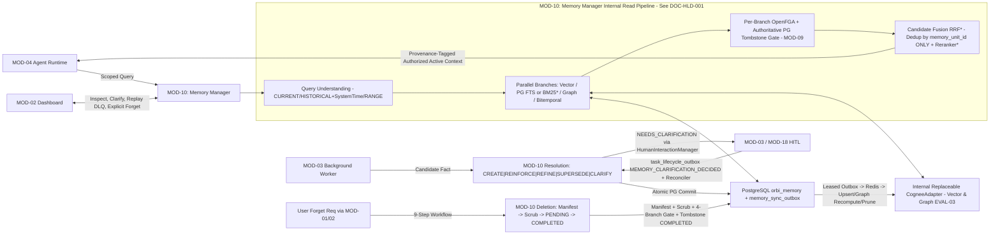
*(\* Proposed / Evaluation Required under `EVAL-03`, `EVAL-07`)*

---

## G. Skill Lifecycle Manager (`MOD-11`, `ADR-005`, `CON-17`)

`[CONFIRMED]` Reusable procedural skills are strictly separated from factual knowledge memory (`AP-04`) and are **never** allowed to grant permissions or bypass `MOD-08` (`AP-01`, `AP-02`).

### G.1 Skill Registry & Package Structure (`SKILL.md`)

`orbi_app.skill_packages` and `skill_versions` store immutable, semantically versioned packages centered around a **`SKILL.md`** file:
- **YAML Frontmatter**: `skill_id`, `version` (`semver`), `title`, `author_actor`, `required_tools[]` (must match `MOD-07` entries), `approval_policy_notes`, `package_mode` (`MARKDOWN_ONLY` initially vs. `WITH_SANDBOXED_SCRIPTS` future).
- **Markdown Body**: Structured workflow instructions, edge-case handling, and composition guidance over existing Gateway tools.
- **Optional Package Companion Artifacts**: `examples/`, JSON `schemas/`, and deterministic `tests/` (golden input/expected-intent fixtures).

### G.2 Skill Discovery, Loading & Creation/Evaluation Flow

1. **Discovery & Loading**: During agent initialization (`Section B.4`), `MOD-04` queries `MOD-11` for `PUBLISHED` skills allowed by OpenFGA (`MOD-09`) and whose `required_tools` are a **subset** of the agent's Stage-1 authorized tools. `SKILL.md` instructions load strictly as procedural guidance; loading a skill adds **zero** new tool authorizations.
2. **Creation & Automated Evaluation**:
   - Either the human owner (in `MOD-02`) or `SkillAuthorAgent` drafts a `DRAFT` skill package.
   - `MOD-11` executes the package's `tests/` fixtures in dry-run mode against mocked `MOD-08` Gateway tools (`EVALUATED`), verifying schema validity, zero unauthorized tool references, and deterministic output assertions.
3. **Human Approval & Versioning**:
   - Passing skills enter `AWAITING_PUBLISH_APPROVAL` and appear in `MOD-02` Dashboard with full Markdown diff, fixture pass report, and required tool list.
   - Explicit owner approval promotes the immutable version (`PUBLISHED`, e.g., `skill:weekly_expense_digest@1.0.0`), registers any declarative trigger entry in `MOD-07`, and records the event in `MOD-15`.

### G.3 Initial Markdown-Only Scope vs. Future Sandboxed Scripts (`CON-17`)

- **Initial Implementation (Phase 4 Baseline)**: Skills operate strictly in **`MARKDOWN_ONLY` mode**—`SKILL.md` procedural instructions + JSON schemas + fixture tests orchestrating existing `MOD-07`/`MOD-08` tools. Any package attempting to declare executable script artifacts is rejected by schema policy until sandbox validation completes.
- **Future Capability (Post-`EVAL-06`)**: Optional supporting executable scripts inside a skill package will run strictly inside **`MOD-11-SANDBOX`** (Zone 2a isolated container/microVM, `OQ-11`), with zero ambient credentials, no host filesystem access, and Gateway-only callbacks to `MOD-08`.

#### Diagram 11: Skill Lifecycle

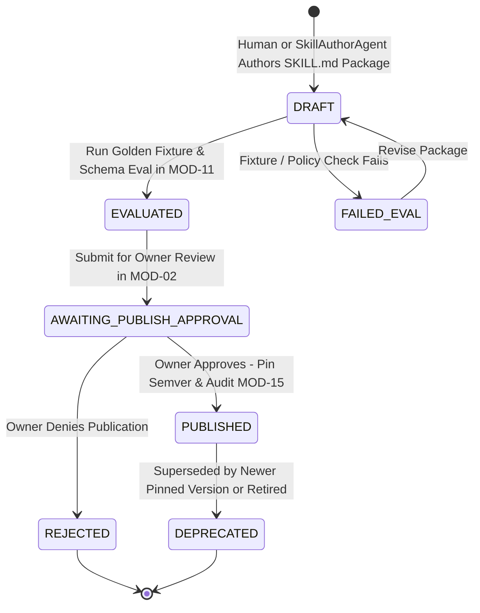

---

## H. Cloud Browser Execution (`MOD-13`)

`[CONFIRMED]` For web workflows lacking SaaS APIs, `MOD-08` dispatches structured browser intents to `orbi-browser` (`MOD-13`), a dedicated container running **Playwright + Chromium** inside Isolated Execution Zone 2a (`TB-05`).

### H.1 Isolation, Session Lifecycle & Cloud vs. Local Boundary

1. **Container & Network Isolation**:
   - `orbi-browser` runs non-root with strict CPU/RAM cgroup caps (`EVAL-05`), zero DB/Redis/Vault credentials, and egress filtering blocking private/link-local/metadata IP ranges (SSRF guard against `169.254.169.254` and Docker internal networks).
2. **Browser Session Lifecycle**:
   - **`EPHEMERAL_CLEAN`** *(Default)*: Fresh incognito `BrowserContext` created per task and destroyed on completion.
   - **`PERSISTENT_ENCRYPTED_PROFILE`** *(Opt-in per authorized site)*: Encrypted storage-state blob saved via `BlobStoragePort` and bound to `(user_id, site_domain)` in OpenFGA (`MOD-09`), decrypted transiently into `orbi-browser` only during an authorized session.
3. **Cloud Browser vs. Local Browser (`MOD-14`)**:
   - *Use Cloud Browser (`MOD-13`)* for public web research, headless form automation, and isolated web accounts without touching the user's workstation.
   - *Use Local Windows Browser (`MOD-14`)* only when the site explicitly requires local intranet access, hardware security keys attached to the PC, or pre-authenticated local browser profiles—always governed by `MOD-14` local policies and `MOD-09`.

### H.2 Human Takeover, OTP/CAPTCHA Handling & Sensitive Approvals (`CON-20`, `Section E.5`)

- **Strict Anti-Bypass Policy**: Orbi **never** solves, computes, or automatically bypasses CAPTCHAs, Cloudflare Turnstile, or anti-bot gates.
- **OTP & CAPTCHA Human Takeover Flow (`SECURE_INPUT_REQUEST` / `HUMAN_TAKEOVER`)**:
  1. When `MOD-13` encounters a login challenge, 2FA/OTP prompt, or CAPTCHA, it returns `HUMAN_TAKEOVER_REQUIRED` or `SECURE_INPUT_REQUIRED` `(reason, masked_screenshot_or_context, session_id)` to `MOD-08`/`MOD-03`.
  2. `MOD-03` (`HumanInteractionManager`) persists the `InteractionRequest`, transitions the task to **`WAITING_FOR_USER`**, releases workers completely (`langgraph_checkpoints` saved), and `MOD-18` notifies the owner via Telegram (`MOD-01` with short-lived replay-protected Dashboard handoff deep-link) and Dashboard (`MOD-02`).
  3. **Takeover Options (Zero LLM / Telegram Exposure)**:
     - For numeric OTPs / passwords (`SECURE_INPUT_REQUEST`): User authenticates on `MOD-02` and enters the credential directly into a secure Dashboard form backed by `ephemeral_secret_handle` (strictly bypassing `MOD-04` prompts, `langgraph_checkpoints`, `MOD-10`, and plaintext logs); `MOD-08` injects it directly into the masked `MOD-13` DOM field and immediately wipes the buffer.
     - For interactive CAPTCHAs/logins (`HUMAN_TAKEOVER`): User opens the independently authenticated **Browser Sessions / HITL** workspace in `MOD-02` passing `MOD-09` OpenFGA `session_controller`, claiming a short-lived `TAKEOVER_ACTIVE` stream lease (`noVNC / WebRTC`) directly to the paused `orbi-browser` context (`CON-20`, blocking agent `MOD-08` commands during custody and preserving browser cookies/DOM state). Once complete, the owner clicks *Return Control to Orbi*; `MOD-03` transitions `RESOLVED`, and `MOD-08` executes a deterministic `READ_ONLY` verification probe before resuming `MOD-04`.
- **Approval & DOM Verification for Sensitive Web Actions**: Browser tools (`browser.click_submit`, `browser.purchase`, `browser.delete_account`) carry `SENSITIVE_WRITE` / `IRREVERSIBLE` tiers. Before clicking, `MOD-08` captures the target element label, target URL domain, and action summary into an `APPROVAL_REQUEST` (`ADR-004`) and revalidates cancellation, generation, and page/element digest (`Gate 5`) upon resume.
- **Failure Recovery**: On page crash, cancel, or `TAKEOVER_ACTIVE` timeout (`EXPIRED`), `MOD-13` captures redacted DOM/screenshot error artifacts to `BlobStoragePort`, immediately revokes the takeover stream lease, tears down the hung context, and returns a clean structured outcome to `MOD-08`/`MOD-03`.

#### Diagram 9: Cloud Browser Execution, Secure Input & Human Takeover Lifecycle

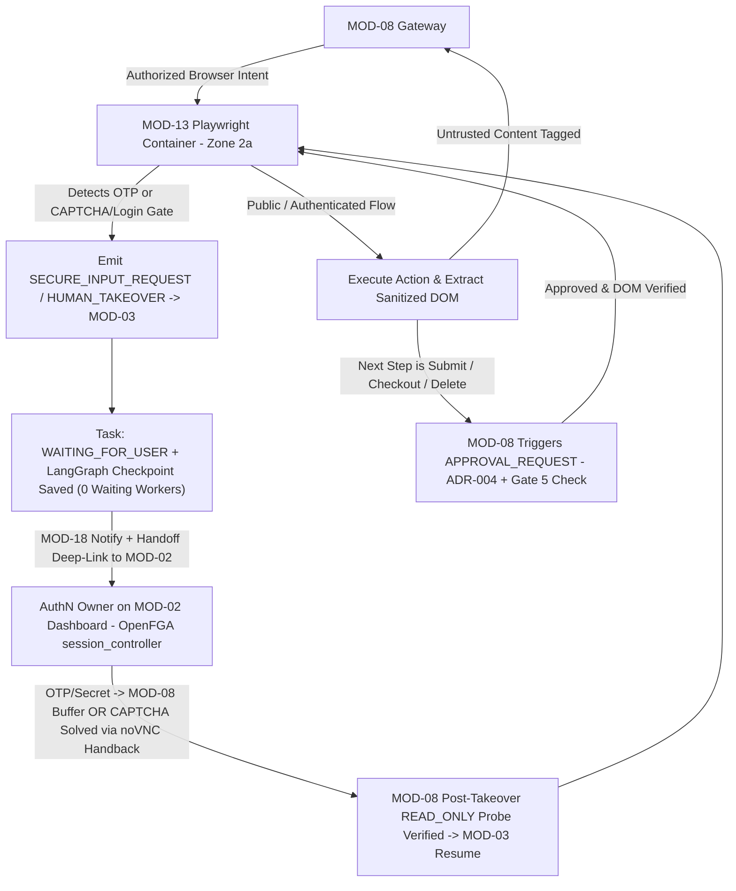

---

## I. Windows Local Companion (`MOD-14`, `ADR-006`)

`[CONFIRMED]` `MOD-14` extends Orbi onto the user's personal Windows 10/11 PC while enforcing strict cloud-to-local sovereignty (`AP-05`).

### I.1 Companion Architecture, Outbound Connection & Heartbeat

1. **Daemon Architecture**: Lightweight local background service + minimal system-tray status/kill-switch applet running under the active Windows user desktop session (required for UI Automation access).
2. **Outbound Authenticated mTLS Connection (`ASM-04`, `ASM-05`)**:
   - The Windows Companion **never** opens inbound internet ports. At startup, it initiates an outbound persistent **WebSocket/gRPC over mTLS** connection to the OCI Gateway Relay (`orbi-core-api`).
   - Authentication uses a per-device X.509 client certificate registered in `orbi_app.companion_devices` and bound to `instance:<device_id>` in OpenFGA (`MOD-09`).
3. **Heartbeat & Reconnect**:
   - `MOD-14` sends signed `HEARTBEAT` frames every 15 seconds; `MOD-08`/`orbi-core-api` updates Redis (`presence:companion:<device_id>`, TTL 45s) with active capabilities (`native_apis`, `agent_desktop_uia`, `vision_fallback`) and kill-switch status.
   - On network drop or laptop sleep/wake, `MOD-14` reconnects using jittered exponential backoff and invalidates any pre-sleep `snapshot_id` epochs (`CON-05`).

### I.2 Command Dispatch, Acknowledgement & Layered Execution (`Decision 9`)

1. **Dispatch & Ack Protocol**:
   - `MOD-08` sends a signed `CompanionCommand(command_id, task_id, idempotency_key, action, args, snapshot_epoch, approval_token_id)` over the mTLS stream.
   - `MOD-14` immediately returns `CMD_ACK` (received), executes locally under timeout, and streams `CMD_RESULT` (`status`, `tier_used`, `confidence`, redacted observation).
2. **Strict 3-Tier Execution Precedence (`ADR-006`)**:
   - **Tier 1 — Native OS / App APIs**: Attempted first via explicitly allowlisted local adapters (e.g., approved file read/move inside permitted workspace paths, Windows toast/clipboard API, COM/app CLI).
   - **Tier 2 — UI Automation (`vercel-labs/agent-desktop`, `EVAL-02`)**: When no Tier 1 adapter exists, invoke `agent-desktop` to inspect the Windows UIA tree as structured JSON and perform `ref`-based clicks/inputs bound to a short-lived `snapshot_id` epoch (`CON-05`).
   - **Tier 3 — Controlled Vision Fallback**: Permitted **only** when Tier 1 and Tier 2 return empty/unresolvable UIA nodes (e.g., custom canvas/Electron views). Captures **only** the allowlisted target window, applies local sensitive-region masking before any cloud vision grounding call, and binds actions to `(window_identity, target_label, perceptual_hash)` (`CON-09`).
3. **Safe Confidence Stop & Uniform Policy**:
   - If UIA matching or Vision grounding confidence falls below configured thresholds (`EVAL-02`, `OQ-12`), `MOD-14` aborts cleanly (`STOP_INSUFFICIENT_CONFIDENCE`) with zero clicks/keystrokes.
   - Sensitive operations require Stage-2 OpenFGA authorization + action-bound approval (`ADR-004`) **regardless** of whether Tier 1, Tier 2, or Tier 3 executes them.

### I.3 Local Filesystem, Process Restrictions & Offline Behavior

- **Local Hard Guardrails (`MOD-14` Local Config — Unoverridable by Cloud)**:
  - *Process & Window Denylist*: Password managers (e.g., 1Password, Bitwarden, KeePass), Windows UAC/Credential prompts, `regedit`, unrestricted `cmd.exe`/`powershell.exe`, banking portals, and `.ssh`/browser-vault directories are blocked locally.
  - *Filesystem Allowlist*: Tier 1 file operations are restricted strictly to configured user workspace directories.
  - *Instant Kill-Switch*: System-tray click or global hotkey immediately halts active execution, rejects incoming cloud commands (`LOCAL_KILL_SWITCH_ACTIVE`), and notifies `MOD-08`.
- **Laptop Unavailable / Offline Behavior**:
  - `MOD-08` checks Redis `presence:companion:<device_id>` before dispatching.
  - For interactive/real-time desktop commands, `MOD-08` fails fast with `COMPANION_OFFLINE` so `MOD-03` notifies the user immediately without blocking workers.
  - Optionally (for deferred tasks explicitly flagged `allow_queue_until_online=True`), `MOD-03` may hold the task with a bounded TTL and re-dispatch upon `HEARTBEAT` reconnection—mandatory **pre-execution approval & snapshot revalidation** (`ADR-004`) always runs before execution.

#### Diagram 10: Windows Companion Architecture & Execution Flow

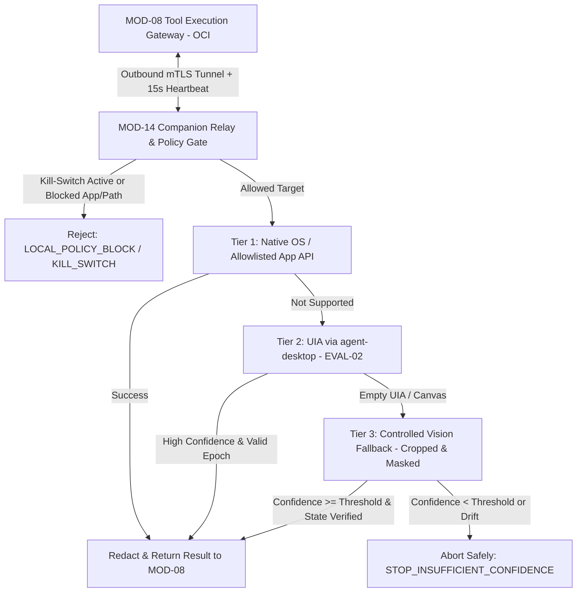

---

## J. External Integrations (`MOD-01`, `MOD-12`, `MOD-16-EXT`)

`[CONFIRMED]` Orbi strictly distinguishes **initial implementation scope** (Phases 1–4) from **future architectural extension boundaries** (Phase 5+, `AP-10`):

| Integration | Scope | Adapter / Module | Boundary & Governance Pattern |
| :--- | :--- | :--- | :--- |
| **Telegram** | **Initial (Phase 1)** | `MOD-01` Channel Gateway | Webhook/polling ingress mapped to verified `user:<id>`/`household:<id>` (`ASM-07`); delivers summaries and interactive action-bound approval prompts. |
| **Gmail / Outlook** | **Initial (Phase 2)** | `MOD-12` SaaS Connectors | OAuth2 refresh tokens isolated in OCI Secret Vault, injected solely in `MOD-08`; read operations `READ_ONLY`, send/delete/forward `SENSITIVE_WRITE`/`IRREVERSIBLE` (`OQ-08`); email bodies tagged `untrusted_external`. |
| **Spotify** | **Initial (Phase 2)** | `MOD-12` SaaS Connectors | Scoped OAuth2 connector behind `MOD-08`; playback/search `READ_ONLY`/`LOW_RISK_WRITE`, account/playlist deletion higher tier. |
| **Other SaaS Connectors & MCP Tools** | **Extensible (Phase 2–4)** | `MOD-12` / `MOD-08` MCP Adapter | Plugged behind typed `SaaSConnectorPort` or `MOD-08` MCP Client Adapter (`CON-19`), cataloged and risk-tiered in `MOD-07`. |
| **Home Assistant / MQTT & ESP32 (`MOD-16-EXT`)** | **Future (Phase 5 — Boundary Only)** | `MOD-16-EXT` IoT Bridge | Interface slots preserved in `MOD-07` (`FUTURE_IOT`), `MOD-08`, and `MOD-09` (`iot_device`, `household` ownership). Two patterns preserved without premature lock-in: (a) local Home Assistant/MQTT bridge over outbound mTLS tunnel (reusing `ASM-05`), or (b) authenticated Home Assistant REST/WebSocket endpoint. High-impact physical actions (door locks, alarms, heating overrides, ESP32 relays) map to `SENSITIVE_WRITE`/`IRREVERSIBLE`. |
| **Future Developer Agent** | **Future (Phase 5 — Boundary Only)** | `MOD-06` (`agent:developer`) + Isolated Workspace Sandbox | Planned specialized agent operating strictly inside an isolated cloud container workspace (separate git worktree/container, zero host credentials) behind `MOD-08`, with `git push`, PR merge, and production deploys gated by `ADR-004` approvals. |

---

## K. Dashboard (`MOD-02`, `OQ-01`)

### K.1 Frontend / Backend Interaction

- **Backend-for-Frontend (BFF)**: FastAPI endpoints inside `orbi-core-api` expose authenticated REST APIs (`/api/v1/...`) and real-time Server-Sent Events (SSE) / WebSocket streams (`/api/v1/stream`) backed directly by `MOD-03`, `MOD-06`, `MOD-07`, `MOD-09`, `MOD-10`, `MOD-11`, `MOD-13`, and `MOD-15`.
- **Frontend Stack (`OQ-01` Open for HLD Finalization)**: `orbi-dashboard` runs as an isolated container (`Zone 2b`) communicating solely via HTTPS/WSS to `orbi-core-api` BFF—never touching PostgreSQL, Redis, or OpenFGA directly. *(Framework alternatives and recommendation documented in Section O.)*

### K.2 Dashboard Functional Workspaces

| Workspace | Backing Modules | Core Capabilities |
| :--- | :--- | :--- |
| **1. Members & Access** | `MOD-01`, `MOD-09` | Manage primary owner and future household members, Telegram/email channel bindings (`ASM-07`), paired Windows Companion certificates, and inspect/edit OpenFGA relationship tuples (`policy_version` audited). |
| **2. Agents & Tools** | `MOD-06`, `MOD-07`, `MOD-09` | View Central Agent Registry definitions, model/budget bindings, Tool Registry JSON schemas (incl. `automation.*`), sensitivity tiers (`READ_ONLY`–`IRREVERSIBLE`), delegation allowlists, and test effective Stage-1 OpenFGA permissions per `(user, agent)`. |
| **3. Memory Management** | `MOD-10`, `MOD-03` | Hybrid search debugger (`QueryPlan`, active branches, RRF/rerank scores), knowledge graph inspector, provenance/trust filter, **`NEEDS_CLARIFICATION` HITL quarantine queue** (linked to `interaction_id` via `HumanInteractionManager`), bi-temporal history, and explicit 9-step deletion/forgetting (`DOC-HLD-001`). |
| **4. Tasks, Automations & Monitoring** | `MOD-03`, `MOD-04`, `MOD-05`, `MOD-17`, `MOD-18` | Live task list (`RUNNING`, **`WAITING_FOR_USER`** across 5 interaction types, `FAILED`, `CANCELLED_AFTER_EXTERNAL_COMMIT`), **Ongoing `AgentResponsibility` work plans**, active 6-type triggers & condition monitor probe status, immutable schedule version diffs, delegation lineage & cycle graph, LangGraph step traces, Decision Service logs, token/cost budget meters, and one-click task or automation pause/resume/cancel/delete. |
| **5. HITL Interactions, Approvals & Audit** | `MOD-03`, `MOD-08`, `MOD-15` | Unified queue of pending **`InteractionRequest`s** (`INFORMATION_REQUEST` structured forms, `APPROVAL_REQUEST` with canonical JSON arguments, target resource, SHA-256 `binding_digest`, `policy_version`, expiry countdown, `PHYSICAL_ACTION_REQUEST` confirmations, and **LLM-bypassing `SECURE_INPUT_REQUEST` OTP/password input**); searchable append-only `MOD-15` audit explorer. |
| **6. Browser & Desktop Takeover Sessions** | `MOD-13`, `MOD-14`, `MOD-03` | Monitor active `orbi-browser` Playwright & companion sessions, domain allowlist status, error trace screenshots, and launch OpenFGA `session_controller`-verified time-bounded **`HUMAN_TAKEOVER`** (noVNC/WebRTC or desktop consent) for paused tasks (`Section E.5` & `Section H.2`). |
| **7. System Settings** | `MOD-04`, `MOD-05`, `MOD-12`, `MOD-14` | Configure provider-independent `ModelAdapter` profiles, per-agent/daily cost caps, `MOD-05` Decision Service fallback thresholds (and optional Jev toggle), SaaS OAuth connection status, and Windows Companion live heartbeat / remote disconnect. |
| **8. Developer Workspace** | `MOD-11`, `MOD-10`, Future `DevAgent` | Author/diff `SKILL.md` packages, run golden fixture evaluations (`EVALUATED`), approve skill publication (`PUBLISHED`), execute `EVAL-07` / `EVAL-08` / `HITL-EVAL` suites, and host the future Developer Agent console (`Phase 5`). |

---

## L. Data Architecture

### L.1 Storage Responsibilities & Logical Isolation (`AP-04`, `AP-09`, `ASM-06`)

To uphold `AP-04` (separation of operational state, knowledge memory, skills, and automation schedules) without multi-cluster sprawl (`AP-09`), a single `orbi-postgres` container hosts **five strictly isolated PostgreSQL schemas** with distinct database roles:

| Store / Schema | Authoritative Owner | Contents | Ownership & Isolation Rules |
| :--- | :--- | :--- | :--- |
| **`PostgreSQL: orbi_app`** | `MOD-01`, `MOD-03`, `MOD-06`, `MOD-07`, `MOD-08`, `MOD-11`, `MOD-15`, `MOD-18` | `tenants` (`PERSONAL \| HOUSEHOLD \| ORGANIZATION_FUTURE`), `users`, `tenant_memberships`, `channel_bindings`, `companion_devices`, `tasks` (`task_version`, `pending_checkpoint_id`, `verified_checkpoint_id`, `resume_token_id`, `claim_epoch`, `lease_expires_at`, `claimed_by_worker_id`, `waiting_reason`, `cancellation_requested`, nullable `automation_execution_id` & `automation_generation`), `task_steps`, `task_budgets`, `step_execution_receipts` *(`action_idempotency_key`, `external_idempotency_mode`, `status: PREPARED\|DISPATCHING\|CONFIRMED_SUCCESS\|CONFIRMED_FAILURE_*\|UNKNOWN_OUTCOME`, immutable args/target hash, sanitized receipt)*, **`interaction_requests`** (`interaction_id`, `interaction_type`, `status`, `interaction_version`, `response_idempotency_key`, non-secret `prompt_payload`/`response_schema`), `approval_requests`, **`task_lifecycle_outbox`** (`DELIVER_INTERACTION_PROMPT`, `RESUME_TASK`, `MEMORY_CLARIFICATION_DECIDED`, `idempotency_key`, `claim_epoch`, `claimed_by_worker_id`, `lease_expires_at`, `attempt_count`, `DEAD_LETTERED`), **`task_lifecycle_processed_events`**, **`ephemeral_secret_handles`** *(encrypted single-use short-TTL handles only — never readable by `MOD-04`/`MOD-10`/`MOD-15`)*, `agent_definitions`, `tool_definitions` (`external_idempotency_mode`, `idempotency_window_seconds`, `reconciliation_probe_tool_id`), `skill_packages`, `skill_versions`, `skill_eval_runs`, `secret_envelopes`, `delivery_receipts`, `audit_events`. | Authoritative system of record for tenants, principals, tasks, centralized HITL interactions, transactional HITL/clarification outbox, write-ahead step receipts, approvals, registries, skills, deliveries, and immutable audit trails. `audit_events` role has `INSERT`/`SELECT` only (`zero` OTP/password plaintext). |
| **`PostgreSQL: orbi_automation`** | `MOD-17` Autonomous Automation Platform *(Phabric-Reusable Schema)* | `agent_responsibilities`, `permission_envelopes` (`envelope_version`, permitted tools/scope/frequency/budget/concurrency/target/approval bounds), `automation_definitions` (`tenant_id`, `owner_principal`, `creator_principal`, typed `execution_target`, trigger, task template, budgets, `schedule_version`, monotonic `generation`, `trigger_depth`, `status: ACTIVE\|PAUSED\|PAUSED_SAFETY_TRIP\|CANCELLED\|DELETED`), `automation_schedule_versions` (immutable history), `automation_event_subscriptions`, `automation_condition_monitors`, `automation_executions`, **`automation_outbox`**, `automation_processed_events`. | Separate schema & DB role decoupled from Orbi-specific LangGraph/Telegram tables (`CON-26`). `automation_outbox` commits atomically with state changes; monotonic `generation` fences stale Redis triggers; 6-step `DELETE` commits PG `DELETED` + `generation += 1` + outbox before async cleanup. |
| **`PostgreSQL: orbi_memory`** | `MOD-10: Memory Manager` | `memory_units` (`memory_unit_id`, `tenant_id`, `owner_principal`, `visibility_scope`, `trust_tier`, `source_provenance`, `corroborating_provenance[]`, `confirmation_count`, `resolution_origin`, bitemporal `valid_from`, `valid_to`, `recorded_from`, `recorded_to`, `superseded_by`, `deletion_state: ACTIVE\|REQUESTED\|PENDING_PROPAGATION\|COMPLETED\|FAILED_REQUIRES_RECONCILIATION`, ingestion-only `content_hash`), `memory_resolution_candidates` (`NEEDS_CLARIFICATION` queue, `interaction_id`), `memory_deletion_requests` (pre-scrub `deletion_dependency_manifest` + per-store propagation state), lexical search index (**PG FTS** `tsvector` / candidate **Genuine BM25** `pg_search` under `EVAL-07`), **`memory_sync_outbox`**, `memory_sync_processed_events`. | Separate schema & DB role (`CON-14`). `memory_sync_outbox` commits atomically with resolution and deletion mutations; `memory_unit_id` is sole fusion deduplication key; Stage 3 authoritative PG tombstone gate enforces `deletion_state = 'ACTIVE'` across all 4 branches prior to fusion/LLM. |
| **`PostgreSQL: openfga`** | `MOD-09` OpenFGA Container | OpenFGA internal tuple store, authorization model versions (`policy_version`). | Accessible **only** by `orbi-openfga` container; `orbi-core` interacts strictly via OpenFGA APIs. |
| **`PostgreSQL: langgraph_checkpoints`** | `MOD-04` Agent Runtime | Ephemeral intra-turn LangGraph & structured `interrupt()` continuation state (`CON-18`, `EVAL-04`). | Subordinate to `orbi_app.tasks` & `interaction_requests`; **zero** `SECURE_INPUT_REQUEST` secrets stored; purged on task completion/expiry/cancellation; never consulted as lifecycle truth (`AP-03`). |
| **`Redis (orbi-redis)`** | `MOD-03`, `MOD-08`, `MOD-14`, `MOD-17`, `MOD-18` | Task queues (`queue:tasks:*`), outbox-fed streams/queues (`stream:events:domain`, `queue:memory:sync`, `queue:automation:eval`, `queue:delivery:outbound`), due-timer sorted sets, worker heartbeat leases, cancellation pub/sub, Windows Companion `presence:companion:*` keys. | **Coordination and transport only**—NOT the durable source of truth. Reconciled against PostgreSQL authoritative task & outbox tables (`NFR-REL-01`, `NFR-REL-04`). |
| **`Cognee Backends` (`EVAL-03`)** | `MOD-10` (Internal Replaceable `CogneeAdapter`) | Vector embeddings and Knowledge Graph entities/edges keyed by `source_memory_unit_ids[]`. | Backends verified in `EVAL-03`; every retrieved vector item, graph entity, edge, attribute, and multi-hop path must pass `orbi_memory` active tombstone check AND independent `MOD-09` source checks before branch exit (`DOC-HLD-001`). |
| **`Object / Blob Storage` (`CON-22`)** | `MOD-10`, `MOD-11`, `MOD-13`, `MOD-15` | Raw uploaded documents, redacted Playwright error screenshots/HAR traces, persistent encrypted browser state blobs, archived skill tarballs. | Abstracted behind `BlobStoragePort`: initially local OCI encrypted Docker volume (zero extra infra per `AP-09`), extensible to OCI Object Storage buckets. |

### L.2 Core Entity Relationships & Key Identifiers

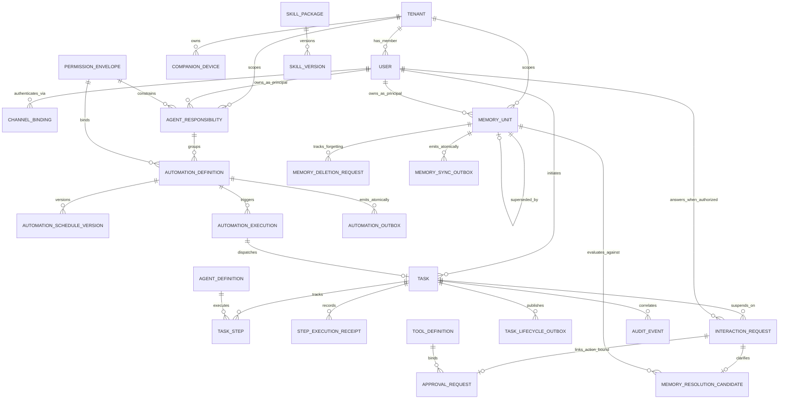

- **Canonical Key Taxonomy**: Every cross-module flow propagates `correlation_id` (root request trace UUID), `task_id` (UUID), `task_version`, `pending_checkpoint_id`, `verified_checkpoint_id`, `resume_token_id` (logical HITL resume operation UUID retained while `RUNNING` and cleared on turn completion), `claim_epoch` (monotonic bounded-lease worker fence counter), `lease_expires_at` (UTC lease deadline for `RUNNING` tasks & outbox claims), `action_idempotency_key` (immutable SHA-256 external tool invocation dedup key reused identically across retries), `external_idempotency_mode` (`PROVIDER_IDEMPOTENCY_KEY | RECONCILABLE_READ_PROBE | NON_IDEMPOTENT_NO_RECONCILE`), `interaction_id`, `interaction_version`, `handoff_nonce` (ephemeral one-time cross-channel deep-link token), `ephemeral_secret_handle` (short-TTL Gateway-only ref), `tenant_id` (`tenant:<uuid>`), `owner_principal` (`user:<uuid>`), `creator_principal`, `execution_target` (`AGENT|WORKFLOW|SCRIPT:<id>@<ver>`), `responsibility_id`, `automation_id`, `envelope_id@version`, `schedule_version`, `generation` (monotonic worker/Gateway fence counter), `execution_id`, `event_id` / `idempotency_key` (outbox/consumer idempotency keys), `trigger_chain_ids[]`, `trigger_depth`, `delivery_id`, `tool_id@version`, `approval_id`, `memory_unit_id`, `deletion_request_id`, `skill_id@semver`, and `audit_event_id`.

### L.3 Memory Correction vs. Explicit Deletion, Automation Cancellation vs. Deletion & Backup Retention (`[PROPOSED]`)

- **Memory Correction / Succession vs. Explicit Deletion ([memory-architecture.md](file:///f:/Projects/Orbi/docs/02-hld/memory-architecture.md) §6)**:
  - *Correction / Succession*: Real-world transitions (`valid_to` bounded) and belief fixes (`recorded_to` closed + `superseded_by` linked atomically) **preserve historical records** for temporal queries (`HISTORICAL` / `as_of_recorded_ts`). **Supersession never equals deletion.**
  - *Explicit Deletion*: Enters `REQUESTED -> PENDING_PROPAGATION -> COMPLETED | FAILED_REQUIRES_RECONCILIATION`; **captures non-plaintext `deletion_dependency_manifest` inside PG *before* scrubbing plaintext/provenance** (`content`, `summary`, `source_provenance`), blocks all 4 retrieval branches immediately via the Stage 3 authoritative PG tombstone gate (even while `CogneeAdapter` sync is pending/failing), propagates removal + graph source recomputation/pruning via `memory_sync_outbox`, verifies 4-branch non-retrievability, transitions `memory_units.deletion_state = 'COMPLETED'` terminal tombstone, and logs redacted `MEMORY_FORGOTTEN` proof in `MOD-15`.
  - *Point-in-Time Backups Limitations*: Physical PostgreSQL backups/snapshots are **not** rewritten instantaneously on delete; they expire under bounded retention TTLs (e.g., 7–30 days), and any disaster-recovery restore MUST replay committed `memory_deletion_requests` / `COMPLETED` tombstones before opening read access.
- **Automation `CANCEL` vs. 6-Step Authoritative `DELETE`**: `CANCEL` terminates future dispatch, cascades cancellation to `WAITING_FOR_USER` interactions, and fences queued pre-cancel Redis events (`status = CANCELLED`, `generation += 1`) while retaining definitions/history; explicit `DELETE` executes the ordered **6-step authoritative sequence** (PG `status = 'DELETED'` + `generation += 1` + `automation_outbox` publish *before* async schedule/timer/payload purge and task/HITL reconciliation, retaining only permitted execution summary & redacted `MOD-15` proof).
- **Ephemeral Browser/Checkpoint Artifacts**: `langgraph_checkpoints` and redacted Playwright screenshots auto-expire via configurable retention TTLs (e.g., 7–30 days), `ephemeral_secret_handles` self-destruct immediately upon single-use Gateway consumption or short TTL expiry, and `audit_events` retain redacted digests longer per audit policy.

---

## M. Security & Reliability Architecture

| Concern | Threat / Risk | Architectural Control & Enforcing Module(s) |
| :--- | :--- | :--- |
| **Threat Boundaries (`TB-01`–`TB-06`)** | Compromise of external channels, public web DOMs, or local PC pivoting into OCI core or secret vaults. | Six explicit trust boundaries (`Diagram 3`). `orbi-browser` (`MOD-13`) and future `MOD-11-SANDBOX` sit in isolated Docker networks with zero DB/Redis/Vault routes; `MOD-14` connects outbound via device-pinned mTLS. |
| **Untrusted Content & Indirect Prompt Injection** | Malicious instructions embedded inside emails, web DOMs, or desktop screen text hijacking agent control flow (`CON-07`). | `MOD-08` tags all external inputs `untrusted_external`; `MOD-04` wraps them in fenced data delimiters; Stage-1 Discovery + Stage-2 OpenFGA + Action-Bound Approvals operate entirely deterministically outside LLM reasoning (`AP-02`). |
| **HITL Secret Exposure & Credential Leakage (`NFR-SEC-06`)** | OTPs, passwords, or auth codes (`SECURE_INPUT_REQUEST`) leaking into LLM prompts, Telegram chat history, checkpoints, memory, or audit logs. | Strictly banned from Telegram (`MOD-01`), `MOD-04` prompts, `langgraph_checkpoints`, `MOD-10` memory, and `MOD-15` plaintext logs. Collected via independently authenticated `MOD-02` Dashboard into encrypted single-use short-TTL `ephemeral_secret_handle` injected solely inside `MOD-08` with DOM field masking and immediate wipe (`Section E.5.2`). |
| **Multi-Channel Handoff, `HUMAN_TAKEOVER` & Household Isolation (`CON-20`, `CON-27`)** | Household member answering another member's private interaction, forged Telegram deep-link hijack, or CAPTCHA bypass attempts. | Zero cross-channel trust inheritance (`handoff_nonce` requires full Dashboard AuthN + OpenFGA `responder`/`approver`/`session_controller` check); `INFORMATION_REQUEST` never counts as `APPROVAL_REQUEST`; zero CAPTCHA automation; `TAKEOVER_ACTIVE` locks out agent commands and verifies return state via probe. |
| **Memory Resolution, Bitemporal Corruption & Forgetting Leakage (`CON-16`)** | Untrusted prompts overwriting `user_explicit` facts, `NEEDS_CLARIFICATION` leaking as truth, or deleted memories still leaking via stale `CogneeAdapter` indexes or graph summaries. | `MOD-10` isolates unresolved items in `memory_resolution_candidates` (clarified via `MOD-03` HITL), captures `deletion_dependency_manifest` before plaintext scrub, enforces the 4-branch authoritative PG tombstone gate pre-fusion even while propagation is pending/failing, sets terminal `COMPLETED` tombstones, recomputes surviving graph sources, and logs redacted `MOD-15` proof. |
| **Stale / Cancelled Task & Automation Race Execution (`PART 6`, `PART 7.2`)** | Queued Redis trigger or late HITL response executing after user/automation cancels, pauses, updates, or deletes a task/automation. | Authoritative PostgreSQL `tasks.cancellation_requested` / `task_version` and `automation.schedule_version` + monotonic `generation` checked deterministically by workers, `HumanInteractionManager`, and **`MOD-08` Gate 5 immediately before every adapter dispatch**; cascade cancel to waiting interactions; honest `CANCELLED_AFTER_EXTERNAL_COMMIT` reporting when an external action already transmitted. |
| **Convergent Graph Entity Leakage (`CON-13`)** | Private and shared memories resolving to the same entity (e.g., `"Project Apollo"`) exposing private details via labels, edges, or summaries. | Every graph entity/edge preserves `source_memory_unit_ids[]`; each source passes `deletion_state == 'ACTIVE'` AND independent OpenFGA checks with zero permission unioning and fail-closed on missing provenance. |
| **Delegated Privilege Escalation (`CON-25`)** | Agent A delegates a recurring/triggered automation hoping `execution_target` exercises Agent A's broader OAuth/desktop/IoT permissions or expands its own schedule budget/tools. | Zero creator inheritance (`FR-AT-05`); typed `execution_target` (`SCRIPT` disabled until `EVAL-06`); immutable `PermissionEnvelope` forbidding self-expansion; live 3-point OpenFGA revalidation + `ADR-004` approvals. |
| **Automation Explosion & Cyclic Chains (`CON-23`)** | Infinite direct or indirect trigger loops (`A -> B -> C -> A`), sub-second probe storms, or unbounded follow-up chains exhausting OCI CPU or LLM spend. | Cohesive 8-control pipeline (`Section D.8`): propagated `correlation_id` + `trigger_chain_ids[]` + `trigger_depth`, `event_id` dedup, cycle/depth checks, `min_interval_seconds`, quotas, bounded retries, indirect-loop circuit breaker, and deterministic `PAUSED_SAFETY_TRIP` abort + `MOD-18` alert. |
| **Transactional Outbox, Lease-Fenced Resumption & Reliable Sync** | Committed task/HITL, clarification, automation, or memory state diverging across PG schemas, Redis, or `CogneeAdapter` on worker crash (`RUNNING` or pre-ack) or transient outage (`CON-14`). | Atomic PostgreSQL commits to `task_lifecycle_outbox`, `automation_outbox`, and `memory_sync_outbox` (incl. 6-step `DELETE` ordering & `MEMORY_CLARIFICATION_DECIDED` callbacks), `FOR UPDATE SKIP LOCKED` leased dispatchers -> Redis/worker transport, bounded-lease + `claim_epoch`-fenced `RESUME_TASK` claims (retaining `resume_token_id` until atomic completion alongside `task_lifecycle_processed_events`), write-ahead `step_execution_receipts` (`action_idempotency_key`), bounded retries + `DEAD_LETTERED` quarantine, and stale-lease/cross-schema crash reconciliation. |
| **Crash-Safe Suspension, Lease Recovery, Post-Dispatch `UNKNOWN_OUTCOME` & Probe Integrity (`CON-24`, `CON-27`)** | Checkpoint/PG torn crash during pause (`SUSPENDING_FOR_USER`), worker crash after `RUNNING` claim or external dispatch before receipt commit (`UNKNOWN_OUTCOME`), sleeping workers during `WAITING_FOR_USER`, or condition probes bypassing `MOD-08`. | Zero cross-store atomic checkpoint-PG assumption and zero sleeping workers (`NFR-REL-04`, `FR-TM-06`); `MOD-03` executes checkpoint-first two-phase suspension (`SUSPENDING_FOR_USER` -> save/verify `pending_checkpoint_id` -> `WAITING_FOR_USER` + `task_lifecycle_outbox`) and recovers expired `RUNNING` (`lease_expires_at < now()`) `RESUME_TASK` leases via PG cancellation/expiry/version/generation revalidation, `claim_epoch + 1` CAS (`STALE_CLAIM_EPOCH_FENCED` — fencing Orbi-side writes only), and `task_lifecycle_processed_events`. `MOD-08` transitions unfinalized `DISPATCHING -> UNKNOWN_OUTCOME`, enforces immutable retry identity, reuses `action_idempotency_key` (`PROVIDER_IDEMPOTENCY_KEY`), probes `RECONCILABLE_READ_PROBE`, or prohibits blind automatic retries for `NON_IDEMPOTENT_NO_RECONCILE` (`UNCERTAIN_EXECUTION_RECONCILIATION`); `MOD-17` `ConditionEvaluator` runs strictly `READ_ONLY` probes via `MOD-08.execute_readonly_probe()`. |
| **Observability & Auditability (`AP-07`)** | Inability to trace why an agent acted or verify compliance without logging secrets. | Every stage emits `correlation_id`/`task_id`/`interaction_id`-linked events to append-only `MOD-15` ledger (zero forgotten memory plaintext and zero `SECURE_INPUT_REQUEST` secrets) plus OpenTelemetry structured metrics/traces exposed in `MOD-02` Dashboard. |

---

## N. Required End-to-End Sequence Diagrams

### Sequence 1: Simple Request Invoking One Tool *(e.g., "Play my Focus playlist on Spotify")*

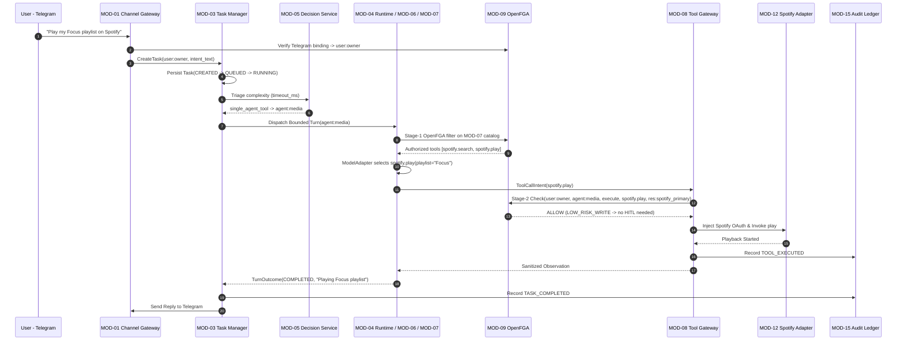

### Sequence 2: Complex Multi-Agent & Multi-Tool Task *(e.g., "Summarize unread project emails from Priya and log action items to Notion via Browser")*

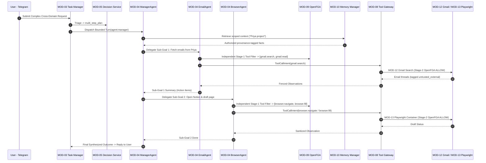

### Sequence 3: Sensitive Action Requiring Cryptographic Approval & Pre-Execution Revalidation *(e.g., "Send reply email to client")*

```mermaid
sequenceDiagram
    autonumber
    participant M04 as MOD-04 EmailAgent
    participant M08 as MOD-08 Tool Gateway
    participant M07 as MOD-07 Tool Registry
    participant M09 as MOD-09 OpenFGA
    participant M03 as MOD-03 TaskMgr / HumanInteractionMgr
    participant M18 as MOD-18 Delivery
    participant UI as MOD-01 Telegram & MOD-02 Dash
    participant M12 as MOD-12 Gmail Adapter
    participant M15 as MOD-15 Audit Ledger

    M04->>M08: ToolCallIntent(gmail.send_email, args={to, subject, body})
    M08->>M07: Lookup RiskTier -> SENSITIVE_WRITE & Semantic Fields
    M08->>M09: Stage-2 Check -> ALLOW + policy_version=v12
    M08->>M08: Compute SHA-256 binding_digest(user, task, exec, tool, canonical_args, target, v12, expires_at)
    M08->>M03: CreateInteraction(APPROVAL_REQUEST, binding_digest, summary)
    M03->>M03: Phase A PG Tx: Interaction(CREATED, v=1) + Approval(PENDING, HMAC) & Task -> SUSPENDING_FOR_USER
    M04->>M04: Phase B: Save & Read-Verify LangGraph checkpoint (pending_checkpoint_id) & release worker (0 sleeping workers)
    M03->>M03: Phase C PG Tx: Verify pending_checkpoint_id -> Task WAITING_FOR_USER + Interaction(PENDING_USER) + task_lifecycle_outbox(DELIVER)
    M03->>M15: Record APPROVAL_REQUESTED(interaction_id, binding_digest)
    M03->>M18: Dispatch Outbox Action-Bound Approval Prompt
    M18->>UI: Push Prompt (Telegram summary + Dashboard full payload)
    alt Unauthorized Responder (Pre-Mutation OpenFGA DENY)
        UI-->>M03: Caller Submits Response(interaction_id, wrong_actor)
        M03->>M09: Step 0 Pre-Mutation Check -> DENY
        M03->>M15: Record AUTHZ_DENIED
        M03-->>UI: Return 403 AUTHZ_DENIED (PENDING_USER, v=1 & Approval PENDING untouched)
    else Authorized Human Explicitly Rejects
        UI-->>M03: Human Rejects(interaction_id, approval_id, actor_user_id, idempotency_key)
        M03->>M09: Step 0 Pre-Mutation Check -> ALLOW
        M03->>M03: 3-Step CAS: RESPONSE_RECEIVED(v=2) -> VALIDATING(v=3) -> Interaction/Approval REJECTED(v=4) & Task CANCELLED
        M03->>M15: Record APPROVAL_REJECTED
        M03->>M18: Notify User Cancelled Cleanly
    else Authorized Human Grants Approval
        UI-->>M03: Human Approves(interaction_id, approval_id, actor_user_id, idempotency_key)
        M03->>M09: Step 0 Pre-Mutation Check -> ALLOW
        M03->>M03: Idempotency Check + 3-Step CAS: RESPONSE_RECEIVED(v=2) -> VALIDATING(v=3)
        alt Expired / Digest or Policy Drift During Validation
            M03->>M03: CAS Commit Interaction INVALIDATED(v=4) & Approval INVALIDATED
            M03->>M15: Record APPROVAL_INVALIDATED
        else Validation Passes
            M03->>M03: Atomic PG Tx: CAS RESOLVED(v=4) + Approval APPROVED + Phase D Task -> QUEUED + task_lifecycle_outbox(RESUME_TASK, resume_token_id, expected_task_version)
            M03->>M08: Worker Bounded-Lease CAS (QUEUED -> RUNNING, claim_epoch+1, lease_expires_at Set, resume_token_id Retained) & Resumes Checkpoint
            Note over M08: Gate 2 Write-Ahead Receipt (action_idempotency_key) & Gate 5 Cancellation, Generation, claim_epoch & Digest Revalidation (ADR-004)
            M08->>M09: Re-check live OpenFGA ALLOW & current policy_version
            M08->>M08: Verify Not Cancelled, claim_epoch Match (Fence Stale Worker), Recompute digest/HMAC & expires_at, Commit Write-Ahead DISPATCHING + CAS APPROVED -> CONSUMED
            alt Any Mutation, Cancellation, Policy Bump, Expiry, Stale claim_epoch, or Non-Idempotent UNKNOWN_OUTCOME
                M08->>M15: Record APPROVAL_INVALIDATED, STALE_CLAIM_EPOCH_FENCED, or EXTERNAL_ACTION_OUTCOME_UNKNOWN
                M08->>M03: Abort Safely or Escalate UNCERTAIN_EXECUTION_RECONCILIATION (0 Blind Non-Idempotent Retries)
            else Valid Write-Ahead DISPATCHING (or Idempotent Key Retry / Reconciled Probe)
                M08->>M12: Inject Credentials & Send Email (With action_idempotency_key Where Supported; Reuses Identical Key on Retry)
                M12-->>M08: Message Sent ID
                M08->>M08: Commit Receipt CONFIRMED_SUCCESS (Or Reconcile Crash Before Ack via Probe / action_idempotency_key)
                M08->>M15: Record TOOL_EXECUTED(CONFIRMED_SUCCESS)
                M08-->>M04: Return Confirmation
                M03->>M03: Atomic Completion Tx: Clear resume_token_id, task_version+1, task_lifecycle_processed_events + Outbox PROCESSED
            end
        end
    end
```

### Sequence 4: Hybrid Memory Retrieval Request *(See [memory-architecture.md](file:///f:/Projects/Orbi/docs/02-hld/memory-architecture.md) for full internal contracts)*

```mermaid
sequenceDiagram
    autonumber
    participant M04 as MOD-04 Agent Runtime
    participant M10 as MOD-10 Memory Manager
    participant QU as QueryUnderstanding
    participant VEC as VectorBranch - Internal CogneeAdapter
    participant BM25 as BM25Branch - PG FTS or Genuine BM25*
    participant GRP as GraphBranch - Internal CogneeAdapter
    participant TMP as TemporalBranch - orbi_memory Bitemporal
    participant M09 as MOD-09 OpenFGA
    participant FUS as Fusion RRF* - ID-Only Dedup & Reranker*
    participant M15 as MOD-15 Audit Ledger

    M04->>M10: retrieve_hybrid_memory(query, tenant_id, actor_principal, limits)
    M10->>QU: Analyze intent, entities, keywords, bitemporal mode (CURRENT|HISTORICAL|RANGE) & graph need
    QU-->>M10: QueryPlan(activated_branches, temporal_constraint)
    par Active Branches Only
        M10->>VEC: Vector semantic search
        VEC->>M09: Per-memory_unit_id OpenFGA check (before branch exit)
        M09-->>VEC: Permitted items only
    and
        M10->>BM25: Lexical search (PG tsvector/ts_rank_cd OR genuine pg_search BM25*)
        BM25->>M09: Per-memory_unit_id OpenFGA check (before branch exit)
        M09-->>BM25: Permitted items only
    and
        M10->>GRP: Entity/relationship traversal preserving source_memory_unit_ids[]
        GRP->>M09: Independent OpenFGA check per contributing source MemoryUnit & hop
        M09-->>GRP: Scope-authorized projections only (No permission union; fail-closed)
    and If Temporal Constraint Active
        M10->>TMP: Bitemporal SQL (valid_from/valid_to + recorded_from/recorded_to per mode; no global superseded_by IS NULL)
        TMP->>M09: Per-memory_unit_id OpenFGA check (before branch exit)
        M09-->>TMP: Permitted items only
    end
    M10->>FUS: Rank-fuse incompatible branch scores (RRF*), dedup by memory_unit_id ONLY & rerank*
    FUS-->>M10: Final Top-K Provenance-Tagged Context
    M10->>M15: Record HYBRID_RETRIEVAL(branches, lexical_backend, dropped_authz, latency)
    M10-->>M04: Authorized Memory Context
```
*(\* Proposed / Evaluation Required under `EVAL-03`, `EVAL-07`)*

### Sequence 5: Task Involving the Windows Local Companion

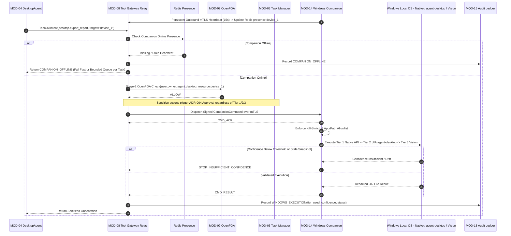

### Sequence 6: Autonomous Ongoing Responsibility & Condition-Driven Adaptation *(General Mechanism — Plant Care Agent Example)*

```mermaid
sequenceDiagram
    autonumber
    participant U as User - Telegram/Dash
    participant M04 as MOD-04 PlantCareAgent
    participant M08 as MOD-08 Tool Gateway
    participant M09 as MOD-09 OpenFGA
    participant M17 as MOD-17 Automation Platform
    participant M03 as MOD-03 Task Manager
    participant HAR as Sensor / ML Inference / IoT Valve
    participant M18 as MOD-18 Result & Delivery

    U->>M03: "Look after my balcony and living-room plants"
    M03->>M04: Dispatch Bounded Turn(resp:plant_care_01)
    M04->>M08: Inspect sensors & consult ML inference (READ_ONLY)
    M08->>HAR: Fetch telemetry & care model prediction
    HAR-->>M04: Current readings & care plan metrics
    M04->>M08: automation.schedule(INTERVAL=4h, CRON ML inference) & automation.create_condition_monitor(moisture < 24%)
    M08->>M09: Point-1 Creation, Tenant/Principal & PermissionEnvelope Check
    M09-->>M08: ALLOW
    M08->>M17: Validate Min Interval, Quotas & Commit Definition + automation_outbox Atomically (v1)
    M04-->>M03: Care Plan Established -> Turn Terminates (Zero Live LLM Wait)

    loop Ongoing Periodic Evaluation (No LLM Session Running)
        M17->>M08: execute_readonly_probe(iot.read_soil_moisture)
        M08->>HAR: Read Sensor
        HAR-->>M17: moisture_pct = 29% -> Predicate FALSE (Stay Idle)
    end

    Note over M17,HAR: Later Probe Returns moisture_pct = 21% (Sustained 2 Checks)
    M17->>M09: Point-3 Revalidate Live Authz & PermissionEnvelope Bounds
    M09-->>M17: ALLOW
    M17->>M03: DispatchNormalTask(AGENT:plant_care, correlation_id, trigger_depth=1, probe_payload)
    M03->>M04: Wake PlantCareAgent Under Own Identity
    M04->>M08: Request Watering Valve Action (SENSITIVE_WRITE) & automation.update(in-envelope frequency tune)
    Note over M08,M17: In-Envelope Update Allowed -> ScheduleVersion v2 (Envelope Expansion Would Require Re-Approval)
    Note over M08,M03: Physical Watering Requires ADR-004 Action-Bound Approval
    M08->>M03: PauseForApproval(binding_digest) -> Notify User via M18
    U-->>M03: Approve Watering
    M08->>HAR: Revalidate Digest & Execute Watering Valve
    M04->>M08: automation.schedule_followup(delay=2h moisture re-check, trigger_depth=2)
    M03->>M18: Deliver Outcome & Commit Completion Callback -> automation_outbox
```

### Sequence 7: Generalized Agent-to-Agent Delegated Automation with Permission Envelope, Transactional Outbox & Loop Guard

```mermaid
sequenceDiagram
    autonumber
    participant CRE as MOD-04 creator_principal
    participant M08 as MOD-08 Tool Gateway
    participant M09 as MOD-09 OpenFGA
    participant M17 as MOD-17 Automation Platform
    participant PG_OB as PG automation_outbox -> Redis
    participant M03 as MOD-03 Task Manager
    participant TGT as execution_target (AGENT)
    participant M18 as MOD-18 Result & Delivery
    participant CH as MOD-01 Telegram / MOD-02 Dash
    participant M15 as MOD-15 Audit Ledger

    CRE->>M08: automation.create(tenant_id, owner_principal, execution_target, trigger, permission_envelope)
    M08->>M09: Point-1 Check(creator can_delegate AND execution_target accesses scoped_resource)
    M09-->>M08: ALLOW
    M08->>M17: Validate Typed Target (AGENT|WORKFLOW; SCRIPT disabled), Cycle/Depth, Min Interval & Envelope
    alt Cycle, Depth Breach, Disabled Target or Envelope Violation
        M17->>M15: Record AUTOMATION_POLICY_REJECTED
        M17-->>CRE: Reject Creation
    else Valid Separated Definition & Initial PermissionEnvelope
        M17->>PG_OB: Atomic PG Commit (Definition + ScheduleVersion v1 + Outbox Event)
        M17->>M15: Record DELEGATED_AUTOMATION_CREATED
        M17-->>CRE: AutomationRegistered(id, envelope_v1, version=1)
    end

    Note over PG_OB,M17: Leased Dispatcher Publishes (automation_id, schedule_version, generation) -> Redis -> Loop Guard
    PG_OB->>M17: Deliver Event(event_id, schedule_version, generation, correlation_id, trigger_chain_ids, trigger_depth)
    alt Event Duplicate, Cycle/Depth Exceeded or Indirect-Loop Circuit Breaker Tripped
        M17->>M17: Abort Dispatch -> Set Status PAUSED_SAFETY_TRIP (No Task Created)
        M17->>M15: Record LOOP_CIRCUIT_BREAKER_TRIP
        M17->>M18: Alert Owner Immediately
    else Loop Guard & Envelope Budget Pass
        M17->>PG_OB: Worker Pre-Dispatch Revalidation (Check PG status==ACTIVE, schedule_version & generation match)
        alt Stale Version/Generation or Cancelled/Paused/Deleted While Queued in Redis
            M17->>M15: Record SKIPPED_CANCELLED or SKIPPED_STALE_GENERATION
        else Authoritative PostgreSQL State Active & Generation Matches
            M17->>M09: Point-3 Revalidate Live Authz(owner_principal, execution_target, permission_envelope)
            M09-->>M17: ALLOW
            M17->>M03: dispatch_automation_task(execution_target, correlation_id, envelope_budget, execution_id)
            M03->>TGT: Initialize Target Agent via Independent 7-Step Discovery
            TGT->>M09: Stage-1 OpenFGA Filter (Own Permissions INTERSECT PermissionEnvelope Only)
            TGT->>M08: Execute Authorized Scoped Action (Aborts on Cancellation Signal)
            M08->>M15: Record TOOL_EXECUTED
            TGT-->>M03: Return TaskOutcome
            M03->>M18: Deliver Result
            M18->>PG_OB: Atomic Callback Event -> automation_outbox (Propagates correlation_id)
            M18->>CH: Notify Owner via MOD-01 / MOD-02
        end
    end
```

### Sequence 8: Information Request (`INFORMATION_REQUEST`) -> Stateless Task Suspension -> User Response -> Resumption

```mermaid
sequenceDiagram
    autonumber
    participant M04 as MOD-04 BookingAgent
    participant M03 as MOD-03 TaskMgr / HumanInteractionMgr
    participant M18 as MOD-18 Delivery
    participant CH as MOD-01 Telegram / MOD-02 Dash
    participant M09 as MOD-09 OpenFGA
    participant LG as PostgreSQL langgraph_checkpoints
    participant M15 as MOD-15 Audit Ledger

    M04->>M03: CreateInteraction(INFORMATION_REQUEST, question="Which train class?", response_schema)
    M03->>M03: Phase A PG Tx: Persist InteractionRequest(CREATED, version=1) & Task -> SUSPENDING_FOR_USER
    M04->>LG: Phase B: Save LangGraph interrupt() checkpoint (pending_checkpoint_id, 0 secrets) & Read-Verify
    Note over M04,LG: Worker Thread & LLM Connection Released Completely (0 Waiting Workers; 0 Cross-Store Atomic Assumed)
    M03->>M03: Phase C PG Tx: Verify pending_checkpoint_id -> Task WAITING_FOR_USER + Interaction(PENDING_USER) + task_lifecycle_outbox(DELIVER)
    M03->>M15: Record INTERACTION_CREATED(interaction_id, INFORMATION_REQUEST)
    M03->>M18: Dispatch Outbox Structured Prompt
    M18->>CH: Render Question / Choices / Form (Same interaction_id across channels)
    CH-->>M03: SubmitAuthenticatedResponse(interaction_id, channel, answer_payload, idempotency_key)
    M03->>M09: Step 0 Pre-Mutation OpenFGA(responder, interaction_request) - 403 AUTHZ_DENIED leaves PENDING_USER & v=1 intact
    M09-->>M03: ALLOW
    M03->>M03: Idempotency Check + 3-Step CAS: RESPONSE_RECEIVED(v=2) -> VALIDATING(v=3) -> RESOLVED(v=4)
    M03->>M03: Phase D PG Tx: Task -> QUEUED + task_lifecycle_outbox(RESUME_TASK, resume_token_id, expected_task_version)
    M03->>LG: Worker Bounded-Lease CAS (PENDING/Expired-RUNNING -> RUNNING, claim_epoch+1, lease_expires_at Set, resume_token_id Retained) & Rehydrate verified_checkpoint_id
    M03->>M04: Resume Bounded Turn with Validated Non-Secret Answer (MOD-08 Gate 2 step_execution_receipts + Gate 5 claim_epoch Fenced)
    M04->>M03: Continue Reasoning & Commit Atomic Turn Completion (task_lifecycle_processed_events + Outbox PROCESSED + Clear resume_token_id)
```

### Sequence 9: Browser Authentication / CAPTCHA Challenge (`SECURE_INPUT_REQUEST` & `HUMAN_TAKEOVER`) -> Multi-Channel Handoff -> Resume

```mermaid
sequenceDiagram
    autonumber
    participant U as Owner (Telegram -> Browser)
    participant M01 as MOD-01 Telegram
    participant M02 as MOD-02 AuthN Dashboard
    participant M03 as MOD-03 HumanInteractionMgr
    participant M09 as MOD-09 OpenFGA
    participant M08 as MOD-08 Tool Gateway
    participant M13 as MOD-13 Playwright Browser
    participant M18 as MOD-18 Delivery
    participant M15 as MOD-15 Audit Ledger

    Note over M01,M03: Task Started Previously via MOD-01 Telegram -> Running M13 Browser Workflow
    M13-->>M08: ChallengeDetected(CAPTCHA or OTP/Login Gate, masked_context, session_id)
    M08->>M03: CreateInteraction(HUMAN_TAKEOVER or SECURE_INPUT_REQUEST)
    M03->>M03: Phase A (SUSPENDING_FOR_USER) -> Phase B (Save & Verify pending_checkpoint_id, 0 Workers) -> Phase C (WAITING_FOR_USER + PENDING_USER + Outbox)
    M03->>M18: Dispatch Outbox Notification + Short-Lived Replay-Protected Dashboard Deep-Link (handoff_nonce)
    M18->>M01: Notify User in Telegram ("Action needed on Dashboard" + Handoff Link; OTP Entry Blocked on Telegram)
    U->>M02: Open Deep-Link & Independently Authenticate Session (Passkey/MFA; zero Telegram trust inheritance)
    M02->>M09: Step 0 Pre-Mutation OpenFGA session_controller / responder (403 AUTHZ_DENIED leaves PENDING_USER intact) & Consume handoff_nonce
    M09-->>M02: ALLOW
    alt OTP / Password (SECURE_INPUT_REQUEST)
        U->>M02: Enter Secret on Masked Dashboard Form
        M02->>M08: Store Encrypted Single-Use ephemeral_secret_handle (Bypasses M04, Checkpoints, M10 & M15)
        M08->>M13: Inject Secret into Masked DOM Field & Immediately Zero Buffer
    else Interactive CAPTCHA / Login (HUMAN_TAKEOVER)
        M02->>M03: CAS PENDING_USER -> TAKEOVER_ACTIVE (Lock Out Agent MOD-08 Dispatches)
        M02<-->M13: Open Time-Bounded OpenFGA-Authorized noVNC/WebRTC Stream (Zero CAPTCHA Bypass)
        U->>M13: Solve CAPTCHA / Login Manually (Cookies & DOM Preserved)
        U->>M02: Click "Return Control to Orbi"
    end
    M02->>M03: Notify Handoff Completed(idempotency_key)
    M03->>M03: 3-Step CAS: RESPONSE_RECEIVED -> VALIDATING
    M08->>M13: Run Deterministic READ_ONLY Post-Takeover Verification Probe During VALIDATING
    M13-->>M08: Authenticated / Gate Cleared Confirmed
    M03->>M03: CAS RESOLVED + Phase D (QUEUED + RESUME_TASK) -> Worker Bounded-Lease CAS (RUNNING, claim_epoch+1, lease_expires_at Set)
    M08->>M15: Record INTERACTION_RESOLVED(Redacted - Zero Secrets Logged)
    M03->>M03: Atomic Turn Completion: task_lifecycle_processed_events + Outbox PROCESSED + Clear resume_token_id
    M18->>M01: Report Continuation / Final Task Completion on Originating Telegram Chat
```

### Sequence 10: User or Automation Cancels Waiting Interaction / Task -> Stale Response Rejected Safely

```mermaid
sequenceDiagram
    autonumber
    participant U as Owner / Automation (MOD-17)
    participant M03 as MOD-03 HumanInteractionMgr
    participant M09 as MOD-09 OpenFGA
    participant M02 as MOD-02 Stream / Takeover
    participant CH as Delayed User / Channel Retry
    participant M15 as MOD-15 Audit Ledger

    Note over M03: Task Currently WAITING_FOR_USER (interaction_id=I-90, task_version=3, automation_generation=4)
    U->>M03: CancelTask or CancelAutomation or UpdateAutomation(generation=5)
    M03->>M09: Check OpenFGA(canceller / modifier)
    M09-->>M03: ALLOW
    M03->>M03: Atomic PG Tx: Task(SUSPENDING_FOR_USER|WAITING_FOR_USER) -> CANCELLED (task_version=4) + Interaction I-90(CREATED|PENDING_USER|TAKEOVER_ACTIVE|RESPONSE_RECEIVED|VALIDATING) -> CANCELLED (v+1) + Approval -> INVALIDATED
    opt Active HUMAN_TAKEOVER Lease
        M03->>M02: Revoke Stream Lease & Close noVNC Session Immediately
    end
    M03->>M15: Record INTERACTION_AND_TASK_CANCELLED
    CH-->>M03: Late / Stale Response Arrives(interaction_id=I-90, expected_task_version=3, gen=4)
    M03->>M03: Revalidate PG State: Status Terminal/CANCELLED / Stale task_version / Stale generation
    M03->>M15: Record STALE_INTERACTION_REJECTED
    M03-->>CH: Reject Cleanly (409 Conflict - Zero Task Resumption)
```

### Sequence 11: Memory `NEEDS_CLARIFICATION` -> Centralized HITL -> Outbox Callback -> `MOD-10` Commits Idempotently

```mermaid
sequenceDiagram
    autonumber
    participant M03_BG as MOD-03 Memory Ingestion Worker
    participant M10 as MOD-10 Memory Manager
    participant M03_H as MOD-03 HumanInteractionMgr
    participant M18 as MOD-18 Delivery
    participant UI as MOD-01 Telegram / MOD-02 Quarantine UI
    participant M09 as MOD-09 OpenFGA
    participant PG as PostgreSQL orbi_memory + memory_sync_processed_events
    participant M15 as MOD-15 Audit Ledger

    M03_BG->>M10: ResolveCandidate("gmail:msg_abc", trust=UNTRUSTED_EXTERNAL, conflicts_with=M_10)
    M10->>PG: Persist Candidate in memory_resolution_candidates (PENDING_CLARIFICATION; 0 visibility in 4 branches)
    M10->>M03_H: CreateInteraction(INFORMATION_REQUEST, kind=MEMORY_NEEDS_CLARIFICATION, candidate_id)
    M03_H->>M03_H: Persist Interaction(PENDING_USER) + orbi_app.task_lifecycle_outbox(DELIVER_INTERACTION_PROMPT)
    M03_H->>M18: Dispatch Outbox Disambiguation Prompt (Shows Conflicting Belief & Source Provenance)
    M18->>UI: Push Prompt to Authorized Owner
    UI-->>M03_H: SubmitClarificationAnswer(interaction_id, choice="Confirm update", actor, idempotency_key)
    M03_H->>M09: Step 0 Pre-Mutation OpenFGA(responder AND can_curate on memory scope) - 403 AUTHZ_DENIED leaves PENDING_USER intact
    M09-->>M03_H: ALLOW
    M03_H->>M03_H: 3-Step CAS: RESPONSE_RECEIVED -> VALIDATING -> Atomic Tx RESOLVED + task_lifecycle_outbox(MEMORY_CLARIFICATION_DECIDED)
    M03_H->>M10: Outbox Dispatcher -> submit_clarification_decision(..., idempotency_key) (Retries + DEAD_LETTERED + Cross-Schema Reconciler)
    M10->>PG: Atomic PG Tx: Dedup memory_sync_processed_events + Commit SUPERSEDE/CREATE preserving original_source_provenance & original_trust_tier + memory_sync_outbox
    M10->>M15: Record MEMORY_CLARIFICATION_RESOLVED
```

---

## O. Unresolved Architectural Choices — Alternatives, Trade-Offs & Recommendations

To avoid locking untested assumptions prior to spike validation (`EVAL-01`–`EVAL-08`) and HLD sign-off, all open questions (`OQ-01`–`OQ-17`) carry structured evaluations below:

| Open Question / Spike | Candidate Alternatives | Trade-Offs | Architect Recommendation | Evaluation / Exit Criteria |
| :--- | :--- | :--- | :--- | :--- |
| **`OQ-01` Dashboard Frontend Stack** | (A) **Next.js / React SPA** (`orbi-dashboard` container)<br>(B) **HTMX + Jinja2/Tailwind** served by FastAPI<br>(C) **Vite + React/TS** static SPA | (A)/(C) deliver richer graph visualization (`MOD-10` memory graph) and WebRTC/noVNC takeover UI (`MOD-13`), at the cost of Node build tooling; (B) minimizes containers (`AP-09`) but limits interactive graph/canvas UX. | **(C) Vite + React + TypeScript** static build served behind reverse proxy calling FastAPI BFF. Keeps SSR complexity zero while supporting rich graph/takeover/diff UIs. | Owner confirmation on frontend stack prior to LLD (`Phase 2`). |
| **`OQ-04` Initial LLM Providers & Budgets** | (A) Frontier Cloud APIs (Anthropic/OpenAI/Gemini) via LiteLLM/custom `ModelAdapter`<br>(B) Local Ollama + Cloud hybrid | Cloud APIs maximize reasoning reliability for LangGraph tool selection without GPU RAM overhead on OCI; local models reduce marginal cost but cannot fit cleanly on CPU-only OCI VMs. | **Cloud Frontier APIs behind `ModelAdapter`** with small fast tier for simple tasks and configurable daily/per-task USD & token caps in `MOD-03`. | Owner sets starter provider keys & daily/per-task spend thresholds. |
| **`OQ-05` / `EVAL-05` OCI VM Sizing** | (A) OCI Always-Free ARM (`VM.Standard.A1.Flex` up to 4 OCPU / 24 GB RAM if capacity available)<br>(B) Paid OCI Flex VM (`16–32 GB RAM`) | Always Free ARM saves cost (`\$0`) but suffers regional capacity scarcity and ARM64 container compatibility checks (`agent-desktop`/Playwright/ONNX); paid Flex ensures availability & predictable IOPS. | **Never assume Always Free suffices.** Run Docker Compose memory/CPU load benchmark (`EVAL-05`) with Postgres, Redis, OpenFGA, `orbi-core`, Playwright, and Cognee backends before choosing shape. | Measured idle & peak RAM/CPU under concurrent browser + memory workloads. |
| **`OQ-06` / `EVAL-03` / `EVAL-07` Cognee Backends, PG FTS vs. Genuine BM25** | (A1) Cognee (`pgvector` + Kuzu) + **PG FTS** (`tsvector`/`ts_rank_cd`)<br>(A2) Same + **Genuine BM25** (`pg_search`)<br>(B) Separate Neo4j/Qdrant/Meilisearch | (A1)/(A2) preserve `AP-09` single-VM simplicity; `ts_rank_cd` is **not** BM25 and must be benchmarked separately against genuine `pg_search` BM25 before deciding; (B) adds 3+ stateful containers exceeding single-VM RAM. | **Benchmark PG FTS (A1) and Genuine BM25 (A2) as separate candidates** in `EVAL-07` alongside `EVAL-03`; add external containers only if PG options miss targets. | Pass `EVAL-03` 6-dimension audit + `EVAL-07` `Recall@10 >= 0.85`, `MRR >= 0.80`, $0\%$ leakage, PG FTS vs. BM25 ablation. |
| **`OQ-08` Sensitivity Matrix, HITL TTLs & Credential Vault Integration** | (A) Strict conservative defaults (all external writes/sends `SENSITIVE_WRITE`, deletes/payments `IRREVERSIBLE`; short 2–5m `SECURE_INPUT_REQUEST` & 10m `HUMAN_TAKEOVER` leases, 15m–1h approvals; ephemeral buffer before future credential manager)<br>(B) Permissive auto-drafts | Conservative defaults prevent accidental external messages/purchases (`AP-06`) and narrow exposure windows for temporary OTP/takeover sessions; future external credential manager (`[PROPOSED]`) can plug behind SecretPort in later phases. | **Conservative defaults per `InteractionType`** (`READ_ONLY` auto; `SECURE_INPUT_REQUEST` 2–5m TTL; `HUMAN_TAKEOVER` 10m TTL; `APPROVAL_REQUEST` 15m–1h TTL; `INFORMATION_REQUEST` configurable). | Owner sign-off on per-tool tier & per-interaction TTL table before Phase 1 LLD. |
| **`OQ-11` / `EVAL-06` Skill Script Sandbox** | (A) Ephemeral unprivileged Docker container (`--network=none`, `--read-only`)<br>(B) gVisor / Firecracker microVM<br>(C) Restricted Pyodide / WASM | Docker `--network=none` is straightforward on OCI Compose; gVisor adds stronger kernel isolation if nested cleanly on OCI VM; WASM avoids container cold start but limits Python C-extensions. | **Launch Phase 4 with `MARKDOWN_ONLY` skills (`CON-17`) and keep `SCRIPT` automation targets disabled**, then evaluate **(A)/(B)** vs. **(C)** in `EVAL-06`. | Security escape test pass + invocation latency $< 500\text{ ms}$. |
| **`OQ-12` / `EVAL-02` Windows UIA & Vision Thresholds** | (A) Native -> `agent-desktop` UIA -> Multimodal Vision API fallback<br>(B) Local lightweight grounding model | Cloud multimodal grounding on cropped/redacted windows avoids shipping large vision models on user's laptop while preserving `STOP_INSUFFICIENT_CONFIDENCE`; local grounding keeps pixels offline at higher laptop GPU cost. | **Native API -> `agent-desktop` UIA -> Window-Cropped/Redacted Cloud Vision** with strict confidence floor (`>= 0.85` proposed), perceptual hash check, and zero silent retries. | Pass `EVAL-02` Windows app matrix + PII redaction verification. |
| **`OQ-13` / `EVAL-07` Memory Reranker Mode** | (A) `NoOp` RRF only<br>(B) Local CPU ONNX cross-encoder<br>(C) External Rerank API | `NoOp` costs `0 ms` & `0 MB RAM`; local cross-encoder adds ~`1–2 GB RAM` + CPU latency on OCI VM; API reranker keeps VM lean at small per-call cost. | **Benchmark (A) vs. (B) vs. (C)** in `EVAL-07`; ship `NoOp` or API reranker in Phase 2 unless local ONNX fits comfortably inside `EVAL-05` RAM budget. | $\Delta \text{NDCG@5}$ lift vs. latency & RAM overhead in `EVAL-07`. |
| **`OQ-14` Bitemporal User-Correction Policy** | (A) Verified & unambiguous user corrections atomically: (1) close previous `recorded_to`, (2) set forward lineage via `superseded_by`, and (3) insert corrected `MemoryUnit`<br>(B) Route ambiguous or external contradictions to Dashboard / user clarification (`NEEDS_CLARIFICATION`) | Semantic separation preserves what Orbi previously believed (`recorded_from`..`recorded_to`) distinct from forward lineage (`superseded_by`) and real-world dates (`valid_from`..`valid_to`) while preventing silent errors on ambiguous edits. | **Hybrid Governance (`CON-16`)**: Unambiguous verified `USER_EXPLICIT` corrections execute the 3 atomic steps automatically; low-confidence or `UNTRUSTED_EXTERNAL` conflicts route to `NEEDS_CLARIFICATION`. | Owner confirmation + validated across `MEM-EVAL-04`, `MEM-EVAL-07`, `MEM-RES-04`, `MEM-RES-05`, and `MEM-RES-09`. |
| **`EVAL-01` Optional Jev Provider** | (A) Enable `JevDecisionProvider` + fallback<br>(B) `DeterministicRule` + fast `LLMDecisionProvider` only | Jev promises fast calibrated `noul`/`choice`/`score`, but adds an external vendor dependency requiring benchmark validation from OCI. | Keep Jev strictly behind `DecisionService` (`MOD-05`) and deploy Phase 1 with rules + LLM fallback until `EVAL-01` proves positive ROI. | Latency, accuracy & calibration benchmark across 30+ triage/risk prompts. |
| **`EVAL-04` LangGraph Turn Checkpointing & HITL Resumption** | (A) Stateless per-turn invocation + `MOD-03` summary state<br>(B) Scoped `langgraph_checkpoints` with structured `interrupt()` cleaned on completion | Scoped checkpoints allow clean intra-turn pause/resume for all 5 HITL types + `UNCERTAIN_EXECUTION_RECONCILIATION` without keeping workers alive while keeping `MOD-03` authoritative over `SUSPENDING_FOR_USER`/`WAITING_FOR_USER` via two-phase suspension, `task_lifecycle_outbox`, bounded-lease `claim_epoch` recovery, and write-ahead `step_execution_receipts` (`action_idempotency_key`, `DISPATCHING -> UNKNOWN_OUTCOME` reconciliation, `CON-18`, `CON-27`). | **Scoped `langgraph_checkpoints` subordinated strictly to `orbi_app.tasks` & `interaction_requests`** (`AP-03`). | Verified pause/restart/crash-recovery/stale-`RUNNING`-lease/post-dispatch-`UNKNOWN_OUTCOME`/resumption + unauthorized non-invalidation + zero secret leakage or duplicate side effects across `HITL-EVAL-01`–`26`. |
| **`OQ-15` / `EVAL-08` Autonomous Automation Quotas, Envelopes & Circuit Breakers** | (A) Conservative platform & envelope defaults (`min_interval >= 60s` probes / `300s` LLM tasks, `max_trigger_depth = 3`, sliding-window loop breaker, explicit envelope approval for expansions)<br>(B) Per-agent unlimited self-expansion | Conservative caps and immutable `PermissionEnvelope` bounds prevent automation storms and privilege creep (`CON-23`, `CON-25`) while allowing safe in-envelope cadence tuning; unlimited risks runaway spend. | **Conservative configurable `PermissionEnvelope` caps** requiring renewed approval for any scope/frequency/budget expansion. | Cycle rejection, indirect-loop `PAUSED_SAFETY_TRIP`, and envelope enforcement tests (`AUTO-EVAL-01`–`12`) in `EVAL-08`. |
| **`OQ-16` / `EVAL-08` Condition Monitor Predicate DSL** | (A) Restricted declarative JSON AST / CEL-subset with comparator, hysteresis & sustained count<br>(B) Arbitrary Python eval lambdas | Declarative AST/CEL evaluates safely in-process without code-injection risk or sandbox spawn latency per probe tick; arbitrary Python would force `MOD-11-SANDBOX` spawns on every check. | **Restricted declarative JSON predicate AST** supporting numeric/boolean thresholds, hysteresis bands, and `sustained_checks` counts (`FR-AT-03`). | Expressiveness + adversarial injection test across sample probe payloads (`EVAL-08`). |
| **`OQ-17` / `EVAL-08` Phabric Cross-Product Packaging** | (A) Workspace-local Python subpackage (`packages/phabric-automation`) with strict `Protocol` ports & `orbi_automation` schema<br>(B) Separate Git repo + published wheel from Day 1 | Workspace subpackage enforces clean dependency boundaries via static import tests (`AP-08`) with zero multi-repo CI tax (`AP-09`) while remaining ready for extraction when a second Phabric product ships. | **Workspace-local `phabric_automation` package** enforced by automated architectural boundary rules against Orbi/LangGraph imports. | Clean import-graph check (`phabric_automation` imports zero `orbi.*` or `langgraph.*` modules) in `EVAL-08`. |
